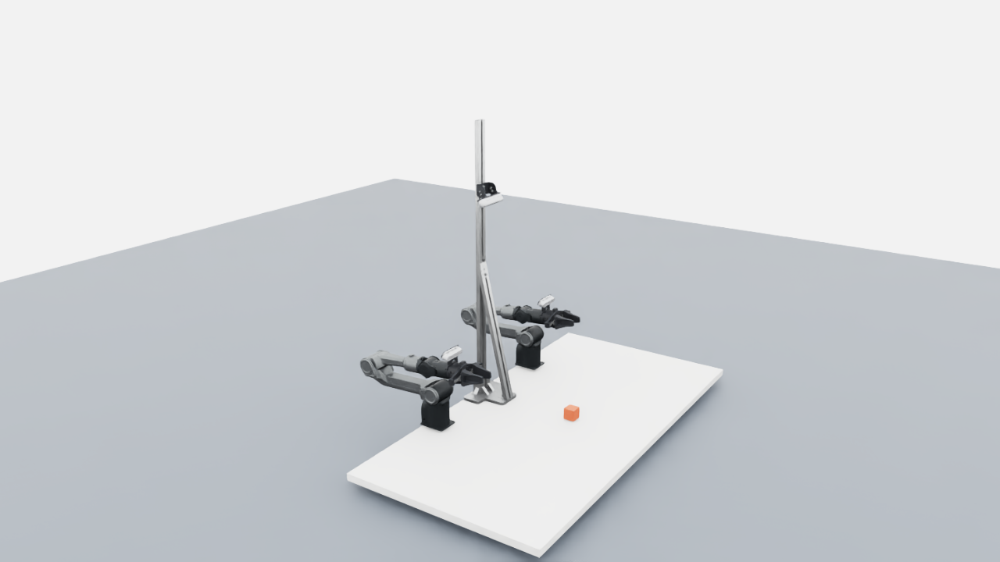
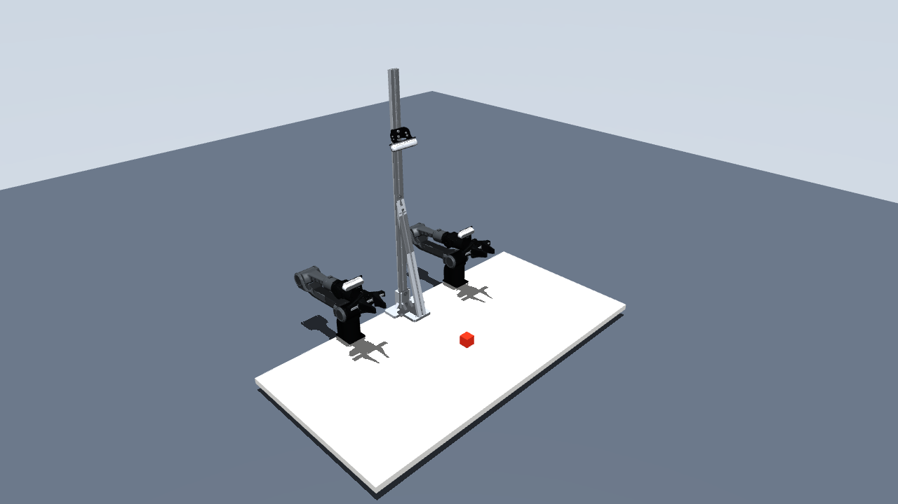
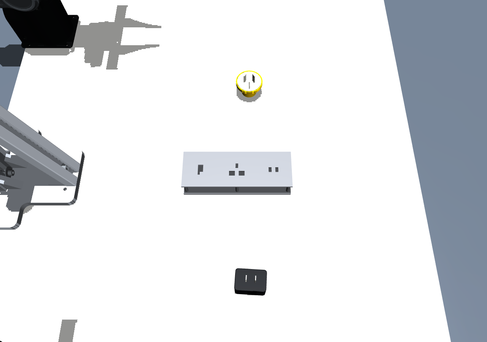
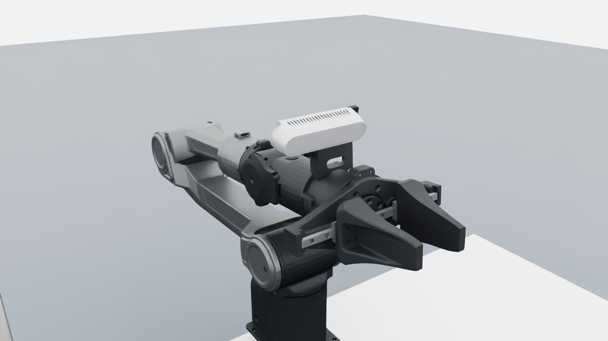
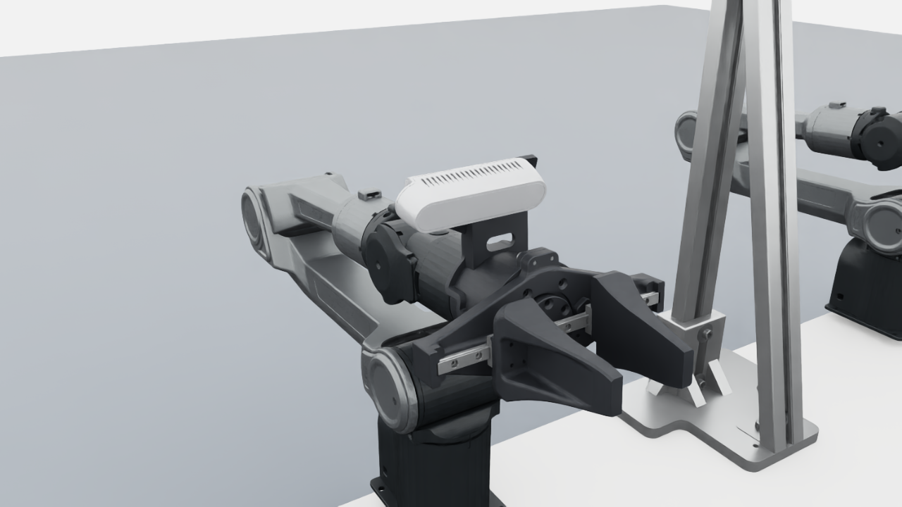
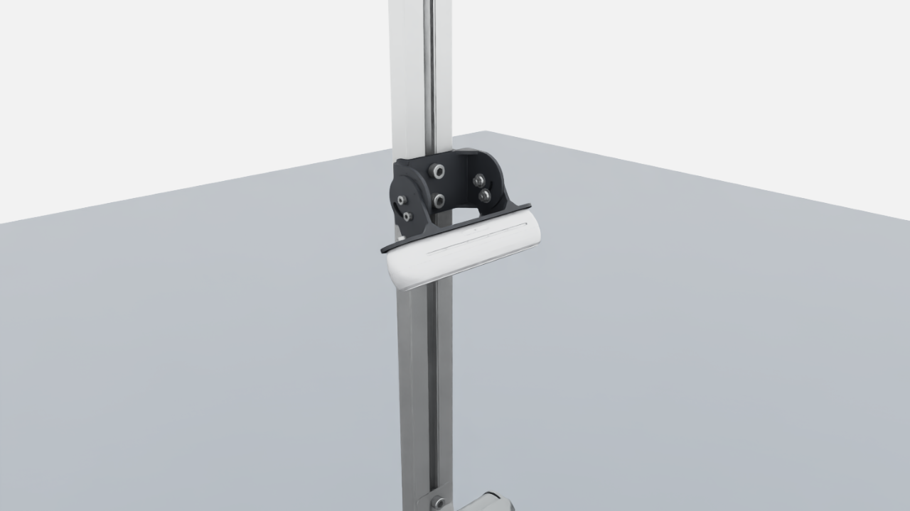
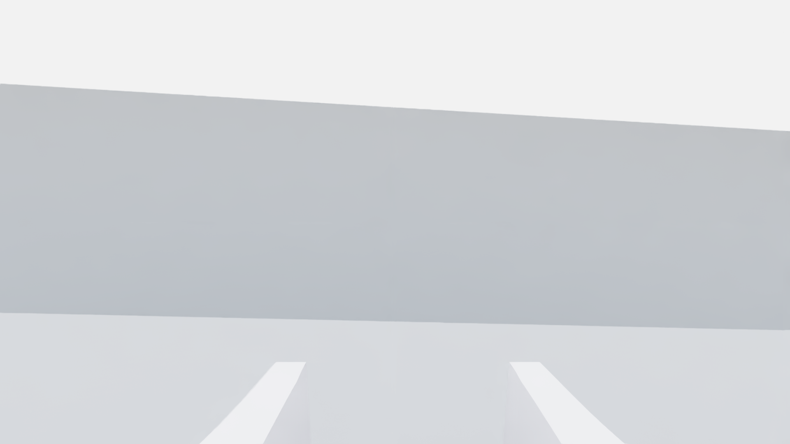
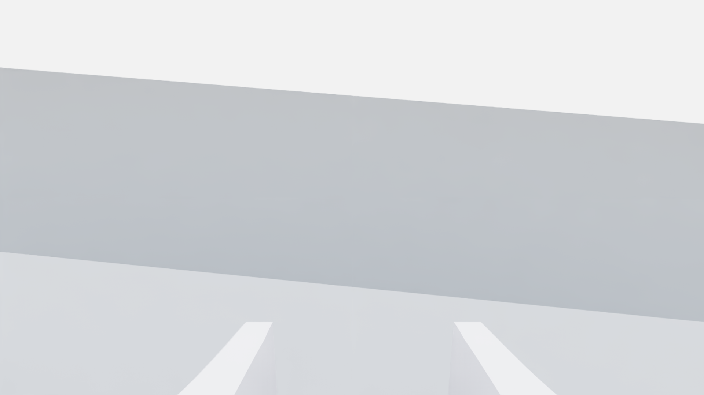
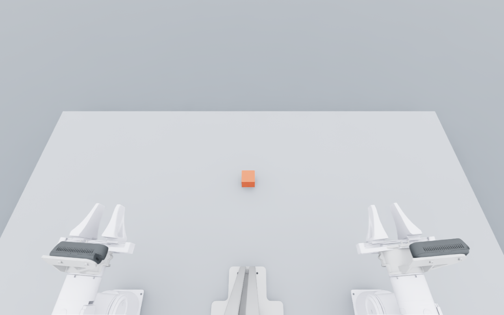
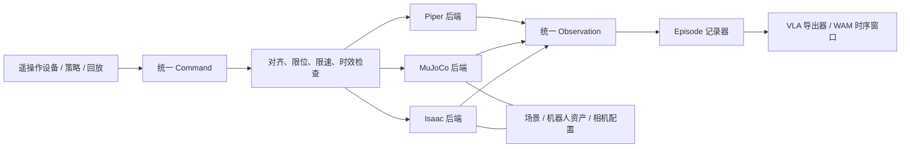

# 双臂 Piper 仿真工作站

本项目提供 **Isaac Lab v2.3.0 / Isaac Sim 5.1.0** 和 **MuJoCo 3.3.7** 两个版本，
各自在本机独立 Python 3.11 环境中运行，共享控制与数据接口。
两臂、场景、传感器、真机通信、指令入口、数据记录分别实现。
VLA / WAM 是后续用途，本阶段提供通用数据契约，不绑定某个模型的训练代码。

**原始资源设计为尺寸与安装位置的权威基准。** 两个引擎均直接继承该设计；
后续核对用于检查坐标转换、数据解释和光学参数，不依据照片残差移动或缩放 CAD。

**两个版本均已通过三路相机物理仿真、120 帧采集和 GUI 回放检查；真机联调待接入 CAN。**
相机配置为 **中央 Intel RealSense D455 × 1、腕部 Intel RealSense D435i × 2**，
外壳、支架和紧固件按提供的 STEP 装配坐标恢复。
详见 [相机与支架还原说明](docs/camera_restore.md)、
[RealSense RGB 参数与来源](docs/realsense_rgb.md)、
[验证记录](docs/validation.md)。

**真机核对更新：** 已检查 `connector_plugin_lerobot_v2` 的 210 集、630 路视频，
修正度/弧度和夹爪字段转换，并替换为原 STEP 的宽型夹爪视觉网格。
数据三路均为640×480。以假设内参投影时，历史检查记录了桌边约39–46 px、腕部指尖约58–67 px的残差。
这些残差不用于否定或更改原始设计；真实设备内参及 SDK 行程映射仍需补充，才能完成真机像素级视角验收。
见 [真机对照、已修正项与剩余差异](docs/real_alignment.md)。

## 双臂 Piper 场景

下图为本项目在 Isaac Lab / Isaac Sim 中的实际零位场景截图。



下图为相同 CAD 布局在 **MuJoCo** 中的实际渲染。机械臂使用原 Piper STL，
夹爪、三台相机、支架、立柱与桌面使用原 CAD 网格。



MuJoCo 手动控制：`bash scripts/run_mujoco.sh --interactive --enable_cameras`。
每臂为6个关节目标及1个夹爪开口；`Control` 面板中的 `left/gripper`、`right/gripper`
分别驱动一整只夹爪，两根手指由约束联动。
详见 [独立安装、采集、回放与验证](docs/mujoco.md)。
真实双臂的独立连接、只读状态和控制API见 [真机接口说明](docs/piper_connection.md)。

**充电器插插座任务：** 原型板按提供STL的170 × 60 × 33 mm尺寸还原，
默认同时放置黑色两脚充电器与黄色三脚插头，插头尺寸按照片估算并可配置。
支持独立任务配置、种子控制的摆放随机化、真实孔洞碰撞与逐物体插入判定。

```bash
bash scripts/run_mujoco.sh --task-scene configs/tasks/connector.yaml \
  --seed 42 --interactive --enable_cameras
```



Isaac同样支持 `--task-scene`。见 [任务使用、尺寸来源和模块设计](docs/connector_scene.md)。

总览和近景采用原 CAD 夹爪视觉网格及参考照片配色。后面的全幅 RGB 保留此前公开光学规格验收版本，
不代表640×480真机标定已完成。

| 左腕 Intel RealSense D435i | 右腕 Intel RealSense D435i | 中央 Intel RealSense D455 |
|---|---|---|
|  |  |  |

RGB 已使用官方公开光学规格及标称镜头偏移：

| 相机 | 默认 RGB 分辨率 | 水平 × 垂直 FOV | 焦距 |
|---|---|---|---|
| 左、右腕部 D435i | 1920×1080 | 69.4° × 42.5° | 1.88 mm |
| 中央 D455 | 1280×800 | 90° × 65° | 1.93 mm |

三路仿真均以 30 Hz 采样；按公开 FOV 推导标称 K，并将 RGB 光心从原开孔中点移到官方
坐标定义的位置。公开值不等于每台设备的出厂标定，畸变、滚动曝光和景深的当前边界见上述参数说明。

| 左腕 RGB | 右腕 RGB | 中央 RGB |
|---|---|---|
|  |  |  |

## 项目结构

```text
configs/workcell.yaml          布局、时步、相机和硬件通道配置
configs/realsense_rgb.json     官方 RGB 规格、镜头偏移及来源
configs/connector_alignment.yaml  历史数据640×480诊断模式（K为未标定假设）
configs/appearance.json        独立外观材质配置
src/piper_sim/
  contracts.py                观测 / 动作统一契约，SI 单位
  robot_asset.py              Piper articulation、关节驱动配置
  scene.py                    桌面、立柱、任务物体
  sensors.py                  三路相机配置
  camera_models.py            独立 RGB 光学模型与等比例缩放
  appearance.py              CAD夹爪视觉替换和材质绑定
  lerobot_alignment.py        connector_plugin专用单位与帧索引核对
  lerobot_export.py           原始HDF5可选导出LeRobot v2.1，与仿真后端解耦
  backends/isaac.py            Isaac 仿真步进与状态接口
  backends/mujoco.py           独立 MuJoCo 物理、三路 RGB、相同状态接口
  mujoco_asset.py              同源 URDF / CAD 到 MJCF 的转换及哈希校验
  backends/piper.py            Piper SDK 真机适配器
  backends/sdk_tracking.py     每组 CAN 帧独立的新鲜度检查
  piper_connection.py          独立真机连接API：六关节＋单夹爪开口，默认只读
  backends/mock.py             离线测试后端
  control.py                  本机 HTTP 指令入口，与具体控制设备解耦
  safety.py                   交接对齐、限位、限速和时效检查
  recording.py                HDF5 episode 记录
  dataset.py                  数据校验与连续时序窗口读取
  kinematics.py               离线 URDF 正运动学
scripts/
  install_runtime.sh          独立 Isaac 环境安装
  install_mujoco.sh            独立 MuJoCo 环境安装
  run_mujoco.sh                MuJoCo 场景、采集、回放、双向主从入口
  connect_piper.py             无仿真依赖的真机状态读取 / 本机HTTP控制服务
  verify_gripper.py            两引擎单输入夹爪联动验收
  prepare_mujoco.py            导出自包含 MJCF 和 OBJ / STL 网格
  run.sh / run_scene.py        场景、采集、回放、双向主从入口
  prepare_assets.py           从原描述派生可运动夹爪的仿真 URDF
  inspect_step.py             STEP 装配层级与变换提取
  convert_workcell_cad.py      STEP 桌面、立柱、三相机及腕部支架转换
  prepare_cad_gripper.py       原CAD夹爪按link6/7/8拆分，可随关节运动
  extract_lerobot_alignment.py 只读抽帧、状态转换与来源核对
  export_lerobot.py            已完成episode离线导出Parquet、三路视频和元数据
  render_lerobot_alignment.py  观测姿态下的三路实虚同帧对照
  measure_real_alignment.py   从CAD与数字标注复现投影残差
  export_realsense_rgb_calibration.py 只读导出设备RGB模式内参
  verify_cad_alignment.py     重新读取 STEP，逐顶点和尺寸核对导出几何
  capture_cad_reference.py    Isaac 零位总览和相机支架近景
  preview_layout.py           离线几何布局预览
  check_episode.py            数据完整性检查
  verify_simulation.py        关节跟踪、落桌接触、三路图像验收
  verify_rgb_projection.py    三维标记与实际渲染像素的投影核对
  verify_mujoco_projection.py  MuJoCo 实际 RGB 投影及偏心内参核对
  doctor.py                  无硬件副作用的环境检查
  download_runtime_wheels.py  网络中断时按哈希校验并续传安装包
assets/generated/             自动生成的 URDF、网格、USD、CAD 元数据
assets/mujoco/                随仓库分发的自包含 MJCF、网格、FK 参考与来源清单
outputs/                      日志、预览、episode、环境版本记录
```



## 布局与资产

- 原始资料 `demoa_asm_20261020.stp`、`zuomian.png` 保持原样。
- STEP 中桌板几何尺寸为 **1400 × 700 × 25 mm**；两台 Piper 装配原点的横向距离为 **600 mm**。
- 场景采用两臂同向并排、中央相机立柱、一个测试物块、一个俯视相机和两个腕部相机。
- 世界坐标 `+X` 向桌面前方，`+Y` 向机器人左侧，`+Z` 向上；左右以站在机器人后方看向工作区为准。
- 桌面、1 m 高立柱、三台相机外壳、支架和螺钉均来自 STEP 实体。导出 52 个静态网格
  （含一个只作 guide 的视场示意件）及每腕 10 个随 `link6` 运动的网格。重复相机及中央 D435 备选件已排除。
- 原尺寸只进行毫米到米的单位转换，网格化公差为 0.1 mm。默认双臂六关节为零，与 CAD 装配参考姿态对应。
- CAD 基座底面比桌面高 11 mm，当前保留原位置。源 URDF 与 CAD 法兰中心相差约 0.205 mm，
  腕部附件使用零位变换的逆矩阵转入 `link6`，使附件在参考姿态下保持原 CAD 世界坐标。
- RGB 投影位置由 CAD 前表面坐标与官方标称镜头偏移组合，内参按对应型号的 RGB FOV 推导。
  几何安装位姿、公开光学规格与每台真机的出厂标定分别记录。
- 从 `example_agilex/piper_description` 复制 URDF 和 STL。派生版本恢复滑动手指，`joint8` 跟随 `joint7`。
  每指行程47.5 mm，总开口0–95 mm，只有一个独立夹爪自由度。MuJoCo用总开口驱动同一条联动tendon；Isaac仅驱动主指。
- 所有关节通过名称映射，不依赖 USD 的关节排列。两臂使用同一资产实例。
- 夹爪采用原 STEP 的164.003 mm宽型组件。Isaac 保留旧URDF碰撞模型，MuJoCo 使用分部件 CAD 凸包碰撞；
  两者保留源 URDF 惯量；行程按原控制器0–95 mm映射统一，真实接触参数尚未辨识。`appearance` 配置控制CAD视觉和参考材质。
- 源 URDF 中的 100 Nm 等参数未经真机辨识；默认驱动参数用于初步仿真，不代表实际 Piper 动力学。
- 旧控制器将夹爪字段叫作 degrees，SDK 实际定义为 **0.001 mm**。这里转换为米。原控制器0–1映射为0–95 mm，仿真已采用95 mm总开口。源URDF与随附SDK默认限位为70 mm；真机接口读取SDK实际限位，超限明确报错，不能把仿真95 mm当成真机行程认证。

## 安装与启动

版本库包含源码、配置、原始 STEP / 布局图、独立 MuJoCo 模型包和选定的验收截图、数值报告。
虚拟环境、运行缓存、生成的 USD / URDF、HDF5 采集数据和调试输出保留在本机，不上传。
**MuJoCo 快速启动**不需要 Isaac 或外部机器人资产目录：

```bash
bash scripts/install_mujoco.sh
bash scripts/run_mujoco.sh --enable_cameras
```

以下为 **Isaac 安装流程**。在另一台机器使用 Isaac 或重新转换资产时，先准备原始 `example_agilex/piper_description` 资料，
修改 `configs/workcell.yaml` 的 `robot.source`；需要连接真机时再配置 `hardware.sdk_path`
及 CAN 通道。当前配置中的绝对路径对应开发机器，原始 SDK 和机器人描述不在本仓库中。
安装脚本会据此重新生成机器人资产及 CAD 场景。文档中的 episode / 日志路径是本地验证记录，
需要在新机器重新采集。

使用独立 `.venv-isaac`，不修改已有 conda 环境。官方固定版本参考：
[Isaac Lab v2.3.0 安装说明](https://isaac-sim.github.io/IsaacLab/v2.3.0/source/setup/installation/pip_installation.html)、
[Isaac Sim 5.1 安装说明](https://docs.isaacsim.omniverse.nvidia.com/5.1.0/installation/index.html)。

```bash
cd /home/midea/Desktop/piper_sim
bash scripts/install_runtime.sh
.venv-isaac/bin/python scripts/doctor.py

# GUI 场景，默认不连接任何 CAN 通道
bash scripts/run.sh --enable_cameras

# 有限步数无窗口测试；--demo 仅在纯仿真模式可用
bash scripts/run.sh --headless --enable_cameras --steps 120 --demo

# 采集 10 秒、30 Hz 的三路 RGB 和状态动作
bash scripts/run.sh --headless --enable_cameras --steps 300 --demo \
  --record outputs/episode_0001.h5 --task "检查双臂关节跟踪"
.venv-isaac/bin/python scripts/check_episode.py outputs/episode_0001.h5

# 回放记录的动作目标到仿真
bash scripts/run.sh --mode replay --trajectory outputs/episode_0001.h5

# 回放已通过验收的双臂动作；退出前保存总览（输出文件须不存在）
bash scripts/run.sh --enable_cameras --mode replay \
  --trajectory outputs/cad_restore_acceptance/dual_piper.h5 --overview-image outputs/overview.png
```

仿真时钟中物理频率 120 Hz、控制和采集频率 30 Hz。真实图像渲染需 `--enable_cameras`。
默认采集两路 1920×1080 和一路 1280×800。`cameras.image_scale: 0.5` 可将完整画幅
等比例缩小，降低渲染和落盘开销。本机原始画幅同步采集实测约 8.53 帧/墙钟秒；
仿真采样频率不代表墙钟实时性能保证。
硬件模式会按控制周期限速，实际频率仍受渲染、记录和通信开销影响。
首次运行涉及 USD 转换、扩展缓存和着色器编译，可能明显慢于后续运行。
初次启动遵循 NVIDIA 的 EULA 提示。启动脚本隔离桌面 shell 的 ROS Python 3.12 路径，
避免污染 Isaac 的 Python 3.11。

完整版本固定在 `requirements/runtime-linux-py311.lock`。采用 Lab 2.3.0 是因为
2.3.1 / 2.3.2 的 Starlette 固定版本与 Sim 5.1 的 FastAPI 依赖范围冲突。
项目内相机适配器读取实时 Fabric 位姿；显式分离物理步进与渲染，并处理
Lab 2.3.0 的退出回调。没有修改 Isaac Lab 或原 Piper SDK 源码。

下载不稳定时，使用 `download_runtime_wheels.py` 读取带 index 注释的
`uv pip compile --emit-index-annotation` 输出，将安装包断点续传到 `.runtime/wheels`，
逐一验证源索引公布的 SHA256。安装器优先复用这些本地文件。

CAD 转换需要资产准备环境中的 `cadquery-ocp==7.7.2`、`usd-core==26.8`。
转换器从冻结的 Piper 子装配中单独提取腕部附件，生成可挂载的 USD；
机器人主体使用可动 URDF。默认 `scene.geometry: cad`，切换为 `primitives`
只简化桌面和立柱，仍保留腕部附件。缺少 CAD 产物会明确报错。

```bash
PYTHONPATH=src .venv/bin/python scripts/convert_workcell_cad.py
PYTHONPATH=src .venv/bin/python scripts/prepare_cad_gripper.py
PYTHONPATH=src .venv/bin/python scripts/verify_cad_alignment.py
# 输出目录使用新名称，避免覆盖已有截图
PYTHONPATH=src .venv-isaac/bin/python scripts/capture_cad_reference.py --output outputs/reference_new
```

`.venv` 用于轻量工具和 STEP 元数据检查，`.venv-isaac` 用于仿真。所有代码也可以通过
`PYTHONPATH=src` 在已有合适的 Python 环境中进行离线验证。

## 双向主从控制

下面命令默认使用 Isaac；将 `scripts/run.sh` 换成 `scripts/run_mujoco.sh` 即使用 MuJoCo，
参数、SDK适配器、指令检查和数据格式相同。每次只选择一个主从方向，防止互相追随形成反馈环路。软件桥运行在本机；
跨机器通信需要另外实现时钟同步和通信适配器，不应暴露当前本机 HTTP 端口。

### 真机 → 仿真

先在 `configs/workcell.yaml` 填写真实的左右 CAN 通道名称：

```bash
bash scripts/run.sh --mode real-to-sim --enable_cameras
```

此模式以真实关节反馈作为仿真位置目标，只读取真实机器人。不会使能电机、
改变固件主从模式或导入旧的自动控制线程。真实主臂的拖动/示教模式由原有设备流程配置。
SDK 通过配置中的 `sdk_path` 延迟加载，不需要把旧遥操作程序的依赖装入仿真环境。
独立环境已安装兼容 Sim 依赖的 `python-can 4.2.2`、`setuptools 80.9.0`，
并验证 SDK 可以导入；未打开 CAN 或发送硬件命令。

### 仿真 → 真机

```bash
bash scripts/run.sh --mode sim-to-real --enable_cameras \
  --command-port 8765 --allow-actuation
```

程序先读取真实姿态并将仿真对齐。外部控制源向本机 `/target` 连续提交仿真目标，
仿真的测量关节位置经过独立限速后发送给真机。两臂电机必须已由操作员使能；
程序不自动上电或回零。首个指令必须与当前状态对齐。无新鲜指令时不启动真机控制，
启动后断流、反馈缺帧、异常或退出均触发两臂停止请求。

**这些保护是软件层实现，尚未完成实机验收，且无法替代硬件急停。** CAN 发送故障时停止
报文也可能无法送达；Python 线程不是硬实时控制器。先完成仿真与现场校准，再开展真机联调。
当前机器检查时没有 CAN 接口，因此本次不会驱动真实机械臂。

### 控制入口

已提供与 `example_agilex` 类似的读取、关节控制、夹爪控制、三相机采集、episode启停和场景随机化接口，见 **[外部控制与数据接口](docs/external_api.md)**。

```bash
# 同时出现黑色充电器、黄色插头；外部程序控制
bash scripts/run_mujoco.sh --task-scene configs/tasks/connector.yaml --api-port 8765 --enable_cameras
# 另一终端：度/归一化夹爪接口，随机两个场景并采集两个episode
PYTHONPATH=src .venv-mujoco/bin/python examples/external_agilex.py
```

Isaac用 `scripts/run.sh` 替换启动脚本。`--command-port` 是 `--api-port` 的兼容别名。

```python
import json, time, urllib.request
import numpy as np

base = "http://127.0.0.1:8765"
state = json.load(urllib.request.urlopen(base + "/state"))
limits = json.load(urllib.request.urlopen(base + "/metadata"))["limits"]
q = np.clip(state["position"], limits["lower"], limits["upper"]).tolist()
start_sequence = state["last_received_sequence"] + 1
for sequence in range(start_sequence, start_sequence+300):
    body = json.dumps({"position": q, "sequence": sequence}).encode()
    request = urllib.request.Request(base + "/target", data=body,
                                     headers={"Content-Type": "application/json"})
    urllib.request.urlopen(request).close()
    time.sleep(1/30)
```

控制源150 ms无更新时，纯仿真保持最后目标并报告timed_out，API继续可用；涉及真机的会话停止。sequence在整个服务生命周期（包括reset后）递增。
时间戳由接收端的 monotonic 时钟生成；该接口不是远程网络协议。
后续可把 Quest、实体主臂、键盘、IK 或策略输出接到同一契约，核心记录器无需改动。

## 数据契约

状态和绝对位置动作都是 14 维：

```text
[left.joint1 ... left.joint6, left.gripper_width,
 right.joint1 ... right.joint6, right.gripper_width]
```

关节角是 rad，夹爪开口是 m，RGB 图像是 H×W×3 uint8。一个 HDF5 文件对应一个 episode：

| 路径 | 含义 |
|---|---|
| `observation/state` | 动作前观测 |
| `action/position` | 本周期施加的绝对位置目标 |
| `next_observation/state` | 动作后观测 |
| `observation/images/{overhead,left_wrist,right_wrist}` | 动作前 RGB |
| `next_observation/images/...` | 动作后 RGB |
| `*/timestamp` | 本机 monotonic 观测 / 动作时间 |
| `*/sim_time` | 仿真时钟，缺失时为 NaN |
| `*/image_timestamps/...` | 仿真图像采样时刻，使用仿真时钟 |
| `*/extras_json` | 相机内参、世界位姿；硬件模式另含 SDK 原始时间戳 |
| 文件 metadata | 任务文本、配置、频率、模式和数据来源 |

仿真→真机模式记录真实状态和实际限速后的硬件动作，图像仍来自仿真，
metadata 明确标记这种混合来源，不能当作真实相机数据训练视觉策略。
原始真实相机采集需要后续接入独立传感器后端。

记录先写 `.h5.partial`，正常结束后原子重命名；异常时保留 partial 便于诊断。
不覆盖既有 episode。不自动把测试动作标为任务成功。
`dataset.sequence_windows()` 返回连续状态、动作、图像序列，窗口不跨 episode；
可作为后续 WAM 数据入口。原始HDF5可选转换为 **LeRobot Dataset v2.1**，保留原episode：

```bash
# 新采集：结束后自动导出；不加该选项仍只录制HDF5
PYTHONPATH=src .venv-mujoco/bin/python examples/external_agilex.py \
  --lerobot-output outputs/lerobot_v2/demo_001 --lerobot-image-size 640 480

# 已有数据：独立离线转换
PYTHONPATH=src .venv-mujoco/bin/python scripts/export_lerobot.py \
  --input outputs/api_episodes --output outputs/lerobot_v2/my_dataset --image-size 640 480
```

导出为Parquet＋三路MP4＋v2.1元数据/统计，关节度和夹爪0–1与原工程一致；
默认保留分辨率，指定尺寸时等比例补边并记录更新后的K。详见 [LeRobot导出说明](docs/lerobot_export.md)。

## 后续扩展边界

1. 以源 CAD 尺寸和装配位置为固定基准，核对坐标/SDK行程映射、设备RGB内参与镜头坐标，辨识真实关节驱动参数。
2. 为具体任务添加物体、重置条件、成功判定和域随机化。
3. 将单工作站后端封装为 Isaac Lab 的向量化任务环境，再做批量训练；当前启动器是单工作站。
4. 选择具体 VLA / WAM 后增加对应数据导出器与策略客户端。
5. 如需 ROS 2 或跨主机控制，作为新通信适配器实现，不让 ROS / CAN 依赖渗入数据与场景层。
