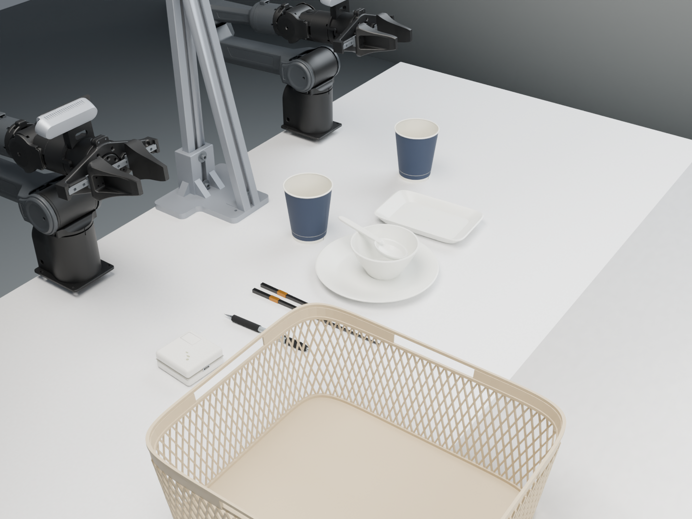
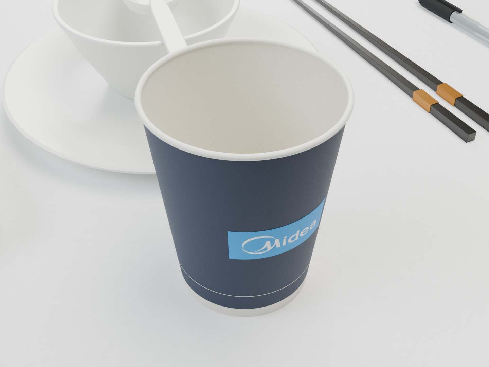
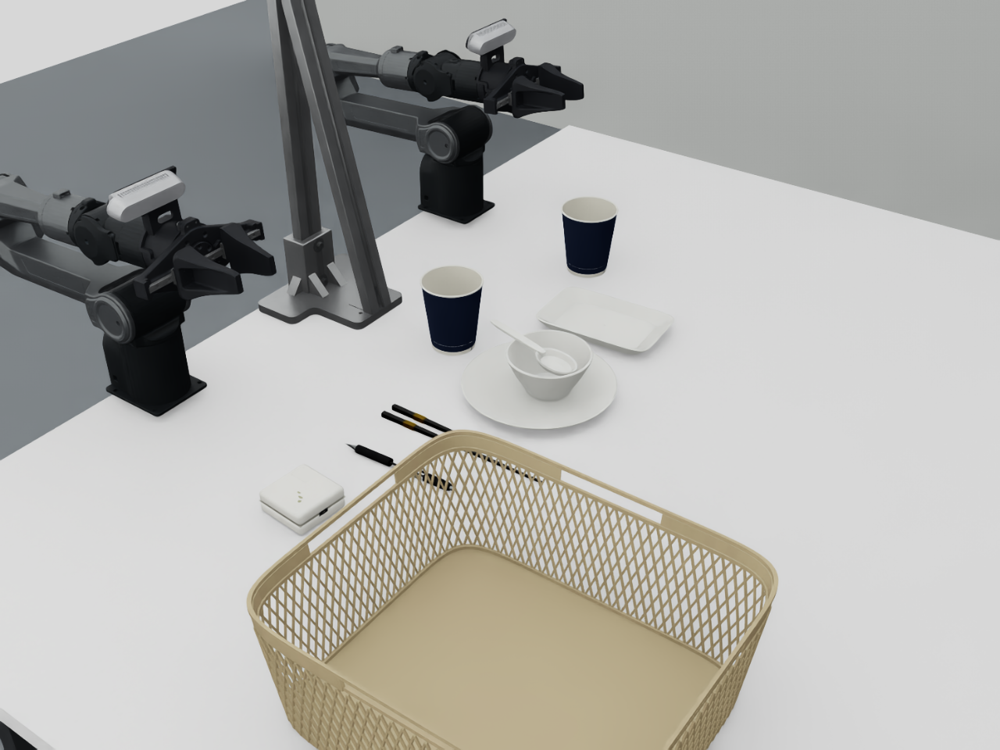
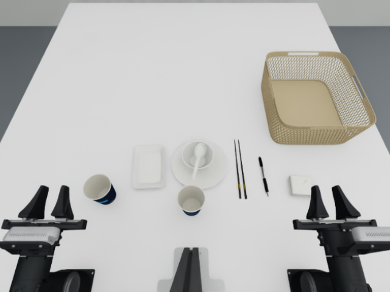

# Blender 场景与资产制作

当前 `clean_table_rigid.yaml` 默认加载 Blender 4.5.15 LTS 制作的视觉资产。物体的放置、任务逻辑、域随机化、控制和采集接口仍由现有 Python/YAML 模块管理。





## 这次修改

- 纸杯：保留 80 mm 杯口、56 mm 杯底、95 mm 高度和空腔，加入纸面细纹、覆膜内壁材质、卷边细节，沿用已有 Midea 印刷贴图。杯身颜色与印刷标记独立，域随机化可继续改色。
- 笔：补充墨管、半透明笔杆、握持区和笔帽细圈，保留条码、笔夹和金属笔尖。透明效果在不同引擎中存在差异。
- 充电头：圆角外壳、上下壳接缝、折叠插脚盖、USB-C 口和不规则残胶痕迹。尺寸沿用现有照片估算值。
- 餐具、篮筐：修整边缘法线与圆角、陶瓷底圈、塑料和釉面材质。
- 表面：在 Blender Cycles 中烘焙六类材质的 1024×1024 基色细节、相对粗糙度和切线法线图。贴图不包含环境阴影或照明。
- 工作台使用新的细纹贴图；原始 CAD 顶点、桌面尺寸、机器人关节和三台相机安装参数保持不变。

材质是根据参考照片制作的近似值，没有测量反射率。Blender 的 Cycles 展示图、Isaac RTX 输出和 MuJoCo 原生输出分别标记，不应视为同一种采集画面。

## 查看和运行

本机 Blender 为独立用户目录安装，不改动 Isaac/MuJoCo 的 Python 环境：

```bash
cd /home/midea/Desktop/piper_sim
# 完整、可编辑的双臂工作台（本机生成，包含原 CAD 和真实安装相机）
./scripts/run_blender.sh outputs/blender_clean_table/scene.blend
# 紧凑的物体资产库，按物体分 Collection，均以物体局部原点保存
./scripts/run_blender.sh assets/blender/clean_table/props.blend
```

物体库的各 Collection 共享局部坐标原点；编辑时在 Outliner 隔离一个 Collection。完整场景的 `Presentation_camera` / `Material_detail_camera` 只用于展示；`overhead`、`left_wrist`、`right_wrist` 沿用原始安装坐标。

仿真直接使用已经导出的资产，不需要后台启动 Blender：

```bash
./scripts/run_mujoco.sh --config configs/clean_table_workcell.yaml \
  --task-scene configs/tasks/clean_table_rigid.yaml --enable_cameras --api-port 8765

# 保留原来的多维域随机化
./scripts/run_mujoco.sh --config configs/clean_table_workcell.yaml \
  --task-scene configs/tasks/clean_table_rigid.yaml \
  --domain-randomization configs/domain_randomization/clean_table.yaml \
  --seed 42 --enable_cameras --api-port 8765
```

Isaac 使用同一 task-scene 配置。实际 RTX 检查图：





## 资产和物理解耦

| 文件/模块 | 用途 |
|---|---|
| `assets/blender/clean_table/props.blend` | Blender 可编辑物体源文件，贴图已打包 |
| `assets/blender/clean_table/props.usdc` | 视觉 USD 资产库；无机器人控制和动力学配置 |
| `assets/blender/clean_table/visual_meshes.npz` | 两个仿真适配器共用的三角网格、UV 和逐顶点法线 |
| `assets/blender/clean_table/manifest.json` | 材质、资产映射、尺寸检查与来源 |
| `src/piper_sim/tasks/visual_assets.py` | 可选视觉库加载、尺寸校验与来源记录 |
| `clean_table_meshes.py` / `rigid_table_meshes.py` | 原来的独立碰撞模型和物理尺寸基准 |

视觉资产不会替换碰撞几何、质量、惯量或任务判定使用的几何。加载器先建立原物理模型，再替换可见外观。它会拒绝与任务尺寸不一致的导出结果，避免修改外观后悄悄影响抓取位置。删除配置中 `appearance.asset_library` 一行即可回到原来的程序化外观。

Isaac 接入基础色、粗糙度、法线贴图及透明度；随机化会同时更新贴图着色和粗糙度缩放。MuJoCo 3.3.7 原生渲染接入几何、法线、基础色贴图、透明度和近似高光，其渲染效果不会等同于 Cycles/RTX。具体差别见 [MuJoCo 材质说明](https://mujoco.readthedocs.io/en/3.3.7/XMLreference.html)。

## 重建与修改

其他机器先安装 Blender，或设置 `BLENDER_BIN` 指向已有程序：

```bash
./scripts/install_blender.sh
PYTHONPATH=src .venv-mujoco/bin/python scripts/blender/prepare_inputs.py
./scripts/run_blender.sh --background --python scripts/blender/build_clean_table.py
```

安装脚本校验固定版本的官方 SHA256。Blender 下载信息：[官方 LTS](https://www.blender.org/download/lts/)。已经烘焙贴图时可在构建命令后加 `-- --skip-bake`；仅构建、不渲染则加 `-- --skip-render`。

手工编辑 `props.blend` 后，保留物体名前缀、材质名称和原始尺寸包络，保存并导出：

```bash
./scripts/run_blender.sh --background assets/blender/clean_table/props.blend \
  --python scripts/blender/export_library.py
```

该命令导出修改后的网格、修改器结果、UV、法线及已有材质分配。新增材质或调整材质节点需同步修改构建脚本/材质清单；不会自动把任意 Blender 节点网络翻译到两个引擎。导出 USD 的兼容范围见 [Blender USD 文档](https://docs.blender.org/manual/en/4.5/files/import_export/usd.html)。

完整 `outputs/blender_clean_table/scene.blend` 是由资产库和 CAD 重建的本地场景，不提交重复的大文件。不要把它当作新的物理安装基准。相机内参的 Blender 展示映射用于构图，数据采集仍使用仿真原有相机实现。

## 验证范围

本轮检查包括：源/导出尺寸、逐顶点法线、原碰撞几何和质量惯量、相机参数、短程物理轨迹、纸杯真实接触嵌套、域随机化复位、三路 RGB、短段 HDF5 录制、外部 API 和 LeRobot 导出回归。验证结果见 [本轮报告](../outputs/blender_clean_table/validation.json)。

本轮没有重新运行整段自主收桌策略，因此不新增完整任务成功率结论。此前策略和运动平滑限制继续沿用。
