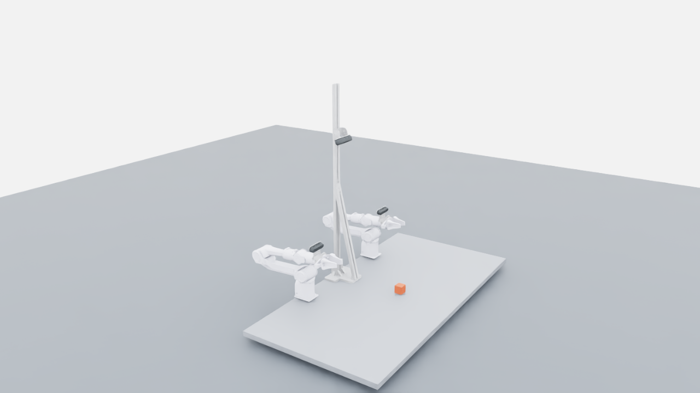

# 原始相机与支架的尺寸还原

采用用户确认的组合：左右腕部 **Intel RealSense D435i**、中央 **Intel RealSense D455**。
几何来源为项目根目录的
`demoa_asm_20261020.stp`，布局对照为 `zuomian.png`。原文件未改动。

腕部的源 STEP 零件名仍为 `REALSENSE_D435`；这是资料中的命名，实际设备型号以用户确认的
**D435i** 为准。导出清单分别保存设备型号和原始 CAD 名称，方便追溯几何来源。



## 保留的实体

| 位置 | STEP 实体 | 处理 |
|---|---|---|
| 左、右腕部 D435i | REALSENSE_D435 | 各保留一个原始相机实体，设备型号记为 D435i |
| 左、右腕部 | PIPER_CAMERA_BRACKET_A4_1 的 SOLID 与 COMPOUND | 原始两部分几何均保留 |
| 左、右腕部 | PIPER_CAMERA_BRACKET_A2_2 | 原形状、孔位及装配位置保留 |
| 每个腕部 | M3×10 四颗，M3×6 两颗 | 随支架一起运动 |
| 中央 D455 | REALSENSE_D455/SOLID、CAMERA_BRACKET_M_3 | 使用对应相机和支架 |
| 中央立柱 | CAMERA_BRACKET_M_1、立柱、斜撑及其紧固件 | 保留源装配 |
| D455 视场示意 | REALSENSE_D455/COMPOUND | 作为 USD guide 保存，无碰撞、不进入相机图像 |

源 STEP 每个腕部有两份近乎重合、命名为 `REALSENSE_D435` 的实体，中央也同时放置 D435 与 D455 备选件。
中央 M_2 支架实体完全包含于 M_3 实体内。按确认组合排除第二份腕部相机、
中央 D435、M_2 及其两颗专用螺钉。所有保留/排除原因及源装配路径见
`assets/generated/workcell/workcell.json`。

总计导出 72 个网格：52 个静态网格（其中一个 guide）、左右各 10 个腕部网格。

## 尺寸和装配基准

几何直接由 OpenCascade 读取 STEP BRep 并网格化，没有用简化盒体重画相机与支架，
也没有按外观缩放。CAD 单位为 mm，世界单位为 m：

```text
world.x = CAD.z / 1000 - 0.055
world.y = CAD.x / 1000
world.z = CAD.y / 1000 + 0.025
```

桌板为 1400×700×25 mm，两臂基座间距为 600 mm；原 CAD 的 11 mm 基座安装间隙保留。
以源 URDF 的六关节零位为参考，将腕部网格的世界坐标乘以 `link6` 零位变换的逆矩阵，
保存为局部坐标。这样既保留原 CAD 坐标，又能跟随六关节运动。

源 CAD 法兰中心和源 URDF 零位法兰中心存在约 **0.205 mm** 的差异，
已记录于 `camera_rig.json` 的 `alignment`。附件不因这个差异而被平移到另一个 CAD 位置；
本次没有重新辨识或修改机械臂的运动学参数。

相机壳体在各自前表面坐标系中的 BRep 包围尺寸（包含源模型细节，不等同于产品规格表）：

| 模型 | 宽 × 高 × 深（mm） | 双目开孔间距 |
|---|---|---|
| 腕部 Intel RealSense D435i（源 CAD 名为 REALSENSE_D435） | 89.904 × 25.001 × 25.051 | 65 mm |
| 中央 Intel RealSense D455 | 123.999 × 29.085 × 26.555 | 95 mm |

原 STEP 没有可用的表面颜色定义，因此使用中性材质显示；布局图片中的配色没有被当作
材质参数。外观网格保持原形，腕部碰撞使用凸包近似，附件质量和惯量尚未实测。

## 几何与成像参数

投影坐标系从 CAD 的双目开孔中心和轴线推导。零位时两个腕部朝前下方约 15°，
中央相机朝前下方 60°。具体矩阵保存在 `camera_rig.json`，每次采集也将该清单保存进 episode 元数据。

这些是**几何投影参考点**，不是已标定的 RealSense RGB 光学中心。
当前 RGB 仍使用通用针孔内参（640×480 时 fx=fy≈426.67 px），畸变、真实 RGB 内参、
RGB 相对于外壳的位置、曝光和真实传感器噪声尚未建模。后续标定应修改独立的
传感器配置，不移动 CAD 外壳和支架来凑画面。

Isaac Sim 5.1 首次从 Fabric 读取相机位姿时可能从过期 USD 父坐标初始化缓存。
适配器在物理开始前初始化该缓存，并保持安装局部变换，避免相机进入自身外壳。
仿真图像外参始终从渲染使用的 Fabric 坐标读取。

## 核对与复现

`verify_cad_alignment.py` 重新打开原 STEP，核对所有导出网格的三角形索引、
逐顶点世界坐标及 BRep 包围盒。网格化公差设为 0.1 mm：

- 72 个网格逐顶点坐标变换和 USD 存储的最大误差为 **0.00002986 mm**。
- 导出网格与源 BRep 轴向包围盒的最大差异为 **0.04944 mm**。
- 这两项分别衡量坐标保存精度和网格近似，不代表真实相机已完成光学标定。

数值证据：`outputs/cad_restore_acceptance/cad_alignment.json`。
动态采集及相机跟随校核见 `docs/validation.md`。

```bash
PYTHONPATH=src .venv/bin/python scripts/convert_workcell_cad.py
PYTHONPATH=src .venv/bin/python scripts/verify_cad_alignment.py
PYTHONPATH=src .venv-isaac/bin/python scripts/capture_cad_reference.py --output outputs/reference_new
```

参考截图在六关节精确复位后渲染，不推进重力积分：
`overview.png`、`left_mount.png`、`right_mount.png`、`central_mount.png`。
因此可以直接对照原装配位置；运行时的关节跟踪误差另由动态 episode 检查。
