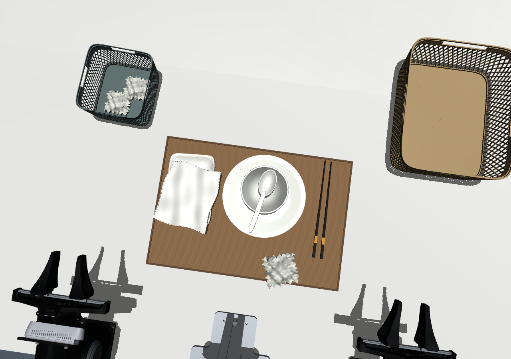
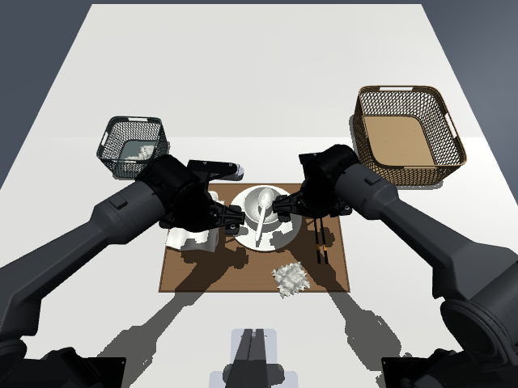
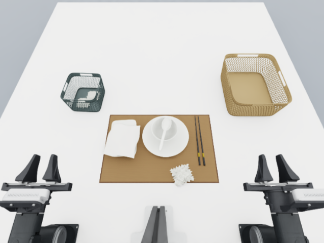

# 视频餐桌收拾场景

新增独立任务 `clean_table`，支持 **MuJoCo 和 Isaac Lab**，复用原双臂 Piper、三台 RealSense、
外部控制、观测、HDF5 录制与可选 LeRobot v2.1 导出。任务物体、材质、随机摆放和分类判定
位于独立模块，不依赖插接任务，也不调用真机 SDK。



## 直接运行

在仓库根目录执行，默认是视频式固定摆放：

```bash
bash scripts/run_mujoco.sh --config configs/clean_table_workcell.yaml \
  --task-scene configs/tasks/clean_table.yaml --interactive --enable_cameras
```

MuJoCo 右侧 `Control` 可控制两臂，夹爪仍是每臂一个 0–0.095 m 的整体开口。
要由外部程序控制，使用 API 模式：

```bash
bash scripts/run_mujoco.sh --config configs/clean_table_workcell.yaml \
  --task-scene configs/tasks/clean_table.yaml --enable_cameras --api-port 8765
```

Isaac Lab 使用同一任务配置：

```bash
bash scripts/run.sh --config configs/clean_table_workcell.yaml \
  --task-scene configs/tasks/clean_table.yaml --enable_cameras --api-port 8765
```

需要后台运行时加 `--headless`。原生手动控制模式 `--interactive` 下 HTTP 指令入口只读。

## 参考来源与尺寸

参考用户提供的 `piper_clean_table_lerobot/videos/chunk-000/image/episode_000000.mp4`，
并检查同一 episode 的 `wrist_image_l`、`wrist_image_r`。视频为 640×480、30 fps、1645 帧，
数据任务文本为 `put the tableware into the basket and the trash into the trash bin`。

原桌面、双臂、相机和支架继续采用已有 CAD 尺寸与安装坐标。新增物体没有 CAD/实测尺寸，
按视频比例估算；并非毫米级测量结果。尺寸、质量、姿态、摆放范围都可在
[`configs/tasks/clean_table.yaml`](../configs/tasks/clean_table.yaml) 调整。

| 物体 | 当前估算尺寸（mm） | 初始关系 |
|---|---|---|
| 棕色编织餐垫 | 300 × 440 × 2 | 桌面中央 |
| 白瓷盘 | 直径 190，高 16 | 餐垫上 |
| 白瓷碗 | 直径 105，高 52 | 盘内 |
| 白瓷汤匙 | 145 × 38 × 14 | 搭在碗上 |
| 黑金筷子 × 2 | 长 225，粗端 6 × 6 | 盘右侧 |
| 白色长方碟 | 165 × 105 × 18 | 盘左侧 |
| 褶皱毛巾 | 140 × 118 × 23 | 方碟上 |
| 废纸团 | 65 × 70 × 32 | 餐垫前侧 |
| 米色餐具篮 | 290 × 235 × 115 | 右后侧 |
| 灰色垃圾筐 | 150 × 145 × 100 | 左后侧 |

另有视频背景中的邻接白桌作为独立静态道具，承托后侧餐具篮。它不修改原工作台 CAD。
若删除 YAML 的 `environment.rear_table`，需同时把餐具篮前移回原桌面范围。
筐内两小片旧纸为装饰网格，不计入待收拾物体。

## 外观与碰撞

- 圆角、上宽下窄的菱形镂空筐体，带顶部手孔；孔洞是真实视觉网格。
- 盘、碗、匙为有内部空间的网格，采用独立凸碰撞分块；筐使用底板和四面墙，顶部保持开放。
- 白瓷光泽、米色塑料、灰色金属网、黑色漆面和金色装饰分别配置材质。
- 餐垫有编织纹理，毛巾有织物纹理、褶皱和缝边，纸团有不规则折面。
- [`materials.json`](../assets/tasks/clean_table/materials.json) 独立管理颜色、粗糙度、金属度与纹理；
  Isaac 使用 USD Preview Surface 和 sRGB→linear 转换，MuJoCo 使用其支持的材质/光照近似。
  两个渲染器不保证逐像素一致。
- 纹理由 [`prepare_clean_table_textures.py`](../scripts/prepare_clean_table_textures.py) 确定性生成，
  已随仓库保存。模型启动不需要原始视频、CAD 软件或纹理下载。

当前**毛巾、纸团、餐垫使用刚体碰撞代理**，可移动、抓取、投放，但不能复现柔性折叠。
筐壁碰撞使用连续薄墙，不能通过视觉镂空孔穿入手指。质量、摩擦、颜色与灯光为估算参数。
视频后半段折叠餐垫并放入较小篮筐，需要后续的柔性模型；不将这部分算作当前任务成功条件。

## 摆放随机化、状态与采集

默认 `randomization.enabled: false` 便于对照视频。改成 `true` 后，CLI 可用 `--seed 42` 指定种子；
也可保持配置不变，通过接口每次显式 `reset(seed=42, randomize=True)`。
随机化同时改变整套餐具的位置/朝向和两个筐的位置/朝向，保留盘—碗—汤匙与方碟—毛巾的支撑关系，
并拒绝越过两块相邻桌面的支撑边界、碰到筐体或占用机器人基座区域的初始摆放。
只有与原桌后缘同高、无间隙并覆盖原桌宽度的扩展桌面，才允许扩大摆放区域。

同步 Python 接口示例（调用方负责步进，关节用 rad、夹爪用 m）：

```python
from piper_sim.simulation import SimulationSession

with SimulationSession.mujoco(
    config="configs/clean_table_workcell.yaml",
    task_scene="configs/tasks/clean_table.yaml", cameras=True,
    record_dir="outputs/clean_table_episodes",
) as sim:
    obs = sim.reset(seed=42, randomize=True)
    print(obs.position)                         # 14 维关节/夹爪实测状态
    print(obs.extras["objects"])                # 11 个物体的世界位姿
    print(obs.extras["task"]["metrics"])        # 各物体分类状态与 summary
    sim.start_recording("table_smoke_001", task=sim.backend.task.config["instruction"])
    target = obs.position.copy()
    for _ in range(30):
        obs = sim.step(target)                  # 换成外部控制器/策略产生的目标
    result = sim.stop_recording(success=False)  # 此示例只保持姿态，不是清桌策略
    print(result["path"])
```

已有 HTTP `SimulationClient`、`AgilexAdapter` 同样适用；`/state`、`/observation.npz`、三路 RGB、
`/reset`、`/recording/start`、`/recording/stop` 均沿用现有接口。
`AgilexAdapter` 仍使用真机示例式的度/归一化夹爪；`SimulationSession` 使用 SI 单位。
不要混用两套单位。详见 [外部接口](external_api.md)。

HDF5 每帧保存双臂状态/动作、图像、相机参数、所有物体位姿和分类指标；元数据保存种子、完整任务配置和材质说明。
结束录制后可选导出 LeRobot v2.1：

```bash
PYTHONPATH=src .venv-mujoco/bin/python scripts/export_lerobot.py \
  --input outputs/clean_table_episodes/table_smoke_001.h5 \
  --output outputs/lerobot_v2/clean_table_001 --image-size 640 480
```

这沿用本项目的 14 维、角度/归一化夹爪导出契约，不复制原视频数据集的 15 维 `state/actions` 命名。
原数据第 15 个辅助字段含义尚未确定。详见 [导出说明](lerobot_export.md)。

分类判定在**移动筐体的局部坐标系**中检查整个物体的可见网格，要求位于内壁之间、底板上方和筐口下方，
持续 0.5 秒。中心在筐口上方、只进入一部分、放错筐均不算成功。默认要求盘、碗、匙、两根筷子、方碟进餐具篮，
毛巾和纸团进垃圾筐。`success.required` 不含当前无法折叠的刚性餐垫。

## 对照与验证

下面是原视频首帧的 14 维关节状态在当前 CAD 上生成的仿真静帧，夹爪分数转换为 95 mm 行程。
关节单位/顺序依据相邻项目 `phoenix-mwa/docs/PIPER_DATA.md` 的声明；这是静帧对照，不是完成清桌的轨迹回放。





VGA 配置保持 CAD 外参，内参仍是公开参数推导的标称值。视频没有提供设备标定和新增物体实测尺寸，
因此不声称像素级视角、光照或绝对尺寸完全一致。

验收脚本会测试 100 个随机种子、初始稳定性、盘/纸团自由落入筐内、分类判定、三相机图像与 HDF5 录制：

```bash
PYTHONPATH=src MUJOCO_GL=egl .venv-mujoco/bin/python scripts/verify_clean_table.py \
  --headless --enable_cameras --output outputs/clean_table_check_mujoco
PYTHONPATH=src .venv-isaac/bin/python scripts/verify_clean_table.py \
  --backend isaac --headless --enable_cameras --output outputs/clean_table_check_isaac
```

每次使用新输出目录。已有 [MuJoCo 报告](../outputs/clean_table_scene/mujoco/report.json) 和
[Isaac 报告](../outputs/clean_table_scene/isaac/report.json)；物体投放是接触测试夹具，不是自动清桌策略。

自动分拣的独立入口见 [特权信息 demo](privileged_clean_table_demo.md)。该入口默认使用明确标注的
接触辅助抓取，保留纯接触实验模式；其结果与上述场景/自由落体验收分开记录。

## 模块边界

`clean_table.py` 管理配置、布局与指标；`clean_table_meshes.py` 管理米制几何；
`clean_table_mujoco.py` / `clean_table_isaac.py` 负责引擎转换。注册表只增加一个任务项。
机器人驱动、相机 CAD、真机连接、记录器和 LeRobot 导出器没有因新任务产生专用分支。

真实记录的逐帧回放、三路实拍对照和当前对齐偏差见 [清桌数据回放](clean_table_replay.md)。
