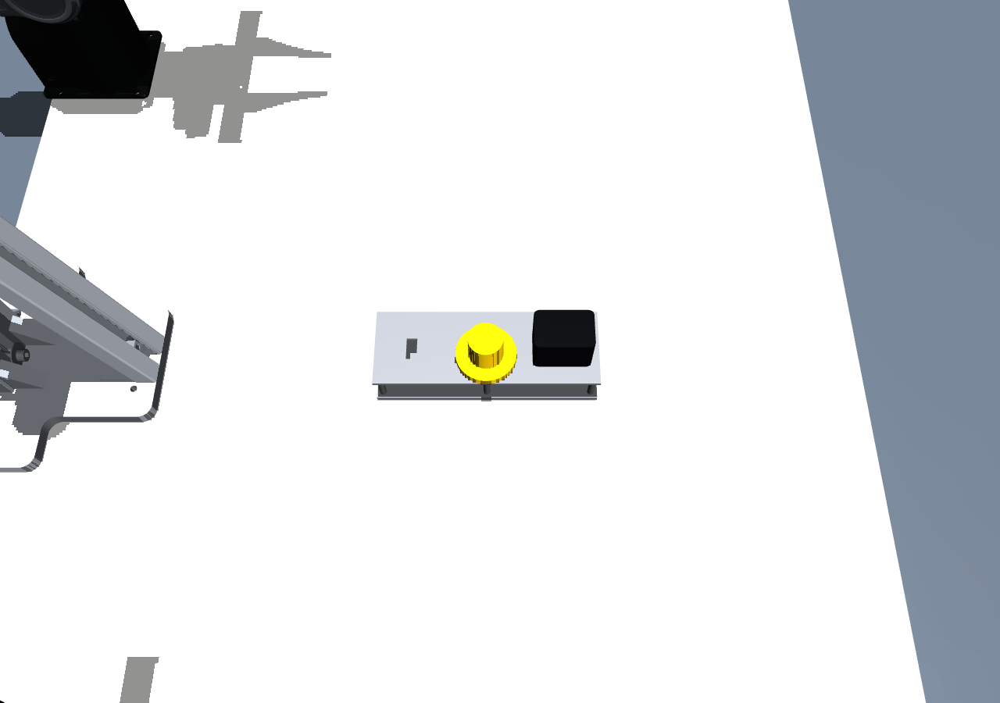

# 充电器插插座任务场景

默认同时放置黑色两脚充电器、黄色三脚插头，以及提供的接插件原型板。
任务可在 MuJoCo 和 Isaac Lab 中运行，复用原双臂 Piper 和三路 RealSense 相机。
任务物体、摆放、接触与到位判定有独立配置；不依赖 CAN 或特定机械臂控制策略。


## 启动与随机摆放

以下命令在项目根目录执行。

```bash
# MuJoCo：随机摆放，同时显示两种插头；Control滑条操控Piper。
bash scripts/run_mujoco.sh --task-scene configs/tasks/connector.yaml \
  --seed 42 --interactive --enable_cameras

# 换一个可复现布局。
bash scripts/run_mujoco.sh --task-scene configs/tasks/connector.yaml \
  --seed 123 --interactive --enable_cameras

# 固定参考摆放，不随机。
bash scripts/run_mujoco.sh --task-scene configs/tasks/connector.yaml \
  --no-randomization --interactive --enable_cameras

# Isaac Lab：同一任务配置和随机种子。
bash scripts/run.sh --task-scene configs/tasks/connector.yaml \
  --seed 42 --enable_cameras

# 采集：可与MuJoCo手动控制或已有HTTP控制源结合。
# 不使用交互/HTTP/demo时，机器人保持初始目标。
bash scripts/run_mujoco.sh --task-scene configs/tasks/connector.yaml \
  --seed 42 --interactive --enable_cameras \
  --record outputs/connector_episode_001.h5 --task 'insert both plugs into the prototype board'
```

配置入口：[configs/tasks/connector.yaml](../configs/tasks/connector.yaml)。
`objects: [black_charger, yellow_plug]` 表示同时加载；可删去其中一个。
`randomization` 分别控制板与两个插头的 XY 范围、朝向和最小间距。
默认板的偏航角为 ±25°，插头偏航角为 ±180°，两种插头分别在板的两侧。
对象按照片以插脚向上开始；需要机器人将其翻转后插入。

随机化发生在重置时，尺寸不随机缩放。完整物体轮廓必须位于桌面上，初始物体之间至少保留15 mm间隔。
同一种子产生相同初始布局。代码调用 `sim.reset(seed=episode_index)` 可逐集生成布局；
`sim.reset(seed=42, randomize=False)` 切换到参考布局。
插座板当前作为固定工装，每集可变位置；两个插头是自由刚体，不与机器人焊接或吸附。

## 比例与几何来源

权威输入是目录 `scene/scene1_ peg in hole/` 中的 `接插件原型板1.STL`。
`SLDPRT` 原文件和8张参考照片一起保留。STL没有单位标签；按原设计尺度和照片将坐标解释为毫米。
转换只做刚体坐标变换与毫米到米的换算，保留原板、六个插孔和六根支柱。
原坐标 `(X,Y,Z)` 转换为任务局部米制坐标 `((85-X)/1000, (Z-30)/1000, Y/1000)`，
长边对应局部X，短边对应局部Y，竖直对应局部Z，板底位于Z=0。

| 部件 | 当前尺寸 | 依据 |
|---|---|---|
| 原型板 | 长170 × 宽60 × 高33 mm | 原始STL包围盒 |
| 底板 / 顶板 | 5 / 3 mm厚；中间净高25 mm | 原始STL平面 |
| 两脚孔 | 每孔4.5 × 8 mm；中心距10.5 mm | 原始STL孔轮廓 |
| 三脚孔 | 两个9 × 8 mm，中心距15 mm；另一个4 × 8 mm | 原始STL孔轮廓 |
| 备用长方孔 | 8 × 17 mm | 原始STL孔轮廓 |
| 黑色充电器外壳 | 44 × 30 × 34 mm，圆角4 mm | 照片比例估算，可配置 |
| 黑色充电器插脚 | 厚1.3 × 宽6.3 × 长16 mm；中心距12.7 mm | 照片与可插入间隙的估算 |
| 黄色插头 | 圆面直径46 mm，外壳总高30 mm，握柄直径26 mm | 照片比例估算，可配置 |
| 黄色插脚 | 厚1.5 × 宽6.3 mm；两短脚17 mm，长脚19 mm | 照片估算，可配置 |

黑色插脚的中心距与原孔中心距不必相同：当前每侧偏移1.1 mm，孔宽4.5 mm仍留下约0.5 mm横向余量。
未为了匹配估算插脚而改动原孔。照片缺少独立量尺、同平面参照与充电器CAD，因此外壳深度、
插脚、圆角、质量和摩擦均属于可校准近似；标识、线缆和弹性电接触片暂未建模。

板的视觉网格直接由STL转换，碰撞体按0/5/30/33 mm层分为22个凸体，保留六个真实空孔。
凸体总体积与原网格体积误差小于 `1e-10 m³`。两个引擎读取同一份分解结果，
避免将整块带孔板做成单一凸包而封住插孔。MuJoCo凸碰撞机制可见
[官方碰撞说明](https://mujoco.readthedocs.io/en/3.3.7/computation/index.html#collision-detection)。

## 模块边界

| 模块 | 职责 |
|---|---|
| `configs/tasks/connector.yaml` | 物体选择、照片估算尺寸、质量、摆放范围、成功阈值 |
| `scripts/prepare_connector.py` | 离线解析原STL、检查比例/体积、导出保孔凸分解 |
| `assets/tasks/connector/` | 自包含板网格、孔位、变换、哈希与来源清单 |
| `src/piper_sim/tasks/__init__.py` | 任务工厂与引擎适配器注册；扩展新任务的入口 |
| `src/piper_sim/tasks/connector.py` | 无引擎依赖的插头几何、种子采样和到位判定 |
| `src/piper_sim/tasks/mujoco.py` | 将任务组合到原MuJoCo工作站中，管理任务刚体 |
| `src/piper_sim/tasks/isaac.py` | 将相同几何/凸体生成USD与PhysX任务刚体 |
| 原机器人 / 相机 / 真机接口 | 继续使用原工作站配置与14维控制契约 |

MuJoCo运行时不需要SolidWorks、Shapely、OCP或Isaac。源板修改后才需要重新导出：

```bash
uv pip install --python .venv/bin/python -e '.[task-assets]'
.venv/bin/python scripts/prepare_connector.py
```

照片估算插头直接由配置生成网格，改尺寸后重新启动即可。
新增任务需在注册表中提供任务类和两个引擎适配器，无需修改机械臂控制实现。

## 数据与到位判定

HDF5继续使用原有14维动作和三路RGB，episode metadata中的 `task_scene` 记录完整配置、
随机种子、采样布局、CAD哈希和目标位姿。每帧 `observation/extras_json` / `next_observation/extras_json` 中：

- `objects` 保存 `board`、`black_charger`、`yellow_plug` 的世界位置与wxyz四元数。
- `task.metrics` 分别保存横向误差、倾角、偏航角、面间隙、插脚入孔情况、稳定时间与 `success`。
- 每根插脚必须完整落在不同的对应孔范围内；只接近孔中心不算成功。
- 两脚允许绕插入轴转180°的等价姿态；三脚必须与非对称孔组一致。
- 默认还需横向误差≤1 mm、角度误差≤5°、外壳面贴近板面，并连续保持0.3秒。

这是几何插入/就位判定，不模拟电接通。episode级 `success` 标签仍由采集流程决定；
逐物体判定已保存于每帧，可用于后续训练数据筛选。

## 已完成验证

57项项目测试通过，包括原工作站回归与新任务的独立性、种子、尺寸、保孔接触、到位判定和记录。
两引擎均验证了100个种子的布局规则；两种插头对准释放后入孔并稳定，横向错开10 mm时受到阻挡且不判成功。
三路RGB和60个transition的采集在两个引擎中均完成。



这张图来自几何接触验收：测试脚本把物体放在孔上方再自由释放。
它验证孔洞和碰撞，不代表已实现Piper自动抓取、翻转和插入策略。

报告：[MuJoCo](../outputs/connector_scene/mujoco/report.json)、[Isaac](../outputs/connector_scene/isaac/report.json)。
三相机示例：[MuJoCo中央](../outputs/connector_scene/mujoco/layout_overhead.png)、
[Isaac中央](../outputs/connector_scene/isaac/overhead.png)。

```bash
PYTEST_DISABLE_PLUGIN_AUTOLOAD=1 .venv-mujoco/bin/python -m pytest -q
MUJOCO_GL=egl .venv-mujoco/bin/python scripts/verify_connector.py \
  --render --output outputs/connector_check_new
PYTHONPATH=src .venv-isaac/bin/python scripts/verify_connector.py \
  --backend isaac --headless --output outputs/connector_check_isaac_new
```
