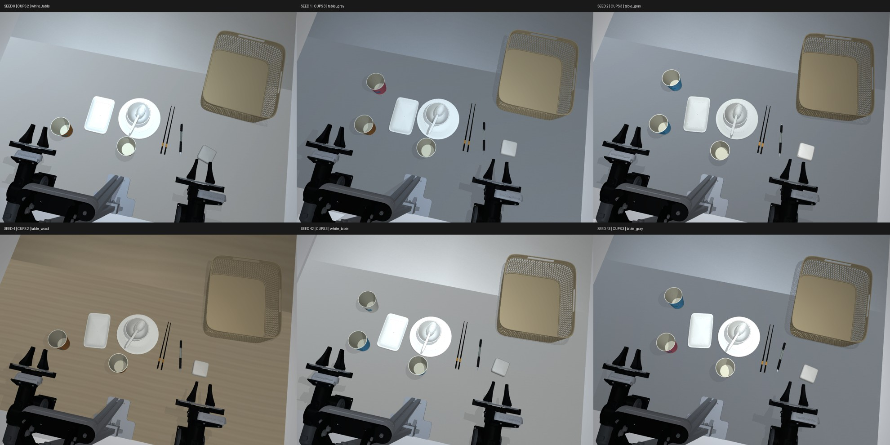
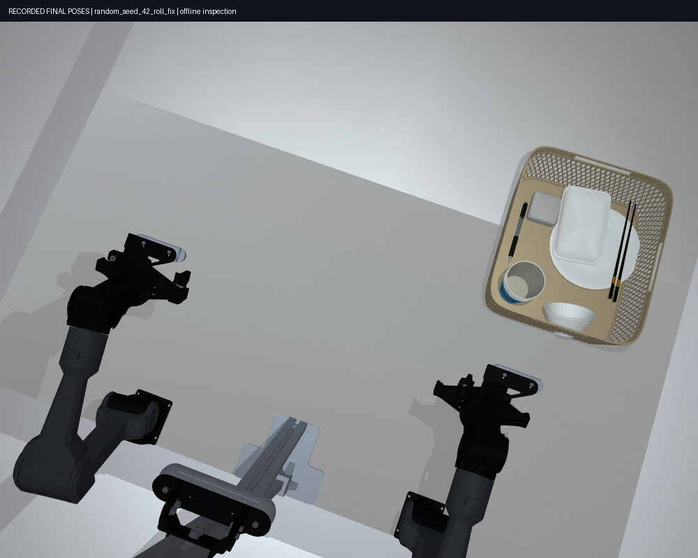
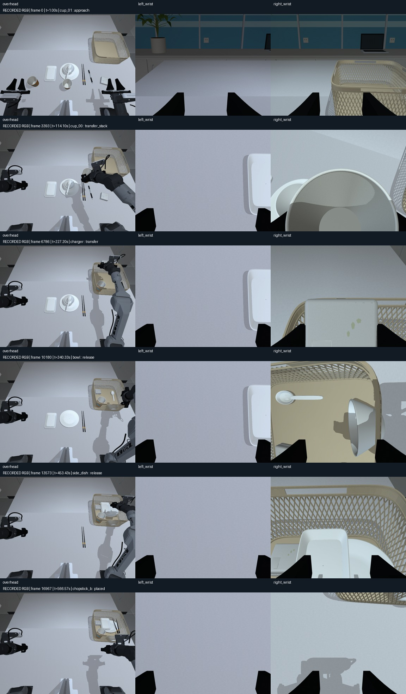
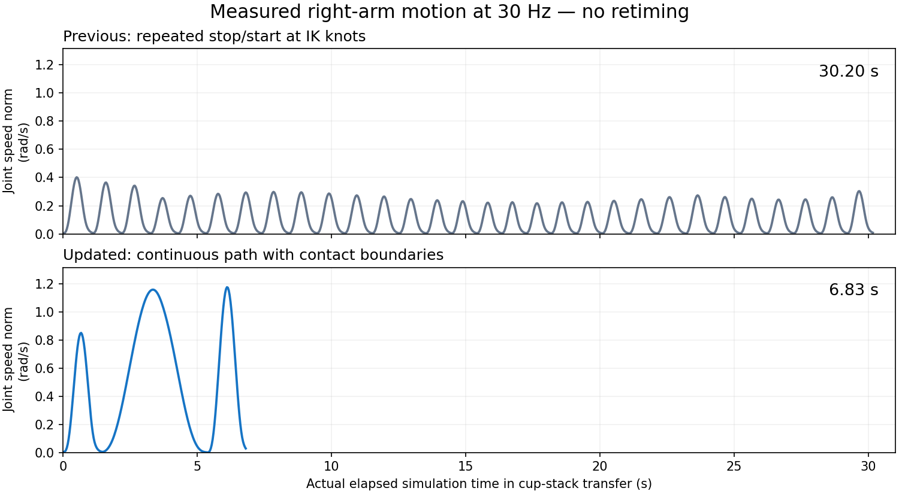
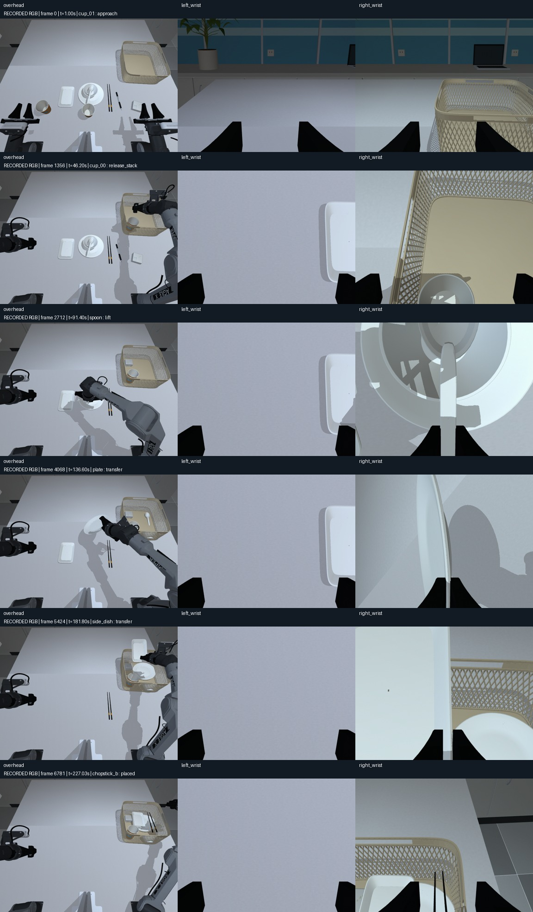

# 刚体收桌、叠杯与域随机化采集

最新审计、已知限制和各版本复测结果见 [平台审计](platform_audit.md)。下文的早期
105 项／135 项测试和旧版成功率保留作历史记录，不代表当前版本的验收结论。

当前演示入口使用 `configs/tasks/clean_table_rigid.yaml`：移除纸团、毛巾、餐垫和左侧纸篓，
保留六件餐具，加入 2–3 只纸杯、笔、充电头。杯子先在桌面套叠，再整摞入右篮；碗直接入篮。
纸杯沿用照片参考的 80 mm 杯口、56 mm 杯底、95 mm 高的空心模型。
笔暂估 150×10 mm，充电头暂估 65×65×28 mm，插脚折叠。
收纳篮为本任务独立估算的 360×310×140 mm，容纳杯摞和餐具；不是旧视频篮筐的精确复刻。
机器人、台面、双臂基座、D455/D435i 安装与光学基准保持原 CAD 配置。

旧 `configs/tasks/clean_table.yaml` 保留用于视频回放对比。旧辅助抓取报告是历史结果，
**不能用于证明当前物理抓取成功，也不能作为本版本采集验收结果**。

## 预览、控制和录制

```bash
# 随机刚体场景、原三摄像头、外部控制/读状态/录制 API
./scripts/run_mujoco.sh --config configs/clean_table_workcell.yaml \
  --task-scene configs/tasks/clean_table_rigid.yaml \
  --domain-randomization configs/domain_randomization/clean_table.yaml \
  --seed 42 --enable_cameras --api-port 8765

# 单条完整特权策略；输出目录必须不存在
PYTHONPATH=src .venv-mujoco/bin/python scripts/demo_clean_table.py \
  --domain-randomization configs/domain_randomization/clean_table.yaml \
  --seed 42 --record --rgb --video --output outputs/rigid_demo_001

# 只诊断叠杯；子任务不进入 accepted 清单
PYTHONPATH=src .venv-mujoco/bin/python scripts/demo_clean_table.py \
  --objects cup_stack --record --viewer --output outputs/stack_check_001

# 批量采集：失败样本保留拒收原因，只转换合格的完整 RGB 任务
PYTHONPATH=src .venv-mujoco/bin/python scripts/collect_clean_table.py \
  --output outputs/rigid_batch_001 --seeds 0 1 2 3 4 --lerobot
```

不传随机化配置时，教师使用固定两杯基准场景。`--nominal-fraction 0.2` 可在批次中按 seed
混入基准场景。先用 `--states-only` 审计运动，再录制 RGB；状态审计不输出视觉训练集。
`--objects` 只用于诊断，不能导出为完整任务合格样本。当前 v3 独立审计只接受完整刚体任务，
所以子任务报告的 `audit_passed=false` 是预期结果；单件诊断可根据 `quality`、`results` 和 `error` 检查。

## 当前随机化维度

| 维度 | 默认范围／实现 |
| --- | --- |
| 杯子数量 | 每次 reset 采样 2 或 3；稳定分配槽位，停用杯不出现在观测/任务指标中 |
| 整体摆放 | 平移 x ±18 mm、y ±25 mm；偏航 ±6° |
| 单件/支撑组摆放 | 独立平移各轴 ±12 mm、偏航 ±12°；盘碗勺保留支撑关系；紧邻筷子使用 0.1 倍扰动 |
| 收纳篮 | 平移 x ±15 mm、y ±20 mm；偏航 ±5° |
| 外观 | 杯身独立颜色，材质色调/亮度与粗糙度；白色细纹、灰色层压板、浅木纹桌面切换 |
| 光照 | 光强 0.75–1.25 倍，灯位各轴 ±120 mm，光色扰动 |
| 物理 | 每件物体质量与惯量同倍缩放 0.85–1.15，物体 geom 摩擦 0.8–1.2 倍；当前不覆盖高优先级指垫的有效抓取摩擦 |
| 相机成像 | 每路独立增益 0.97–1.03、白平衡 0.98–1.02、gamma 0.92–1.08、模糊半径 0–0.45 px、噪声标准差 0–1 灰度级 |

杯身与蓝色标识分开建材质，配色不再被原深蓝纹理压暗。桌面在原 CAD 顶点上补充 UV，
没有缩放或挪动 CAD；木纹/层压板变化来自材质。光色按暖冷方向变化，材质亮度按同一 RGB
倍率变化，避免把白色餐具和照明随机成不自然的红绿蓝。

布局通过桌面边界、非堆叠物体间间隔、容器间隔检查后才接受。杯子、笔、充电头不是绑定在
固定轨迹上的装饰物，均有自由刚体、碰撞和质量。可见的材料颜色、纹理选择、质量、摩擦、
传感器参数、活动物体清单、seed 都写入 episode 元数据，支持同 seed 重建。
每次 reset 从初始参数恢复，避免随机化累积；同一仿真 tick 重复 read 返回相同噪声。
成像扰动是 RGB 后处理，并非完整的 RealSense 噪声标定模型。MuJoCo 用高光参数近似粗糙度，
Isaac 使用材质粗糙度；两者共享采样值，不保证像素或接触轨迹完全一致。

相机安装/内参、原始 CAD、重力和采样周期固定。执行延迟、控制增益扰动、相机标定误差和
物体尺寸变化尚未启用；这些需要独立验证和课程式扩大范围，不能仅在配置里写个参数就算完成。
两引擎共享场景和采样字典，当前自动叠杯/分拣教师只在 MuJoCo 实现。

## 策略与质量门槛

默认 **physical**，不创建抓取 weld，不修改物体状态来搬运。历史 `assisted` 模式不能进入
合格采集清单，刚体叠杯教师直接拒绝该模式。

1. 每次接近和放置根据实时物体/篮筐位姿、抓取后相对变换重新算 IK。
   筷子按实际长轴与中心生成向下抓取姿态，避免邻近物体接触造成的滚转变成不可达手腕姿态。
2. 必须双指接触才抬起；搬运中按控制周期（30 Hz）监控接触锚点滑移与双指接触。滑移超过 12 mm 或连续丢失双指
   接触超过 0.2 秒即拒收。该门槛不会把空夹爪带动物体视为成功。
3. 左臂逐杯套叠到中央底杯，退出后右臂夹底杯、抬起整摞、保持直立搬运；上层杯靠接触和重力随行。
   每次套叠检查轴线偏差 <6 mm、倾角 <8°、相邻杯底高差 5–18 mm。
   全部杯子须先在桌面稳定 0.75 秒，再整摞入篮；最终仍须套叠且全部完整在篮内。
4. 碗直接入篮，盘、方碟、筷子等使用篮内的分区放置点。规划检查使用抓取后实测相对姿态；
   整摞杯子的预测碰撞检查同时移动全部杯子，实际仿真仍是独立自由刚体。
5. 连续路径使用 C2 穿越样条与七次时间律，按采样速度、加速度、jerk 重新定时；独立段使用
   首尾速度、加速度、jerk 为零的七次曲线。通用上限为关节 1.0 rad/s、2.5 rad/s²、20 rad/s³，
   夹爪 0.06 m/s、0.18 m/s²、1.5 m/s³；闭合仍限 0.04/0.12/1，薄盘负载为 0.5/1.2/8，
   小碟负载为 0.3/0.6/4（关节量）。实际轨迹还需通过记录后的独立质检。
   每段等待实测误差和速度连续达标，超时停止。轻物体使用较小夹爪力，避免被过度夹紧弹出。
6. 最大机器人障碍穿透 4 mm；碰撞、不可达、滑脱、套叠散开、落错位置、时钟断续、相机异常、
   实测抖动超限均拒收。完整任务的全部物体还会在退让后重新检查。

接触力、材质、惯量与几何均有估计部分；这些门槛是仿真数据筛选，不是真机迁移认证。
短段 IK 与碰撞拒绝检查不等于任意布局的通用规划器，失败率必须保留报告。
薄盘夹持启用多点接触，并在负载搬运时使用 NoSlip 迭代抑制软接触的数值漂移；
它仍受接触与摩擦约束，不是固定物体的 weld。求解器和主要夹爪参数写入 teacher 元数据，
其余分物体接触配置可按报告的源码指纹定位。
相关机制见 [MuJoCo 接触求解器说明](https://mujoco.readthedocs.io/en/3.3.7/XMLreference.html#option)。
MuJoCo 教师的指垫具有较高接触优先级，覆盖了指垫/物体接触中的物体摩擦参数；实际抓笔
姿态复核已确认这一限制。桌面/物体间接触仍按各 geom 的优先级和混合规则计算，不能将
单个 geom 的采样范围直接当作每一接触对的有效范围。夹爪力与控制增益按物体类型配置，
也未作为本轮随机变量。固定指垫材料的试验尚未替代默认生产接触配置。
可选后端配置 `configs/clean_table_fixed_contact.yaml` 将指垫材料与教师解耦：左右臂在 reset
时分别采样并整回合固定，实际抓取摩擦也随之变化。该配置为未标定候选，使用方式与元数据
见 [外部接口的固定材质说明](external_api.md#可选的固定指垫材质mujoco未标定实验配置)，
完整验证和失败样例见 [平台审计](platform_audit.md)。默认配置仍采用原有按目标改变材料的
教师行为，不应将其称作整回合固定的实物指垫。

## 输出与外部接口

`SimulationSession` 和 HTTP 接口的控制、读取、reset、HDF5 录制不变。
reset 改变杯子数量时，`observation.extras.objects` 仅包含活动物体；不要硬编码物体数量。
`extras.task.metrics.cup_stack` 提供套叠状态，`summary.required_count` 随数量改变。
元数据 `task_scene.layout.content` 与 `domain_randomization` 保存实际随机样本。

```python
from piper_sim.client import SimulationClient
from piper_sim.agilex import AgilexAdapter

robot = AgilexAdapter(SimulationClient('http://127.0.0.1:8765', timeout=15))
obs = robot.reset(seed=42, randomize=True)
print(obs['extras']['objects'])                 # 活动物体实时位姿
print(obs['extras']['task']['metrics'])          # 入篮和套叠指标
print(robot.meta['task_scene']['layout'])        # 本轮采样参数
```

读关节角、发控制、录制与转换的完整例子仍是 `examples/external_agilex.py`；上层使用度数和
0–1 夹爪开度，底层 HDF5 保持 rad/m。批量教师可用 `--config`、`--task-scene` 和
`--domain-randomization` 分别指定工作站、物体场景和随机化范围。

| 输出 | 内容 |
| --- | --- |
| `episode.h5` | 30 Hz 状态/实际动作/下一状态、可选三路 RGB、物体真值和策略阶段 |
| `report.json` | 成功与拒收原因、套叠事件、物理抓取统计、运动质检、配置/源码/素材 SHA-256 |
| `audit.json` | v3 独立策略复检：文件、三路 RGB、运动、接触与任务；旧 `audit_rigid_sequence.py` 仅检查记录位姿 |
| `accepted.jsonl` / `rejected.jsonl` / `diagnostics.jsonl` / `unverified.jsonl` | 合格 RGB、拒收、仅状态诊断及缺少完整证据的尝试分开列出 |
| `lerobot_v2_train/` / `lerobot_v2_validation/` | 可选，只从合格完整 RGB episode 转换；继续保留质量与仿真来源信息 |

真值单独保存在 extras，视觉策略训练时应明确选择输入字段，避免把部署拿不到的真值混入观测。
训练/验证按 seed 和场景组合切分，同轨迹的外观变体不要跨训练/验证集合。

## 验证

多域场景对比见下图；数量、位置、外观变化均来自真实 reset 后的渲染。

可用 `PYTHONPATH=src .venv-mujoco/bin/python scripts/preview_rigid_randomization.py` 重建预览与参数清单。



旧目录 `outputs/domain_randomization_collection` 的五 seed 辅助抓取验收已被用户指出不足，
保留作历史审计，不计入当前纯物理教师通过率。当前验收结果以
[validation.json](../outputs/rigid_table_collection/validation.json) 及对应报告为准。

最终策略的两组完整物理复测如下；两者均通过运动质检，所有搬运抓取在监控采样时刻均为双指接触。

| 随机回合 | 完整入篮 | 最大抓取锚点滑移 | 最大机器人穿透 | 桌面先套叠、再整摞入篮 |
| --- | --- | --- | --- | --- |
| [seed 0，两杯](../outputs/rigid_table_collection/random_seed_0_roll_fix/report.json) | 10/10 | 3.11 mm | 0.50 mm | 位姿复核通过 |
| [seed 42，三杯](../outputs/rigid_table_collection/random_seed_42_roll_fix/report.json) | 11/11 | 3.32 mm | 0.92 mm | 位姿复核通过 |



回归测试 105 项通过，其中刚体场景覆盖 80 个 seed 的布局合法性、原 CAD 台面尺寸、
活动物体切换、接触套叠与滚转筷子的抓取姿态。MuJoCo/Isaac 分别完成 42→43→42 的
运行时属性复位、三路成像和 HDF5 检查；HTTP 接口完成 0→42→0、2→3→2 杯切换，
控制指令确认与三路 640×480 RGB 录制。这些接口检查不计作教师任务成功。

上述上一轮教师复测使用状态记录；本轮完整 RGB 复检见文末。`nominal/demo.mp4` 为此前通过的
固定两杯参考回合，4 倍速预览，早于充电头抓取和滚转筷子修复；报告保留当时源码指纹。
新回合的 `final.png` 由记录末帧位姿离线渲染，用于核对摆放，不计作额外物理回合。

开发中的充电头接近失败、滚转筷子 IK 失败都保留在报告中。不能把单件诊断或“10/11 件入篮”
记为完整成功，也不能将有限 seed 的复测结果解释为整个随机分布的成功率。

## 采集质量 v3：训练样本必须经过独立复检

本项目参考 [LIBERO 的采集实现](https://github.com/Lifelong-Robot-Learning/LIBERO/blob/master/scripts/collect_demonstration.py)
中的连续成功判定与状态/动作记录，以及 [RoboTwin 的采集流程](https://robotwin-platform.github.io/doc/usage/collect-data.html)
中先筛选 seed、再采集的方式。**下面的数值阈值是 Piper 项目的验收配置，不是 LIBERO/RoboTwin
公布的通用标准，也不代表已经取得相同的策略训练效果或真机成功率。**

`configs/collection/clean_table.yaml` 控制教师行为，生产验收独立加载
`configs/collection/quality_policy.yaml`；记录中教师声明的门限不能给自己授予训练许可。
`audit.json` 保存验收策略 SHA256，导出还核对当前策略及内嵌/外置审计一致性。
历史 v2 成功文件须明确重新审计后才能新导出，历史原件保持不变。
运行中的成功标志只叫 `rollout_accepted`；录制关闭后由 `piper_sim.collection_audit` 重新打开
HDF5，从保存的动作、状态、物体位姿、接触证据和图像复检。只有完整 RGB 回合通过后，
才设置 HDF5 和报告中的 `accepted=true, training_ready=true`。
同目录的 `audit.json` 保存最终 HDF5 的 SHA-256；移动回合时需一起保留该审计文件。
导出前与导出结束时都核对文件指纹，质检后被修改的文件必须重新审计，不能沿用旧的成功标志。

| 门槛 | 当前检查 |
| --- | --- |
| 真正完成任务 | 按记录的全部物体位姿重算完整几何入篮；杯子必须先在桌面稳定套叠，再整摞入篮；全部物体结果齐全 |
| 放置后稳定 | 末尾连续 ≥1 s 全部成功且未被夹持；各物体速度 ≤0.01 m/s、角速度 ≤0.10 rad/s |
| 真实抓取 | 每件物体都有逐帧物理接触记录；双指接触比例 ≥98%、最长连续丢接触 ≤0.20 s、接触锚点滑移 ≤12 mm；拒绝辅助约束 |
| 碰撞 | 记录的最大机器人障碍穿透 ≤4 mm；这是控制周期采样检查，不声称覆盖每个物理子步 |
| 平滑 | 从实际写盘的动作和测量状态重算速度、加速度、jerk、跟踪误差和保持段抖动；不通过后期平滑伪造合格轨迹 |
| 状态/动作连续 | 每段 `(obs_t, action_t, obs_t+1)` 时长为 1/30 s；相邻状态严格衔接、动作序号无缺口、SI 单位及通道顺序固定 |
| 三路 RGB | 原生分辨率、RGB uint8、每帧相机时刻与状态一致；读取全部 before/after 图像，逐帧核对跨 transition 的像素连续性；核对内参和相机位姿格式 |
| 图像可用性 | 空白/极端曝光图像占比 ≤1%，全回合完全重复图像比例 ≤98%；空间亮度标准差检查可以拒绝纯色帧。这是基础异常筛选，不是完整感知质量评分 |
| 回合完整性 | 至少 150 帧、最长 300 s；缺字段、NaN、截断文件、子任务、失败回合、未完成独立审计一律不能进入训练集 |

每帧接触证据保存在 `extras.teacher`；特权真值仍与部署用的 RGB/机器人状态分开。
自动教师目前只支持 MuJoCo 的刚体收桌任务。记录包含仿真接触和近似物理参数，
不会因为 `training_ready=true` 就被标成真机数据。

默认批量流程：状态预检 → 同 seed 重新执行并录制完整 RGB → 文件复检 → 比较两遍的动作、
机器人状态和物体轨迹指纹 → 接受或拒收。渲染速度不改变仿真采样周期；不同软件/硬件版本
可能改变接触轨迹，此时应保留差异并重新验证。`--skip-preflight` 只跳过第一遍，不能跳过最后的验收。

```bash
# 默认质量流程；输出目录必须不存在。每阶段超时默认 7200 s。
PYTHONPATH=src .venv-mujoco/bin/python scripts/collect_clean_table.py \
  --output outputs/curated_batch_001 --seeds 0 1 2 3 4 --lerobot

# 快速诊断完整物理任务；只进入 diagnostics.jsonl，不进入 accepted.jsonl
PYTHONPATH=src .venv-mujoco/bin/python scripts/collect_clean_table.py \
  --states-only --output outputs/motion_audit_001 --seeds 0 42

# 对已关闭的原始文件重新审计；命令不修改原文件
PYTHONPATH=src .venv-mujoco/bin/python scripts/audit_collected_episode.py \
  outputs/curated_batch_001/episode_000000_seed_0/episode.h5 \
  --output outputs/recheck_001.json

# 从真正记录的三路 RGB 制作审阅图和视频，不重新摆姿态渲染
PYTHONPATH=src .venv-mujoco/bin/python scripts/preview_collected_episode.py \
  outputs/curated_batch_001/episode_000000_seed_0/episode.h5 \
  --output outputs/review_001 --video --speed 4

# 可选：无损合并相邻 transition 重复的 RGB 存储，保留原文件
# 输出需要重新完整审计；同时保留生成的 compact.audit.json。
PYTHONPATH=src .venv-mujoco/bin/python scripts/compact_collected_episode.py \
  outputs/curated_batch_001/episode_000000_seed_0/episode.h5 \
  --output outputs/compact.h5
```

合并存储采用 HDF5 虚拟数据集，`observation` / `next_observation` 的名字、形状、类型和像素值保持一致，
在项目 h5py 读取、序列读取和 LeRobot 转换中验证过。复制时逐帧核对相邻图像完全相同；
非连续相机流会拒绝合并。完整原生无损 RGB 体积很大，采集过程每 30 个控制帧检查磁盘余量，
低于配置中的 5 GiB 预留空间就停止并拒收，保留原因和已完成的记录前缀。
合并存储的命令需要额外的输出空间，并不会自动删除原文件。

清单分为 `accepted.jsonl`、`rejected.jsonl`、`diagnostics.jsonl`、`unverified.jsonl`，
汇总保留全部尝试和失败原因。默认教师在线共享连续 RGB 帧：存 N 张 observation 和终止帧，
next_observation 仍可完整读取；外部 API 的默认存储布局不变，可显式选 `image_storage="shared"`。

新批次可以用首次启动时的相同参数追加 `--resume`。代码、配置、资产、依赖或通过文件的
校验和发生变化时拒绝恢复，需新建批次。已完成任务不重跑，未完成尝试保留，并在新 attempt
目录重试。旧批次没有 `run.json`，不能直接恢复。不要在批次执行过程中修改其代码/配置。

2026-11 的完整 RGB、官方 LeRobot 读取、状态回归和性能证据见
[平台审计](platform_audit.md)。它明确区分历史结果、状态诊断、训练验收，以及尚未修复的布局；
后续的旧验证章节保留其原报告和源码指纹，不代表当前全部随机种子通过。
状态预检通过不算一个 RGB 成功样本。`--lerobot` 仅转换 accepted 回合，按固定 seed 家族分成
`lerobot_v2_train` 与 `lerobot_v2_validation`；默认验证比例 0.2，不保证小批次一定两边都有样本。
固定 nominal 场景无论用哪个 seed 都属于同一划分；同一随机布局的外观变体应复用 seed，
且不同批次应保持同一个 `--validation-fraction`。真实项目若另行改变布局/资产生成规则，应按来源
重新制定划分，不应仅依赖随机帧切分。

导出器遇到带 `teacher` 的脚本数据会要求最终 RGB 验收；通用外部录制仍可做诊断转换。
原始 HDF5 保留无损 RGB；LeRobot 视频采用 H.264 / CRF 18 / yuv420p，是有损编码，
不是原始像素的无损替代。导出逐路解码核对帧数和尺寸，并保留源文件指纹、相机标定及 SI 单位旁路数据。
要对外部输入使用相同导出门槛，可显式调用 `export_lerobot_v2(..., require_quality=True)`，
但需要先提供当前审核器所要求的任务、接触和完整 RGB 证据。不会把普通遥操作录制自动认证为专家数据。

当前策略仍由分段运动组成，完整收桌约需数百仿真秒；低抖动不等于人类动作效率。
正式扩大采集规模前还需检查不同随机布局的失败分布，并用这些数据训练策略、做留出场景评估。

### v2 实际采集验收（2026-11-08）

本轮保留全部 5 个不同 seed 的物理诊断结果，没有调整阈值让失败回合过关。
状态诊断通过 3/5；这不是随机分布的成功率估计，也不是 3 个 RGB 训练样本。

| Seed | 实际物体入篮 | 质量结果 | 原因 |
| --- | --- | --- | --- |
| 0 | 10/10，两杯 | 状态诊断通过；同 seed 完整 RGB 复跑通过 | 两遍机器人动作/状态与物体轨迹指纹完全相同 |
| 42 | 11/11，三杯 | 状态诊断通过 | 接触、运动、套叠顺序与最终稳定性通过 |
| 1 | 11/11，三杯 | 状态诊断通过 | 接触、运动、套叠顺序与最终稳定性通过 |
| 7 | 11/11，三杯 | 拒收 | 抓取第一根筷子时实测夹爪加速度 1.788 m/s²、jerk 57.402 m/s³，超过 1.0 与 50.0 的阈值 |
| 43 | 10/11，三杯 | 拒收 | 后续搬运规划检测到右腕与篮筐的路径干涉 9.98 mm，停止任务 |

seed 0 的完整 RGB 回合包含 **16,968 个 transition、565.6 s、三路 640×480 / 30 Hz RGB**。
独立审计读取了全部 **101,808 张 before/after 图像**，没有发现像素衔接错误或基础图像异常。
无损共享存储将本次 HDF5 从 61,778,705,522 B 减至 30,980,304,740 B（审计元数据追加前），
三个相机的逐像素哈希及机器人/物体轨迹哈希均保持一致，合并后再次完整审计通过。
原始 HDF5 只保存在本机；Git 保存小体积报告与实际记录画面的审阅图。

同一完整回合已导出为 LeRobot v2.1，输出位于本机
`outputs/collection_quality_v2/lerobot_v2_verified`。独立读回逐项核对全部 16,968 行状态、
动作、帧序号和时间戳；三路视频均解码得到 16,968 帧、640×480、30 fps。
每路抽查首、中、末三帧，压缩后的 RGB PSNR 为 38.93–45.01 dB；这是 9 帧压缩误差抽查，
不是整个数据集的感知质量认证。HDF5 的无损原图继续保留。

另对成功回合的**副本**进行故障注入：保留成功标志、将末帧碗移出篮筐，独立审计正确拒收
`incomplete_final_inventory` 和 `unstable_final_placement`，原文件未修改。
磁盘预留检查也通过单独的故障注入验证。回归测试 **129 项通过**，不包括正在独立开发的 PPO 测试。

- [本轮汇总与局限](../outputs/collection_quality_v2/validation.json)
- [完整 RGB 审计](../outputs/collection_quality_v2/rgb_seed_0/audit.json)
- [LeRobot 转换与独立读回](../outputs/collection_quality_v2/lerobot_verified_report.json)
- [失败回合清单](../outputs/collection_quality_v2/batch_holdout/rejected.jsonl)
- [故障注入证据](../outputs/collection_quality_v2/fault_injection.json)



审阅图确认了杯子整摞搬运、碗直接放入篮筐以及最终桌面清空；中后段主要由右臂搬运，
左腕画面大部分为桌面。这不是相机丢帧，但也不代表三路画面始终具有相同的信息量。
目前只完整验证了 **1 个 RGB seed**，尚未以这些样本完成策略训练、留出任务评估或真机验证，
因此不能宣称已经达到 LIBERO/RoboTwin 的整体训练质量。

### 连续运动配速 v3（2026-11-09）

旧版 seed 0 的 565.6 s 回合逐小段启停：接触前最后 3 cm 分成 11 次运动，
杯堆转向分成 20 次，短距离退让也反复等待机械臂静止。这会产生明显的机械停顿。

本轮参考的是动作生成方式：[LIBERO 采集脚本](https://github.com/Lifelong-Robot-Learning/LIBERO/blob/master/scripts/collect_demonstration.py)
接收人的连续遥操作输入；[RoboTwin 规划器](https://github.com/RoboTwin-Platform/RoboTwin/blob/main/envs/robot/planner.py)
与[执行器](https://github.com/RoboTwin-Platform/RoboTwin/blob/main/envs/_base_task.py)
执行整条带位置/速度的规划轨迹。两者没有可直接套用到本机器人、任务和控制器上的统一秒数标准。

Piper 采用独立的 NumPy 实现：整条 Cartesian 路径先求 IK，再通过 C2 关节样条连接，
统一使用七次时间曲线；按真实 30 Hz 控制样本的速度、加速度、jerk 重新分配时长。
中间 IK 点不再要求停稳；抓住、释放、检查杯子套叠等语义边界仍保留停稳。
空手接近时同步将夹爪调整到预抓宽度，放下物体后优先直接前往下一个物体。
杯子与充电头闭合到带预紧量的实际尺寸附近，避免继续命令一个不可能达到的零宽度。
薄边餐具使用单独的持物速度，不能把空手快移参数套用到所有接触阶段。

这不是视频加速、跳帧或删除数据段。`--video-speed 1` 的画面以原始仿真秒播放，
HDF5 仍逐控制步记录。公开的状态、控制、随机化、录制及 LeRobot 接口保持兼容。
`configs/collection/clean_table_legacy.yaml` 保留旧的配速配置，便于比较。

```bash
# 默认完整物理 demo；这条命令录状态与原速总览视频，属于诊断，不是 RGB 训练样本。
PYTHONPATH=src MUJOCO_GL=egl .venv-mujoco/bin/python scripts/demo_clean_table.py \
  --record --video --video-speed 1 --seed 0 \
  --domain-randomization configs/domain_randomization/clean_table.yaml \
  --output outputs/natural_motion_demo

# 正式训练采集增加 --rgb（同时录三路原始 RGB）；需要 LeRobot 时再加 --lerobot。
# 比较真实时长和停顿，不改写输入数据：
PYTHONPATH=src .venv-mujoco/bin/python scripts/compare_collection_motion.py \
  outputs/collection_quality_v2/rgb_seed_0/episode.h5 \
  outputs/natural_motion_demo/episode.h5 --output outputs/natural_motion_comparison.json
```

比较脚本将“命令和实测的全部臂关节低于 0.02 rad/s，且两个夹爪低于 0.002 m/s”
定义为近似静止，并统计持续至少 250 ms 的停顿。它包含必要的接触保持，不能把静止比例
直接解释成人类动作自然度或策略训练质量。

配速采用分阶段限制：空手/普通物体关节目标上限为 1.0 rad/s、2.5 rad/s²、20 rad/s³；
盘子持物为 0.5 / 1.2 / 8，小碟持物为 0.3 / 0.6 / 4。闭合捕获仍限制到
0.04 m/s、0.12 m/s²、1.0 m/s³。为允许上述加速，实测臂关节速度验收上限由
0.8 调为 1.2 rad/s；实测加速度、jerk、滑移、失去接触、碰撞及跟踪误差门槛保持原值。
这些是仿真收集配置，不是标定过的真机速度或力限制。

同 seed 0、相同随机场景，实际状态记录对比：

| 指标 | 旧版 | 连续路径版 |
| --- | ---: | ---: |
| 回合时间（不含 1 s 预热） | 565.60 s | 226.07 s |
| 30 Hz transitions | 16,968 | 6,782 |
| 静止段 ≥250 ms | 302 | 69 |
| 近似静止时间占比 | 30.83% | 19.70% |
| 杯堆转运阶段 | 30.20 s | 6.83 s |

时间缩短 60.03%，并保留完整接触过程。盘子、碗直接入篮，纸杯先桌面套叠再整摞入篮。
状态预检 seed 0 为 10/10，seed 42 为 11/11；后者用时 252.37 s，包含三个杯子。
两回合持物时记录的双指接触均连续保持，最大接触点滑移分别为 3.411 / 3.423 mm。
这只是有限场景的工程验证，不能据此声称达到 LIBERO/RoboTwin 的训练效果或总体成功率。



完整 RGB 仍使用逐帧无损数据。本轮增加可选 `image_compression="gzip"`（level 1）；
它只改变 HDF5 存储方式，公开字段、像素、分辨率、帧率和时间戳均不变。
外部 `SimulationSession.start_recording` 保留默认 LZF，收桌采集配置选用 GZIP 以减少磁盘占用。
两种方式均可通过已有的 HDF5 审计、无损共享帧压缩及 LeRobot 导出流程。

最终运动配置复测了与 v2 相同的五个工程回归种子（包含调参使用过的种子，非留出集）：

| Seed | 入篮 | 状态审计结果 |
| --- | --- | --- |
| 0 | 10/10 | 通过，226.07 s |
| 42 | 11/11 | 通过，252.37 s |
| 1 | 11/11 | 拒收：小碟释放时实测夹爪加速度 1.046 m/s²，门槛为 1.0 |
| 7 | 7/11 | 拒收：抓盘规划预测指尖侵入台面 4.01 mm，超过 4 mm；未执行该段 |
| 43 | 10/11 | 拒收：后续抓筷规划预测右腕与篮筐干涉 9.98 mm；未执行该段 |

因此本轮五个状态回归为 **2 通过、3 拒收**，不能只根据 seed 0 视频宣称随机化场景已全面可靠。
批量训练采集应继续使用 `collect_clean_table.py` 的“状态预检 → RGB 复跑 → 独立审计”流程。
开发中出现的抓取滑脱、IK 不可达以及被主动中止的替代方案也保留在汇总中，后者单独标记。
135 项回归测试通过；测试日志中的 QVEL 警告来自专门设置 `qvel[0]=1e20` 的故障注入用例，
单独复跑确认该异常会被拒绝，成功 demo 日志中没有该异常。

seed 0 随后用最终配置完整复跑并录制三路 **640×480、30 Hz RGB**，得到 6,782 个 transition。
关闭文件后的独立审计检查了全部 **40,692 张 before/after RGB**，图像衔接错误和基础图像质量
异常均为零；机器人动作/状态及物体轨迹哈希与状态预检完全一致，`training_ready=true`。
原始无损 HDF5 为 18,219,534,877 B，保存在本机，不推送大体积训练数据。
总览视频独立解码确认 3,406 帧、1000×800、15 fps、227.066667 s，包含 1 s 预热，播放倍率为 1。
本轮未重新导出 LeRobot；可使用上述 `--lerobot` 选项或既有导出接口。

- [新的完整原速视频](../outputs/natural_motion_v3/rgb_seed_0/demo.mp4)
- [时间和停顿对比](../outputs/natural_motion_v3/timing_comparison.json)
- [完整 RGB 审计](../outputs/natural_motion_v3/rgb_seed_0/audit.json)
- [开发尝试、回归失败与验证汇总](../outputs/natural_motion_v3/validation.json)



## 并行批采集与恢复（平台审计阶段新增）

`collect_parallel_clean_table.py` 将种子分给最多三个独立串行采集进程，默认两个。每个 worker 有自己的
journal、日志和录制目录；相机、物理、控制时钟不共享。父进程重新校验结果后，按输入种子
顺序发布统一的 accepted / diagnostics / rejected / unverified 清单。可选 LeRobot 导出
在全部 worker 结束后执行，按 train / validation 汇总；特权信息仍在独立 extras 中。

```bash
PYTHONPATH=src MUJOCO_GL=egl .venv-mujoco/bin/python scripts/collect_parallel_clean_table.py \
  --output outputs/parallel_collection_new --workers 2 --seeds 0 7 9 43 --lerobot

# 保持源码、配置、资产、依赖、workers 和种子顺序相同。
PYTHONPATH=src MUJOCO_GL=egl .venv-mujoco/bin/python scripts/collect_parallel_clean_table.py \
  --output outputs/parallel_collection_new --workers 2 --seeds 0 7 9 43 --lerobot --resume
```

默认仍先状态预检再采 RGB。`--skip-preflight` 可避免重跑成本，但失败可能留下较大的 RGB
诊断文件；最终独立审核不会跳过。`--states-only` 只做物理诊断，不发布训练接受数据。
`--workers 1` 可在新目录中进行同配置串行对照，不能用改变 workers 的方式恢复已有批次。

父进程收到 Ctrl-C 或 SIGTERM 后会记录中断并终止自己启动的进程组（包括录制子进程），
保留 partial 文件；忽略 SIGTERM 的所属后代也会被清理。再次恢复时
由各 worker 的 journal 决定复用已完成结果或创建新的 attempt 目录。父进程被 SIGKILL
时无法执行清理，需要先确认其 worker 已停止，再运行恢复；进程锁会拒绝并发写同一 shard。

`invocation_*.json` 单独记录本次启动到校验/导出结束的墙钟时间；首次运行的合格回合/小时
包括失败尝试，恢复运行不报告这个比率，以免把复用结果伪装成新采集速度。普通 `summary.json`
中的累计 phase 时间相加包含并发重叠，不能作为并行产能。完整三路 RGB 回合实测约需
6–10 GB HDF5，预留空间需覆盖整个批次的总量与至少 5 GiB 运行余量；图像熵会改变体积。

并行入口不提高专家本身的成功率。当前仍有被审核拒收的布局，版本和完整证据见
[平台审计](platform_audit.md)；不能仅凭可并行运行就视为已达到稳定批量生产标准。

### 同版本、同种子的完整吞吐量对照

基准入口将 seed 数量和并发数解耦。下面先以一个 worker 顺序跑三个种子，再以三个 worker
同时跑同一组；两组不会彼此重叠：

```bash
PYTHONPATH=src MUJOCO_GL=egl .venv-mujoco/bin/python scripts/benchmark_qualified_collection.py \
  --seeds 0 2 7 --compare-workers 1 3 \
  --output outputs/qualified_pair_new --min-free-gib 65 --expected-episode-gib 10
```

每个回合包含完整三路 RGB、独立闭文件审计、LeRobot 导出和父进程再次验证。基准不做状态
预检，也不生成额外总览视频；失败尝试与所有这些阶段均计入 cohort 墙钟时间。它不改变
物理步长、30 Hz 记录频率或验收门槛。生产入口仍可保留预检，两种流程的产能不能混报。

`inputs.json` 保存源码、配置、资产、依赖、编码器可执行文件与运行环境指纹；每条回合启动
前以及 cohort 结束时重新校验，变更会中止比较。`workers_*/report.json` 保存当前所属 PID、
每个种子的通过/失败和速率；`comparison.json` 仅在两组完整通过、动作/状态、物体位姿、帧数
和验收策略匹配时给出加速比。它不据此声称 RGB 逐像素一致或分布总体成功率。

`seed_*_profile.json` 记录阶段耗时和资源峰值。单组使用 `--workers 1`、`2` 或 `3`。
`--timeout-s` 默认每回合 7200 s，包含审核与导出；超时或 SIGTERM 会清理本次拥有的进程组，
保存中断记录且不发布成功速率。基准目录必须是新目录；生产批采集另有 journal 恢复机制。

磁盘预算为 `max(min_free_gib, 5 + 组数 × 种子数 × expected_episode_gib)`，默认每回合
10 GiB，属于规划估计，不是硬上限。运行时 recorder 的空闲磁盘门槛继续生效。这里两组
刻意重复相同 seed 家族，不能把六个文件当六条独立轨迹拼入训练集，更不能将复制的家族
分别放进训练和验证集；整理数据时选择一组并应用生产采集的固定家族划分。
## 可选 MuJoCo 内部参考控制器（实验配置）

`configs/clean_table_servo.yaml` 使用同一 CAD、场景和相机配置，在 30 Hz 接收绝对位置目标，
以物理子步生成单调三次位置参考和对应速度参考。默认配置不变。位置参考保持在前后两个
目标之间，停止/反转处会显式限制端点导数；这不能保证全程 C1 连续，也不是已标定的真机控制器。

```bash
PYTHONPATH=src MUJOCO_GL=egl .venv-mujoco/bin/python scripts/demo_clean_table.py \
  --config configs/clean_table_servo.yaml --record --seed 0 \
  --domain-randomization configs/domain_randomization/clean_table.yaml \
  --output outputs/servo_trial_new
```

上述命令仅做完整状态诊断，不生成训练合格 RGB 数据。每回合仍须通过原独立任务/运动审计；
候选 seed 0 已通过完整三路 RGB 与官方 LeRobot 消费者检查，但扩展种子仍有失败；
不能将原控制器的 2.128× 基准直接归给新控制器，详见 [审计报告](platform_audit.md)。

公共接口仍为 14 维 SI 绝对目标，夹爪为总开口；action 表示控制周期开始时接收的端点，
不是该周期内每个子步的瞬时执行器目标。配置与控制语义进入 `physics_model.controller`，
私有 `controller_interval` 记录前后目标、内部参考范围、原生速度/差分峰值、导数约束跳变量、
增益和执行器力限幅。记录中的峰值定位到控制周期，没有伪造准确子步时间。
LeRobot 公共训练列不因此增加特权字段。Isaac 会明确拒绝此 MuJoCo 专用控制器配置。

```bash
PYTHONPATH=src .venv-mujoco/bin/python scripts/audit_recorded_dynamics.py \
  outputs/servo_trial_new/episode.h5 --output outputs/servo_trial_native_check.json
```

此只读诊断核对全部区间的时钟、动作、连续性、限位、原生边界速度与峰值范围；
它检查摘要一致性，不声称独立重算了未存储的完整 960 Hz 轨迹，也不授予训练许可。

同频原生基线可用 `configs/clean_table_observed.yaml`：模式为 `zero_order_observed`，保持原
零阶保持位置目标，只把批量积分拆成同数量的单步并读取状态。积分内部不写目标、力偏置
或物体状态，不额外调用 `mj_forward`；原 backend 在控制周期末的刷新仍保留。其速度参考
与导数限制字段为零，**不表示零阶位置目标连续**。此模式增加诊断开销，不能将它的墙钟
时间作为原来未观测基线的吞吐成绩。用同一只读审计命令检查其区间摘要。

```bash
PYTHONPATH=src MUJOCO_GL=egl .venv-mujoco/bin/python scripts/demo_clean_table.py \
  --config configs/clean_table_observed.yaml --record --seed 0 \
  --domain-randomization configs/domain_randomization/clean_table.yaml \
  --output outputs/observed_baseline_new
```

## 持物样条限位备选（实验配置）

合法的 IK 节点也可能被自然三次样条插值推过关节限位。可选采集配置
`configs/collection/clean_table_bounded_path.yaml` 仅在这种情况发生时尝试凸 B 样条，
不裁剪目标，也不改变正常自然样条。默认采集配置仍保留原来的持物越界拒绝行为。

备选曲线需通过额外的 FK 偏离检查：在同一个路径参数上，与**原始已求解 IK 节点**构成的
位置线段和 SO(3) 旋转插值比较。预算为位置 2 mm、旋转 0.01 rad；它约束额外插值偏离，
不包含 IK 求解误差、实测跟踪误差，也不是实机精度标定。超预算时最多两次二分控制多边形，
原始比较基准不变；仍不满足就拒绝。每个候选重新按原速度/加速度/jerk 限值确定时长，
选中的全部控制目标仍须通过原机械臂、双臂和持物碰撞检查。

```bash
PYTHONPATH=src MUJOCO_GL=egl .venv-mujoco/bin/python scripts/demo_clean_table.py \
  --config configs/clean_table_servo.yaml \
  --collection-profile configs/collection/clean_table_bounded_path.yaml \
  --domain-randomization configs/domain_randomization/clean_table.yaml \
  --record --seed 9137 --output outputs/bounded_path_trial_new
```

这是完整状态诊断命令，不含 RGB。`bounded_path_selected` 事件保留各次细分的样本数和最大
位置/旋转偏离；采集元数据保存配置与未标定范围。几何与偏离检查都是采样检查，不保证
连续时间无碰撞。在线通过也不替代最终独立闭文件审核。

## 考虑篮内支撑的放置搜索（实验配置）

`configs/collection/clean_table_placement_search.yaml` 在有界持物曲线配置上，只增加
筷子和小碟的可选放置搜索。读取实际抓持变换、篮筐和已入篮物体的当前碰撞三角面，
在原槽位周围 5 cm 内搜索位置、偏航和俯仰，每次最多检查 216 个姿态候选。
几何估计的首次接触面决定释放高度；原机械臂、双臂和持物碰撞检查仍保留，并增加
释放时夹爪开口的采样检查。搜索不会写入物体位置，也不启用吸附或更改接触参数。

```bash
PYTHONPATH=src MUJOCO_GL=egl .venv-mujoco/bin/python scripts/collect_parallel_clean_table.py \
  --config configs/clean_table_servo.yaml \
  --collection-profile configs/collection/clean_table_placement_search.yaml \
  --seeds 13 15619 0 --workers 2 --states-only --output outputs/placement_trial_new
```

这是状态诊断命令。当前三个工程回归种子中 13、0 通过，15619 的物体全部入篮，
但最后一根筷子仍在滚动，因此被原稳定门限拒收。该候选还没有完整 RGB 验证，
未提升为默认配置，不能把 2/3 状态通过率当作批量训练数据成功率。

`placement_search_selected` 事件记录槽位、角度、内壁余量、预计支撑间隙、候选数、
障碍物名单和开爪检查范围。当前支撑估计只采样持物可见顶点，可能漏掉杆身中部的
碰撞接触；几何首次接触也不能证明动态落稳。后续改进需保留这些失败证据并完整复测。

辅助诊断命令：

```bash
PYTHONPATH=src .venv-mujoco/bin/python scripts/audit_final_object_motion.py \
  outputs/placement_trial_new/worker_01/episode_000000_seed_15619/episode.h5 \
  --output outputs/final_motion_new.json
PYTHONPATH=src MUJOCO_GL=egl .venv-mujoco/bin/python scripts/render_recorded_release.py \
  outputs/placement_trial_new/worker_00/episode_000000_seed_13/episode.h5 \
  --object chopstick_a --output outputs/release_review_new
```

第一条对闭文件（包括失败回合）做 30 Hz 位姿差分分析，采用独立生产稳定门限；
第二条按原速显示连续原生状态，视频明确标注状态重建，**不是原始同步相机数据**。
两者只读原始记录，不修改训练许可。隔离放置实验另用 `diagnose_placement_search.py`，
只在初始化时恢复记录姿态；因缺少物体速度和求解器缓存，它不是精确动态回放，也不产训练数据。

另一实验配置 `configs/collection/clean_table_collision_support.yaml` 增加
`slender_surface_spacing_m: 0.005`，将筷子的真实碰撞三角面按最长边二分，直到每条边
不超过 5 mm，然后用细分顶点估计支撑。它不会改变视觉网格、碰撞网格、质量或摩擦，
也不改变默认配置；这修复可见端点无法代表杆身碰撞形状的问题，但不是动态落稳保证。

查询加速采用保守 XY 包围盒筛选，保留原三角面高度计算。包围盒包含原重心坐标容差
扩展后的角点（系数可能达到 `1+2ε`），避免只扩展 `ε` 导致漏判。单元测试比较原全量
计算，并单独检查这些角点。性能报告只描述几何查询，不代表采集吞吐提升。

隔离诊断可加 `--execute --observe-stability-s 6`，额外观察目标物体末段速度；结果仍是
单物体诊断，不构成完整回合许可。生产是否接收数据仍由独立审核决定。

## 可选的刚性物体收取顺序

`configs/collection/clean_table_packing_order.yaml` 在碰撞表面采样配置上增加
`pacing.rigid_sort_order`：叠杯并搬运整摞后，先收两根筷子，再收笔、充电头、勺、碗、盘、
小碟。这样可以测试细长物体先使用篮底的策略，避免固定把它们留到最后。
默认顺序仍然不变。

配置必须恰好列出场景中的全部非杯目标，每个名字仅一次；非激活物体在执行时跳过。
杯子继续走独立的先套叠、后整摞搬运流程。按场景 `support` 关系检查拆除顺序，
必须先拿走上方物体，再拿支撑物，不能通过漏掉难处理目标提高成功率。
实际顺序写入教师元数据；每一步仍使用原物理抓取、路径检查、质量门限和最终稳定审核。

```bash
PYTHONPATH=src MUJOCO_GL=egl .venv-mujoco/bin/python scripts/collect_parallel_clean_table.py \
  --config configs/clean_table_servo.yaml \
  --collection-profile configs/collection/clean_table_packing_order.yaml \
  --seeds 13 15619 0 --workers 3 --states-only --output outputs/packing_order_trial_new
```

上述命令仍是完整状态诊断；没有 RGB，不产生训练许可。不能把一次未录制的顺序试验
当作此配置通过独立数据审计的依据，当前验证结果见 `docs/platform_audit.md`。
