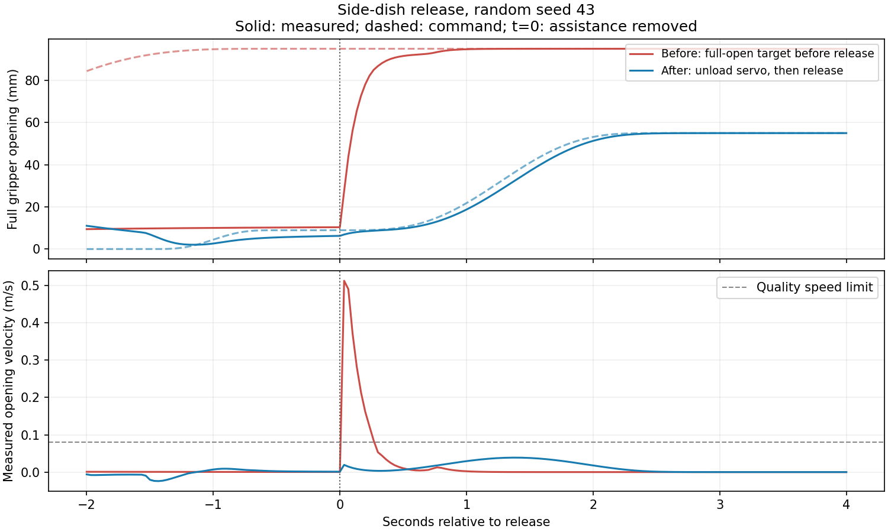

# 收拾桌面：域随机化与平滑特权采集

任务仍是纸团、纸巾进左盒，六件餐具进右篮，餐垫留桌面。原始 CAD、双臂安装、三相机
安装和标定不变。域随机化、运动控制、质量检查、录制和导出分别实现。

## 开始采集

仓库根目录运行，输出目录必须尚不存在。默认录制三路 640×480 RGB 和 30 Hz 状态／动作：

```bash
PYTHONPATH=src .venv-mujoco/bin/python scripts/collect_clean_table.py \
  --output outputs/clean_table_collection_001 \
  --seeds 0 1 2 3 4 5 6 7 8 9 --lerobot
```

第一次建议加 `--states-only` 做运动检查，去掉 `--lerobot`；这时输出不含 RGB。
`--nominal-fraction 0.2` 可按 seed 稳定地混入约 20% 原始场景，小批次比例不保证恰好 20%。
`--video` 另存总览视频，不替代三相机数据。每条 episode 有超时限制，默认 3600 秒。

单条演示／诊断：

```bash
PYTHONPATH=src .venv-mujoco/bin/python scripts/demo_clean_table.py \
  --domain-randomization configs/domain_randomization/clean_table.yaml \
  --seed 42 --record --rgb --video --lerobot \
  --output outputs/clean_table_random_demo_001
```

`--objects paper` 等只运行诊断子集，不能进入完整任务的合格清单，也不能通过该入口导出
LeRobot。`--grasp-mode physical` 禁用辅助约束；目前完整纯物理抓取尚未通过验证。

## 随机化内容与复现

配置为 [`configs/domain_randomization/clean_table.yaml`](../configs/domain_randomization/clean_table.yaml)：

| 参数 | 首版范围 |
| --- | --- |
| 整套餐具平移／偏航 | x ±18 mm、y ±25 mm、±6°，保留原堆叠关系 |
| 两个容器平移／偏航 | x ±15 mm、y ±20 mm、±5° |
| 光强／灯位 | 0.85–1.15 倍／各轴 ±40 mm |
| 材质颜色／粗糙度 | 0.94–1.03 倍／±0.06，截断到合法范围 |
| 每个任务刚体质量／惯量 | 同比例 0.9–1.1 倍 |
| 每个任务刚体摩擦 | 0.85–1.15 倍；教师指尖接触参数单独固定并记录 |
| 每台相机增益／白平衡 | 0.97–1.03／0.98–1.02 倍 |
| RGB 噪声 | 标准差 0–1 个 uint8 灰度级 |

这些是保守试采范围，不是已辨识的真机参数。首版不随机几何、物品数量、相机外参、
内参、重力、控制周期或采集延迟，也没有生成新的纹理素材。

摆放、材质、质量、摩擦、相机增益都在 reset 时采样，episode 内固定。仅噪声随帧变化；
同一时刻重复 read 不会重新采样。视觉、物理和传感器的每个命名属性有独立随机流，增加一种材质不会改变质量采样。
相同 seed 保证参数采样复现，不承诺不同物理引擎或 GPU 间逐位相同的轨迹。
每次 reset 都从原参数恢复，不在上一次随机结果上继续相乘。

两种引擎使用同一采样字典；MuJoCo 与 Isaac Lab 的材质模型不同，不要求像素完全相同。
Isaac 的质量、惯量和摩擦通过实时 PhysX 接口更新。其随机化、重置和 RGB 录制已可独立验证；
当前自动分拣教师仍仅支持 MuJoCo。

## 平滑与闭环策略

[`configs/collection/clean_table.yaml`](../configs/collection/clean_table.yaml) 管理控制和质检参数。

- 抓取偏移随物体实测 SE(3) 变换。接近后再次读取真值，并搜索小幅倾斜候选避开腕部极限。
- 抓取最后一段采用短距离、首尾静止的平滑推进，接触辅助激活后停止继续下探。
- 放置目标由容器实测位姿和抓取后物体相对手掌的变换计算；碗的暂放点跟随餐垫布局。
- 筷子的放置点向篮内收，释放开口缩小；释放后的退让采用短段近似竖直路径。
- 松手先按实测开口卸载夹爪位置误差，误差必须降到 3 mm 内才解除辅助约束，然后完成张开。
  避免盘沿挡住夹爪时积累大开口目标、解除约束后突然弹开。
- 关节与夹爪都使用七次多项式，段首尾速度、加速度和 jerk 为零。根据位移和限值延长运动时间，
  然后向上取整到控制周期。没有通过修改仿真状态实现运输。
- 每段之后检查实际关节误差和速度，连续满足停稳条件才进入下一段；超时直接失败。
- 在独立 scratch state 上采样检查机器人与障碍物／另一只手臂的路径碰撞，实时再检查穿透。
  已抓物体在路径检查中跟随手掌变换，避免把它错误地留在原地。

指令上限：关节 0.5 rad/s、1.2 rad/s²、8 rad/s³；夹爪开口 0.04 m/s、0.12 m/s²、1 m/s³。
夹爪默认增益 1000 N/m、阻尼 120 Ns/m、力限幅 ±5 N，指尖接触时间常数 0.01 秒。
这些是仿真控制参数，不应直接当作真机控制参数。

碰撞检查是保守的拒绝检查，不是通用避障规划器：同臂自碰撞 CAD 验证、完整携带物体扫掠、
任意混乱堆叠和自动重抓恢复尚未覆盖。不可达／受阻布局会退出并记录原因。

## 数据质量与输出

`report.json` 同时记录任务结果和质量结果，二者都通过才有 `accepted=true`：

| 检查 | 默认阈值／要求 |
| --- | --- |
| 指令速度、加速度、jerk | 上述规划限值，有限差分检查预留 1% 数值容差 |
| 实测关节速度／加速度／jerk | 0.8 rad/s、8 rad/s²、200 rad/s³ |
| 实测夹爪速度／加速度／jerk | 0.08 m/s、1 m/s²、50 m/s³ |
| 最大关节跟踪误差 | 0.10 rad |
| 停稳段速度 RMS | 关节 0.025 rad/s、夹爪 0.003 m/s |
| 机器人与障碍物／另一臂穿透 | 最大 4 mm；目标物与指尖接触单独处理 |
| 时间与相机 | 连续 30 Hz；三路图像时间与状态对应；拒绝整段几乎无对比度的相机流 |
| 任务 | 八件物品完整入正确容器并满足停留时间，机械臂退让后重新验收 |

实测导数由记录频率下的位置差分得到；报告包含峰值出现的时间、关节、物品和阶段。
该检查约束的是 30 Hz 采集轨迹，不是对所有积分子步震动的完整频谱证明。

| 文件 | 用途 |
| --- | --- |
| `accepted.jsonl` | 仅列出完整任务、运动与录制检查均通过的 episode；状态审计也会明确标记 `rgb=false` |
| `rejected.jsonl` | 失败、超时、异常和超阈值记录；不自动导出到合格数据集 |
| `summary.json` | 全部尝试和接受数量，保留失败率，避免只报告成功样本 |
| `episode_*/episode.h5` | 原始状态、实际发送动作、三路 RGB（启用时）、物体真值、教师阶段 |
| `episode_*/report.json` | 参数样本、质检峰值、失败原因、接触事件、源码／配置／素材 SHA-256 |
| `lerobot_v2/` | 可选，仅转换本批次合格 RGB 记录；最终质检也保存在 `meta/sim_episodes.jsonl` |

教师使用真值，但真值与普通图像、机器人状态分开存储，训练时不要误把真值作为部署输入。
训练／验证按 seed、布局和外观组合分组；同轨迹的不同视觉版本放在同一分组。

**默认仍为明确标注的接触辅助抓取。** 必须先发生真实指尖接触，随后临时约束保持当时相对姿态；
松手先卸载夹爪驱动，再解除约束、继续张开和物理仿真。`accepted=true` 表示当前模式下通过本配置的检查，
不是纯物理抓取或真机迁移认证。保留 `training_ready=false` 与 `grasp_mode`，
不要把它与纯物理／真机数据无标记混用。纸巾、纸团和餐垫仍是刚体近似。

## 外部接口

现有 `SimulationSession`、HTTP reset／控制／读取／录制接口不变。要启用此域随机化，
将任务配置加载成字典并增加 `domain_randomization`，随后照常 `reset(seed, randomize=True)`：

```python
import yaml
from piper_sim.config import ROOT, load
from piper_sim.backends.mujoco import MujocoBackend
from piper_sim.simulation import SimulationSession

cfg = load('configs/clean_table_workcell.yaml')
cfg['task_scene'] = yaml.safe_load((ROOT/'configs/tasks/clean_table.yaml').read_text())
cfg['task_scene']['domain_randomization'] = 'configs/domain_randomization/clean_table.yaml'
with SimulationSession(MujocoBackend(cfg, cameras=True)) as session:
    observation = session.reset(seed=42, randomize=True)
    sampled = session.metadata()['task_scene']['layout']['domain_randomization']
    # 之后继续用现有 step/read/start_recording/stop_recording。
```

录制过程中不能 reset。要使用教师的完整质量筛选和事件标记，使用上面的采集入口；普通外部
控制接口本身不会自动把外部策略认证为合格教师。

## 本次验证结果

见[验收报告](../outputs/domain_randomization_collection/validation.json)。seed 42、43、44、45、46
均完成八件物品分拣并通过全部运动质量检查，共 67,558 条状态转换。100 项相关仓库回归测试通过。
这是五个 seed 的小样本验收，不代表所有随机布局都可完成；后续批量采集仍逐条筛选。

五条完整任务中的最大实测值：

| 指标 | 关节 | 夹爪全开口 |
| --- | --- | --- |
| 速度 | 0.499 rad/s | 0.0397 m/s |
| 加速度 | 1.035 rad/s² | 0.587 m/s² |
| jerk | 47.36 rad/s³ | 22.59 m/s³ |
| 停稳段速度 RMS | 0.00112 rad/s | 0.00105 m/s |

下面展示相同随机 seed 43 的方碟释放阶段：旧流程在解除辅助约束后出现夹爪弹开，
新流程先消除位置误差，再继续平滑张开。两条曲线来自实际记录；两种流程的时序与释放开口不同。



另完成 seed 43 的三路 RGB 全流程：30 Hz、13,440 帧、每路 320×240，LeRobot v2.1
三路视频帧数、动作单位和质量标签均验证通过。其关节状态和动作与同 seed 的无图像采集逐值一致。
该分辨率用于端到端验收；命令默认仍为 640×480，且两引擎另有 640×480 重置／录制检查。

[三相机 4 倍速预览](../outputs/domain_randomization_collection/three_cameras_4x.mp4)
从左到右是中央、左腕、右腕。原始 30 Hz 视频和 HDF5 保留在本机
`outputs/dr_work/rgb_unload43/`，不随代码提交。

先前“完成任务但抖动超标”的试验被拒收，未进入最终批次的合格清单。质检阈值在这些修复过程中
未放宽来迁就失败数据。
