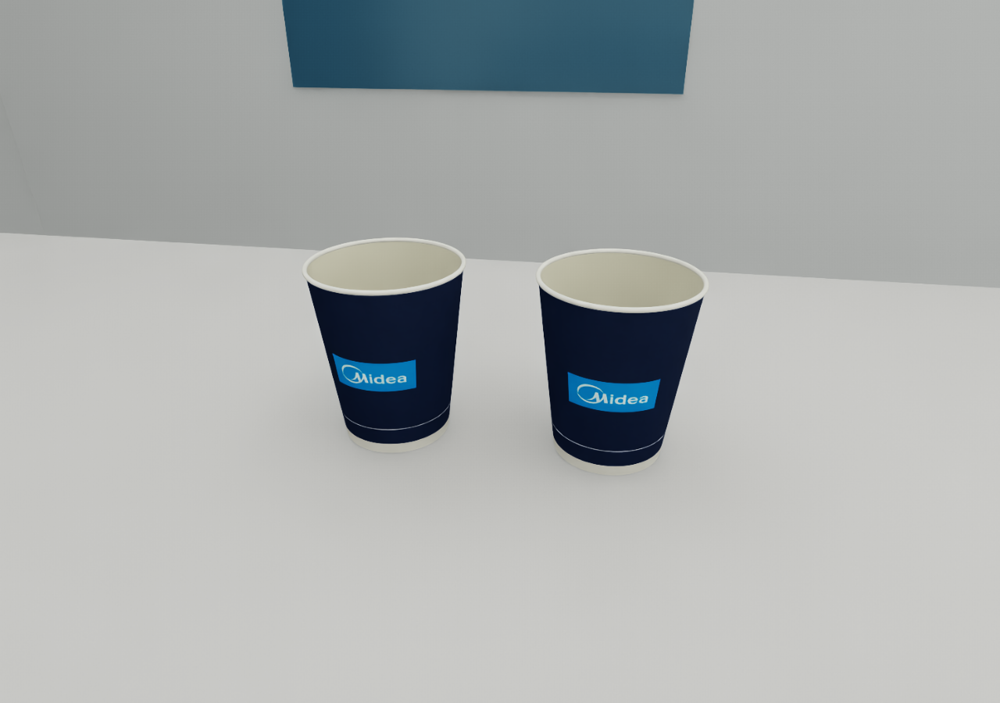
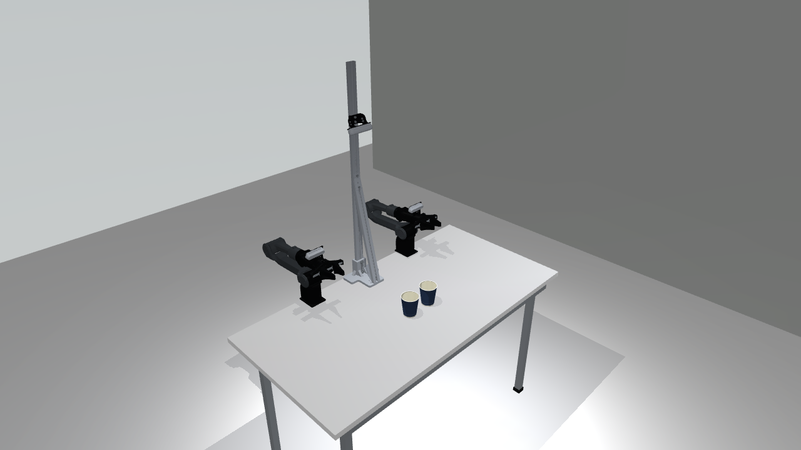

# 随机纸杯场景

独立任务 `paper_cups`，支持 **MuJoCo 和 Isaac Lab**。默认两只纸杯，按种子随机改变桌面位置和朝向，
复用双臂 Piper、三台 RealSense、外部控制、状态读取、HDF5 录制和 LeRobot v2.1 导出接口。

下面是 **Isaac Lab 实际渲染**，使用额外的近景检查相机；生产采集仍使用原来的三台相机。
为便于观察外观，这张近景使用固定摆放。



## 启动

在仓库根目录执行：

```bash
bash scripts/run_mujoco.sh --config configs/paper_cups_workcell.yaml \
  --task-scene configs/tasks/paper_cups.yaml --seed 42 --interactive --enable_cameras
```

右侧 Control 面板控制双臂，夹爪仍为每臂一个整体开口目标，单位 m。更换 `--seed` 可得到新的摆放；
加 `--no-randomization` 使用近景图中的固定布局。图像采集配置是 640×480，保留原 CAD 外参与现有标称内参。

外部程序控制时使用 API 模式：

```bash
bash scripts/run_mujoco.sh --config configs/paper_cups_workcell.yaml \
  --task-scene configs/tasks/paper_cups.yaml --seed 42 --enable_cameras --api-port 8765
```

Isaac Lab 使用同一份配置：

```bash
bash scripts/run.sh --config configs/paper_cups_workcell.yaml \
  --task-scene configs/tasks/paper_cups.yaml --seed 42 --enable_cameras --api-port 8765
```

后台运行加 `--headless`。原生 MuJoCo `--interactive` 模式由 GUI 控制关节，其 HTTP 指令入口只读。

## 尺寸、随机化与外观

纸杯依据用户提供的两张照片重建，**照片没有标尺，以下是估算参数**，不是实测标定结果。
原双臂、相机、支架和桌面继续采用原 CAD 尺寸和安装坐标。

| 参数 | 默认值 | 配置字段 |
|---|---:|---|
| 数量 | 2，只允许整数 1–12 | `cup.count` |
| 高度 | 95 mm | `cup.height_m` |
| 杯口外径，含卷边 | 80 mm | `cup.top_diameter_m` |
| 杯底外径 | 56 mm | `cup.bottom_diameter_m` |
| 壁厚 / 卷边半径 | 0.6 / 1.2 mm | `cup.wall_m` / `cup.rim_radius_m` |
| 内底相对最低点高度 | 5 mm | `cup.floor_height_m` |
| 空杯质量 / 摩擦系数 | 8 g / 0.60 | `cup.mass_kg` / `contact.friction` |
| 杯中心 x 范围 | 0.22–0.51 m | `randomization.center_bounds_xy_m` |
| 杯中心 y 范围 | −0.26–0.26 m | 同上 |
| 绕竖直轴旋转 | −180°–180° | `randomization.yaw_degrees` |
| 杯外缘最小间距 | 35 mm | `randomization.min_gap_m` |

修改 [`configs/tasks/paper_cups.yaml`](../configs/tasks/paper_cups.yaml) 后重启场景即可改变数量、尺寸、范围和光照。
运行中的 `reset(seed=..., randomize=True)` 只重置位姿，不改变物体数量或几何。相同配置和种子产生相同初始布局。
采样会拒绝杯子重叠、越过桌边或占用基座/立柱区域的布局；数量过多或范围过小时会报错，不会悄悄少放杯子。

外观包含锥形杯身、奶白色内壁、真实卷边、凹入杯底、白色底脚、背面粘合缝，以及蓝色 Midea 印刷纹理。
室内环境补充桌腿、铝制支撑、橡胶脚、墙面和蓝色墙板；更低的地面和分布式顶灯改善整体尺度感和阴影。
这些新增环境尺寸按外观估算。桌面材质和室内照明只作用于此任务。



材质在 [`materials.json`](../assets/tasks/paper_cups/materials.json) 中独立配置。Isaac 使用 USD 材质和面光源，
MuJoCo 使用其原生材质与阴影近似，近景仍可能有薄壁阴影锯齿；两个引擎不保证相同颜色或逐像素一致。
相关参数见 [MuJoCo 官方渲染参数](https://mujoco.readthedocs.io/en/3.3.7/XMLreference.html#visual)。

杯身 [cup_print.png](../assets/tasks/paper_cups/cup_print.png) 由 **built-in image_gen** 参考照片生成，
完整提示词和来源记录在 [texture_provenance.json](../assets/tasks/paper_cups/texture_provenance.json)。
该纹理是外观近似，并非官方印刷稿或实测反照率。运行时无需图像生成服务或原始照片。

## 空心碰撞与当前边界

每只杯子具有独立自由刚体：32 段杯壁碰撞、32 段卷边碰撞和一个杯底圆柱碰撞。
杯口保持开放，没有使用跨越整个杯口的凸包。MuJoCo 中直径 8 mm 的小球能自由落入并停在内底。
杯壁和杯底使用较硬的接触参数，避免薄结构被默认软接触穿透。

当前模拟的是**空的刚性纸杯**，不包含液体、挤压变形、纸张折叠或质量/摩擦的实测拟合。
本次没有定义抓取、叠杯或分类目标，也没有把场景验收当作抓取策略成功。
`metrics.summary.success_defined` 为 `false`，每只杯子可读取 `upright`、`tilt_degrees`、`on_table`、`lift_height_m`。

## 外部读取、控制与录制

同步 Python 示例（调用方负责步进，14 维控制量为左臂 6 关节+夹爪、右臂 6 关节+夹爪，使用 rad/m）：

```python
from piper_sim.simulation import SimulationSession

with SimulationSession.mujoco(
    config="configs/paper_cups_workcell.yaml",
    task_scene="configs/tasks/paper_cups.yaml", cameras=True,
    record_dir="outputs/paper_cups_episodes",
) as sim:
    obs = sim.reset(seed=42, randomize=True)
    print(obs.position)                    # 14 维机械臂/夹爪实测状态
    print(obs.extras["objects"])           # cup_00、cup_01 的世界位姿
    print(obs.extras["task"]["metrics"])  # 直立、倾角、在桌面等指标
    print(obs.images.keys())               # overhead、left_wrist、right_wrist
    sim.start_recording("cups_001", task="Observe randomly placed paper cups")
    target = obs.position.copy()
    for _ in range(60):
        obs = sim.step(target)             # 此处可替换为外部控制器的关节目标
    result = sim.stop_recording(success=False)
    print(result["path"])
```

已有 `SimulationClient` 和 `AgilexAdapter` 也可直接使用新场景。
HTTP 的 `/state`、`/observation.npz`、三路 RGB、`/reset`、录制接口均保持原协议。
`AgilexAdapter` 延续真机示例的度/归一化夹爪接口；不要与上述 rad/m 接口混用。
详见 [外部控制与数据接口](external_api.md)。

HDF5 记录状态、动作、三路图像、相机参数、杯子位姿与指标；元数据记录种子、任务配置和材质。
采集结束后可选转换：

```bash
PYTHONPATH=src .venv-mujoco/bin/python scripts/export_lerobot.py \
  --input outputs/paper_cups_episodes/cups_001.h5 \
  --output outputs/lerobot_v2/cups_001 --image-size 640 480
```

导出沿用项目的 14 维、角度/归一化夹爪契约。详见 [LeRobot 格式说明](lerobot_export.md)。

## 验收与模块边界

[`verify_paper_cups.py`](../scripts/verify_paper_cups.py) 检查 1000 个种子的可复现布局和间距，
在每个引擎中对 3 个种子运行落桌稳定性检查，并采集三路 RGB、5 帧 HDF5。
小球落入空心杯的动态夹具只在 MuJoCo 中运行，Isaac 报告明确标记为未执行。
已另行通过 5 帧、3 路视频的 LeRobot v2.1 导出和视频解码验证。

```bash
PYTHONPATH=src MUJOCO_GL=egl .venv-mujoco/bin/python scripts/verify_paper_cups.py \
  --headless --enable_cameras --output outputs/my_cups_check_mujoco
PYTHONPATH=src .venv-isaac/bin/python scripts/verify_paper_cups.py \
  --backend isaac --headless --enable_cameras --output outputs/my_cups_check_isaac
```

每次使用新的输出目录。验收记录：
[MuJoCo](../outputs/paper_cups_scene/mujoco/report.json)、
[Isaac Lab](../outputs/paper_cups_scene/isaac/report.json)、
[LeRobot 导出](../outputs/paper_cups_scene/lerobot_export.json)。

`paper_cups.py` 管理配置、随机布局和指标；`paper_cup_meshes.py` 管理米制几何；
`indoor_lab.py` 管理可选室内外观；`rigid_scene_mujoco.py` / `rigid_scene_isaac.py` 负责通用引擎适配。
清桌场景也复用这些通用适配器，原模块名保留兼容包装。纸杯模块不导入清桌任务或插接任务。
机器人、相机标定、真机驱动、记录器和导出器没有增加纸杯专用分支。
