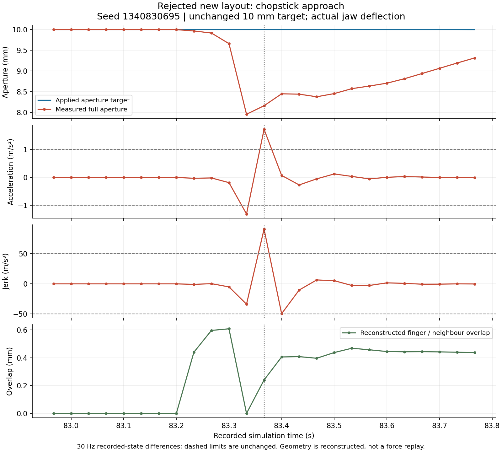
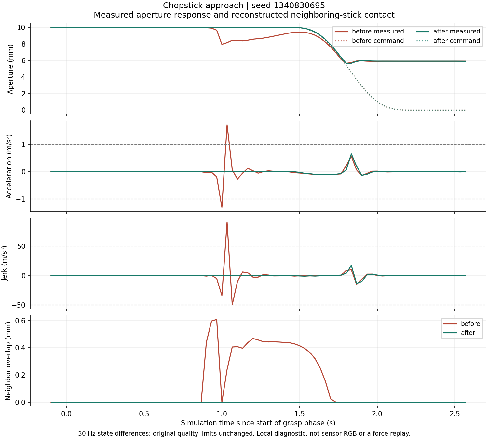
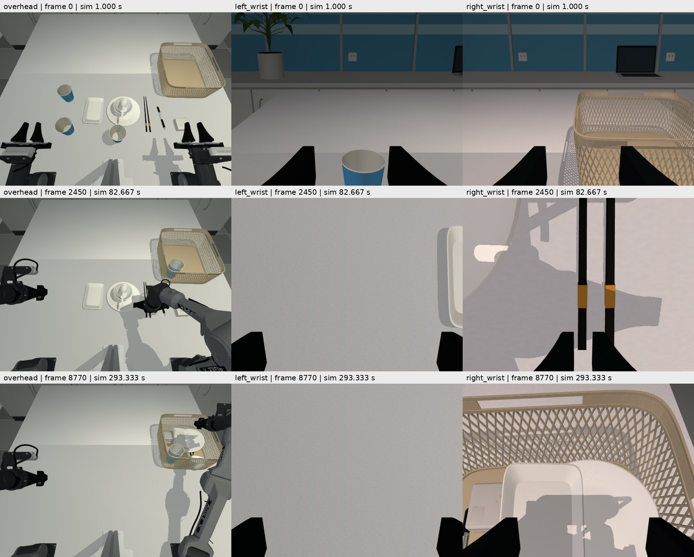
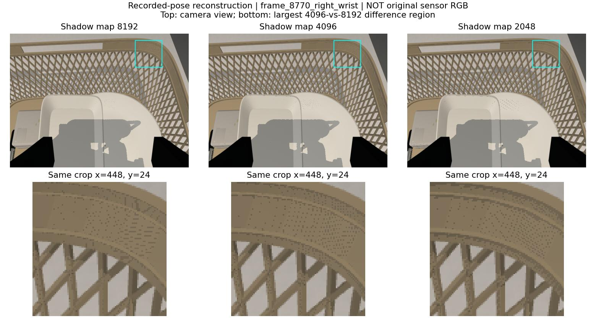
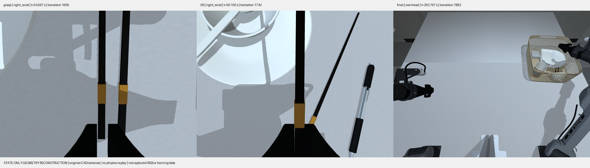

# VLA 数据生产平台审计（进行中）

目标是物理可信、可复现、高吞吐的合格数据生产，不以单个成功视频作为完成证据。
本审计从 `798d398` 开始。原有 PPO 工作不属于本次修改；所有真机接口仅做代码/记录审查，不连接 CAN。
用户目标正文在第七部分第 10 项“失败、成功、未验证、”处截断，已请求补充；已完整收到的要求全部保留。

## 验收证据清单

下表是工作清单，不是完成声明。每项只有取得对应当前版本证据后才可关闭。

| 范围 | 必需证据 | 当前状态 |
|---|---|---|
| 代码/历史基线 | 源码版本、dirty 状态、依赖/硬件、历史报告和当前复测分开 | 起始提交、各回合源码哈希、第三轮成功和失败结果均保留 |
| 六项历史现象 | Isaac 输出分辨率墙钟 FPS；种子 1/7/43 运动及碰撞复测；完整时间；加速版独立审计；标定来源 | 已复测；1/7 完整 RGB 通过，43 状态通过；仍有其他拒收布局，硬件标定缺失 |
| 关节动力学 | URDF/CAD 质量惯量/限位/驱动与两引擎实际参数对照，来源与未辨识范围 | MuJoCo 编译参数和 URDF 对照已保存；总驱动力与实机响应未辨识 |
| 抓取/接触 | 实际接触力/滑移/释放/非物理状态修改检查，双臂和自碰撞 | 固定指垫材料配合紧间距候选已通过四个已知完整状态回合；960 Hz 追踪确认释放回弹，高处投放和真实接触支撑仍需改进；不得以 30 Hz 通过代替原生接触诊断 |
| 运动约束 | 目标与实测关节速度/加速度/jerk，TCP 速度，保持/释放阶段、随机种子回归 | TCP 六例中一例邻筷接触导致抖动拒收；可选正间距规划修正后，原失败例及两个已知回归均完整状态通过；同候选的一条完整三路 RGB 也通过独立审核，未标定为硬件能力 |
| 引擎一致性 | 相同姿态几何/相机/关节开口；物体落体/接触的可解释差异 | 腕相机 FK、相同初始落体已测；碰撞响应不同，不能视为动力学等价 |
| 相机/尺寸 | CAD 保持不变；三路 K/外参/模式/畸变/腕部更新；同姿态实虚误差报告 | CAD 未变；已有完整 RGB 的全帧 FK 已核对，本轮新增 8,772 姿态；真实内外参/畸变待标定 |
| 视觉域 | 材质/灯光/曝光/噪声/遮挡随随机种子变化；成像开销 | 500 个重置候选统计与后处理基准已完成；未认证真实感/覆盖全部现实条件 |
| 时序 | obs_t、施加目标、obs_t+1、仿真/主机/图像时钟，全部帧连续性 | v9 六条配对 RGB 全帧审计通过；子步参考与外部动作语义明确；时间跳变、缓存隔离负例已覆盖 |
| 数据存储 | 无损压缩、完整/失败隔离、共享帧一致性、崩溃恢复、磁盘限制 | 共享无损 RGB 与可选遥测压缩已验证；修复跨回合/过期报告误发布，新增输入指纹、文件锁和原子审计发布；故障注入及真实文件复审通过 |
| 性能 | 物理/IK/碰撞/渲染/读回/写入/审核/导出分阶段；资源占用；合格回合/小时 | v9 同种子完整配对达到 2.128×（2.149→4.573 合格回合/小时）；仅该队列，不能转用于新控制器 |
| 批处理 | 预检重复成本、进程启动/资产加载、恢复调度、并行可行性、失败保留 | 独立并行入口、两个真实状态 worker 与恢复验证通过；汇总 RGB 导出需扩大验证 |
| 专家策略 | 停顿/绕路/任务顺序/双臂并行、抓取规划与错误恢复、独立质量审核 | 既有正间距候选有完整 RGB 验证；固定材料/紧间距有四例完整状态验证；盘低位放置单例 11/11，但原生 jerk 和撤离接触未改善，未替换默认；更大留出集及双臂并行待验证 |
| VLA 语义 | 单位/顺序/夹爪映射/语言匹配，非特权训练字段与独立额外状态 | 严格官方消费者已查历史 v9 与本轮 TCP 导出；本轮新增 8,771 数值行、全部 26,313 编码帧和严格 HDF5 读取验证；未做训练收益实验 |
| 数据泄漏/多样性 | 稳定场景族拆分、重复轨迹/跨 split 检查、随机化覆盖和接受偏差 | 重置分布和录制近重复检索工具已建立；合格跨 split 样本量仍不足 |
| 正式验收 | 同条件基准、完整物理 RGB 回合、多种子且含未调参种子、LeRobot 读取和失败注入 | 未完成 |

## 起始观察

- `EpisodeWriter` 当前为每个 transition 分别写 obs/next_obs 图像，每步 flush。
  相邻帧虽在 MuJoCo 渲染层缓存，写盘仍重复；已有离线 compaction，不能节省采集时压缩成本。
- 批采集默认为状态预检后重跑完整 RGB 专家。当前不记录各阶段墙钟时间，也无断点恢复。
- Isaac 的 `step()` 即使无采集相机也调用 render；`read()` 每次重新 GPU→CPU 拷贝。
  这是候选瓶颈，尚未在本轮实测，不能直接下性能结论。
- 质量审核检查全部 transition 和图像，但接触/穿透量来自记录的教师遥测；质量阈值从 HDF5
  内嵌配置读取。后续必须区分“按记录声明阈值通过”和“按生产验收策略通过”。
- LeRobot 普通字段为图像、状态、动作及索引/时钟；物体真值和教师信息在 extras sidecar。
  导出器单位是 degree/归一化夹爪，不是 HDF5 的 rad/m，需要训练入口确认。
- 起始磁盘只剩约 8 GiB；先使用短诊断和已有数据，不删除任何源数据或旧基线。

证据存放在 `outputs/platform_audit_v1/`。短诊断、状态回合、RGB 训练回合需明确分开标记。
任何吞吐改进都必须保持原时间步、全部样本、像素和质量阈值；无实测即标记待验证。

## 第一轮证据与改进

### 当前版本复测

- `baseline_seed0/`：同样的随机化种子 0，物理模式 10/10 入篮，226.0667 秒，
  6,782 transitions；状态审核通过。动作/状态轨迹哈希和物体运动哈希均与上一轮
  `natural_motion_v3/rgb_seed_0` 一致。此回合没有 RGB，不能作为训练回合接受。
- `baseline_cprofile.json`：带 cProfile 的整回合约 389.9 秒，物理积分累计 250.5 秒；
  `robot_penetration` 累计 46.4 秒，任务 metrics 累计 23.2 秒。这些是包含 profiler
  开销的定位数据，不是未插桩的产线吞吐。规划、两次观测和教师检查有重复读取成本。
- `alignment/alignment_measurements.json`：原数字标注同姿态重投影诊断最大垂直残差
  67.1003 px；无拟合、无标定、CAD 未改变。它是有人工关联不确定度的诊断，不是标定板
  RMSE，也不是本轮实机采集得到的新内外参。

### 在线共享 RGB

`EpisodeWriter(image_storage="shared")` 只存 N 张 obs 图像和一张终止图像。
`next_observation/images` 使用同文件 HDF5 virtual dataset 映射到下一张，所有原公开字段、
shape、像素、时间戳都保留。每次共享前要求与上一 transition 的 next_obs 像素、采集时间
完全相同；缓存拥有独立副本，避免调用者复用缓冲区悄悄改写。中断/错误只留下 `.partial`。
验证错误即使被调用者捕获，也不能把截短回合发布为完整文件。

源像素：`outputs/natural_motion_v3/rgb_seed_0/episode.h5` 第 2400–2459 帧，三路
640×480，实际状态/动作/时间戳。三个重复、轮换顺序，每轮重新打开生成文件并检查全部图像。
临时诊断复制品在检查后删除，只保留 `writer_benchmark.json`；没有更改原数据。

| 写入方式 | 中位写入秒数 | 文件字节 | 写入倍率（对第一行） |
|---|---:|---:|---:|
| 两份 RGB，GZIP1，每步 flush | 2.980 | 163,045,130 | 1.00 |
| 共享 RGB，GZIP1，每步 flush | 1.642 | 83,262,865 | 1.81 |
| 共享 RGB，GZIP1，每 30 步 flush | 1.634 | 83,262,865 | 1.82 |
| 共享 RGB，LZF，每 30 步 flush | 1.002 | 112,418,421 | 2.97 |

所有方式的三路 RGB、动作/状态哈希相同；GZIP 共享格式的审核时间也从 1.104 秒降为
约 0.615 秒。结果只是无损写盘微基准，包含 close/flush，不包含仿真、规划、渲染或 fsync；
不能换算成整条产线已达 2 倍。flush 频率收益很小，优先保留每步 flush。
实际 RGB 回合接口验证后，默认采集已切换为共享 GZIP、仍每步 flush。
外部 `EpisodeWriter` / `SimulationSession` 的默认参数保留原布局；可显式选择共享模式。

实际物理抓笔对照 `rgb_pipeline_comparison.json`：553 transitions、18.4333 秒仿真，
每路原生 640×480/30 Hz，原布局 126.97 秒墙钟、共享布局 114.31 秒（约 1.11 倍）。
文件 1,492,591,995 → 750,717,757 字节；写盘本身约 1.83 倍。
这是单次顺序对照、单物体诊断，整桌任务未执行，两个文件均明确 `training_ready=false`。
两份数据所有 transition 均通过完整性审核，动作/状态哈希、每帧物体和相机位姿完全一致。

两次独立渲染的 RGB 未达到逐位相同：对每路 554 张唯一图像的全部像素比较，左腕 132、
中央 5,301、右腕 15,029 个通道值不同（各路共 510,566,400 个值），最大差 1/2/2。
原输入重复执行传感器后处理 12 次逐位相同，跨进程图像差异的具体来源尚未定位；
`rgb_all_frame_difference.json` 保留全部计数，不能宣称像素级跨进程确定性。
这与写入无损性分开：同一输入的所有 writer 微基准和回归测试都逐位一致，未丢帧或改时间。

复现（新输出文件）：

```bash
PYTHONPATH=src .venv-mujoco/bin/python scripts/benchmark_recording.py \
  --source outputs/natural_motion_v3/rgb_seed_0/episode.h5 \
  --output outputs/writer_benchmark_new.json --start 2400 --frames 60 --repeats 3

PYTHONPATH=src MUJOCO_GL=egl .venv-mujoco/bin/python scripts/profile_collection.py \
  --profile-output outputs/profile_new.json \
  --record --rgb --seed 0 --domain-randomization configs/domain_randomization/clean_table.yaml \
  --output outputs/profile_episode_new
```

插桩按物理积分、forward、IK、规划碰撞检查、渲染场景更新、渲染/读回、RGB 压缩写入、
元数据、flush、审核、checksum 和导出分别统计。inclusive 时间存在嵌套，不可求和；
exclusive 才可求和。未调用的阶段不声称为零成本。GPU 样本是整卡（包含其他应用），
尚未等价于本进程显存峰值或无竞争 GPU 基准。

### 独立生产验收策略

`configs/collection/quality_policy.yaml` 固定当前生产阈值，数值没有放宽。新版审核
`piper.collection.v3` 从独立文件加载策略，HDF5 中的教师阈值只作为溯源记录。
审核结果保存策略文件 SHA256。训练导出必须核对当前策略、源文件 checksum，以及内嵌/外置
审核报告一致性。旧 v2 审核需用明确策略重新检查后方能新导出；原始历史文件保持不变。

默认只读复核：

```bash
PYTHONPATH=src .venv-mujoco/bin/python scripts/audit_collected_episode.py EPISODE.h5 \
  --output NEW_AUDIT.json
```

要更新某个待发布 HDF5 的 acceptance，可显式加 `--update-acceptance`，并把新 sidecar
放在该 HDF5 同目录。这会改变文件 checksum；历史不可变基线不要执行该选项。
`--policy FILE` 由操作者选择，不能由记录中的路径指定。训练导出也支持相同 `--policy`。

剩余工作包括：完整任务的共享 RGB 回合和完整导出验证、Isaac 新基准、种子 7/43 复测、接触力与
自碰撞证据、策略/规划修复、调度恢复和并行、多样性/泄漏统计、同条件合格回合/小时对照。
整个审计目标仍未完成。

### 当前问题复现与参数来源

种子 1 已重跑完整物理回合：11/11 入篮，但小碟释放时右夹爪加速度
1.0461066 m/s² > 1.0，按原门限拒收。`seed1_profile.json` 记录墙钟 511.19 秒，
其中积分 384.23 秒、规划碰撞检查 21.07 秒、IK 5.79 秒、状态写入 19.83 秒。
期间存在独立的只读审核和测试进程；这个定位结果不是无竞争性能认证。
进程 RSS 峰值约 2.29 GB，GPU 显存数值包含无关应用，不归因于状态采集器。

当前旧 RGB 完整回合经 v3 独立策略只读重新审核仍通过（`existing_rgb_policy_v3.json`），
未改写原 HDF5、旧 sidecar 或旧验收哈希。

`physics_model.json` 从当前编译模型读取：30 Hz 控制、120 Hz 对外物理 tick、960 Hz 内部
积分，每个 action 32 子步，732 个 geom；机器人质量和主惯量与源 URDF 一致。
这不能证明实机动力学正确：相机/支架质量未辨识，URDF 六轴 velocity=10 rad/s 未实测，
MuJoCo 阻尼/armature、接触摩擦与夹爪控制参数是仿真假设。教师使用 `qfrc_applied`
施加偏置补偿，因此 actuator 的 forcerange 不能单独充当总关节驱动力上限。

## 第二轮：存储解除限制后的验证（进行中）

用户清理后，本轮开始时输出盘可用约 48 GB，已启动完整共享 RGB 回合及 LeRobot 导出验证。
`full_shared_seed0` 保留第一轮提交 `9be3d79` 的运动实现，用于检验存储；后续接触/释放改进
在独立状态回归中验证，不能混称为同一版完整 RGB 验收。

### 释放尖峰与自碰撞

种子 1 的小碟释放时，目标仍由 0 向外追赶，实际开口约 6.8 mm；接触消失时产生加速度尖峰。
候选策略先执行短距离平滑卸载，再张开至释放宽度。无物体锁定、位置赋值或门限放宽。

| 同种子完整状态回合 | 原实现 | 卸载候选 |
|---|---:|---:|
| 任务 | 11/11 | 11/11 |
| 记录仿真时长 | 255.1667 s | 258.6333 s |
| 最大实测夹爪加速度 | 1.0461066 m/s² | 0.8995333 m/s² |
| 独立运动门限 | 1.0 m/s² | 1.0 m/s² |
| 闭文件状态验收 | 拒收 | 通过 |
| RGB 训练验收 | 未做 | 未做 |

`release_seed1_comparison.json` 和 `failed_seed1_motion_v3.json` 使用同一独立策略重新计算。
失败文件的总审计会提前拒收；独立运动诊断仍可分析失败轨迹，但不会给它训练许可。
`audit_collection_motion.py` 现在也从独立策略读取门限，优先使用真实记录的 holding 标志。

`geometry_seed0.json` 对 6,783 个记录状态逐帧重建几何，没有发现当前模型报告的同臂或互臂
穿透；最大非目标接触为指尖/桌面约 0.528 mm。此检查保留模型相邻体排除与凸包近似，
不能观察 30 Hz 帧间碰撞。旧记录只有总开口，重建时两指各分一半，不是完整动力学复现。
基于这个检查，在线和规划碰撞门限已覆盖非相邻同臂接触，并加入相应反例测试；没有提高
4 mm 拒绝门限。拓扑索引使用弱引用缓存、接触过滤使用数组，减少重复 Python 名字查询。

新教师记录在特权 extras 内保存 8 个原生关节位置/速度、执行器力、外加力、约束力、
两指法向接触力、TCP 位姿/速度。它们是 30 Hz 求解器采样，不是子步极值或实机标定。
普通 VLA Parquet 列仍只使用公开图像、状态、动作及索引/时间字段。
种子 7/43/0/42 的新回归已完成：0、42 通过闭文件状态审计；7 在抓盘前因桌面约 4.01 mm
阻挡拒绝执行，43 在下一根筷子接近阶段因篮筐/右 link6 约 9.98 mm 阻挡拒绝执行。这两个
问题尚未修复；四个回合都不是 RGB 训练验收，不能用种子 1 的改善代替跨布局成功率。

### 可恢复批采集与性能边界

新批次记录 `run.json` 和逐任务 `jobs/*.json`。`--resume` 验证代码、配置、实际资产、依赖
版本及已通过数据的验收策略/校验和；文件或策略变化时要求另建批次。进程锁防止同时恢复。
中断尝试的原文件保留，新尝试使用 `_attempt_002` 等目录；已完成成功/失败不自动重跑。
完成但缺少审计的尝试进入 `unverified.jsonl`，与明确拒收、状态诊断和训练接受分开。
清单原子发布；恢复测试覆盖中断、证据损坏、配置变化及并发锁。旧批次没有 journal，不能
直接用此选项恢复。若导出完成后尚未来得及写 checkpoint 就中断，恢复会拒绝覆盖该导出，
需要独立校验或另设导出目录。

真实四回合批次完成后执行恢复：0.482 秒复用四个完成任务，没有新建重试目录；所有 HDF5
和 jobs 文件的 SHA256、大小及修改时间保持一致（`batch_resume.json`）。这是同一代码/
配置快照上的恢复证据；后续源码变化后，应按约定新建批次。

```bash
# 参数与首次启动保持一致；timeout 可以调整。
PYTHONPATH=src MUJOCO_GL=egl .venv-mujoco/bin/python scripts/collect_clean_table.py \
  --states-only --output outputs/platform_audit_v1/regression_contact_v2 \
  --seeds 7 43 0 42 --resume
```

每个结果记录预检/采集墙钟时间。summary 的 rate 仅按已完成阶段计时，明确排除中断尝试、
恢复检查与最终导出；它不是端到端吞吐认证。预检仍可用 `--skip-preflight` 显式关闭。

RGB 后处理的 gamma 改为 256 个值的 float32 查表，后续白平衡、噪声与最终取整保持原计算。
200 组 gamma、完整 uint8 值域探针逐位一致；含噪声/模糊的像素回归也通过。单独 gamma
步骤中位耗时约 3.82 → 1.39 ms；这是微基准，不能称为整回合 2.75 倍。
新 profiler 使用 `nvidia-smi pmon` 单独记录本进程（包括 EGL graphics）的显存，和整卡
使用量分开。没有采到该进程时保留空值，不报零占用。

### 完整 RGB 与官方 LeRobot 读取结果

`full_shared_seed0` 已完成 10/10 物体任务、6,782 transitions、226.0667 秒记录，
三路均为 640×480/30 Hz。闭文件 v3 审计和训练导出均通过；动作/状态哈希与旧基线一致。
HDF5 从 18,219,534,877 减为 9,147,511,695 字节；完整 LeRobot 导出约 115 MB。
这个回合检验第一轮存储改进，没有采用后续卸载策略或新增力证据。

完整进程墙钟 1,822.09 秒，包含仿真、审核和导出：物理积分累计 254.02 秒、渲染/读回
453.69 秒、成像后处理 350.11 秒、recording append 188.46 秒、审核 80.08 秒、导出
399.50 秒。阶段有嵌套，不能直接求和。单次观测相当于约 1.98 条合格回合/小时、每十进制
GB HDF5 约 741 条 transition；同机存在其他审计/测试负载，不能当作稳定产能或 2 倍提升。

使用独立环境中的官方 `lerobot==0.3.3`、`datasets==3.6.0`、PyAV 读取完整 v2.1 导出，
未修改用户现有环境。实际检查首帧、中间帧、倒数第二帧、末帧：三路 RGB tensor、14 维
state、16×14 action chunk、任务语言、30 Hz 时间索引，以及末尾 action padding 均符合
读取器约定。关节角从弧度转为度、总开口除以 0.095 m 后与 HDF5 相符；特权物理信息未进入
普通训练行。H.264 为有损视频，报告保留抽样像素误差，不宣称与原始 RGB 逐位一致。
证据为 `lerobot_official_reader.json`，复现脚本为 `scripts/check_lerobot_reader.py`。

### 当前两引擎三路相机基准

相同配置、每轮 180 transitions、3 次重复、三路 640×480/30 Hz、共享 GZIP、headless，
用小幅关节运动检查腕相机更新和记录。它不是收桌任务成功率测试。当前墙钟帧率中位数为
MuJoCo **6.147**、Isaac **5.310**；不是仿真时间轴的 30 Hz。Isaac 保留默认 RTX/DLSS，
640×480 是输出分辨率，内部渲染可能使用较小分辨率，不能称为每条光线原生 640×480。

Isaac 的 1,270 次 observation read 重复执行了 1,270 次成像后处理（累计 57.77 秒），
MuJoCo 已按状态复用，只有 634 次（28.30 秒）。这是下一步可验证的重复计算优化点。
Isaac 本进程 RSS 采样峰值约 7.88 GB、pmon 显存峰值 6,335 MB；整卡另有其他应用占用。
结果与限制见 `backend_native_comparison.json`，复现脚本为 `scripts/benchmark_backend.py`。

### 同时刻图像复用与导出统计

Isaac 现在按实际 camera capture revision 和控制帧缓存 CPU 图像/相机位姿。每次 read
先触发 Isaac Lab 的懒更新，再判断是否复用；reset 清空缓存，静态对齐工具强制采图也会
增加 revision。返回值拥有独立副本，修改某次返回的图像不会污染下一次观测。控制状态、
时钟及物体信息每次正常读取，不复用旧状态。

同进程、交替顺序、各三轮 180 帧对照：未缓存 **5.5524**、缓存 **7.6349** 墙钟帧/秒，
中位数比 **1.375**。各轮完整流审计通过；同一捕获的缓存/重新处理图像逐位一致，强制新
捕获可使缓存失效。六个诊断文件全部 181 个状态的腕相机位置与 URDF FK 对比，最大误差
约 0.292 μm（仅仿真数值一致性，不是实机标定精度）。保留 `isaac_cache_comparison.json`
和 `paired_camera_fk.json`；没有把该微任务收益称为整桌生产收益。

LeRobot 视频导出的 RGB 统计改为每通道 256 个整数计数，避免每帧生成 float64 全图并重复
求和/极值。最后计算均值及中心方差；编码输入、尺寸、帧率及 H.264 参数不变。24 张预加载
真实仿真图像、三次交替重复的统计步骤约快 **14.7 倍**，与旧统计最大数值差约 2.39e-12；
常量、二值和完整灰度级的解析统计测试通过。对 6,782 帧完整回合重新导出，耗时为
120.73 秒，先前导出为 399.50 秒（单次观测约 3.31 倍，负载/文件缓存条件不同）。三路
MP4、Parquet、extras 与原导出 SHA256 完全相同；全部统计最大差 7.61e-12。
`export_histogram_comparison.json` 保留证据。这是导出阶段收益，不是整条产线 3.31 倍。

### 随机化覆盖边界

默认配置采样种子 0–499：500 个不同有效布局，255 个两杯、245 个三杯；三种桌面材质
计数为白 161、灰 192、木 147，四种杯身颜色均出现。train 406、validation 94，未发现
完全相同布局跨 split。统计在去掉 seed 和非活动物体后计算，不靠种子字段制造唯一性。
完整位置、质量/摩擦、曝光/白平衡/噪声/模糊等范围见 `scene_diversity_500.json`。

这些只是重置候选布局，未跑物理任务，不能充当 500 次成功采集。两侧仍共享物体网格、语言
模板和随机范围，当前 split 只测试同分布布局泛化；不代表未见物体、任务或环境泛化，也
尚未做已录制图像/轨迹的近重复检索。CAD 尺寸、相机标定、重力和时序按要求保持固定。

第二轮最终非 PPO 全量回归 **189 passed in 87.78 s**，含缓存隔离与 RGB 统计新增测试。
更多随机种子、策略/路径修复、更新策略后的完整 RGB 验收、并行调度及端到端 2 倍目标
仍未完成；不把状态诊断算作合格 RGB 训练数据。

## 第三轮：完整录制、抓取路径和接触诊断（进行中）

### 种子 1 的完整 RGB 验收

`full_unload_seed1` 使用第二轮 `e06ec0a` 的释放卸载策略，已完成 11/11 物体、7,759 个
transition、258.6333 秒记录；三路 640×480/30 Hz 的闭文件 v3 审计通过，`training_ready=true`。
官方 LeRobot 0.3.3 读取器再次通过四个时间位置、16 步 action chunk 和末尾 padding 检查。
新增力证据留在 extras，没有加入视觉策略的普通训练列。

总墙钟 1,739.27 秒，包含采集、审核和导出；渲染/读回 564.76 秒、成像后处理 344.73 秒、
物理积分 391.64 秒、writer append 165.68 秒、审核 83.67 秒、导出 116.95 秒。
阶段存在嵌套。此时同机有状态回归和诊断任务，不能把与另一种子/负载的比值当同条件提速。
单次观察约 2.07 条合格回合/小时；本进程 RSS 采样峰值 2.89 GB、EGL 显存约 1,009 MB。

`full_seed0_camera_fk.json` 和 `full_seed1_camera_fk.json` 分别核对全部 6,783/7,760 个状态
（含终止状态），腕部外参跟随 URDF FK，位置数值误差均小于 0.3 μm；中央相机保持静止。
这仅验证程序坐标链一致，不是相机标定精度或真实视角对齐认证。

### 抓取候选和有界路径

只检查抓取点 IK 可达不足以保障完整接近路径。现在先在 scratch 数据上验证预抓取和连续
下降轨迹，再执行候选。盘子候选只改变夹持点/局部姿态，未改 CAD、物体位姿或碰撞门限。
种子 7 从原来的桌面碰撞推进到真实双指抓盘、抬升和入篮，但后续暴露两个独立问题：

1. 自然三次样条在合法 IK 节点之间越过关节 5 上界约 0.000208 rad。无载路径现在可尝试
   clamped B-spline；端点精确，内部 IK 点作为控制多边形、曲线位于其关节凸包内。不会逐值
   裁剪指令，仍检查完整曲线的碰撞和速度/加速度/jerk；载物路径不使用此备选。事件中记录
   `bounded_path_selected`，元数据明确内部点不再精确插值。
2. 盘子回撤解决后，筷子在搬运时擦到篮筐并滑脱。全帧末段几何诊断发现约 0.137 mm 的
   瞬时筷子/篮筐重叠。4 mm 的拒绝门限不能充当细物体搬运的安全余量。独立状态试验中，
   原路径再次滑脱；增加 1/3/6 mm 正间距后均完成搬运和下放。默认候选给筷子搬运增加
   6 mm 规划余量，使用 signed geom distance 检查未接触但过近的情况；验收门限未放宽。
   最初的 3 mm 候选在种子 2 仍滑脱；6 mm 候选通过原有中间姿态重新规划后，在独立搬运
   试验中保持双指接触，最大相对滑移约 1.96 mm。完整多种子复测仍在进行。

种子 43 的原篮筐碰撞可用倾斜姿态避开，但实测没有夹住筷子，因此该版本仍被拒收。
诊断发现倾斜指尖先碰桌面。刚体教师现在保持筷子夹爪直立，在实际长轴中央区域选择夹持点
（最多 ±40 mm，且不超过长度的四分之一）。该修复版本种子 43 已完成 11/11 并通过状态
审计；它还不是 RGB 训练回合，也不能替代新增搬运余量版本的复测。

所有失败回合保留：`grasp_candidates_v3`、`bounded_seed7`、`axis_seed7` 及 holdout 种子 2。
`diagnose_failed_paths.py` 只做几何规划；`diagnose_grasp_capture.py` 和
`diagnose_payload_clearance.py` 每次试验只恢复一次记录的初始状态，后续全程物理控制。
它们缺少历史物体速度和求解器 warm-start，因此是独立诊断，不能算历史逐位回放或训练验收。

### 两进程采集与引擎接触差异

`worker_feasibility/report.json` 对三路 640×480、共享 GZIP、每进程三轮 180 帧进行测量：
单进程端到端 4.210 transition/s；两个独立进程合计 6.846 transition/s，观察比值 **1.626**。
包含进程启动、warmup、close 和流审计，但只有简单关节运动，`success=false`，不算合格
任务回合。该对照每组只有一次，期间有完整 RGB 任务共享主机；该测量本身没有验证生产调度。

`drop_mujoco/report.json` 与 `drop_isaac/report.json` 在同一名义场景中，将同一 0.1 kg
充电头放在指定初始高度一次后自由落下，记录 91 个状态：

| 指标 | MuJoCo | Isaac / PhysX |
|---|---:|---:|
| 初始段拟合垂直加速度 | −9.810000 m/s² | −9.809992 m/s² |
| 内部物理步长 | 1/960 s | 1/120 s |
| 最终物体 root z | 24.932 mm | 25.000 mm |
| 最低采样 root z | 18.526 mm | 24.071 mm |
| 最后十个采样的最大线速度 | 约 0 | 0.000203 m/s |

root 高度不是网格穿透深度；该结果显示接触瞬态不同，不能只因最后停在相近位置就宣称
动力学一致。两个引擎的求解器、子步、contact offset/softness 和碰撞代理不同；还需实机
落体/摩擦/夹持响应辨识。没有用改重力、瞬移或教师吸附来让曲线一致。

### 已录制数据的重复检索

`audit_recorded_duplicates.py` 读取显式带 split 的 JSONL 清单，计算整条动作/状态哈希、
去掉 seed 的活动物体布局哈希，以及 129 个归一化轨迹采样和 9 个 RGB 缩略采样。
检索特征仅用于找候选，不改变记录、split、质量判定或导出像素。

`recorded_duplicates_v2.json` 比较旧种子 0、新共享存储种子 0、完整种子 1：准确找到前两者
相同布局和相同动作/状态轨迹。这是存储回归复制品，合并生产数据时应只保留一份。
三条都按原规则属于 train，因此这组结果没有实际 train/validation 对照，不能据此宣称
跨 split 无泄漏。背景相似、时间相位错位和未采到的局部变化仍可能影响近重复检索。

随后加入状态诊断种子 9（validation）的 `recorded_duplicates_with_validation.json`，未检出
它与上述 train 回合的完全相同布局或轨迹。种子 9 没有 RGB，跨 split 视觉相似度仍未测；
单个验证布局也不能代表验证集多样性。

### 接近开口与完整回归

3 mm 余量版本的种子 7 虽然完成 11/11，但夹爪实测加速度约 1.568 m/s²，仍按原门限拒收。
把闭合时间延长到两倍、三倍不能消除峰值：碰撞发生在张开夹爪下降阶段，指垫先碰到了旁边
的另一根筷子。局部物理对照把接近开口从 12 mm 改为 10 mm 后，仍完成双指抓取和抬升，
该段峰值降至约 0.367 m/s²。依据是 `seed7_closing_probe.json`、`seed7_aperture_probe.json`。

当前候选根据筷子实际横截面投影计算开口，再加 4 mm 接近间隙，名义 6 mm 筷子约为 10 mm。
物体滚动时使用新的截面姿态；不改变夹爪限位、驱动力、质量门限或记录频率。
`aperture_clearance_seeds7_43/episode_000000_seed_7` 完成 11/11，7,861 transitions、
262.0333 秒仿真；完整状态审计通过，最大实测夹爪加速度约 0.90251 m/s²（本次全回合峰值
发生在抓笔阶段）。它没有 RGB，`training_ready=false`；新版本完整 RGB 另行验证。

加入并行入口和收尾监测后的非 PPO 全量回归为 **207 passed in 85.88 s**。原来的失败、仅局部通过、完整
状态通过与完整 RGB 训练通过分别保留，不能相互替代。

同版本种子 43 也完成 11/11 并通过完整状态审计。种子 2 虽然解决了筷子搬运滑脱并完成
11/11，仍因实测机械臂 jerk 229.29 rad/s³ 超过 200 而拒收。原生关节逐帧几何复核在
178.10 s 发现右指尖/篮筐约 0.136 mm 接触，随后出现 jerk 峰值；发生在前一盘子放下后
转向小碟的路径，不是筷子搬运阶段。不能因碰撞深度低于 4 mm 就认定没有运动质量影响。

`seed2_approach_rise_probe.json` 恢复该转场起点后用正常控制器积分：原路径复现 jerk
229.29 和约 0.136 mm 接触；先竖直上撤 20/40 mm 的局部试验无采样接触，峰值分别约
11.81/14.43 rad/s³。它只验证接近到预抓取点，尚未集成成通用转场避障策略，也不是完整
回合通过。`scripts/diagnose_approach_clearance.py` 保留可复现实验入口。

种子 13 在当前默认放置目标下因筷子未完全留在篮内拒收（9/11）。只将两根筷子的篮内
放置目标沿篮筐局部 x 轴向机械臂方向移 30 mm，保持初始摆放、CAD、控制/物理参数和
门限不变后，`placement_goal_seed13` 完成 11/11，总仿真 263.5667 s（含 1 s 预热），闭文件状态审计通过。
可复现配置为 `placement_slot_candidate.yaml`；目前仍是候选，未替换默认目标、未做 RGB
或其他种子的完整验证。孤立释放试验中的原位置也曾成功，说明缺少速度/warm-start 的
局部恢复不能完全复现原失败；完整回合证据优先于局部试验。

### 尚未解决的接触建模限制

现有刚体教师会按当前对象切换夹爪力上限、控制增益，以及指垫的滚动摩擦、接触
softness 和求解器 noslip 次数。改变力上限/增益可对应控制策略，但同一指垫的材料属性随
任务对象类别切换，没有实测支持。当前域随机化改变物体摩擦，指垫参数则由教师设置，
两者共同决定有效接触响应，不能把物体的采样范围等同于最终接触系数范围。因此不能将
`physical` 模式解释为已辨识的实机接触模型。它仅表示运动由动力学和接触积分产生，
没有使用附着约束或逐帧设置物体姿态。

`contact_friction_mixing_v2.json` 用实际录制的双指抓笔姿态做了独立参数检查：物体滑动
摩擦从 0.52 / 0.65 / 0.78 改变时，所有恢复出的指垫/笔接触仍使用滑动摩擦 1.0，五维
接触摩擦向量保持 `[1, 1, .015, .002, .002]`。指垫 geom priority=1，物体为 0。
因此，现有“物体摩擦随机化”并未覆盖这个抓取接触对的有效摩擦。这是当前待修问题，
不能把 500 个重置中的摩擦采样统计当作 500 种真实夹持响应。复现工具为
`scripts/audit_contact_mixing.py`；只在 scratch 模型变化参数，不推进物理或修改原记录。

目前的质量通过是“满足当前仿真模型与独立数据策略”，不是现实成功率认证。后续需要
固定指垫材料参数、显式建模对象材料配对，并用真实夹持/摩擦试验辨识范围，再独立回归；
不能为了保留现有通过率而隐去这项限制。

### 运动节奏的量化边界

`cadence_full_episodes.json` 按原始 30 Hz 时间戳统计完整种子 0、1 和当前状态种子 7。
同时满足目标与实测各关节速度低于 0.02 rad/s、夹爪低于 0.002 m/s 的时段约占
19.70%、19.56%、19.90%；持续至少 250 ms 的段数为 69、74、73，最长约 2.33–2.53 s。
其中包含必要的抓取、释放、套叠稳定和轨迹端点减速，不等于全部可删等待时间。种子 1 的
接近/抬升/搬运分别约 55.3/53.0/40.6 s；它们是原事件标签下的阶段归属，不是独立 CPU 耗时。
这三个回合布局和版本不同，不能用时长差直接计算策略加速倍率。

当前已经按 30 Hz 控制/记录。增加采样频率本身只增加同一物理过程的样本数，不会缩短
视频对应的仿真时长；改变编码 fps 却不重采样只会使播放和动作时间失配，禁止用于训练提速。

### 并行调度与固定收尾等待的问题

`collect_parallel_clean_table.py` 使用独立 worker journal 和进程组，父进程复核结果后汇总，
支持分 split 统一 LeRobot 导出。真实 `parallel_scheduler_states` 同时执行种子 0/9：
9 通过状态审计，0 虽然 10/10 入篮，却因最后仅连续稳定 0.9 s（要求 1 s）拒收。
父进程正确保留两个结果，不将任务完成计作数据通过。

再次以原参数 `--resume` 耗时约 1.04 s，复用成功与失败结果，没有新增 attempt 目录。
两份 HDF5 和各 worker 的 jobs 文件 SHA256、大小、修改时间完全不变，证据为
`parallel_scheduler_resume.json`。父进程的汇总/调用记录会正常更新；恢复调用不报告生产速率。

种子 0 的三相机完整 v6 回合也因同一收尾问题拒收，不能计算为合格吞吐。固定等待 2 s
不保证最后 1 s 内角速度始终不超过 0.1 rad/s；该回合末段峰值为约 0.10123 rad/s。
新收尾逻辑保留原来 2 s 最短时长，按每个真实控制步观测物体位姿和成功状态，在必要时延长
至连续稳定满 1 s，最多等待 5 s。所有延长帧正常录制；超过时限仍失败。默认门限不变，
闭文件审核保持独立，不能追认旧 v6 失败文件为合格。

v7 已完成种子 0/7 的完整物理状态回归，两者都通过闭文件审核。种子 0 从 6,880 增至
6,930 transitions，真实增加 50 帧/1.6667 s，末尾连续稳定 1 s；它在额外等待中再次有
轻微转动，因此简单固定补 0.1 s 并不充分。种子 7 保持 7,861 transitions，不增加等待。
与 v6 RGB 回合逐帧比较，两者原有前缀的动作、观测/下一观测、仿真时间和全部物体位姿
完全相同；证据为 `final_stability_regression.json`。新种子 0 仅做状态验收，尚无 v7 RGB
训练回合；旧失败文件保持拒收。

### 完整两进程 RGB 结果

`qualified_parallel_v6/report.json` 同时运行种子 0/7，包含两个尝试、闭文件审计、合格回合的
LeRobot 导出与父进程复核，总墙钟 **1,969.60 s**。种子 0 因上述稳定时长不足拒收；种子 7
完成 11/11、7,861 transitions、262.0333 s 记录，三路 640×480/30 Hz，通过独立 v3 策略。
原始共享无损 HDF5 为 9,708,742,062 字节。官方 LeRobot 读取检查也通过，含三路图像、
16 步 action chunk、末尾 padding 和单位换算，见 `qualified_seed7_reader.json`。

该次观测为 **1.828 条合格回合/小时**，合格 transition 吞吐 3.991/s，所有尝试的原始
transition 吞吐 7.484/s。只计合格 HDF5 时约 810 个有效 transition/十进制 GB；把失败文件
也计入磁盘成本后约 413 个/GB。失败数据被保留，不用于训练。当前仍**没有建立至少 2 倍
有效吞吐量**；不能以原始帧吞吐替代合格产能。该批期间有状态回归/测试共享主机，且没有
相同种子、相同新版本的串行配对试验，不能据此给出准确并行加速比。

种子 7 的阶段 inclusive 时间约为渲染/读回 697.04 s、成像后处理 353.30 s、物理积分
405.37 s、写入 205.33 s、审核 95.64 s、导出 131.82 s；IK 4.99 s、规划碰撞检查 6.58 s。
存在嵌套，不能把这些数直接求和。单进程 RSS 采样峰值约 2.89 GB，独占可归因 EGL 显存
约 1,009 MB；整卡显存还含其他应用。渲染/读回和物理仍是主要成本，失败率则直接损失产能。

中央相机视频独立检查为 7,861 帧、30/1 fps、262.033333 s，没有播放加速；下图是其最后
一帧解码图。它证明可见任务结果，不是实机视角标定或训练收益认证。


## 2026-11-09 第四轮：按间距选择转场路径

空手转场增加了对目标容器的正间距检查：默认要求至少 2 mm，关节路径按最大
0.01 rad、夹爪开度按最大 1 mm 采样。直接路线不足时，先在 scratch 状态中检查
20/40/60 mm 竖直上撤及后续完整转场，保留中央途经点候选；只有两段均通过才执行。
原 4 mm 穿透拒绝、持物转运 6 mm 余量和独立审核门限均未修改。上撤起点允许靠近容器，
上撤段仍按原碰撞门限检查，正间距要求用于随后的空手转场。这是采样预测，不是连续
无碰撞证明，实际运动仍由物理积分并接受记录后审计。

`transit_clearance_states_v8` 的四个完整状态回合全部通过独立 v3 策略：

| 种子 | 入篮 | transitions | 记录时长 | 新增绕行 |
| --- | --- | ---: | ---: | --- |
| 0 | 10/10 | 6,930 | 231.0000 s | 无 |
| 2 | 11/11 | 7,748 | 258.2667 s | 小碟接近前上撤 20 mm |
| 7 | 11/11 | 7,861 | 262.0333 s | 无 |
| 43 | 11/11 | 7,550 | 251.6667 s | 无 |

种子 2 的原路径预测距篮筐仅 1.15 mm，因此选择上撤。相对原失败回合只增加
26 个真实控制步（0.8667 s），在线测得臂 jerk 峰值从 229.2874 降至 34.5817 rad/s³；
独立审核在存储 float32 状态上重算得到 34.5683，低于原门限 200。种子 0/7/43 的
动作/状态轨迹哈希和全部物体位姿哈希与之前对应回合完全相同，没有普遍增加绕行或等待。
证据见 `transit_clearance_regression_v8.json`。这些是开发回归种子，不是新的留出成功率；
状态回合也不自动成为 RGB 训练样本。

### 中断恢复实测与 SIGTERM 修复

该状态批次原父进程以 143 退出，信号来源未确定；当时一个 worker 及录制子进程仍在运行。
旧代码仅在 Python 异常／Ctrl-C 时执行清理，没有将 SIGTERM 转成可清理的退出。
等待所属 worker 完成后，用原代码与参数恢复汇总约耗时 1.84 s，四份 HDF5 及 worker
任务记录的 SHA256、大小和修改时间均未变化，见 `transit_v8_parent_recovery.json`。
原 `invocation_001.json` 保留中断时的 running 状态，恢复的 `invocation_002.json` 为完成；
不能把恢复耗时计作采集吞吐。

并行入口现已捕获 SIGTERM，先记录中断、清理所属进程组，再以 143 退出。对已异常退出
的 worker 组也执行清理，避免遗漏其录制后代；忽略 SIGTERM 的后代使用 SIGKILL 清理。
真实进程集成测试验证了中断日志、无接受结果、后代退出及无关进程继续运行。
SIGKILL／机器掉电仍无法运行清理程序，journal 与 partial 文件用于后续恢复，不宣称可捕获。

### 固定指垫材料的独立试验

新增 `diagnose_fixed_contact.py` 与 `probe_fixed_contact_rollout.py`，不更改默认教师。
候选取消按目标对象切换指垫材料：一次试验内固定滑动摩擦 1、扭转摩擦长度 15 mm、
滚动摩擦长度 2 mm、接触时间常数 10 ms 和同一组 impedance，再将三个摩擦分量统一
乘以 0.8/1.0/1.2。保留原来按对象设置电机力上限／增益的控制策略及负载时的求解器
迭代细化。这些材料数值未做真机辨识，候选与默认配置的证据分开保存。

`fixed_pad_material_probe_v1.json` 从历史接近起点恢复机器人位置/速度、物体位姿，之后
正常积分完成单件搬运。笔和盘子在三个倍率下均入篮且通过在线运动门限；小碟在 1.0/1.2
下完成，在 0.8 下失去双指接触、滑移约 29.5 mm 并触发夹爪加速度拒收。每一组实际
solver contact 的摩擦向量均正确反映设定倍率，例如 0.8 得到 `[.8, .8, .012, .0016, .0016]`。
这证明改变指垫参数确实覆盖了抓取接触，与仅改变低优先级物体 geom 摩擦的旧行为不同。
相关混合规则见 [MuJoCo 官方接触参数说明](https://mujoco.readthedocs.io/en/stable/modeling.html#contact-parameters)。

局部恢复没有原物体速度和 warm start，且之前已放物体的位置来自旧材料回合，因此不是
同参数从头运行的精确替代。固定材料 0.8 倍的种子 1 从初始化完整运行后反而完成 11/11、
8,028 transitions、267.6 s 记录，并通过独立状态审计：
`fixed_material_seed1_scale08/audit.json`。局部失败没有被删去，也没有用于宣称这个完整回合
失败。另一次局部试验只将固定滚动摩擦长度改成 8 mm，在 0.8 倍下小碟完成，但该设置尚未
经过完整回合验证，不能据此选择有利参数来宣称真实材料已辨识。

两个新入口都明确标记为诊断。完整候选仍使用既有 recorder 与独立审计，元数据保存
替换教师的源码 SHA256 和实际固定材料；仅状态输出不进入视觉训练接受清单。默认生产
配置暂不替换，仍需更多种子、倍率、有效接触统计和完整 RGB 验证后再决定。

固定材料 1.0 倍的种子 1 完整回合在 219.3667 s 发生小碟滑脱，8/11，拒收；
`fixed_material_seed1_scale10` 保留原始状态记录。`diagnose_contact_loss.py` 对失败前 20 帧
按原位姿重建几何接触，恢复原 multi-contact 开关，力只引用原 30 Hz 记录而不重算。
在该采样区间没有小碟与篮筐/其他物体的几何接触；失效前指垫/小碟穿透约
0.56–0.58 mm、每指记录法向力约 13 N、总开度约 1.53 mm。随后双指接触消失，开度
降到 0.10 mm，最后滑移达到 27.45 mm。证据为 `fixed_material_seed1_loss_geometry_v2.json`。
这些观察将问题缩小到薄边夹持的接触/姿态稳定性，但不足以在未辨识材料时断言唯一根因；
尤其不能单纯增加摩擦来把候选重新算作成功。

第三个固定材料完整状态试验为种子 43、1.2 倍摩擦：11/11、7,516 transitions、
250.5333 s 记录，通过独立审核。三个完整试验共两次通过、一次小碟滑脱拒收，布局和倍率
同时不同，不能据此估计总体成功率或推出摩擦越大越可靠。默认接触配置继续保持原样。

本轮代码回归为 **211 项非 PPO 测试通过，93.53 s**。其中新增实际 SIGTERM 进程树清理、
正间距查询与碰撞掩码变化、完整绕行预检和无必要绕行等测试；QVEL 警告仍来自既有故障注入。

### v8 完整三路 RGB 与合格产能

`qualified_parallel_v8` 同时采集种子 0/2，均完成物理任务、通过独立 v3 审核和 LeRobot
导出，父进程再次校验。总墙钟 **2,038.8273 s（约 33.98 分钟）**，计入两次尝试、审计、
导出与父进程复核，得到 **3.5314 条合格回合/小时、7.1992 个合格 transition/墙钟秒**。
这次基准不做状态预检，因此不含此前单独状态回归的成本；默认批采集若保留预检，产能应
连同预检重新计时。该批仍与状态诊断/测试及其他应用共享主机，不能与旧不同种子批次直接
计算加速比，也尚未证明至少 2 倍有效吞吐。

| 种子 | 完整入篮 | RGB transitions | 原速时长 | 共享无损 HDF5 |
| --- | --- | ---: | ---: | ---: |
| 0 | 10/10 | 6,930 | 231.0000 s | 9,396,547,268 B |
| 2 | 11/11 | 7,748 | 258.2667 s | 8,439,897,932 B |

三路均为 640×480/30 Hz。两个 RGB 回合的动作/状态轨迹哈希、物体位姿哈希与 v8 状态
预检分别完全相同。合计每十进制 GB 约 823 个有效 transition，包含 before/after 三相机
共享无损存储。LeRobot 官方本地读取器分别抽查初始、中间和末尾共四个位置，验证三相机、
16 步 action chunk、padding、单位及特权字段隔离；这部分兼容性检查在上述计时之后执行。
中央相机视频全帧解码数量与记录一致，另人工查看三个抽帧；这是抽查，不是逐帧人工复核。

种子 2 的 inclusive 耗时：渲染/读回 697.03 s、成像后处理 351.02 s、物理积分 471.71 s、
写入 198.86 s、审核 104.53 s、导出 130.35 s、IK 4.26 s、规划碰撞 11.44 s。
各项有嵌套，不可直接求和。两个进程 RSS 采样峰值分别约 2.88/2.81 GB，可归因 EGL 显存
各约 1,009 MB。渲染/读回、物理和成像后处理仍是主要成本，IK 不是当前主要吞吐瓶颈。
完整数据见 `qualified_parallel_v8_analysis.json`，消费者检查见 `qualified_v8_seed*_reader.json`。

- [种子 0 中央相机原速视频](../outputs/platform_audit_v1/qualified_parallel_v8/seed_0/lerobot_v2/videos/chunk-000/observation.images.cam_external_rgb/episode_000000.mp4)
- [种子 2 中央相机原速视频](../outputs/platform_audit_v1/qualified_parallel_v8/seed_2/lerobot_v2/videos/chunk-000/observation.images.cam_external_rgb/episode_000000.mp4)

视频与 HDF5 留在本机，Git 只保存代码、诊断/审核报告及少量原视频解码图。当前通过仍指
现有未标定仿真接触模型和独立数据策略；固定材料候选的失败、实机 K/外参和接触辨识缺口
均未消除，不宣称达到真实部署成功率或稳定的大规模生产水平。


### 固定指垫后端配置与释放阶段诊断（v9 候选）

新增可选 `mujoco.finger_contact`，由 MuJoCo 后端加载独立材料配置、在 reset 时采样并保持
整回合不变。左右指垫使用独立、可复现的 RNG 子流；名义滑动/扭转/滚动系数为
`[1, .015, .002]`，三分量共同乘以各自的 0.8–1.2 倍率，接触时间常数 10 ms。
这是未标定范围，不能理解为真机辨识结果。默认 `clean_table_workcell.yaml` 未启用候选。

`clean_table_fixed_contact.yaml` 启用同一套材料供自动教师和外部 HTTP 控制使用；材料不再
随笔、盘子、小碟切换，目标相关电机力/增益仍属于明确记录的控制策略。独立文件的 SHA256、
完整参数与实际左右倍率写入会话/HTTP/HDF5 元数据，并由 LeRobot 旁路元数据保留。
运行中若材料被改写、全局 contact override 开启或其他 geom priority 覆盖指垫，拒绝继续
步进。Isaac 显式拒绝该 MuJoCo 专用配置；未实现的物理等价关系不作隐式回退。

测试通过实际 solver contact 检查摩擦、solref、solimp，覆盖重复 reset、不累乘、教师
切换对象和真实 HTTP 服务录制。阻抗与时间常数还避免依赖隐式截断；相关依据见
[MuJoCo 接触参数](https://mujoco.readthedocs.io/en/stable/modeling.html#contact-parameters)与
[求解器参数](https://mujoco.readthedocs.io/en/stable/modeling.html#solver-parameters)。
本项只覆盖指垫接触，不能证明原有物体/桌面摩擦随机化都有效。

`backend_fixed_contact_v1` 从初始化运行三条完整状态回合，保持原采样率与独立质量策略：

| seed | 左/右指垫倍率 | 任务完成 | 独立状态审计 |
| --- | --- | --- | --- |
| 0 | 0.841388 / 1.105694 | 10/10 | 通过 |
| 1 | 0.915474 / 0.819715 | 11/11 | 拒收：夹爪加速度/jerk |
| 43 | 0.862813 / 0.864211 | 11/11 | 通过 |

种子 1 的右夹爪在小碟释放阶段达到 1.2116 m/s²、68.9949 m/s³，超过原来的 1/50 门槛。
任务完成没有覆盖拒收结果。释放开始时实际开度约 1.62 mm、目标为 0：尚有接触，却因为
教师清空 `carried` 而将全局 NoSlip 后处理从 10 次迭代切到 0；旧 3 mm 预载阈值也未触发
短行程卸载。独立审计首先检查到 unsuccessful_episode，在线质量报告保留具体超限原因。

`diagnose_contact_release.py` 从该帧恢复状态做四组局部对照（`fixed_release_probe_v3.json`）：

| 短行程卸载 | 释放时 NoSlip 迭代 | 开度加速度峰值 m/s² | jerk 峰值 m/s³ | 在线运动检查 |
| --- | ---: | ---: | ---: | --- |
| 无 | 0 | 1.2072 | 68.2106 | 拒收 |
| 有 | 0 | 1.1311 | 67.5672 | 拒收 |
| 无 | 10 | 0.6394 | 35.9565 | 通过 |
| 有 | 10 | 0.7119 | 33.8950 | 通过 |

这支持“释放时切换 NoSlip 对该失效有影响”，不证明所有抖动来自同一原因。NoSlip 是去除
摩擦方向正则化的后处理，并非简单提高主求解器精度；它影响当前模型的所有接触、增加成本，
也不能代替实机接触辨识。见 [MuJoCo NoSlip 说明](https://mujoco.readthedocs.io/en/latest/computation/)。
诊断未恢复原物体速度与 warm start，不是精确历史回放或训练合格证据。


图中保留真实仿真时间，没有对齐成等长动作；短行程卸载会增加耗时。四组对照也显示仅保留
NoSlip 已能通过此局部检查，因此不能声称新增卸载是必要条件，后续需要比较其完整回合
稳定性与时间成本。

新增可选控制配置 `configs/collection/clean_table_fixed_contact.yaml`：预载阈值 0.5 mm，
盘/碟松夹期间保留 10 次 NoSlip，打开完成后退出释放状态。CAD、材料、验收门槛均不随之
改变。它显式区分“停止追踪携带物”与“指垫已完成松开”，没有增加附着或位姿锁定。

```bash
PYTHONPATH=src MUJOCO_GL=egl .venv-mujoco/bin/python scripts/demo_clean_table.py \
  --config configs/clean_table_fixed_contact.yaml \
  --collection-profile configs/collection/clean_table_fixed_contact.yaml \
  --domain-randomization configs/domain_randomization/clean_table.yaml \
  --record --seed 1 --output outputs/fixed_contact_trial
```

抓取几何另有独立诊断 `fixed_rim_geometry_v1.json`：在同一固定名义材料、30° 抓取倾角下，
小碟原 x=-40 mm 抓点复现 27.4 mm 滑脱；x=-20/0 mm 均完成单件搬运并通过在线检查。
这些局部结果未直接替换全任务抓点，也未作为布局分布上的成功率；需继续完整回合验证。

释放候选的完整状态复测 `backend_fixed_release_v2` 已完成：

| seed | 任务完成 | transitions | 独立审计 | 结论 |
| --- | --- | ---: | --- | --- |
| 0 | 8/10 | 5,957 | 拒收 | 小碟松夹后的撤离路径预测 `right/link6` 与篮筐穿透 4.44 mm，被原碰撞门槛拦截 |
| 1 | 11/11 | 8,053 | 通过 | 原释放超限消除；整回合夹爪加速度/jerk 峰值降至 0.8995 m/s²、33.9679 m/s³ |
| 43 | 11/11 | 7,771 | 通过 | 原有完整收纳仍通过 |

候选种子 1 比固定材料原控制增加 32 帧（1.0667 s），这是实际控制过程增长，没有压缩
时间戳或修改视频速率。种子 0 的失败保留，不能将这组结果描述成总体成功率提升，也没有
提升为默认配置。下一步需验证仅保留释放 NoSlip 的方案，并处理松夹后的安全撤离规划。

最终源码下的默认配置种子 0 回归为 6,930 transitions、10/10，通过独立审计；动作/状态
轨迹 SHA256 与物体位姿 SHA256 均和 v8 完全一致。最终 **218 项非 PPO 测试通过，100.27 s**；
QVEL 警告为既有故障注入。各回合、失败原因、源码与政策哈希汇总为
`outputs/platform_audit_v1/round5_validation.json`。本轮新增数据均无 RGB，不进入视觉训练
接受清单；没有新增合格 RGB 吞吐量基准，也没有证明 2 倍有效产能。

### 端到端同组吞吐量基准准备

基准入口新增独立的 worker 上限和顺序执行的同组对照，生产并行入口也支持最多三个
worker（默认仍为两个）。已通过 **224 项非 PPO 测试，101.41 s**，覆盖 1/2/3 worker 队列、
超时、输入改动拒绝、对照哈希条件，以及生产/基准两个入口的真实 SIGTERM 后代清理。
中断的 partial 与失败记录保留，不把不完整比较发布为成功速率。

下一组实测固定默认物理配置和种子 0/2/7，先 1 worker，后 3 workers；每组完整三路 RGB
录制、独立审计、导出与父进程复核。代码、资产、依赖和编码器在每次启动与组结束时校验。
CLI 使用方式见 [同组吞吐量对照](domain_randomization_collection.md#同版本同种子的完整吞吐量对照)。
准备记录为 `outputs/platform_audit_v1/round6_benchmark_setup.json`，计划结果目录为
`outputs/platform_audit_v1/qualified_pair_v9`。**准备验证不等于性能实测；此处尚无新的加速结论。**

### 原生动力学遥测的只读复核

`scripts/audit_recorded_dynamics.py` 独立读取 HDF5 中的原生求解器记录，不启动物理、不解码
RGB、不改写源文件或训练许可。它逐条检查双臂八关节的维度/有限值、原生时间与公开时间、
原生关节位置与公开 14 维状态（夹爪为两指位置之和）、相邻 transition 的原生位置/速度/TCP
连续性，以及 `combined_drive = qfrc_actuator + qfrc_applied`。
边界处教师可以更新偏置补偿，所以不错误地要求前后两份力记录相同。

新增 **17 项测试通过**，包含错误时钟、NaN、缺失字段、错误夹爪映射、驱动力不一致、原生
速度断裂、未关闭文件等负例，以及读前后源文件 SHA256/mtime 不变检查。
已有 v8 状态回合 0/2/7 的共 45,078 份 observation/next_observation 快照均一致；
诊断结果仍统一 `training_ready=false`，不能代替任务、图像、接触或训练验收。
报告保存在 `native_dynamics_seed{0,2,7}_v2.json`，执行记录为 `native_dynamics_v2_run.json`。

| seed | 右臂原生 TCP 采样速度峰值 m/s | 右臂 TCP 相邻帧平均速度峰值 m/s | 右臂总驱动关节力矩采样峰值 N·m |
| --- | ---: | ---: | ---: |
| 0 | 0.5516 | 0.6022 | 11.7468 |
| 2 | 0.5083 | 0.5618 | 12.4595 |
| 7 | 0.5090 | 0.5598 | 12.5700 |

前两列是不同测量：一列为帧时刻 `J(q) qvel`，另一列为两帧 TCP 位移除以实际设定的
采样周期，峰值也可能出现在不同阶段。两者都不是 960 Hz 内部子步的全程极值。
力矩来自仿真广义驱动力，包含偏置补偿，不含约束/被动力，也不是实机能力辨识。

这确认了一个覆盖缺口：`pacing.cartesian_speed_m_s=0.25` 是部分路径的规划参数，
当前独立策略未将其作为所有关节插值/转场段的 TCP 速度门限。三条记录均出现更高的末端
速度；不能将“关节运动审核通过”解释为“全程 TCP ≤0.25 m/s”。下一轮需要明确全局
TCP 约束并在轨迹生成和独立审核中覆盖它，同时补充子步证据；不能在本轮吞吐对照中
更换条件，也不能把上述数值直接当作真机安全阈值。

```bash
PYTHONPATH=src .venv-mujoco/bin/python scripts/audit_recorded_dynamics.py \
  outputs/platform_audit_v1/transit_clearance_states_v8/worker_01/episode_000000_seed_0/episode.h5 \
  --output outputs/native_dynamics_new.json
```

本项在配对吞吐测试期间以低进程优先级读取已有状态文件，合计约 16.1 s，无 GPU 工作。
因此仍将吞吐结果表述为共享工作站上的工程基准，不声称独占主机性能。

### 合并颜色查表的独立实验：不采用

单进程首个完整 RGB 回合的后处理耗时约 308.6 s，因此另外测试将 gamma、增益和白平衡
合并为每通道 256 项查表。`scripts/benchmark_sensor_color_lut.py` 只运行候选函数，
没有修改正在采集的处理代码。以已有回合的一组三路 640×480 RGB 作代表输入，预热缓存，
轮换运行顺序，比较 15 个不同噪声 tick。输入已包含后处理；这里再次处理仅测组件，
不把所得图像保存成观测或训练记录。

| 实现 | 三路处理时间中位数 ms | 相对生产实现 | 与生产像素不同的通道值 |
| --- | ---: | ---: | ---: |
| 现有 gamma 查表＋通道乘法 | 45.568 | 1.000× | 0 |
| 合并查表，广播索引 | 49.026 | 0.929× | 0 |
| 合并查表，分通道索引 | 46.169 | 0.987× | 0 |

**两种候选都没有得到加速，因此不进入生产实现。** 30 项等价测试通过，覆盖 256 个色阶、
非连续输入、五个 gamma、噪声和模糊，确认不是以改变像素换取时间。报告为
`sensor_colour_lut_v1.json`，包含单次计时、输入像素摘要、参数及实现哈希。
这是共享主机上的短 CPU 组件实验；不能推导整回合吞吐加速，也不能据此认定后处理
没有其他优化空间。

### 训练端字段隔离与全行数值复核

复核 `check_lerobot_reader.py` 时发现：旧工具的允许字段取自待检导出自己的 `info.json`，
然后固定报告 `privileged_fields_in_public_rows=false`。如果导出同时声明并包含一个意外
的特权列，旧比较可能仍通过。这是校验器的覆盖漏洞；目前未发现已交付数据包含该列。

现在由训练端工具独立定义 Piper v2.1 的公共字段、双臂关节顺序、14 维状态/动作，以及
三路相机。额外/缺失声明、实际 Parquet 中的额外列、错误类型/顺序均拒绝。
全部数值行逐一与 HDF5 比较：状态/动作独立转成度和归一化夹爪；仿真时钟、源主机单调
时钟和从零开始的视频时钟分别比对；索引、任务与回合编号也全行检查。
关键条件改为显式异常，不依赖可能被 `python -O` 关闭的 `assert`。

新增 **23 项测试通过**，覆盖额外特权字段、未声明 Parquet 列、缺相机、关节顺序/类型错误、
错误单位、未关闭源、NaN/null，以及原四点抽查之外的九种中间行篡改。
另通过真实 `python -O` 子进程确认字段隔离检查仍然生效。
本轮单进程组的种子 0/2 已用官方 LeRobot 0.3.3 / v2.1 读取器通过：分别 **6,930/7,748 行
× 9 个数值列**全部对齐，每条回合另抽查首、中、末尾共四行的三相机、16 步 action chunk
与 padding。证据为 `qualified_v9_workers1_seed{0,2}_reader_v2.json`。
三个新诊断测试文件合计 **70 项通过，0.50 s**；运行与文件指纹保存在
`consumer_contract_v2_validation.json`。这些读取检查以 CPU 单线程参数、禁用 CUDA、低进程
优先级执行；同组吞吐测试仍按共享主机基准描述。

该检查面向本项目原生分辨率的单回合 Piper 导出；H.264 与原 RGB 的误差作为测量值报告，
没有自行设定视觉质量门槛，也没有将抽帧检查说成全视频逐帧对齐。读取器通过不新增任务
或训练合格许可。完整录制/独立审核仍由原生产策略负责，吞吐对照条件未更改。

### 积分子步证据：控制周期内的速度波动

新增独立 `diagnose_substep_motion.py`，从旧种子 0 的最初纸杯接近段初始化两个相同的
MuJoCo data 副本，对照 `mj_step(nstep=32)` 与逐次调用后只读 qpos/qvel。积分内不额外
调用 forward，不变更目标、材料、求解器或时间步；控制周期结束仍按原后端刷新一次。
Euler/implicitfast、有/无接触等 **11 项测试通过**。该工具没有修改生产后端。

90 个控制帧、3 秒的实际 Piper 场景诊断获得 2,881 个初始/子步样本。在全部 90 个边界上，
两种方法的完整 `mjSTATE_INTEGRATION` **逐位一致**。短窗口墙钟约 2.386/2.441 s；
这包含诊断记录/比较开销，不能作为完整采集吞吐或长期监测成本。

| 测量 | 左臂关节最大速度 rad/s | 左夹爪总开口最大速度 m/s |
| --- | ---: | ---: |
| 960 Hz 原生 qvel | 1.1213 | 0.0470 |
| 30 Hz 时刻的原生 qvel | 0.8366 | 0.0312 |
| 30 Hz 位置差分 | 0.9805 | 0.0359 |


关节峰值来自左臂 joint6。按子步原生速度差分的加速度峰值约 239.3 rad/s²，尖峰发生于
30 Hz 控制目标更新后的第一个子步。它与原策略的 30 Hz 位置二阶差分是不同带宽的测量，
不能直接冒充原门槛判定；但周期内的波动确实存在，现有低频质量门限不能证明执行全程
平滑。需要比较控制器内部目标插值，并用完整抓取/释放与原独立审计复测。

该诊断与历史记录的边界位置最大差约 6.9e-8 rad / 3.9e-9 m，但仍不称精确历史回放：
原物体速度和 warm start 未保存，动作也来自 float32 HDF5，且只覆盖首次无负载接近。
报告位于 `substep_approach_seed0_v1/report.json`，完整 NPZ 子步记录留在本机并保存摘要。
没有观察力/接触缓冲区后就错误地把它们标成积分后的时间。

用户提供的真机 `example_agilex/piper_controller.py:1045` 使用
`MotionCtrl_2(0x01, 0x01, 60, 0x00)`；随附 SDK 将其定义为 MOVE J、60% 速度、位置速度模式。
这不足以辨识固件内部插值、带宽或延迟，也不能直接证明当前 MuJoCo 的理想 PD 与真机响应
一致。本轮没有连接或驱动真实机械臂。

### 内部线性插值候选：波动减小，但未通过原门限

独立诊断新增 `--compare-linear`：保留相同的 30 Hz 动作输入、3 秒仿真窗口、位置 PD、
偏置补偿和积分步长，在每个控制周期的 32 个子步内，从上一个已接收目标线性推进至当前
目标。这会改变控制器和实际物理轨迹，不能再宣称与原控制器逐位一致。报告将观测等价性
明确限定为 `batched` 与 `observed` 两种原控制器调用方式。

| 测量 | 原目标保持 | 线性插值候选 |
| --- | ---: | ---: |
| 左臂子步原生速度峰值 rad/s | 1.121320 | 0.980492 |
| 左臂子步速度差分加速度峰值 rad/s² | 239.2693 | 1.1532 |
| 左夹爪子步原生速度峰值 m/s | 0.046955 | 0.035903 |
| 原 30 Hz 跟踪误差峰值 rad | 0.085717 | **0.100705** |
| 原 30 Hz 运动审核 | 通过 | **拒绝：跟踪误差 >0.1 rad** |


插值消除了大部分控制更新引发的周期内速度波动，但增加了跟踪滞后。**不采用此候选，
不放宽 0.1 rad 门限，也不通过缩短视频时间伪造改善。** 它只在诊断工具中可选，生产后端
未变更。12 项子步/插值测试通过；最终报告为 `substep_linear_seed0_v3/report.json`，
决策为 `substep_linear_decision_v1.json`。v2 原始实验保留本机，其未明确列出比较方法的
观测等价字段已在 v3 澄清；不把它解释成线性候选与原积分状态相同。

该结果仍仅覆盖首次无负载接近，不能证明任何候选的抓取、接触、释放或整回合质量。
下一版控制器需连同规划跟踪特性进行验证，再通过完整任务原审计和单独吞吐基准。
当前物理和运动门限都不能代替真实 Piper 内部控制响应辨识。

### 配对吞吐测试的串行组完成

冻结输入的 v9 串行组种子 0/2/7 均完成三路 RGB、独立审计、LeRobot 导出与父进程复核。
总计 22,539 个 transition，751.3 s 仿真时间，5,025.10 s 墙钟时间，按原独立质量策略
计算为 **2.149 条合格回合/小时、4.485 个合格 transition/墙钟秒**。这里的“合格”限定为
原策略的验收结果；不表示子步平滑、真实设备标定或域外成功率已获证明。

三个回合全部通过新版官方读取器检查：22,539 行的九个数值列与 HDF5 对齐，并对每回合
四个时刻检查三相机、16 步 action chunk 和 padding。新增种子 7 的结果为
`qualified_v9_workers1_seed7_reader_v2.json`，不是对所有 RGB 帧逐帧视觉验证。
三进程并行组仍在运行；在两组都完成且状态/物体哈希一致前不报告加速比。
诊断、读取检查以低优先级在同一工作站进行，吞吐结果仍只作为共享主机工程基准。

### 位置/速度参考候选：短段改善，整回合仍未验证

在独立诊断中进一步比较位置与速度参考。实现使用 MuJoCo 3.3.7 的
[仿射执行器偏置](https://mujoco.readthedocs.io/en/3.3.7/XMLreference.html#actuator-general-biastype)，
在私有 model 副本中计算 `kp*(位置参考−位置)+kv*(速度参考−速度)`。速度参考通过原
执行器的力限幅，不额外注入 `qfrc_applied`；原重力偏置补偿保持不变，它仍位于执行器
限幅之外，所以不能声称总驱动力已满足真机限制。未修改 kp/kv、材料、物理时间或质量门限。

| 控制器诊断 | 原 30 Hz 跟踪误差 rad | 子步左臂加速度峰值 rad/s² | 子步左夹爪加速度峰值 m/s² |
| --- | ---: | ---: | ---: |
| 原位置目标保持 | 0.085717 | 239.2693 | 15.3486 |
| 线性位置＋该段目标速度 | 0.002657 | 26.0142 | 1.9638 |
| 三次 Hermite 位置＋导数速度 | 0.002655 | 3.5705 | 0.2846 |
| 单调 Hermite 位置＋导数速度 | 0.002655 | 3.5705 | 0.2846 |

后面三个方案在这一个 3 秒无负载接近段均通过原 30 Hz 运动检查；子步数值单独报告，
没有擅自将它们按原低频阈值判定。原始与观测积分仍在全部 90 个控制边界逐位一致。


普通 Hermite 并不能直接用于完整任务：`check_controller_schedule.py` 读取种子 0/2/7
已有 22,539 个动作，以相同的 32 子步生成内部参考，不运行物理、不改写数据。原保存动作
均在限位内，但普通 Hermite 分别有 **27/28/29 个控制周期**产生超界参考，最大约
0.98 µm 夹爪开口或 1.43e-5 rad 关节位置；报告保留具体周期和通道。

单调版本显式约束端点导数方向和幅值，使内部位置参考保持在两个已接收目标之间，
不在生成后裁剪位置。这三个完整动作序列中已无超界内部目标。但约束分别在
**427/494/503 个周期**触发；停止或反转时不能保证全局 C1 连续。
实测最大参考速度跳变量约 **0.0573 rad/s / 0.000491 m/s**，仍需完整物理轨迹检查。
这些是旧动作的离线参考生成检查，不能冒充新控制器闭环执行成功；新反馈会改变后续教师动作。

32 项诊断测试通过，覆盖原生观测无扰动、关节/夹爪 tendon 的解析 PD 力、原执行器正负
力饱和、私有模型隔离、无效输入拒绝，以及停止过冲和单调导数约束。最终短段报告为
`substep_bounded_hermite_seed0_v1/report.json`，全动作参考检查为
`hermite_schedule_bounds_v2.json` 和 `bounded_hermite_schedule_v1.json`，决策为
`substep_controller_candidate_v1.json`。

**这些控制器均未进入生产后端。** 必须等冻结的吞吐对照结束，再用显式可选配置运行完整
抓取、搬运、释放和原独立审计。单调参考检查、短段跟踪改善都不授予训练数据合格许可，
也没有建立真实 Piper 固件响应的一致性。

### v9 完整配对结果：该三回合队列达到 2.128 倍合格吞吐

冻结输入的串行、三进程组均已正常退出，六个完整 RGB 回合全部通过原独立审计、导出与
父进程复核。三个种子的动作/状态、完整物体位姿摘要、帧数、仿真时长和验收策略摘要均
逐种子一致。没有跳帧、缩短记录时间或放宽门限。

| 指标 | 串行 1 worker | 并行 3 workers |
| --- | ---: | ---: |
| 合格回合/尝试 | 3/3 | 3/3 |
| 完整 transition 数 | 22,539 | 22,539 |
| 仿真时长合计 s | 751.3 | 751.3 |
| 含启动、审计、导出、父进程复核的墙钟 s | 5,025.10 | 2,361.56 |
| 合格回合/小时 | 2.149 | 4.573 |
| 合格 transition/墙钟秒 | 4.485 | 9.544 |
| HDF5 总量，十进制 GB | 27.545 | 27.545 |
| transition/十进制 HDF5 GB | 818.26 | 818.26 |

**本次配对队列的合格吞吐比为 2.127874×。** 这是按顺序执行的一组共享工作站工程对照，
不是独占主机的重复统计，也不是所有场景、物理配置或未知种子的普遍加速保证。
当前“合格”仍限定于原策略，不能据此宣布子步平滑和真机参数辨识完成。

下表为各 worker 的排他阶段时间之和除以总记录帧数；并行 worker 的等待时间会重叠，
不能将这些阶段之和当成并行队列墙钟，也不能与 30 Hz 仿真时钟混淆。

| 阶段 ms/记录 transition | 串行组 | 三进程组 |
| --- | ---: | ---: |
| 物理积分 | 47.225 | 49.958 |
| 渲染与读取 | 68.478 | 130.137 |
| 传感器后处理 | 43.633 | 45.068 |
| RGB 压缩写入 | 20.700 | 21.217 |
| IK | 0.630 | 0.656 |
| LeRobot 视频编码与统计 | 14.928 | 16.714 |

并行下渲染/读取的每 worker 等待显著增加，因此增加到三个进程没有得到线性 3×。
不能将这个现象单独归因于 GPU 算力；驱动、读取同步以及共享工作站负载还需进一步分离。
各 PID 的 RSS、CPU 时间、所报显存和整卡采样分别保存在 profile 和汇总中。
整卡显存峰值包含桌面及其他程序，不按该数值宣称采集进程独占占用。

六条导出均已通过新版官方 LeRobot 读取检查：共 **45,078 行九个数值列**与 HDF5 对齐，
每条另检查四个时刻的三相机、16 步 action chunk 与 padding。训练端检查不计入上表
采集/审计/导出基准计时，轻量诊断也在同一主机运行，已保留这一限制。

两组的原始 RGB 摘要并非逐位相同。每个回合、每台相机检查五个观测时刻，共 45 对图像，
抽样差异最大为 **1 个 uint8 色阶**，单张最多约 **0.0051% 通道值**不同；两组随机化
参数相同。原因尚未确证，不声称全帧像素完全可复现。完整回合各自的全部 RGB 连续性和
质量检查均通过；抽样差异报告不能替代这些全帧检查。

最终证据：`qualified_pair_v9/comparison.json`、`qualified_pair_v9_summary.json`、
`qualified_v9_rgb_pair_samples.json` 及各 worker 的完整 audit/profile。两组是重复种子家族，
不能拼成六条独立训练样本，更不能将其配对副本分到训练集和验证集两侧。

### 可选控制器完整状态验证：三个种子通过，尚不替换生产默认

吞吐对照正常结束后，将单调三次位置/速度参考控制器作为独立模块接入 MuJoCo，使用
`configs/clean_table_servo.yaml` 显式选择。公共接口仍为 14 维绝对目标；新增元数据解释
动作端点与内部执行器参考的关系，并将每个周期的原生速度、差分峰值、导数约束跳变量、
增益和力限幅写入私有 `controller_interval`。这些字段不进入 LeRobot 公共视觉策略列。

| seed | 完成物体数 | 原控制器时长 s | 候选时长 s | 原最大跟踪误差 rad | 候选最大跟踪误差 rad | 原独立状态审计 |
| --- | ---: | ---: | ---: | ---: | ---: | --- |
| 0 | 10/10 | 231.000 | 236.867 | 0.086422 | 0.017104 | 通过 |
| 2 | 11/11 | 258.267 | 259.367 | 0.086608 | 0.008524 | 通过 |
| 7 | 11/11 | 262.033 | 262.967 | 0.086382 | 0.006868 | 通过 |

三条均为完整物理任务，没有物体吸附/锁定/瞬移，没有修改原质量门限。合计 22,776 个
状态 transition，包含 728,832 个积分子步的区间摘要。只读诊断逐区间检查时钟、动作端点、
连续性、内部参考限位、边界原生速度是否位于所报峰值范围，以及增益/力限幅/导数数据的
有效性。它不独立重算未保存的全部 960 Hz 轨迹，也不授予训练许可。

**改善的是此三条记录的跟踪误差，不是所有运动指标都改善。** 三条回合均略长；种子 0 的
30 Hz 实测机械臂 jerk 从约 51.0 增至 68.2 rad/s³，仍通过原 200 rad/s³ 门限。
新记录的子步夹爪加速度峰值约 29.3/30.1/31.1 m/s²，发生在小碟抓取或卸载阶段；
这些高频接触峰值不能用此前接近段结果忽略，也不能与低频门限混为一谈。
完整任务原控制器的同频原生峰值对照仍缺失，因此尚不宣布全程更平滑。

同时修复原默认后端的一个异常检测缺口：首次积分从 t=0 自动重置后，时间仍可能等于
预期时间。现在增加原生物理警告检查，拒绝这类重置及容量/非法状态警告；不修改正常
积分或控制目标。故障注入测试已复现并验证拒绝，包含 t=0 与后续周期两种情况。

345 项非 PPO 全套测试通过（101.31 s），随后扩展的只读动力学审计 29 项测试通过
（其中 12 项新增区间损坏负例）。控制器测试包括关节和夹爪 tendon、力饱和、重置清理、
动作与 HDF5 元数据、区间证据、限位保持的浮点误差，以及与独立诊断的全积分状态一致性。

运行和记录方式见 [可选控制器](domain_randomization_collection.md#可选-mujoco-内部参考控制器实验配置)。
回合证据位于 `servo_full_states_v1/seed_{0,2,7}`，汇总为 `servo_full_states_v1_summary.json`，
原生证据为 `servo_native_seed{0,2,7}_v1.json`。**三条均没有 RGB，`training_ready=false`。**
下一步仍需完整原生基线对照、新 RGB/导出验证和未参与开发种子验证；原 2.128× 吞吐结果
不转用于这套新控制器。实机控制响应与总驱动力限制也仍未标定。

### 原控制器全程子步对照：种子 0，观测无轨迹扰动

新增显式 `zero_order_observed` 模式和 `configs/clean_table_observed.yaml`，只将原来的批量
积分拆成相同数量的单步并读取状态，积分内部不改控制量、力或状态、不添加 forward。
包含物体接触的单元测试中，全积分状态、加速度和执行器力与原批量积分逐位一致。
该模式用于诊断，保留原零阶目标，不是新的平滑控制器，观测开销不参与原吞吐基准。

完整 seed 0 回合再次完成 10/10 物体、6,930 transitions、231 s，原独立状态审计通过。
与 v9 串行 RGB 基线比较，动作/状态摘要、全部物体位姿摘要、帧数、时长完全一致；
**13,860 份原生 float64 力学快照全部相等**。比较程序还核对相同 CAD、相机、任务布局、
随机化配置、教师设置和验收策略，仅规范化配置文件路径表达、排除新增控制器配置。

| 960 Hz 原生测量，全任务最大值 | 原零阶控制器 | 单调三次参考候选 |
| --- | ---: | ---: |
| 机械臂角速度 rad/s | 1.12436 | 0.99824 |
| 机械臂速度差分加速度 rad/s² | 239.523 | 26.931 |
| 机械臂速度二阶差分 jerk rad/s³ | 237,663 | 30,289 |
| 夹爪总开口速度 m/s | 0.27236 | 0.06002 |
| 夹爪速度差分加速度 m/s² | 251.074 | 29.294 |
| 夹爪速度二阶差分 jerk m/s³ | 422,668 | 29,992 |


这是完整任务的同频原生峰值，不能与 30 Hz 差分审核门限混用。原机械臂峰值在接近盘子
时出现，原夹爪峰值在盘子释放时出现；候选机械臂峰值转为提杯阶段，夹爪峰值转为小碟
卸载阶段。各控制周期峰值的 p95 加速度也从 171.02 降至 5.74 rad/s²、从 16.69 降至
0.73 m/s²。**这些分位数是各周期最大值的分布，不是所有原始子步样本的分位数。**

因此本工程种子既有跟踪改善，也有全程高频运动峰值的明显降低；不过候选仍存在接触
冲击，耗时略增，30 Hz 机械臂 jerk 指标略升，不宣称所有指标均更优。两个闭环任务的
动作和接触时刻不同，不将其包装成逐帧对齐回放。此次核对不建立真实硬件限制，也不将
两个无 RGB 的状态回合授予训练许可；其他种子的同频原生比较和候选 RGB 检查仍需继续。

364 项非 PPO 测试通过（97.55 s）；故障注入中的 QVEL 警告为预期拒收案例。
证据与可重跑的只读分析程序为 `controller_native_comparison_v1.json` / `.py`，原回合
位于 `observed_baseline_seed0_v1`。程序保留所有来源 HDF5 摘要、验收策略摘要、每阶段
指标与子步摘要一致性检查；不修改源记录，不覆盖已有报告。

### 冻结候选的扩展状态验证：1 通过、3 拒收

在 `servo_validation_plan_v1.json` 中先固定种子和原策略，再运行两个状态 worker。
13 是已知放置失败回归；5987/9137/15619 是未用于本轮运动调参的选定种子，此次验证后
它们也成为开发回归样本，不再作为未来修改的全新留出集。没有在种子之间修改参数。

| seed | 类别 | 完成物体 | 原独立状态审计与拒收原因 |
| --- | --- | --- | --- |
| 13 | 历史失败回归 | 9/11 | 拒收：chopstick_a 未完全入篮 |
| 5987 | 新验证 | 10/10 | 通过；7,077 transitions；无 RGB，不能授予训练许可 |
| 9137 | 新验证 | 0/11 | 拒收：提杯连续路径的第 5 轴插值到 1.22113814 rad，超过 1.22 rad 限位 |
| 15619 | 新验证 | 7/10 | 拒收：side_dish 未完全入篮 |

因此新增三个验证种子仅 **1/3 通过**；全部四条为 1 条状态诊断通过、3 条拒收、0 条未验证、
0 条合格 RGB 训练回合。先前 0/2/7 成功不能替代这个结果，不将候选提升为生产默认。
四条完整或提前终止的闭文件均保留，原生时序/区间摘要一致性诊断分别通过；后者仅说明
证据自洽，不推翻任务/路径拒收。

失败末帧按同一可见网格、篮筐坐标和原容差重算：13 的筷子超出 y 边界约 26.9 mm、
上边界约 42.5 mm；15619 的小碟超出 x 边界约 11.7 mm、上边界约 22.3 mm。
这是几何失败定位，不是接触因果证明。报告 `servo_placement_failures_v1.json` 保存实际
边界、全部来源哈希和开爪事件；没有改变篮筐尺寸、成功容差或源记录。

9137 的局部候选使用 `scripts/diagnose_loaded_path.py`，在独立进程中仅对“合法 IK 节点的
自然样条越界”尝试凸 B 样条。原实际曲线碰撞检查、关节限位和物理抓取检查全部保留。
一段提杯路径的 1.138 mrad 超限消失，控制样本数由 191 变为 153，重新计算的速度、
加速度、jerk 与原限值之比分别为 0.980、0.467、0.429。随后三杯套叠、整摞入篮完成，
在线运动质量检查通过。**它只有杯子子任务，没有 HDF5、RGB 或独立闭文件审核，也没有
完成其余八个物体，不能作为全回合修复或训练成功。** 中间 IK 节点被近似，仍需约束持物
路径偏离并做完整回归；实验未修改生产规划源码。证据为 `loaded_path_seed9137_v1`。

另对先前候选 seed 0 的 7,107 个姿态作独立几何复核：启用碰撞对中无同臂/互臂穿透记录，
机器人/环境峰值约 0.549 mm。右臂采样 TCP 速度峰值 0.618 m/s；配置 0.25 m/s 仍只是
部分笛卡尔段规划值，并非全局限速。邻接碰撞排除、凸包近似、30 Hz 采样和未标定工具
偏置等限制见 `servo_geometry_seed0_v1.json`，该报告不授予训练许可。

### 候选控制器 seed 0：完整 RGB 与官方读取验证通过

冻结源码/配置/资产的单 worker 回合正常结束，父进程在结束时再次核对输入指纹。
物理任务完成 10/10，三路 640×480、30 Hz，7,106 transitions、236.8667 s；原独立策略
审核通过并标记 `training_ready=true`。全部 42,636 张 before/after 图像连续性检查通过，
基础图像质量异常率为零；动作/状态、全部物体位姿、帧数和时长与先前状态回合逐项一致。
这里的训练接受仍限定于现有策略，不等于实机一致或域随机化总体成功。

官方 LeRobot 0.3.3 / v2.1 消费者读取通过：全部 7,106 行九个数值列与源 HDF5 对齐，
另抽查四个时刻的三相机、16 步 action chunk 与末尾 padding，没有额外特权公共列。
三段 H.264 视频均完整解码为 7,106 帧、30 fps、236.866667 s；视频为原速，不重定时。
全部 7,107 个唯一状态的三相机 FK 检查通过，最大矩阵绝对残差约 2.8×10⁻⁷；这只验证
仿真挂载一致性，不证明真实内外参或曝光延迟已标定。

本次含启动、审核、导出和父进程检查的墙钟为 1,497.40 s（24.96 min），4.746 合格
transitions/墙钟秒；HDF5 为 9,691,366,574 B。同期存在低优先级状态验证和诊断，
这是共享负载下的一条验收运行，不能与不同控制器的三种子基准直接计算加速比。
现有 2.128× 结论仍只属于先前配对基准。完整阶段数据和限制保存在
`servo_rgb_seed0_v1_summary.json`、`servo_rgb_seed0_v1/seed_0_profile.json`。


本机原速视频（大型原始数据与 LeRobot 视频不提交 Git）：

- [中央相机](../outputs/platform_audit_v1/servo_rgb_seed0_v1/seed_0/lerobot_v2/videos/chunk-000/observation.images.cam_external_rgb/episode_000000.mp4)
- [左腕相机](../outputs/platform_audit_v1/servo_rgb_seed0_v1/seed_0/lerobot_v2/videos/chunk-000/observation.images.cam_left_wrist_rgb/episode_000000.mp4)
- [右腕相机](../outputs/platform_audit_v1/servo_rgb_seed0_v1/seed_0/lerobot_v2/videos/chunk-000/observation.images.cam_right_wrist_rgb/episode_000000.mp4)

候选仍不替换默认配置：新增验证种子只有 1/3 通过，放置规划和持物曲线问题尚未完成
整任务修复。此 seed 与既有记录属于同一家族，不能将其副本跨训练/验证划分。

### 持物越界曲线的有界备选：完整状态回归通过

加入可选 `configs/collection/clean_table_bounded_path.yaml`，只在合法 IK 节点的自然样条
越界时尝试凸样条。除这一项规划选项，其他采集参数与原配置逐字段相等；默认配置不变。
新检查在同一路径参数上比较 FK 位置和 SO(3) 旋转，预算为额外位置偏离 2 mm、旋转偏离
0.01 rad。这里的参照是原始已求解 IK 节点的位姿折线，**不包含 IK 或跟踪误差，不能解释
成硬件精度**。离散检查也不证明连续时间无碰撞。

9137 的初次凸样条为 153 个控制样本，额外位置偏离 2.371 mm，因超预算而没有执行。
对控制多边形做一次中点细分后，31 个原始 IK 节点变成 61 个控制点，仍与原始参照比较；
重新按原速度/加速度/jerk 限制确定时长，得到 197 个样本、最大位置偏离 **1.425 mm**、
旋转偏离 **0.000825 rad**。所选曲线通过原机械臂/双臂/持物几何检查后才执行，没有裁剪
关节目标、改变几何或放宽验收门限。在线事件保留每次候选的偏离和样本数。

先冻结 `bounded_loaded_plan_v1.json` 的两个工程回归种子，再完整运行；结束后核对批任务
记录的全部源码、配置与资产哈希，没有运行中修改。结果如下：

| seed | 完成物体 | transitions | 记录仿真时长 | 原独立状态审计 |
| --- | --- | --- | --- | --- |
| 9137 | 11/11 | 7,643 | 254.7667 s | 通过；原先提杯时越界失败 |
| 0 | 10/10 | 7,106 | 236.8667 s | 通过；未触发持物备选 |

seed 0 的动作/状态哈希、全部物体运动哈希、帧数和时长与之前成功候选完全一致，
**14,212 份 float64 原生物理快照也全部相等**。两条新记录的原生区间摘要一致性检查通过。
9137 的 7,644 个姿态另作逐帧几何复核，使用 15,288 份原生八关节状态，没有等分夹爪重建；
启用碰撞对内未记录同臂/互臂穿透，机器人/环境峰值约 0.623 mm。右臂采样 TCP 速度峰值
0.639 m/s，再次说明配置中的 0.25 m/s 不是全部动作的全局末端速度上限，真实限制仍待辨识。

380 项非 PPO 测试通过（98.96 s），包括偏离拒绝、原碰撞拒绝不被绕过、细分仍使用原始
参照、同参数比较不会误选相邻路径段、旋转跨 ±180°、命令不变和导数限值。故障注入
QVEL 警告仍是预期拒收测试。

**两条都是无 RGB 的状态诊断，`training_ready=false`，不算两条训练成功，也不是留出集
成功率。** 原 13/15619 放置失败仍未修复；新配置未提升为默认。当前磁盘约余 7.2 GiB，
不足以再存一条约 9.7 GB 的完整 RGB 回合并保留 5 GiB 写盘余量，已请求新的数据目录或
释放空间；未删除任何已有原始数据。状态回归的共享负载耗时不用于宣称新吞吐提升。

汇总与可重跑分析为 `bounded_loaded_summary_v1.json` / `.py`；完整状态与闭文件审计在
`bounded_loaded_states_v1/`，原生审计为 `bounded_loaded_native_seed{0,9137}_v1.json`，
几何复核为 `bounded_loaded_geometry_seed9137_v1.json`。

### 两条入篮失败的释放阶段定位

`scripts/inspect_release_geometry.py` 只读取历史闭文件，在独立模型中重建记录的原生关节
和物体位姿，不执行动态回放、不修改记录和验收。它保存来源 SHA、源码差异、篮筐局部
边界余量和重建接触对；这只能定位几何现象，不能单独证明接触力和因果。

- 13 的筷子在开爪前，XY 内壁余量约 1.65 mm、长轴倾角约 59.69°；卸载 0.5 s 后已越出
  内壁约 20.25 mm。约 1 s 后重建几何与盘子、篮壁同时接触，最终仍卡在边缘。
- 15619 的小碟开爪前有约 54.07 mm 的 XY 余量；约 1 s 后倾斜到约 57.67°、与充电头
  接触并越出内壁约 17.41 mm，后续与盘子、篮壁接触。可见单独增加平面边界余量并不能
  覆盖已入篮物体造成的下落/翻转问题。

这两条报告为 `servo_release_geometry_seed{13,15619}_v2.json`。源码差异仅涉及轨迹和教师
规划文件，没有本轮几何修改；报告仍列出差异，不将几何重建包装成位级动态复现。
下一步放置候选需同时考虑可达姿态、篮壁余量和已入篮物体的支撑/下落空间，再做物理
完整回合复测；本轮没有用特定种子偏移或修改成功容差掩盖这两条失败。

### 支撑感知放置候选：两个完整状态回合通过，一个仍因滚动拒收

新增可选 `clean_table_placement_search.yaml`，在默认槽位附近搜索筷子/小碟的释放位置和
姿态。考虑篮内现有碰撞几何、真实抓持变换、水平放平后的筷子长度、释放开爪扫掠，
保留原始 IK、机械臂/持物路径与独立质量门限。没有改变名义尺寸、物理接触配置或默认采集配置。

提前冻结种子 13、15619、0；完整回合结束后核对 **412 个输入文件哈希全部不变**：

| seed | 完成物体 | transitions | 记录仿真时长 | 原独立状态审计 |
| --- | --- | --- | --- | --- |
| 13 | 11/11 | 8,010 | 267.0000 s | 通过；原筷子落篮外问题消除 |
| 15619 | 10/10 入篮 | 6,997 | 233.2333 s | 拒收；最后一根筷子持续滚动 |
| 0 | 10/10 | 7,437 | 247.9000 s | 通过；比原候选增加约 11.03 s |

15619 的最后 6 s 中，`chopstick_b` 线速度峰值约 0.000533 m/s，但角速度峰值
0.228675 rad/s，其中沿自身 X 长轴分量约 0.228621 rad/s。最后 1 s 有 11 个不稳定区间，
结束时连续稳定仅 0.0333 s；原门限要求低于 0.1 rad/s、持续 1 s。本轮没有延长超时或
放宽门限。几何重建显示最终与盘子接触，但这不能单独证明滚动的力学原因。

三个回合的原生区间摘要一致性检查均通过；13 的 8,011 个姿态另外用 16,022 份原生
八关节状态逐帧复核，启用碰撞对内未记录同臂/互臂穿透，机器人/环境峰值约 0.589 mm。
右臂采样 TCP 速度峰值约 0.653 m/s，仍不满足把 0.25 m/s 解释为全局末端速度限制的条件。

385 项非 PPO 全套测试通过（98.19 s），之后新增的 4 项末段运动诊断测试通过（0.16 s）。
测试包括支撑面、障碍物当前位置、候选多样性、原碰撞拒绝、开爪拒绝和只读诊断。
这三个回合均 `training_ready=false`，无 RGB、无 LeRobot 导出；两条通过不是两条合格
训练轨迹，也不是留出集成功率。共享负载下的耗时不用于宣称吞吐提升。

当前支撑搜索使用持物可见顶点，筷子可见锥度与其均匀盒形碰撞体不同，顶点也可能漏掉
杆身中部支撑。需要改进碰撞表面采样和落稳预测，再做新的冻结回归。另有保守 XY 包围盒
过滤原型：22 组实际场景查询的高度与原算法逐值相等，小碟查询中位加速约 7.97 倍、
筷子约 1.20 倍。它尚未进入生产算法，只是局部查询基准，不能解释为整条采集链加速。

证据：`placement_search_summary_v1.json` / `.py` 汇总全部成功和失败；
`placement_search_states_v1/` 保存完整状态审计，`placement_search_stability15619_v1.json`
保存滚动诊断。早期隔离试验 v1/v2/v3 未记录全部专家源码哈希，仅作开发定位，不作为
最终冻结版本的验收证据。

原速释放视频及联系图位于 `placement_preview_chop13_v1/`、
`placement_preview_dish15619_v1/`，旧失败对照为 `placement_preview_original13_v1/`。
视频由连续原生状态重建，均明确标注 **NOT SENSOR RGB**；不当作新的采集图像。
小碟片段成功不代表其所属 15619 完整回合成功。原始 HDF5 和视频保留本地，不删除。

### 碰撞表面细分与支撑查询加速

可选 `clean_table_collision_support.yaml` 对筷子碰撞三角面进行最长边二分，边长不超过
5 mm；当前筷子得到 2,938 个表面点，覆盖杆身中部。没有改动真实碰撞网格、质量或接触
参数。环境三角面查询增加保守包围盒过滤，原重心坐标求交和高度计算保持不变。

开发中新增的角点测试发现第一版包围盒只扩展 ε，不能覆盖重心坐标允许的 `1+2ε`。
立即停止自有工作进程，保留 `collision_support_states_v1` 的中断记录和部分 HDF5；
修正解析边界并增加回归测试后，在新目录重跑，未把两种代码混在一个回合中。
早期局部基准的查询结果本身仍相等，但不代表旧算法没有此边界缺陷，见
`support_query_benchmark_v2_caveat.json`。

修正版 392 项非 PPO 测试通过（100.24 s）。`collision_support_states_v2` 完整重测
13、15619、0，结束后核对 413 个输入文件哈希均不变；仍是 13、0 状态审计通过，
15619 因筷子滚动拒收。三条动作、当前/下一关节状态和仿真时钟均与上一轮逐值相等，
说明这组种子没有因采样细化改变运动；不能声称它解决了落稳问题。

三个回合原生区间摘要一致性检查均通过，全部仍为无 RGB 的诊断，训练许可为 false。
详细比较在 `collision_support_summary_v2.json` / `.py`，失败末段复核在
`collision_support_stability15619_v2.json`。`support_query_benchmark_v3.json` 使用相同输入
比较原全量查询与生产过滤：可见筷子顶点约 8.81 倍、细分筷子表面约 26.52 倍、小碟
顶点约 16.32 倍，15 组查询高度逐值相等；这是共享负载下局部查询中位耗时，不是整回合
吞吐量。

后续顺序诊断将筷子提前到叠杯之后，其余操作沿用原有物理教师。15619 的一次未录制
完整试验在 235.47 s 仿真时刻完成，10/10 入篮，在线运动质量及最终稳定检查通过。
证据为 `packing_order_seed15619_v1.json` 和 `diagnose_packing_order_v1.py`。它没有 HDF5、
没有独立闭文件审核或 RGB，不能授予训练许可；需要把顺序做成可选配置并完整回归。

### 先收筷子的完整录制回归：三个工程种子均通过状态审计

新增 `clean_table_packing_order.yaml`，相对碰撞表面采样配置仅增加 `rigid_sort_order`。
杯子仍先在桌面套叠、再整摞搬运；之后先收两根筷子，再收笔、充电头、勺、碗、盘、小碟。
不改变物体几何、接触、控制或质量门限。配置校验要求完整且不重复的目标名单，并检查
`support` 依赖：上方物体必须先于支撑物收取。默认顺序保持原样，元数据记录实际顺序。

冻结 13、15619、0 三个已知工程种子，用三个独立 worker 完整录制状态。结束后核对
**414 个输入文件哈希均未改变**，结果如下：

| seed | 完成物体 | transitions | 记录仿真时长 | 独立状态审计 |
| --- | --- | --- | --- | --- |
| 13 | 11/11 | 8,054 | 268.4667 s | 通过 |
| 15619 | 10/10 | 7,034 | 234.4667 s | 通过；原末段筷子滚动拒收消除 |
| 0 | 10/10 | 7,533 | 251.1000 s | 通过 |

三条在杯子搬入篮子之前的动作、关节状态和仿真时钟均与上一版逐值相等（分别
2,167、1,446、1,413 个 transitions）。总时长比上一轮各增加约 1.47、1.23、3.20 s；
15619 上一轮是失败回合，不能把此比较解释成成功任务的速度基准。本次改善是稳定完成，
没有通过跳帧、加快视频播放或放宽成功阈值缩短记录。

15619 的末段 30 Hz 位姿差分复核显示，最后约 5.967 s 全部物体持续稳定。
`chopstick_b` 线速度峰值约 1.40e-8 m/s、角速度峰值约 3.58e-6 rad/s；原门限仍为
0.01 m/s、0.1 rad/s，要求连续 1 s。这个差分结果不等于高频原生物体速度测量。
新放置顺序避免了本例最后把筷子落到已堆放餐具上的情况，不能据一个布局证明普适因果。

三个回合的原生区间摘要一致性检查均通过。15619 另以 14,070 份原生八关节状态重建
7,035 个姿态，未用等分夹爪近似；启用碰撞对内没有记录同臂/互臂穿透，机器人/环境
峰值约 0.518 mm，预期指尖/目标接触峰值约 0.941 mm。采样 TCP 峰值仍可达约
0.653 m/s，未标定的真实全局末端限制仍待处理。

395 项非 PPO 测试通过（98.88 s），包括默认顺序保持、目标完整性、重复/未知目标拒绝、
支撑依赖拒绝、非激活目标过滤，以及既有物理和数据审核测试。
证据在 `packing_order_summary_v1.json` / `.py`、`packing_order_states_v1/`、
`packing_order_native_seed{0,13,15619}_v1.json`、`packing_order_geometry_seed15619_v1.json`
和 `packing_order_stability15619_v1.json`。


本地 `packing_order_preview15619_v1/release.mp4` 含连续 233 帧，30 Hz、7.7667 s 原速，
明确标注状态重建，来源哈希和渲染参数保存在同目录 `preview.json`。它展示早期释放阶段，
不替代最后全部物体稳定的闭文件检查，也不作为训练图像。

**三条均为状态诊断，`training_ready=false`，RGB 合格回合数仍为零。** 这不是留出集
成功率，也没有复测当前配置的合格数据吞吐。当前项目磁盘约余 5.5 GiB，无法再存完整
三路 RGB 回合并保留 5 GiB 写盘余量；已询问可用数据目录/释放空间，未删除旧原始记录。
该配置继续作为可选候选，完整 RGB、官方 LeRobot 消费者与新留出种子验证尚未完成。

### 遥测 JSON 无损压缩：存储收益与写入代价分别验证

此前 HDF5 `extras_json` 虽声明 LZF，变长字符串的实际堆载荷没有被该过滤器压缩。
三条完整状态回合约 96% 的字节来自两路 JSON 遥测。新增可选
`extras_storage="compressed"`，内部按 UTF-8 实际字节数分桶并 GZIP level 1 压缩，
公开路径仍是同文件 VDS 转换后的变长 UTF-8 字符串。长字符串动态扩容，不截断；
JSON、物体真值、原生控制证据、图像和全部控制帧均保留。默认录制模式暂不改变。

`compress_episode_json.py` 保留原文件，生成一个带来源哈希的新副本，清除旧训练许可。
原 15619 的 7,034 帧状态记录从 **161,970,920 B 缩小到 67,153,889 B**（减少 58.54%）。
转换逐项比较全部 11 个原数据集的值、形状、类型；源文件 SHA256 不变。副本重新通过
原生产门限的独立状态审计和原生控制区间一致性检查，仍 `training_ready=false`。
证据：`json_storage_copy_v1.json`、`json_storage_copy_v1/audit.json`、
`json_storage_copy_native_v1.json`。

同一记录窗口交替测试两种写法，各三次，均保持 `flush_every=1`，计入 append/flush/close，
不计输入加载和文件系统 fsync。临时基准副本核对后删除，原始记录保留。结果为中位数：

| 窗口 | 原变长 JSON 文件 | 压缩 JSON 文件 | 写入耗时：原→压缩 |
| --- | --- | --- | --- |
| 300 帧状态 | 6,180,400 B | 2,529,488 B（减少 59.07%） | 0.6142→0.6320 s（增加 2.89%） |
| 150 帧三路 RGB，已有共享无损图像 | 207,543,619 B | 205,353,740 B（减少 1.06%） | 3.8948→3.8886 s（基本持平） |

两种写法的轨迹哈希、三路 RGB 哈希、每条 JSON 原字节均相等，原流审计策略不变。
纯状态窗口的读取验证耗时从约 0.0110 s 增至 0.0306 s；压缩不是无代价的。
这些只是短窗口存储测试，**不是整回合加速、任务成功率或合格样本吞吐基准**。
JSON 占 RGB 文件比例很小，不能据状态压缩比例推算三摄像头的容量节省。
证据：`json_writer_state_benchmark_v1.json`、`json_writer_rgb_benchmark_v1.json`。

403 项非 PPO 全套测试通过（99.86 s），包含八项 JSON 长字符串/Unicode、桶切换、
移动文件、失败关闭、训练许可清除、LeRobot 通用样本转换、RGB 合并兼容和 CLI 输出路径
冲突测试。日志中的 MuJoCo 异常速度警告来自已有故障注入测试。默认公共字段和采样语义
不变；`.partial` 文件的公开 VDS 尚未完成，不支持将其作为完整数据读取。
完整测试证据：`json_compact_tests_v1.json`。

### 压缩在线录制与两个新布局的完整冻结回归

`json_compact_states_plan_v1.json` 在加载新场景之前固定种子：由公开命名空间 SHA256
顺序产生候选，选首个 train 与首个 validation；沿用原 0.2 场景族划分，不依据成功率选种子。
历史 batch summary 没有这两个种子的采集记录。另加已知 15619 作存储回归。
`clean_table_packing_compact.yaml` 与上一版唯一参数差异是遥测存储选项；物理与质量门限
不变。三个完整回合结束后，**416 个冻结输入文件哈希均未改变**。

| seed / 角色 | 完成物体 | transitions | 记录仿真时长 | 独立状态审计 |
| --- | --- | --- | --- | --- |
| 15619 / 已知回归 | 10/10 | 7,034 | 234.4667 s | 通过 |
| 4178702991 / 新 train 布局 | 11/11 | 8,164 | 272.1333 s | 通过 |
| 3304020488 / 新 validation 布局 | 10/10 | 7,093 | 236.4333 s | 通过 |

15619 全部动作、状态、仿真时间、动作序号和两路 JSON 原字节与未压缩旧回合一致；
三路 host-monotonic 时间戳因实际重跑而不同，未伪造为旧值。新录制文件为
67,508,985 B，较原 161,970,920 B 减少 58.32%。存储变更没有改变该回合的执行轨迹。
三条原生快照和控制区间摘要一致性检查均通过；这不代表实机动力学标定或高频力/jerk认证。

两个新种子另逐帧重建 8,165 / 7,094 个姿态，共用 30,518 份原生八关节状态，
没有等分两指的近似。几何来源哈希无变化；启用碰撞对内未记录同臂/互臂穿透，
机器人/环境穿透峰值分别约 0.651 / 0.510 mm，指尖/目标约 0.854 / 0.851 mm。
采样 TCP 速度峰值仍约 0.621 / 0.659 m/s；规划参数 0.25 m/s 依旧不能解释为全局限制。
本诊断只重建 30 Hz 位姿，不覆盖帧间接触，不推断接触力，也未移除相邻刚体碰撞排除。

证据：`json_compact_summary_v1.json` / `.py`、`json_compact_states_v1/`、
`json_compact_native_seed{15619,4178702991,3304020488}_v1.json`、
`json_compact_geometry_seed{4178702991,3304020488}_v1.json`。
两个新样本全部成功仍不足以估计分布成功率；若后续据此调参，它们就成为开发回归种子。
**本组三条均 `training_ready=false`，没有 RGB、没有合格 LeRobot 导出。**
共享负载下状态采集时间不能用于替代同条件的 RGB 合格吞吐基准。
结束时实际磁盘约余 5.3 GiB，继续保留 5 GiB 预留门限和全部原始记录；完整三路 RGB
容量条件仍未满足。原有 2.128× 吞吐结论只属于此前的 v9 配对基准，不延伸到本配置。

### 末端速度覆盖缺口：全任务重新定时与原生子步证据

查明直接关节接近/退让段只应用关节导数约束，原 `cartesian_speed_m_s` 仅给部分笛卡尔
路径估算时长，不能约束整条任务。可选 `clean_table_tcp.yaml` 将 FK 平移及 SO(3) 角速度
检查加入直接关节段、自然/凸样条、持物备选曲线和避障中间段的重新定时。按最终采样
结果增加真实控制帧，继续执行原关节导数、姿态偏差和碰撞检查；没有裁剪动作或时间戳。
后续抓取目标仍来自实际物理状态，因此不宣称整回合物体轨迹与旧运行相同。

新增 `MujocoTcpObserver` 在独立 scratch data 上计算 TCP Jacobian，与 live qvel 相乘，
覆盖区间起点和每个积分后的两个机械臂。记录线/角速度范数最大值、发生子步和端点
速度；每个 30 Hz 控制帧 32 个积分子步，采样边界为 960 Hz。没有向活体机器人/物体状态、
约束或控制力写入，也不通过运行 `mj_forward` 改动原求解器缓存。证据不包含两个积分
边界之间的连续时间最大值，TCP 偏移 `[0,0,0.1375]` m 仍未做实机工具标定。

候选预算为 0.25 m/s 与 1.5 rad/s，规划使用 95% 余量；它们是显式仿真预算，不是硬件
额定能力。在线超限帧保留后拒收。独立 `quality_policy_tcp.yaml` 保留原策略全部数值，
只增加 TCP 证据与速度要求；批次、恢复、子 worker、单回合和导出均显式传递该策略。
审核核对每个区间的样本数、时间连续性、双臂、峰值合法性和原生端点快照，不使用生产者
自行声明的更松门限。默认策略未改动；外部控制的后端观察器本身不执行限速。

414 项非 PPO 测试通过（95.05 s）。包含观察器在普通/参考控制器下逐步积分状态完全
不变、控制帧端点静止但中途出现峰值的拒收、纯旋转/平移约束、最终关节导数仍受限、
缺失子步证据拒收和恢复时使用操作员策略。原 15619 完整记录按旧状态策略通过，但
按新策略因缺少 TCP 子步证据拒收；原文件/旧审核不变，见 `tcp_previous_record_rejection_v1.json`。

`tcp_observer_benchmark_v1.json` / `.py` 在实际任务几何下交替测三次开启/关闭观察器，
每次 150 个低幅运动控制步。全部 qpos/qvel/qacc/warmstart/applied-force/ctrl 哈希一致。
步进加哈希耗时中位数 2.9255→3.0964 s，增加 **5.84%**。这不包含教师、RGB、写盘、
审核或导出，不是合格数据吞吐基准。测试证据在 `tcp_tests_v1.json`。

### 严格 TCP 策略的完整回合回归

预先固定的两个已知开发种子在同一组 422 个冻结输入下完成，全部文件哈希保持不变。
两回合各完成 10/10 物体，包含两纸杯堆叠后入篮。旧的运动、接触、任务、300 s 时长
门限均未更改；新策略额外检查完整记录的原生积分边界 TCP 线速度和角速度。

| seed | transitions | 原/新记录仿真时长 | 双臂 TCP 线速度最大值 | 双臂 TCP 角速度最大值 | 独立状态审计 |
| --- | --- | --- | --- | --- | --- |
| 15619 | 7,665 | 234.4667 / 255.5000 s | 0.241156 m/s | 1.120396 rad/s | 通过 |
| 3304020488 | 7,728 | 236.4333 / 257.6000 s | 0.233308 m/s | 1.177672 rad/s | 通过 |

约 21 秒的增加是真实控制帧和物理积分；限速约束有时间代价，本候选不作为加速成果。
速度证据分别覆盖 245,280 / 247,296 个积分步，另含每个控制区间起点。
3304020488 已用于上一轮验证，现在属于已知开发回归，不能再次称为新留出样本。
严格策略恢复运行已通过，复用后原始记录哈希不变、未生成新回合；恢复调用不报告
“合格回合/小时”。证据：`tcp_states_plan_v1.json`、`tcp_summary_v1.json` / `.py`、
`tcp_states_v1/`、`tcp_native_seed{15619,3304020488}_v1.json`、
`tcp_interval_seed{15619,3304020488}_v1.json`。

15619 几何复核覆盖 7,666 个姿态、15,332 份原生机械臂状态，无等分两指近似。
启用碰撞对中机器人/环境穿透峰值约 0.518 mm、指尖/目标约 0.948 mm，未记录同臂或
互臂穿透类别。该检查仅重建 30 Hz 位姿，保留原相邻刚体排除，不证明帧间无碰撞，
也不从重建位姿推断接触力。见 `tcp_geometry_seed15619_v1.json`。

`tcp_preview_original_v1/` 与 `tcp_preview_limited_v1/` 保存同一小碟接近阶段的原速
状态重建预览：170 / 277 帧、5.6667 / 9.2333 s，均 30 Hz，每个记录状态只展示一次，
已用 ffprobe 核对帧数和时长。片上明确标注不是传感器 RGB。预览元数据和三帧总览
可用于检查姿态变化，不能作为同步视觉训练数据或自然度已达到真实操作的证明。

本组仍为 `training_ready=false` 的状态诊断，没有 RGB 或合格 LeRobot 导出。
真实 TCP、相机和接触参数未辨识；此前 v9 的 2.128× 吞吐量不适用于本配置。

为覆盖三纸杯任务，另预先固定已知种子 13，保持上述全部 422 个输入文件完全相同，
没有根据中途结果调参。11/11 物体成功，8,776 transitions、292.5333 s，较先收筷子的
旧回合 268.4667 s 增加 24.0667 s，仍通过原来的 300 s 上限。三杯先套叠再整摞入篮，
其余全部目标的接触、释放、最终稳定性及独立状态门限通过。
原生 TCP 证据覆盖 280,832 个积分步，双臂线速度最大 0.233090 m/s、角速度最大
1.221216 rad/s；关节/控制区间快照一致性诊断无违规。记录关闭后复核源码与配置哈希
仍全部一致。证据：`tcp_three_cup_plan_v1.json`、`tcp_three_cup_summary_v1.json` / `.py`、
`tcp_three_cup_state_v1/`、`tcp_native_seed13_v1.json`、`tcp_interval_seed13_v1.json`。

三个已知回归成功不构成分布成功率，所有结果仍保留状态诊断标记。
本轮结束时工作目录所在磁盘实测剩余约 5.07 GiB；5 GiB 预留及原始录制均保留。
RAM 充足不能替代录制磁盘容量，本候选的完整三路 RGB 回合和导出仍待容量条件满足后验证。

### 审计发布缺口：报告必须绑定实际检查过的文件

查到 `save_audit()` 原先直接丢弃传入报告的源指纹，把报告写入任意指定 HDF5，再计算
新文件指纹。这只能保护“发布以后”的数据变化，不能发现发布时误传了其他回合的报告，
或数据在审核完成至发布之间已发生变化。

隔离故障注入使用现有完整 RGB 回合的真实通过报告，尝试发布到一份仅 3 帧、无 RGB、
无任务证据的临时文件。该临时文件的新审计明确拒收；旧发布函数仍接受旧报告，随后
`_inspect(require_quality=True)` 也放行了这 3 帧。没有实际导出训练集，临时故障文件已移除，
正式录制与旧审计原件均未修改。证据：`audit_binding_reproduction_v1.py`、
`audit_binding_before_v1.json`。

修复在读取前后对实际打开的文件描述符做完整 SHA-256，额外检测同路径文件替换。
发布前检查回合路径和输入指纹，在排他文件锁内验证、写入/同步 HDF5，并原子发布同目录
JSON。拒绝不匹配报告时不打开可写 HDF5、不改动目标或已有报告；也拒绝把 sidecar 指向
HDF5 本身或它的硬链接。保存 `audited_source_sha256`（检查版本）与 `source_sha256`
（发布版本），避免写入自身哈希的递归。合法的预检/RGB 不一致撤销仍可执行。

同一个故障重现脚本在修复后于发布前拒绝，目标字节保持不变；见
`audit_binding_after_v1.json`。这不是防恶意重写全部数据/报告的签名机制，也不改变任务、
接触、运动或图像验收阈值。已发布且匹配原文件的历史审计仍有效；旧只读报告没有输入
指纹时需重新审核，不能自动猜测其对应版本。

428 项非 PPO 全套测试通过（92.33 s），其中新增 14 个发布测试覆盖状态/图像/元数据/
JSON 在审计后变更、审计期间追加字节和替换同路径文件、并发读锁、同文件/硬链接别名、
发布失败后严格导出拒绝与显式复审恢复、有效撤销，以及共享 RGB/压缩 JSON 的全部公开
字段和移动文件兼容性。发布单元测试使用明确的任务判定桩，不将微型 fixture 计为训练
回合。原有故障注入仍产生预期的 MuJoCo 巨大速度警告。见 `audit_binding_tests_v1.json`。

另对真实已关闭记录完成验证，过程和输入指纹由 `audit_binding_validation_v1.py`、
`audit_binding_validation_plan_v1.json`、`audit_binding_validation_v1.json` 保存：

- `baseline_seed0` 的 6,782 帧完整状态记录制作无损 JSON 压缩副本，再执行新审计、发布和
  diagnostic 恢复验证。全部通过；发布后的 11 路公开数据（动作、状态、序号、时钟和
  两路 JSON 原字节）逐项哈希与原件完全一致。副本约 26.1 MB，仍 `training_ready=false`。
  副本、派生依据与发布前/后报告保存在 `audit_binding_state_copy_v1/`。
- 已有 `servo_rgb_seed0_v1` 的 7,106 帧、三路 640×480 RGB 只读复审通过，实际检查
  42,636 张 before/after 图像；旧 HDF5 指纹保持不变，原有严格导出入口检查仍通过。
  见 `audit_binding_existing_rgb_v1.json`。没有新仿真回合或新 LeRobot 导出，不作为新增
  成功率样本，也不证明上一轮 TCP 候选的 RGB 采集已完成。

文件绑定增加审核前/后两次原文件哈希、发布前一次核验，原有发布后哈希继续保留。
同一已缓存的 9,691,366,574 B RGB 文件，三次只读完整哈希耗时 2.7425 / 2.6805 /
2.6782 s，合计 8.1011 s。此测试不清空页缓存，不包括解码、任务审计、fsync、仿真或
导出；它只显示保护的 I/O 成本，不是整条产线吞吐比较。证据：`audit_binding_hash_cost_v1.json`
与 `.py`。状态/RGB 复审的墙钟时间记录在验证报告中，存在同机测试负载，不能用于推断
合格回合/小时。原生产质量策略文件哈希未变。

### 原始 HDF5 训练读取与严格导出使用同一验收

继续检查实际消费数据的入口，发现 `dataset.sequence_windows()` 原先只有结构校验，
README 却把它列为 WAM 读取入口。真实完整状态诊断副本 `audit_binding_state_copy_v1`
没有 RGB，且 `training_ready=false`；旧默认读取器仍能返回 16 帧窗口，严格 LeRobot
导出会拒绝。同一只读复现脚本在修复后确认默认读取已拒绝，显式诊断读取仍返回原始
数组，源文件指纹未变。证据：`training_reader_reproduction_v1.py`、
`training_reader_before_v1.json`、`training_reader_after_v1.json`。

现在两条训练入口共用 `training_acceptance.verify_training_acceptance()`，检查当前
操作员策略、通过的 RGB 审计、内嵌/同目录报告一致性，以及实际打开文件的完整指纹。
窗口读取保留同一个 HDF5 只读句柄，整次生成器只做一次完整哈希；每个窗口前检测路径
替换，提前结束时需关闭生成器释放读锁。此处是默认 API 行为变更，失败、状态预检或
未审核数据需显式 `require_quality=False` 作诊断。`validate_episode()` 不授予训练资格。

补齐 `sim_timestamp`、`next_sim_timestamp`、`action_timestamp`、`action_sequence`
和分相机 `image_timestamps`；旧 `timestamp` 保持主机 monotonic 含义。状态/动作继续是
原始 rad/m，窗口内部不跳帧、不补帧、不跨回合，不混入特权 extras 或教师元数据。
`next_state` 只能作预测目标，不能当作该步策略输入；时间窗口的因果切分仍由模型适配层
负责。使用、单位差异和迁移说明见 [HDF5 训练读取](training_reader.md)。

同时堵住外部存储绕过单文件哈希的缺口。独立审计、训练读取、严格导出与状态恢复均要求
硬链接/内部 VDS 的项目存储格式，拒绝外部链接、外部原始存储和其他文件的 VDS。
软链接也不在支持格式内，即使它指向同文件；不是声称所有软链接都依赖外部数据。
测试实际修改外部像素后确认主 HDF5 的 SHA-256 不变，各严格入口仍拒绝该格式。
普通共享 RGB 的内部 VDS 与压缩 JSON 保持兼容。原任务/运动/图像验收阈值没有放宽。

447 项非 PPO 测试通过（91.35 s），较上一轮新增 19 个读取测试，覆盖同入口拒收、
明确诊断模式、逐字段/像素/时钟保真、策略及指纹不符、读锁与路径替换、哈希次数、
外部依赖、参数检查和无仿真/编码框架依赖。测试中的微型合格文件继续使用任务判定桩，
不把它们算作真实物理成功样本。故障注入测试仍输出预期的巨大 QVEL 警告。
源码、策略及日志指纹保存在 `training_reader_tests_v1.json`。

对现有 `servo_rgb_seed0_v1` 的完整 7,106 transitions 做只读消费验证：逐行比对所有
返回的状态、实际动作、序号、时钟及三路 640×480 图像，共 21,318 张动作前 RGB；再
核对起点 0 / 3545 / 7090 的三个 16 帧窗口，共额外 144 张图像。全部数值/像素与索引
对应的 HDF5 原始值逐项完全一致，任务文本正确，返回键严格限定于公开训练字段。
严格 LeRobot 检查通过；原 6,782 帧状态副本也重新通过独立诊断审计，仍为
`training_ready=false`。全部源 HDF5、sidecar、代码/策略指纹复核不变。

该 RGB 回合仿真跨度 236.8667 s，仿真间隔始终约 0.0333333 s；主机间隔中位数为
0.173453 s、最大 2.257200 s。这是保留独立时钟字段的实际依据：用主机间隔推断仿真
运动速度会得到错误结果。消费验证耗时 165.27 s，包含逐项独立重复读取，不是训练
吞吐量基准。最大返回窗口数组共 44,240,512 B；整个进程（含随后完整状态复审）的
峰值 RSS 为 1,003,208 KiB，不将窗口字节数冒称整个进程内存。

计划、脚本与结果见 `training_reader_validation_plan_v1.json`、
`training_reader_validation_v1.py` / `.json`、`training_reader_state_audit_v1.json`。
没有新录制或新导出，不增加独立成功率样本，也不补足 TCP 候选的完整 RGB 验证或
实机标定。此次验证只写小型证据文件，保留已有记录与 5 GiB 磁盘预留。

### TCP 候选的冻结六场景验证：五条通过，一条夹爪抖动拒收

用命名空间 `piper/platform_audit/tcp_frozen_holdout/v1` 与索引 0–5 的 SHA-256 前四字节
确定六个种子，选择前不查看布局。检索既有 outputs 报告、计划、分析脚本与配置，没有
这些数字的匹配记录。运行前固定 423 个源文件/配置/资产及策略，三个 worker 各运行两条
完整物理状态轨迹；期间没有调参，也没有剔除失败。结束后所有输入指纹仍相同。
这是小型新场景诊断组，不是总体成功率认证；这些种子此后只能作为已知回归使用。

| seed | 杯数 | transition 数 | 记录仿真时长 s | 全部入篮 | 原独立状态门槛 |
| --- | ---: | ---: | ---: | --- | --- |
| 2581007687 | 3 | 8,655 | 288.5000 | 11/11 | 通过 |
| 4073883530 | 2 | 7,985 | 266.1667 | 10/10 | 通过 |
| 4073940106 | 3 | 8,621 | 287.3667 | 11/11 | 通过 |
| 3074758446 | 3 | 8,900 | 296.6667 | 11/11 | 通过 |
| 1990188034 | 2 | 8,018 | 267.2667 | 10/10 | 通过 |
| 1340830695 | 3 | 8,833 | 294.4333 | 11/11 | 拒收：夹爪加速度/jerk |

记录时长不包含录制前 1 秒初始化。共 51,012 transitions，原 300 秒上限没有改变。
六条的 TCP 积分边界证据、原生八关节与公开状态、控制区间摘要一致性均通过；双臂 TCP
线速度最大 0.238839 m/s，角速度最大 1.355412 rad/s，均低于候选 0.25 / 1.5 的未标定
仿真预算。此处是 960 Hz 积分边界摘要及其 30 Hz 原生边界一致性，不是独立完整子步
轨迹重建，也不证明真实机器人能力。

全帧几何复核覆盖 51,018 个姿态、102,036 份原生机械臂状态，没有使用等分两指近似。
启用碰撞对未检出同臂/互臂穿透类别，机器人/环境穿透峰值约 0.7494 mm。保留原相邻体
排除与凸包近似；30 Hz 位姿重建看不到帧间碰撞，不由重建接触推断原动力学力或滑移。

失败种子 `1340830695` 的在线报告在仿真 83.3667 s、`chopstick_a/grasp` 阶段测得
右夹爪加速度 1.723909 m/s²、jerk 90.944420 m/s³，超过原 1 / 50 门限。25 帧局部
记录复核确认：目标开口保持 10 mm，实际开口在 83.3000→83.3333 s 从约 9.661 mm
降到 7.952 mm 后回弹；此时尚未形成目标筷子的双指接触。原记录与独立几何重建均发现
`right/link7` 接触邻近的 `chopstick_b`，局部穿透峰值约 0.6083 mm。
因此下一步优先检验细长物体接近路径的非目标间距，不能通过放宽运动门槛或删除异常帧
让这个回合通过。该证据支持排查方向，还不构成唯一因果证明；本轮没有修复该失败。



总任务审核在失败标记处提前拒绝，因此该失败报告没有执行后续策略加载。六条额外的
TCP 复核仍使用明确策略，原生状态复核独立检查数据一致性；它们不替代完整训练验收。
失败回合另做全帧运动复核，仍得到相同的加速度/jerk 拒收结论。
汇总脚本 v1 因误以为所有拒收报告都包含策略字段而停止；v2 保留缺失的审核范围，按源
指纹复用已经生成的诊断，再处理失败回合。没有重新运行轨迹，也没有改写旧报告。

节奏方面，另对已有种子 13 的配对记录复算：TCP 限速增加 24.0667 秒，其中接近阶段
增加 13.7333 秒、搬运增加 8.8333 秒。低速/静止占比为 25.14%→24.86%，最长连续段
仍为 2.6 秒；这类统计包含必要的接触保持，不能将全部低速段视为可删等待。它是实际
仿真时间的代价，视频播放速度和 30 Hz 数据采样均没有改变。

计划与指纹：`tcp_holdout_plan_v1.json`、`tcp_holdout_inputs_v1.json`；完整结果：
`tcp_holdout_summary_v2.json` 与对应分析脚本；逐例报告/审核、原生状态、TCP、节奏和
末段状态保存在 `tcp_holdout_evidence_v1/`。几何报告为 `tcp_holdout_geometry_seed*_v1.json`，
失败局部证据为 `tcp_holdout_failure_seed1340830695_v1.json` 与绘图脚本，完整失败回合的
运动复核为 `tcp_holdout_motion_seed1340830695_v1.json`。已有配对节奏为
`tcp_cadence_seed13_v1.json`。本轮没有生产源码或控制配置变更，未重复执行无关单元测试。

六条原始状态 HDF5 合计 530,807,137 B，暂保留于 `/dev/shm/piper_tcp_holdout_v1`，**该
目录在重启后会丢失，仍需归档到持久磁盘**。所有小型报告已复制到上述仓库输出目录，
原始记录没有删除；5 GiB 磁盘预留保留。此批无 RGB、无 LeRobot 导出、无训练合格回合，
不是合格 RGB 吞吐量基准。候选仍存在随目标切换指垫材料的旧行为，固定材料与真实接触
辨识仍未完成；不能用五次通过掩盖这些限制。

### 筷子接近路径：显式避开非目标物体

对失败种子 1340830695 的抓取候选重新做只读几何检查：原中心抓点与沿长轴 ±20、
±40 mm 的五个候选，均预测会碰到邻近筷子；最大预测穿透分别约 2.133、1.355、
2.912、0.577、3.691 mm。它们都小于既有 4 mm 穿透拒绝阈值，因此旧规划全部放行。
这是静态预测，和上一节真实记录中 0.608 mm 的接触不能直接等同；真实接触会推动
物体并使手指偏转。问题不在目标开口命令突然改变，而在接近路径缺少邻物正间距要求。

新增可选配置 `configs/collection/clean_table_tcp_clearance.yaml`，保留 TCP 候选的物理、
材料、动作及独立质量门槛，只对筷子接近阶段增加 1 mm 的非目标物体间距预算。候选
检查、实际移动到预抓取点、整段接近样条均执行该检查；同时保留原同臂、互臂、桌面
和载物碰撞检查。按将要执行的夹爪开口重建手指位置，距离检查覆盖整个运动臂与所有
激活的非目标任务物体，考虑实时碰撞掩码。所有检查在独立 IK 状态上进行，不修改
实时机械臂或物体位置。样本间距收紧到关节 0.01 rad，开口变化采样间隔不大于 1 mm；
它仍是采样预测，不能当作连续时间无碰撞证明。

保留原五个抓点，并允许额外检查相对物体中心 ±0.3、±0.4 倍长度的抓点，保持指垫
竖直，并在抓点中心与物体端部之间保留至少总长 10% 的余量。长度和轴向来自当前
物体几何及姿态，没有种子专用坐标、几何缩放、吸附或目标物体位姿锁定。本例的新
候选位于长轴 -90 mm 处；其余候选被间距门限拒绝，原因写入抓取事件。该端部余量
和间距均是未标定的仿真规划预算，不是实机抓取能力结论。

距离工具核查发现：MuJoCo 3.3.7 在该模型一对 mesh/box 上，搜索上限为 1 mm 时
返回上限，较大搜索上限则偶有返回 0。独立凸包面法线及边叉积检查在该具体姿态
得到 1.029 mm 的投影分离下界，支持 1 mm 检查结果；不能把较大搜索半径下的 0
直接写成实际穿透。没有切换生产碰撞算法或修改求解器迭代次数，所有零距离仍按
不满足正间距处理。一次单独的迭代次数诊断崩溃也如实记录，未用于候选验收。
API 的上界语义见 [MuJoCo 3.3.7 官方文档](https://mujoco.readthedocs.io/en/3.3.7/APIreference/APIfunctions.html#mj-geomdistance)。
这些局部几何证据不替代完整动力学回合与独立审核。

相关回归测试覆盖正间距、低于旧穿透门限的邻物接触、目标接触豁免、碰撞掩码、
中间路径碰撞、计划开口、所有候选阻塞时不执行、拒绝原因保留及长轴/端部边界。
完整非 PPO 测试 **461 passed in 91.39 s**，故障注入中的预期 QVEL 警告保留。
证据为 `tcp_clearance_tests_v1.json`。默认采集配置和原 TCP 配置没有改动；当前是
单独候选，须经完整回合验证后再评估采用。

几何诊断见 `tcp_grasp_clearance_*seed1340830695_v1.json`；原脚本修订分别保存在
`tcp_grasp_clearance_probe_v0.py`、`tcp_grasp_clearance_probe_v1.py`（旧规划）以及
`tcp_grasp_clearance_probe_v2.py`（新候选），与对应报告中的
指纹一致。可复用入口为 `scripts/diagnose_grasp_clearance.py`。距离查询异常证据为
`tcp_grasp_distance_query_diagnostic_v1.json`、`tcp_grasp_separating_axis_check_v1.json`，
保留原始顶点以便独立复算。

随后冻结 425 个源码/配置/资产输入，预先选择原失败场景、原最慢的三杯通过场景及一个
双杯通过场景，均从 reset 开始跑完整任务，期间不调参。它们是**已知开发回归**，不能
重新称为未见场景或据此估计总体可靠性。

| seed | 杯数 | 原记录时长 s | 本轮记录时长 s | 目标全部入篮 | 独立状态审核 |
| --- | ---: | ---: | ---: | --- | --- |
| 1340830695 | 3 | 294.4333 | 292.3667 | 11/11 | 通过，原先因抖动拒收 |
| 3074758446 | 3 | 296.6667 | 294.8667 | 11/11 | 通过 |
| 1990188034 | 2 | 267.2667 | 266.7333 | 10/10 | 通过 |

记录仍为 30 Hz，时长不包含录制前 1 秒初始化，300 秒上限未改。三个场景分别选择
长轴 -90、-67.5、-20 mm 的第一根筷子抓点，均完整保留被拒候选的原因。原失败场景
的全回合独立复算夹爪加速度峰值由 1.723910 降至 **0.827299 m/s²**，jerk 由
90.944466 降至 **24.275442 m/s³**；原门限仍是 1 / 50。该场景抓取窗口的原生位姿
重建中，手指/邻筷重叠峰值从约 0.608 mm 降为 0。该结果支持此次接近规划修正，
不证明在所有随机摆放中都有效。



三条共 25,619 transitions，运动指标独立复算、原生八关节与公开状态一致性、控制区间
摘要及 819,808 个原生积分边界汇总全部通过。全帧几何检查覆盖 25,622 姿态、51,244
份机械臂状态，无等分两指重建；启用碰撞对未检出同臂或互臂穿透类别。机器人/环境
仍有最大约 0.7494 mm 的指垫/桌面接触，未修改原接触模型或将其隐去。所有输入指纹
及旧六条原始轨迹的 SHA-256 复核不变。

抓取与放置的 [20 秒全景预览](../outputs/platform_audit_v1/tcp_clearance_grasp_workcell_v1/release.mp4)
保留实际时间，600 个 30 Hz 状态逐一显示，没有加速或抽帧；它明确标注为记录状态重建，
**不是采集时的三路传感器 RGB，也不进入训练数据**。另保留篮筐近景预览，部分轨迹
出画，因此以全景版本作为动作检查入口。

复现该候选的状态诊断：

```bash
PYTHONPATH=src MUJOCO_GL=egl .venv-mujoco/bin/python scripts/collect_parallel_clean_table.py \
  --output /path/with/enough/space/new_run --seeds 1340830695 3074758446 1990188034 \
  --workers 3 --states-only --config configs/clean_table_tcp.yaml \
  --collection-profile configs/collection/clean_table_tcp_clearance.yaml \
  --acceptance-policy configs/collection/quality_policy_tcp.yaml
```

计划/指纹为 `tcp_clearance_plan_v1.json`、`tcp_clearance_inputs_v1.json`；完整结果为
`tcp_clearance_summary_v1.json`、`tcp_clearance_validation_v1.json`，逐例审核、原生动力学、
TCP 和节奏证据在 `tcp_clearance_evidence_v1/`。完整运动及几何复核另见
`tcp_clearance_motion_seed*_v1.json`、`tcp_clearance_geometry_seed*_v1.json`。
三条原始 HDF5 共 266,363,701 B，仍保存在 `/dev/shm/piper_tcp_clearance_v1`，重启前
需要持久归档。严格训练读取入口实测拒绝全部三条状态诊断，`training_ready=false`。
本轮无合格 RGB 训练轨迹或 LeRobot 导出；602.70 秒并行状态测试墙钟耗时不作为合格
RGB 吞吐量。更大规模未见布局、该候选的完整 RGB、固定指垫材料及实机辨识仍待验证。

### 正间距候选的完整三路 RGB 与训练读取验证

本轮选择上节已修复的已知回归种子 `1340830695`，冻结 426 个源码、配置和资产输入。
直接从 reset 完整采集三路原生 640×480 / 30 Hz RGB，复用保留的状态回归作为对照，
没有再跑一次状态预检。物理、时钟、材料、TCP 限速和独立验收门槛保持不变。
计划及输入指纹为 `tcp_clearance_rgb_plan_v1.json`、`tcp_clearance_rgb_inputs_v1.json`。

同时修复完整吞吐量基准入口的策略传递遗漏：
`scripts/benchmark_qualified_collection.py --acceptance-policy FILE` 现在将同一份操作者
策略交给采集、导出和父进程复核，策略本身加入输入指纹，并在启动前校验其有效性。
不指定时仍使用原默认策略；不能拿 TCP 策略通过的回合冒充默认策略通过。
当前 RGB 进程直接使用 `profile_collection.py` 的显式 TCP 策略，未受基准入口修改影响。
回归测试包含实际关闭 HDF5 的策略绑定、错误策略拒收、外部策略文件变更和无效门限。

新增 `scripts/audit_exported_video.py`：逐帧解码三路导出视频，检查全部帧数、PTS、
分辨率、帧率及实际编码信息，再按同一索引与源 HDF5 RGB 比较。输出每帧 MAE/MSE/
最大通道误差和全片 PSNR，保存压缩误差轨迹。H.264 是有损编码，这些测量不表示与
原像素相同，也没有凭空增加视觉质量门槛。它另外检查全部 Parquet 行及公开字段、
单位转换和来源哈希；不授予新的物理成功或实机视觉标定结论。

常规非 PPO 测试 **464 passed in 95.58 s**；视频检查器的四个独立测试 **4 passed**，
覆盖实际 H.264 解码、错序图像的误差响应及错误帧数/帧率/尺寸。后者加入晚于完整
测试发现阶段，因此不写成“468 项完整测试通过”。日志与范围说明见
`tcp_clearance_rgb_tests_v1.json`。完整测试在采集初期并行运行，阶段耗时属于共享主机
诊断；原始记录及导出写入易失内存盘，也不能当作持久磁盘的产线吞吐量。

完整任务 **11/11 入篮**，记录 8,771 transitions、292.3667 秒仿真，三路原始数据各含
8,772 张唯一图像（含终止观测）。初始化前 1 秒未计入记录时长。独立 TCP 策略审核
通过，违规项为空，`training_ready=true`。完整回合实测夹爪加速度/jerk 峰值仍为
0.827299 m/s² / 24.275442 m/s³，没有修改原 1 / 50 门限。

严格原始数据读取器逐项比较全部 8,771 行公开状态、动作、时钟及 **26,313 张 RGB**，
另检查开头、中间和结尾的 16 步序列窗口，未混入教师/物体特权字段。三路终止图像
时间戳也与终止状态对应。与保留的状态回归相比，所有状态/动作、物体运动哈希一致，
并且 **8,772 份原生物理遥测逐项相同**：包含关节、驱动力、接触、控制区间及 TCP
子步摘要。它证明此例启用 RGB 后物理轨迹没有改变，不等于已标定真机动力学。

官方 LeRobot 0.3.3 读取器离线读取通过：全部数值行、关节 degree/夹爪开口除以
0.095 m 的转换，以及索引 0/4385/8769/8770 的 16 步动作块、末尾 padding 和 RGB
样本均通过。全部 26,313 张 H.264 图像也逐帧解码，对应 PTS 最大误差约 0.333 μs。
按同索引原始 RGB 测得中央/左腕/右腕 PSNR 分别为 41.58 / 44.20 / 40.51 dB，MAE
为 1.542 / 1.237 / 1.682（0–255）；最大单通道误差为 94 / 99 / 101，不能把平均指标
当作所有像素都接近。这里没有给压缩误差凭空设合格阈值，结论仍是编码检查与误差测量。

全 8,772 姿态的三相机 FK 通过。两腕最大位置数值残差约 0.155 / 0.063 μm，中央约
4.8e-13 m；这些是仿真内部计算的一致性，**不是实机外参精度**。全部 426 个冻结输入、
原始 HDF5 与导出文件哈希保持不变。



该图为实际传感器 RGB 的 JPEG 排版预览，不是生成图片，也不进入训练。头部视角在
三个抽样时刻可见任务台面与篮筐，右腕可见筷子或篮内。中、末两个抽样的左腕主要看到
桌面，仍有低信息视角；材质简化、硬阴影也依然可见。三个时刻不能估计全回合遮挡
比例，更不能由本次数据链路通过宣称视觉上已达到真实世界或某数据集的标准。

采集、独立审核及 LeRobot 导出合计 **1,940.46 秒（32.34 分钟）**。下表均取互斥时间，
不把嵌套计时重复相加；全部阶段保存在 profile 中。

| 阶段 | 互斥墙钟秒 |
| --- | ---: |
| 三路渲染及读回 | 572.99 |
| 物理积分 | 418.08 |
| 相机后处理 | 368.90 |
| RGB 压缩写入 | 178.55 |
| 视频编码及统计 | 124.93 |
| 流完整性审核 | 79.90 |
| 规划碰撞检查 | 17.72 |
| IK | 5.96 |

记录主机时钟跨度 1,673.67 秒，对应 5.241 组完整三路观测/墙钟秒；完整链路为
4.520 组/秒。单个已知成功例换算为 1.855 回合/小时，**不是未见场景总体合格吞吐量，
也不是持久盘基准或新的 2× 改善**。额外的全帧读取、官方消费者、FK 及视频复核另用
367.40 秒；它们没有被隐藏在“采集已完成”之外，采集加这些复核合计约 38.46 分钟。
峰值进程 RSS 2.895 GB，进程 CPU 平均约 100.9%（单核尺度），进程显存采样峰值
1,009 MB。整卡使用率包含其他程序，不等同于本采集器 GPU 利用率。

原始 HDF5 10,722,233,115 B；完整导出（含隔离的附加遥测）300,682,388 B。
原始文件每十进制 GB 约 818.02 条有效 transition。原始数据保留于
`/dev/shm/piper_tcp_clearance_rgb_v1`；没有删除现有数据。根盘最初按 5 GiB 预留，
本轮结束共享主机可用量约 4.99 GiB，波动记录于汇总中；没有将大文件写回根盘。
**内存盘重启后会丢失，完整原始回合和导出仍需持久归档，不属于已持久发布的数据集。**

总结果及引用哈希为 `tcp_clearance_rgb_summary_v1.json`；原始读取、官方消费者、全帧
视频与 FK 分别为 `tcp_clearance_rgb_validation_v1.json`、`tcp_clearance_rgb_consumer_v1.json`、
`tcp_clearance_rgb_video_audit_v1.json/.npz`、`tcp_clearance_rgb_camera_fk_v1.json`。
顺序检查记录为 `tcp_clearance_rgb_postcheck_v1.json`，日志/profile/原审核副本在
`tcp_clearance_rgb_evidence_v1/`，视觉抽样范围见 `tcp_clearance_rgb_visual_review_v1.json`。
复现脚本和冻结指纹均保留。固定指垫材料、实际相机与动力学标定、未见布局可靠性、
低信息视角和进一步吞吐优化仍未完成。

### 三路相机 CPU 后处理并行候选

上一节完整 TCP RGB 的相机后处理占 368.90 秒。此前“合并颜色查表”无收益的结论保留，
本轮改测相机之间的独立计算：每路的 RNG 由名字和 tick 派生，不共享随机状态。
先用既有原生 RGB 的第 0/2450/8770 帧做组件输入，三种实现各 45 次，轮换顺序、预热
线程池。输入已含传感器效果，重复处理仅用于组件计时和等价对照，不作为新观测。`scripts/benchmark_sensor_workers.py` 记录：

| 实现 | 三路处理时间中位数 ms | 组件倍率 | 不同通道值 |
| --- | ---: | ---: | ---: |
| 串行 | 46.990 | 1.000× | 0 |
| 两线程 | 30.818 | 1.525× | 0 |
| 三线程 | 20.841 | 2.255× | 0 |

这是组件结果，不能当作整回合加速。原实现保存为 `sensor_workers_reference_v1.py`，
其哈希与探针报告中的原生产源码一致；报告为 `sensor_workers_probe_v1.json`。

新增 `SensorImageProcessor` 管理每个后端自己的有界线程池。一次只处理一帧，最多三路
相机并行，所有已提交工作在返回或抛异常前结束；后台不推进仿真、读取渲染器或排队
后续帧。处理数学、dtype、RNG、取整均沿用原实现，线程数配置为
`runtime.sensor_postprocess_workers`（缺省 1，可选 1–3）。该配置没有进入几何/光学
模型指纹。独立候选为 `configs/clean_table_tcp_sensor_workers.yaml`，默认配置不变。

同时修复 MuJoCo 的失败缓存：原先在后处理前就将原始 RGB 赋给 `_images`，一旦处理
异常，下一次读可能直接返回未加工的图像。现在只发布完整处理成功的帧；故障注入
覆盖串行和三线程，验证失败后缓存仍为空、重试执行处理，后续读和 reset 不串帧。

针对性测试 71 项通过；完整非 PPO 测试 **492 passed in 101.66 s**，保留预期 QVEL
故障注入警告。初版两个测试未启用随机化，处理被正确跳过，因而没有触发注入异常；
测试修正为先显式启用随机化。两次日志及完整结果均见 `sensor_workers_tests_v1.json`。
真实 EGL 后端测试又比较两个 reset 下的 64 组三相机原始渲染输入，三线程结果与冻结
串行实现逐像素一致，重复读、数组所有权、step 和 reset 刷新检查通过。
初版探针直接把实测状态作为命令，被原目标限位保护拒绝；v2 改为从已知合法 home
构造目标，没有修改后端限位。失败日志、v1/v2 脚本与 `sensor_workers_gl_check_v2.json`
均保留。

随后冻结 429 个输入，使用同一已知种子、任务、30 Hz、三路 640×480、物理教师和独立
TCP 策略采集完整回合；没有再次状态预检。计划为 `sensor_workers_rgb_plan_v1.json`，
原始数据位于 `/dev/shm/piper_sensor_workers_rgb_v1`。本轮完整测试在采集前已结束。
与上一轮串行基线的比较仍是不同时间窗口下的共享主机结果，不能冒充配对总体吞吐
验证。完整采集、独立读取与导出视频检查现已完成。

完整任务仍为 **11/11 入篮、8,771 transitions、292.3667 秒仿真**，TCP 独立审核通过，
`training_ready=true`。所有状态、动作、仿真时间及 8,772 份物理/教师/物体/相机位姿
遥测与原串行回合逐项一致，夹爪加速度与 jerk 峰值未变。相机位姿与已经完成全帧 FK
检查的基线一致；这依然只是仿真内部一致性。所有 429 个冻结输入、源文件及导出哈希
在检查前后未变，普通训练读取器没有特权字段。

同一原始渲染输入的串行/线程处理完全一致；**两次独立 GPU 运行的最终 RGB 并非
逐像素相同**。各相机比较 8,772 张图像，中央/左腕/右腕分别有 128,296 / 34,815 /
50,439 个通道值不同（每路共 8,084,275,200 个通道值），最大差异均为 2/255，平均
绝对误差分别为 0.00001639 / 0.00000442 / 0.00000631。完整差异轨迹保存在
`sensor_workers_rgb_raw_comparison_v1.npz`；这是测量，不新设像素合格阈值，也不将
跨次渲染差异说成位级一致。

官方 LeRobot 读取器检查全部数值行和 0/4385/8769/8770 的 16 步动作窗口通过。
三路视频全部 26,313 帧解码通过，PTS 最大误差约 0.333 μs。中央/左腕/右腕视频相对
源 RGB 的 PSNR 为 41.58 / 44.20 / 40.51 dB，MAE 为 1.542 / 1.237 / 1.682，最大
单通道误差为 91 / 101 / 101；有损编码指标不代表视觉真实度合格。

| 阶段 | 原串行秒 | 三线程秒 |
| --- | ---: | ---: |
| 完整采集、审核及导出 | 1,940.46 | 1,791.51 |
| 相机后处理 | 368.90 | 199.96 |
| 渲染及读回 | 572.99 | 573.47 |
| 物理积分 | 418.08 | 428.13 |
| RGB 压缩写入 | 178.55 | 182.23 |
| IK | 5.96 | 6.04 |
| 规划碰撞检查 | 17.72 | 17.85 |
| 独立审核合计 | 108.49 | 109.04 |
| LeRobot 导出合计 | 141.29 | 141.48 |

上述阶段为 profile 的 inclusive 时间，完整链路和子阶段不可重复相加。组件探针
2.255×，完整回合后处理 1.845×，**完整链路仅 1.083×**（32.34 → 29.86 分钟，
耗时减少 7.68%）。该已知成功例换算为 2.009 回合/小时，原基线为 1.855；不是未见
场景的总体合格吞吐。30 Hz 与视频时长均未改变，没有靠变速播放获得改善。
峰值 RSS 从 2.895 GB 增为 2.951 GB，进程平均 CPU 从 100.9% 增为 112.5%
（单核尺度），进程显存采样峰值均为 1,009 MB。渲染仍是最大单项，后续需要继续分析。

新增独立检查另用 484.40 秒，连同完整链路约 37.93 分钟。新检查还逐帧读取旧回合
RGB，工作量与旧检查不同；Isaac 探针只与这些后检查重叠，没有与采集 profile 重叠。
因此不能直接比较两次后检查耗时推断性能退化或提升。

实际 Isaac 引擎也检查两个 reset、52 组三相机图像：与冻结串行实现逐像素一致，重复
读取不重做处理，返回数组独立，强制相机刷新生效，关闭后工作线程全部退出。初版探针
将报告写在 `SimulationApp.close()` 后，Kit 关闭时终止进程，未留下报告，因此该次
标记为“未验证”。v2 将结果与异常写在关闭应用前，最终报告通过且进程退出码为 0。
两版脚本、日志及未验证记录均保留；短相机探针不证明完整 Isaac 收桌或跨引擎动力学
等价。工作区已有另外的 PPO 兼容接口修改，验证使用默认 home 与 `/World/Task` 路径，
相关源码哈希已记录；本次提交不包含那些已有修改，也不宣称是干净检出的测试结果。

总汇为 `sensor_workers_rgb_summary_v1.json`，独立读取、官方消费者、全视频结果分别
为 `sensor_workers_rgb_validation_v1.json`、`sensor_workers_rgb_consumer_v1.json`、
`sensor_workers_rgb_video_audit_v1.json/.npz`，profile 与日志副本在
`sensor_workers_rgb_evidence_v1/`。Isaac 结果为 `sensor_workers_isaac_check_v2.json`。
新原始 HDF5 为 10,722,234,044 B，导出为 300,701,994 B，每十进制原始 GB 约
818.02 条 transition。原始文件和导出仍在 `/dev/shm`，尚未持久归档；根盘只保留
小型代码和证据，全部新证据限制在 2 MiB 内。缺省仍为一个后处理线程，多个采集环境
竞争 CPU 时需要另测。固定指垫材质、实机标定、未见布局可靠性及视觉真实度仍未完成。

### 渲染瓶颈：隔离实验与未采用的方案

以当前三线程后处理回合为基线，渲染/读回占 573.47 / 1,791.51 秒，即 32.01%。
即使把这一项理想化为零、其他耗时固定，全链路也最多约 1.471×；因此仅优化渲染
不足以达到整体 2×。这是对已测耗时的数学上界，不是新的产能基准。

`benchmark_render_paths.py` 从同一已审核回合恢复第 0/2450/4385/8770 帧的原生关节
和物体位姿，静止渲染三路 640×480。没有积分物理，也不把重建图像作为训练数据。
每种模式先预热，再轮换顺序测 48 组三路渲染。逐路绘制、三次读回的中位耗时为
64.22 ms；三个横向视口绘制后一次读回为 60.76 ms（1.057×）。分组读回出现最大
32/255 的通道差异，重复基线最大为 1/255。收益有限且图像有差异，未采用。

`benchmark_render_workers.py` 测试每路独占线程、OpenGL 上下文和 `MjData` 副本，
所有相机完成后才改变状态，资源在所属线程关闭。初版误用了 Python 绑定未暴露的
`mj_copyData`，保留失败脚本/报告/日志，改为绑定已支持的 `copy.copy(MjData)`。
混合模式测得三线程 67.70 ms，基线 65.58 ms，没有加速。

为排除实验额外的上下文切换干扰，又按“基线、缩小缓冲区、三线程、三线程、缩小
缓冲区、基线”顺序运行六个独立进程。每个进程只运行一种实现，四个姿态各测 20 次，
每种实现共 160 组三路图像。物理状态检查不变，三路相机位姿相同，所有 worker 已退出。

| 独立进程实现 | 三路渲染中位数 ms | 相对基线 |
| --- | ---: | ---: |
| 已验证的串行渲染器 | 64.403 | 1.000× |
| 离屏缓冲区匹配 640×480 | 64.218 | 1.003× |
| 每相机独占线程/上下文/状态 | 68.953 | 0.934× |

缩小缓冲区的混合上下文探针原先显示 1.114×，在独立进程中未重现；不把它列为优化
收益。三线程则更慢并占用更多显存，因此同样未接入生产。完整时序、像素差异与进程
资源在 `render_isolated_v1/`，汇总为 `render_probes_summary_v2.json`。只有四个静态
姿态，不足以推断完整动态回合或不同布局总体性能。

额外的同步诊断在每路绘制后调用 `mjr_finish`：三路显式等待中位约 48.76 ms，之后
像素读取 API 合计约 0.54 ms。普通 `readPixels` 计时包含前面提交的 GPU 绘制等待，
不能将全部 41 ms 都解释为图像传输带宽；显式 finish 会扰动调度，也没有成为生产
优化。实现依据是 MuJoCo 3.3.7 的
[视口渲染说明](https://mujoco.readthedocs.io/en/3.3.7/programming/visualization.html)、
[像素读取与 MSAA resolve 源码](https://raw.githubusercontent.com/google-deepmind/mujoco/3.3.7/src/render/render_gl2.c)
以及 [finish 源码](https://raw.githubusercontent.com/google-deepmind/mujoco/3.3.7/src/render/render_gl3.c)。

检查真实上下文还发现阴影分辨率覆盖链：基础工作台设为 2048，通用刚性场景设为
4096，当前 `indoor_lab` 最终覆盖成 **8192**，MSAA 保持 4。初版汇总脚本把基础
2048 当作最终值，断言失败；`render_probes_summary_v1_failure.json` 保留原因。
v2 改为核对真实上下文与室内场景源码，未改任何实验结果或生产图像设置。

随后对 8192/4096/2048 阴影贴图按正反顺序各做一次独立进程测量，每种分辨率共
160 组三路图像。只在诊断模型中改变阴影贴图大小，CAD、相机、物理、MSAA、光源及
纹理均保留；没有采集新训练轨迹。

| 阴影贴图大小 | 三路中位数 ms | 相对 8192 |
| --- | ---: | ---: |
| 8192 | 64.368 | 1.000× |
| 4096 | 63.786 | 1.009× |
| 2048 | 63.331 | 1.016× |

降低阴影分辨率收益很小，局部像素变化却可达 88/255。相对首个 8192 运行的 12 张
原始渲染样本，4096 的平均绝对误差约 0.0839，2048 约 0.1847；末次 8192 自身的
最大差为 1。均值小不代表物体边缘或接触阴影无变化，未用 PSNR 门槛自动授予视觉许可。
因此继续保留生产设置，并将报告及截图保存于 `render_shadow_v1/`。



图示选取 4096 相对 8192 平均像素误差最大的样本（末帧右腕），下方放大同一 96×96
区域。整体视角接近，但篮沿斑点和边缘样式会变化；三者仍有生硬阴影，8192 也有疑似
自阴影斑点伪影。高分辨率本身不是实机视觉质量保证，伪影原因还需通过隔离光照/阴影
进一步定位。此图是静态重建检查，不是新 episode 或同姿态实机标定图。

本轮没有修改生产渲染路径。已完成实际引擎组件试验、十二次独立进程检查、原始输入
哈希/状态不变检查及脚本编译检查；没有把上轮 492 项测试冒充本轮重跑结果。
后续优先回到固定指垫材料与当前轨迹规划的联合可靠性，再评估跨阶段或跨环境并行。
完整原始 RGB 回合仍待持久归档，本轮也没有宣称新的整体 2× 吞吐。


### 固定指垫与当前 TCP 控制器的联合回归

本轮新增可选 `configs/clean_table_tcp_fixed_contact.yaml`：相对现有 TCP 控制器配置，
仅增加后端持有的固定指垫材料。两臂材料在 reset 时各自采样，整回合不随目标物体改变，
仍明确标记未标定；物体 CAD、相机及独立 TCP 验收策略不变。原缺省配置没有被替换。
实验计划、冻结的源文件/资产指纹、每个成功和失败回合的报告均保留。

先用现有 `clean_table_tcp_clearance.yaml` 运行已知种子 0/1/43，再运行原材料对照。
两组均为 **1/3 状态审核通过**：种子 1 完成 11/11；0 和 43 在筷子抓取候选检查时失败。
0 的末个候选与另一根筷子仅有 0.80 mm 间距，小于原有 1 mm 规划要求；43 的候选拒绝
包含篮筐/邻筷间距及末个候选 IK 不可达，不能只根据最终一条异常将全部原因归于 IK。
这组对照表明，失败不是固定材料独有的问题。历史固定材料种子 1 在 **30 Hz 记录审核**
中的释放超限没有在当前组合复现；这一结论不代表 960 Hz 内部动力学已经平滑。
本轮没有直接加入旧的预卸载阈值修改或释放求解参数作为默认补偿。

对已关闭的失败记录进行了纯几何诊断，不积分物理、不改原始数据：换抓另一根筷子、
额外开口 4/3/2 mm、抓取中心横移 ±1 mm 等方案均保留结果。2 mm 开口余量和横移在 43
可行，但未解决 0；1 mm 开口余量在 0 找到了可行解。接受的 IK 解在 0 的两个目标上
最大位置残差分别约 1.661 和 0.294 mm；这不足以将失败统一归因于 IK，本轮未修改求解器。

据此新增实验采集配置 `configs/collection/clean_table_tcp_slender.yaml`。它只把
`slender_pregrasp_clearance_m` 从 4 mm 改为 1 mm：例如竖直的 6 mm 筷子使用 7 mm
总开口，名义上每侧留 0.5 mm。**邻物间距仍要求 1 mm**，全部碰撞、接触、轨迹及独立
验收阈值不变；这不是实机精度许可。随后重新从 reset 运行完整物理回合，而非从失败点
恢复或修改物体位置。

| 已知种子 | 原开口 + 固定材料 | 新开口 + 固定材料 | 新配置记录时长 s | 30 Hz 夹爪加速度 / jerk 峰值 |
| --- | --- | --- | ---: | ---: |
| 0 | 2/10 后规划拒绝 | 10/10，状态审核通过 | 262.77 | 0.827 / 24.286 |
| 1 | 11/11，状态审核通过 | 11/11，状态审核通过 | 283.40 | 0.823 / 26.925 |
| 43 | 3/11 后规划拒绝 | 11/11，状态审核通过 | 271.50 | 0.827 / 24.519 |

加速度和 jerk 单位分别为 m/s²、m/s³，沿用 1 和 50 的记录审核门限。三回合各目标受检查
抓持样本的双侧接触比例均为 1，接触丢失时间为 0；抓第一根筷子的 grasp/lift 区间中，
另一根筷子的记录位置位移均为 0，旋转变化仅为浮点量级。这些是已知场景的回归结果，
不是未见布局的成功率，也不是 RGB 训练数据发布许可。所有状态回合 `training_ready=false`。



图像根据种子 0 的原生姿态单独渲染，保持原 CAD/相机，没有积分物理或图像后处理；它是
检查图，不是采集时同步保存的 RGB，也不作为训练数据。三组主实验的计划、原始记录路径、
哈希、日志和独立审核副本见 `tcp_fixed_contact_v1/` 与 `tcp_fixed_slender_v1/`。

更细的检查还发现必须保留的限制：30 Hz 审核通过，并不保证 960 Hz 内部瞬时峰值合格。
原开口固定材料的种子 1，在小碟 release 阶段的夹爪原生加速度峰值为 28.97 m/s²，jerk 为
38,261.94 m/s³；新开口的三个回合也存在碗卸载或小碟释放瞬态。原生区间证据、边界连续性
和数值身份检查通过，但记录审核中的差分阈值不能直接冒充这些内部峰值的硬件认证。
后续需结合接触求解、驱动响应和实机辨识处理，不能因为状态审核通过就宣布物理真实性完成。


补充的已知 RGB 基准种子 1340830695 也从 reset 完整运行，结果为 11/11、8,561 条
transition、285.3667 秒记录时长，独立状态/TCP 审核通过；此处没有录制 RGB。
因此新开口与固定材料组合目前为 **4/4 已知场景状态回归通过**。四个回合的原生区间
证据检查均通过，抓第一根筷子时的邻筷位移检查也均为零。`reference_summary.json`
及各 `seed*_native_dynamics.json` / `seed*_neighbor_motion.json` 保留详细证据。

复现实验可使用以下命令，输出目录需要不存在；`--states-only` 明确禁止将结果作为
RGB 训练数据导出：

```bash
PYTHONPATH=src MUJOCO_GL=egl .venv-mujoco/bin/python scripts/collect_parallel_clean_table.py \
  --output /dev/shm/piper_fixed_slender_new_run --workers 3 --seeds 0 1 43 \
  --config configs/clean_table_tcp_fixed_contact.yaml \
  --task-scene configs/tasks/clean_table_rigid.yaml \
  --domain-randomization configs/domain_randomization/clean_table.yaml \
  --collection-profile configs/collection/clean_table_tcp_slender.yaml \
  --acceptance-policy configs/collection/quality_policy_tcp.yaml --states-only
```

上述 `/dev/shm` 路径是临时内存文件系统，重启会丢失，须另外持久归档。当前可用内存可
支撑状态回合，但根盘仍只有约 5 GB，不能将“内存足够”当作完整 RGB 持久存储已经解决。
并行工作负载与各回合物理路径不同，本轮不据其墙钟时间宣称吞吐提升或新的 2× 成果。


针对内部释放峰值另做了单变量完整回合：保留原 4 mm 开口与固定材料，仅将
`rim_release_noslip_iterations` 设为 10，没有加入预卸载阈值修改。该已知种子 1 仍为
11/11、8,502 transitions，独立状态审核通过；第一处盘子 release 前的 **6,890 条**
状态、动作、时间、物体、原生物理及控制器区间证据与基线完全一致。

| 960 Hz 区间中的右夹爪峰值 | 原释放求解 | 保持 10 次 noslip 迭代 |
| --- | ---: | ---: |
| 小碟 release 加速度 m/s² | 28.967 | 27.186 |
| 小碟 release jerk m/s³ | 38,261.940 | 34,496.590 |
| 盘子 release 加速度 m/s² | 13.903 | 12.700 |
| 盘子 release jerk m/s³ | 16,474.700 | 15,355.068 |

这项数值求解变化改善有限，且没有消除其他接触阶段的内部瞬态；**没有作为默认修复**。
它保留在 `outputs/platform_audit_v1/tcp_fixed_release_probe_v1/collection.yaml` 和
配套计划/报告中，不与新开口配置捆绑。比较包括盘子释放后物理状态变化对后续小碟的
影响，不是单一接触的局部重放。下一步应记录释放时的原生逐子步轨迹和接触力，定位
峰值持续时间、接触切换与驱动响应，再检验合理的材料/控制候选。

本轮总计 11 次完整采集尝试，保留 4 次规划失败及 7 次状态审核通过结果；其中新开口
主候选是 4/4 已知场景通过，其他为对照或单变量诊断。没有新的正式 RGB 训练回合，
没有把状态预检吞吐当作合格 RGB 产能。生产源码没有改动，验证依据是实际引擎回合、
冻结输入不变检查、独立状态/TCP 审核、原生区间检查和配置单一差异检查；未将此前
单元测试结果当成本轮重跑。汇总索引为 `fixed_contact_regression_summary_v1.json`。

工作区仍有其他 PPO 工作的既有修改；本提交不包含它们。冻结指纹覆盖的是本机实际运行
源码，不将本轮称为干净检出的测试，也不把这些既有修改归入本轮成果。

## 原生释放力诊断：2026-11-10

使用固定指垫材料与 1 mm 细杆预抓开口配置，从 reset 重新运行 seed 1 全任务。
`scripts/trace_contact_substeps.py` 仅在碗、大盘、小碟的卸载/释放阶段记录每个原生
积分步的前后速度、位置、控制参考、实际电机力、力限、接触对与约束力分解。
无额外 `mj_forward`、状态重建、物体赋值或接触修改。采集与物理频率仍是
30 Hz / 960 Hz。它是诊断工具，不是新的生产控制器。

完整回合再次 11/11，通过原独立 TCP 策略；8502 条 transition，283.4 s，
无 RGB，`training_ready=false`。新增诊断记录了 12832 个原生步。与此前未装诊断的
同配置 seed 1 比较，全部已记录状态、动作、仿真时间，以及所有后继观测中的物体位姿、
原生物理量、控制区间、TCP 区间逐项一致。冻结输入检查无变化。
约束力分解的最大误差为 7.29e-15；限幅仿射电机力重建误差为 2.74e-13。
这验证诊断的一致性，不是实机精度或动力学校准。

| 阶段 | 原生开口加速度峰值 m/s² | 原生 jerk 峰值 m/s³ | 加速度峰值处电机力 N |
|---|---:|---:|---:|
| 碗卸载 | 24.5020 | 26352.5 | -3.5502 |
| 碗释放 | 15.9153 | 17888.6 | -2.1102 |
| 大盘释放 | 15.4090 | 17984.0 | -2.3801 |
| 小碟释放 | 28.5671 | 37743.9 | -3.2018 |

这些峰值处参考开口连续增大，但参考开口仍小于实际开口，因此电机保留闭合力。
CAD 的 `gripper_right_36` 属于 link8 指垫；其接触在峰值步消失，另一指垫仍接触，
关节约束支撑突然下降。小碟释放时实际开口速度从 +0.000939 变成 -0.028818 m/s，
即张开命令下出现短暂回弹。峰值时电机没有达到原始力限，不能归因于力饱和。
碗存在重复接触切换，不是一个孤立尖峰。这些是实际模拟的接触/控制响应，
尚不能仅凭峰值大小断言真实硬件也会或不会出现同样行为。

按照 [MuJoCo 3.3.7 的积分流程](https://mujoco.readthedocs.io/en/3.3.7/programming/simulation.html#simulation-loop)，
报告明确区分 `time_before` 的力求值与 `time_after` 的积分状态；隐式积分的速度差分
不直接等同于缓存 `qacc`。约束力采用
[`mj_mulJacTVec`](https://mujoco.readthedocs.io/en/3.3.7/APIreference/APIfunctions.html#mj-muljactvec)
映射回广义力，支持稠密和稀疏 Jacobian。

证据：`outputs/platform_audit_v1/contact_substeps_v1/analysis.json`、
`recorded_dynamics.json`、`episode_evidence/` 与 `baseline_force_windows.png`。
完整原生数值追踪保留在本机该目录的 `native/trace.npz`，对应 checksum 在
`native/trace.json`；Git 保存图、峰值窗口、报告与指纹，不重复提交完整浮点追踪。
原始状态 HDF5 位于 `/dev/shm/piper_contact_substeps_v1/episode/episode.h5`，属易失存储。

### 释放闭合力渐卸候选：完整任务完成，但质量拒收

`scripts/probe_release_force_floor.py` 作为独立实验，在三个器皿释放时用 0.4 s
五次曲线把允许的闭合力下限从原负值升至 0，张开力上限不变；退回阶段再用
0.4 s 恢复原下限。每个原生子步记录实际力限，元数据明确标为未标定实验。
原位置参考、几何、接触、随机化、速度/加速度/jerk 阈值均不变。
它没有接入默认后端、正式采集入口或真实机械臂。

同 seed 1 完整回合 11/11 入篮，但在线质量拒收，原始 HDF5 保留；8504 条
transition，283.4667 s。**不能作为训练轨迹或默认修复。** 首次修改前 5957 条
transition 的公开状态、动作、时间和记录的物体/原生物理/控制/TCP 证据完全一致。
冻结指纹、固定指垫参数、在线阈值均一致。闭文件审计按 `unsuccessful_episode`
前置条件拒收，尚未进入独立策略评价；因此报告的 `same_evaluated_policy=null`，
不能将这次早退写成“独立策略已完整审核所有项”。

| 比较项 | 基准 | 卸力候选 |
|---|---:|---:|
| 30 Hz 最大夹爪加速度 m/s²，门限 1.0 | 0.823189 | 2.006732 |
| 30 Hz 最大夹爪 jerk m/s³，门限 50 | 26.924684 | 116.536208 |
| 全任务原生右夹爪速度峰值 m/s | 0.059939 | 0.169412 |
| 全任务原生右夹爪加速度峰值 m/s² | 28.567140 | 37.314483 |
| 全任务原生右夹爪 jerk 峰值 m/s³ | 37743.934 | 65345.821 |

候选确实降低了碗卸载/释放和大盘释放的部分原生峰值，但恶化了小碟，不能只报告
改善的窗口。失败位置约 278.44 s：夹爪已脱离接触，位置误差项仍要求 -20.19 N，
速度反馈提供 +16.03 N，合力仍被限在 -2.98 N；夹爪继续快速闭合，直到速度反馈
足以抵消位置误差。**仅缩小力限并没有消除释放前积存的位置误差。**
这是实际 trace 的代数分解，见 `failure_mechanism.json`，不是第二次动力学重放。

候选所有原生 trace 峰值与录制区间摘要一致；力分解/电机公式误差分别小于
7.11e-15 / 2.89e-13。`analysis.json` 中候选与自身的比较仅检查 trace/记录一致性，
不能被当作候选与基准相同；跨版本比较在 `comparison.json`。
原生左夹爪、机械臂的全局峰值仍与基准相同，不能把局部释放实验称为整个系统平滑化。

相关证据在 `outputs/platform_audit_v1/release_force_floor_v1/`，包括失败报告、
独立审计早退、原生一致性报告和曲线。完整 NPZ 仅本机保存，原始状态 HDF5 位于
`/dev/shm/piper_release_force_floor_v1/episode/episode.h5`。本轮新增的 9 项测试通过，
覆盖只读观察、约束分解、实际电机限幅与恢复；没有重跑并冒称此前的全套测试。

下一步控制候选必须同时处理位置参考中的夹持预载和释放阻抗，并保留可执行的控制语义；
不能继续仅调力限坡度来追求通过。若需要阶段相关的增益/控制模式，必须明确在外部接口
和数据契约中表示，或由公开状态/动作确定，不能依赖未记录的教师任务标签。
本轮没有改生产控制默认值，也没有新的正式 RGB 数据、吞吐量提升或实机校准结论。

### 开爪柔顺控制：30 Hz 审核通过，原生释放尖峰恶化，未启用

在上述闭合力渐卸失败后，`scripts/probe_opening_compliance.py` 做了一次独立、
仅状态的完整 seed 1 实验。它只读取原生位置参考历史、实际开口和已有电机参数，
不读取物体名称、任务阶段、物体位姿或接触标签；同时作用于两只夹爪的所有开爪运动。
两个时间常数 0.06 s 的一阶滤波器串联，将负位置误差的等效刚度平滑降至原值的
10%，速度阻尼和原双向力限保持不变。实现只增加电机仿射偏置，没有额外外力、
吸附、物体状态改写，也未接入生产默认入口。滤波系数连续不等于接触力一定平滑。

完整回合 11/11 入篮，8598 条 transition，录制仿真时间 286.6 s，较基准增加
96 条 / 3.2 s。独立 TCP 策略审核通过，仍是 `training_ready=false` 的无 RGB
诊断回合。初始随机场景、固定指垫材料、在线阈值及独立策略 checksum 均与基准一致。
由于控制修改作用于整个回合的开爪动作，不声称首次器皿释放前轨迹相同。

| 比较项 | 基准 | 柔顺候选 |
|---|---:|---:|
| 30 Hz 夹爪加速度峰值 m/s²，阈值 1 | 0.823189 | 0.823189 |
| 30 Hz 夹爪 jerk 峰值 m/s³，阈值 50 | 26.924684 | 34.191415 |
| 960 Hz 碗卸载加速度 / jerk | 24.502 / 26352.5 | 20.469 / 22136.3 |
| 960 Hz 碗释放加速度 / jerk | 15.915 / 17888.6 | 0.732 / 885.6 |
| 960 Hz 大盘释放加速度 / jerk | 15.409 / 17984.0 | 25.121 / 26968.7 |
| 960 Hz 小碟释放加速度 / jerk | 28.567 / 37743.9 | 40.114 / 46125.2 |

原生加速度/jerk 单位分别为 m/s²、m/s³。小碟也是候选全任务右夹爪原生极值位置。
大盘加速度恶化 63.0%，小碟恶化 40.4%；这足以否定此候选作为当前平滑化修复，
即使它通过现有 30 Hz 门限。原生极值仍是仿真诊断，不是已标定的实机验收限值。

`scripts/audit_opening_compliance.py` 使用录制的参考历史和原生关节反馈，独立重建了
全部 8598 个控制区间的两级滤波状态、额外电机偏置和区间终点电机力。
滤波状态误差 0，位置误差重建 1.39e-17 m，偏置误差 1.25e-13 N，
终点电机力误差 2.29e-13 N。原生 trace 的约束力分解 / 限幅电机公式误差为
7.11e-15 / 2.99e-13，各阶段原生极值也与录制摘要一致，冻结输入未变化。
这些验证说明控制证据自洽，不能将不佳的动力学表现解释成录制误差。

诊断工具也做了两项修正：未提供独立基准时，trace 分析将“完全相同”比较字段置为
`null`，明确只校验当前记录的一致性；图中不再把总仿射偏置除以 kv 当作速度参考，
因为实验的柔顺补偿也包含在该偏置里。正确曲线是本目录的 `force_windows_v2.png`；
早期本地绘图保留供追溯，不作为交付证据。trace 工具要求任何改控制的实验钩子
携带显式元数据，不能冒充只读观察器。

证据目录：`outputs/platform_audit_v1/opening_compliance_v1/`，以
`summary.json` 列出的文件和指纹为准。包括 `analysis_verified.json`、
`comparison_verified.json`、`compliance_audit.json`、完整闭文件报告和独立审计。
原始 HDF5 为 `/dev/shm/piper_opening_compliance_v1/episode/episode.h5`，
SHA256 `237dca7f530b1c44381e7fec364ff95f2335b24693e6fd96416e2f290852ad60`；
原始 NPZ 仍在本机 `native/trace.npz`。它们未作为训练数据导出，HDF5 所在目录为易失存储。

### 释放支撑几何：当前策略仍有高处投放，需要先解决放置可达性

`scripts/audit_release_support.py` 从闭文件中取每个卸载/释放阶段第一条动作执行前的
实际物体姿态，并用录制的对象规格重建碰撞面；不运行物理重放、不修改实时状态。
篮底距离在篮筐局部坐标计算，下方支撑采用 5 mm 细分碰撞面采样和其他任务物体的
竖直上包络估计。它不测量接触力，也不是精确碰撞距离或静态稳定性证明。

基准 seed 1 的几何结果：

| 开始阶段 | 物体最低点距篮底 | 最小采样竖直支撑间隙 |
|---|---:|---:|
| 碗卸载夹持预载 | 123.96 mm | 117.97 mm，筷子 |
| 碗随后正式开爪 | 90.26 mm | 84.27 mm，筷子 |
| 大盘开爪 | 122.53 mm | 122.53 mm，篮底 |
| 小碟开爪 | 73.68 mm | 65.94 mm，已放入的大盘 |

这与代码和规划事件吻合：碗/盘的常规低位目标仍在口沿附近；小碟搜索事件实际选择
70 mm 的预测支撑间隙，先前累计拒绝了 122 个 IK/几何尝试。不能简单把间隙参数
改成零，因为更低位置的机械臂路径和开爪扫掠仍需通过原碰撞检查。
柔顺候选开始碗卸载时距篮底仍为 123.97 mm，但正式 release 阶段前碗已经降至篮底；
碗 release 峰值改善不能解释成“同一悬空释放过程变平滑”，它的接触过程已经改变。
候选的大盘仍离篮底 122.52 mm，小碟离下方大盘的采样间隙仍为 61.41 mm。

下一步应验证更低的、可达且允许完整开爪的放置姿态，并实测承重接触后再卸载；
必要时调整装篮姿态/顺序，保持原 CAD、碰撞和质量约束。当前几何结果是支持该方向
的证据，尚未证明低位放置可行，也没有完成释放尖峰的因果修复。

本轮相关测试 23 项通过，覆盖原生观察非干扰、柔顺状态/力公式、录制证据重建与
篡改拒绝、已有货物支撑及旋转篮筐坐标。不冒称重跑了此前全套测试。

### 盘低位放置：几何可行且完成全任务，但未成为正式平滑化方案

`scripts/probe_supported_lowering.py` 使用基准 seed 1 的开爪前原生关节位置和物体
位姿做静态几何查询，使用隔离模型，不步进、不采集数据。每次查询后完整积分状态
保持不变；它不恢复求解器历史，结果不能作为动力学重放或训练验收。
盘保持当前抓持方向，可下降至预测支撑间隙 1 mm，下降路径和完整开爪扫掠均通过
原 IK/碰撞检查。碗的低位开爪或下降会碰篮壁（link7），小碟直接下降会发生
腕部 link5 与篮壁干涉。随后各试十个平移方案，以及各 216 个姿态/槽位候选，
在原容差下仍未找到碗/小碟的 1 mm 支撑间隙方案。这是有限搜索失败，不证明不存在
可行姿态；不能通过放宽碰撞阈值把失败改为成功。证据在 `supported_lowering_v1/`
的 `static_feasibility.json` 和 `orientation_feasibility.json`。

`scripts/probe_supported_release.py` 因此先做可检验的盘单项干预：仍执行完整任务，
保留所有原控制参数，在盘原低位之后增加连续下降、至多 6 mm 的小步支撑探测；
原抓持/滑移检查在下降中继续执行。0.1 s 的三个 30 Hz 支撑样本均至少承担半数
自重才开爪，下降中观测到超过三倍自重则拒绝。阈值是显式实验约束，未经实机标定。
没有对象位置改写、辅助吸附、力限/增益变化或验收门限放宽。

`support_evidence.py` 将接触坐标中的力转换为世界坐标，按物体位于接触对哪一侧
选择符号，并排除机器人施力。转换和符号依据
[MuJoCo 3.3.7 求解器对外力的累积实现](https://github.com/google-deepmind/mujoco/blob/3.3.7/src/engine/engine_core_smooth.c#L2011-L2032)，
测试覆盖实际接触对的两种顺序和落地物体的重力平衡。普通遥测是 `mj_forward`
后的状态样本；原生 trace 则是每次积分前的力求值，两者时序明确区分。

首次完整尝试 `supported_lowering_v1` 降到了篮底，但随后诊断追踪达到一百万条接触
容量上限而明确中止。它是 9/11 的失败记录，不能计入成功率；HDF5、失败报告和
原始 trace 均保留。确认进程终止后，以相同冻结输入重新从 reset 运行，只把原生
接触追踪对象限定为本次修改的盘，避免重复存储其他器皿的支撑接触。其他物体的
原生控制极值仍完整记录。`supported_lowering_v2` 全任务 11/11，8693 条 transition，
录制仿真时间 289.7667 s，较基准增加 191 条 / 6.3667 s；独立 TCP 审核通过。
前 6889 条公开状态、动作、时间和物体/控制器/TCP/原生物理证据与基准完全一致。
冻结输入、在线门限及独立验收策略 checksum 一致；无 RGB，`training_ready=false`。

| 960 Hz 释放阶段指标 | 基准 | 低位放置候选 |
|---|---:|---:|
| 盘夹爪加速度峰值 m/s² | 15.4090 | 13.1900 |
| 盘夹爪 jerk 峰值 m/s³ | 17984.0 | 21244.9 |
| 小碟夹爪加速度峰值 m/s² | 28.5671 | 30.8625 |
| 小碟夹爪 jerk 峰值 m/s³ | 37743.9 | 40177.7 |

盘加速度下降 14.4%，jerk 上升 18.1%；未干预的小碟因前序装篮状态改变，其后续
峰值也变差。不能只以 11/11、30 Hz 审核通过或单个下降指标宣称整体平滑化成功。
整条 30 Hz 夹爪加速度/jerk 峰值仍为 0.823189 / 26.924684，与基准相同；
这再次说明粗采样极值不能代替原生接触检查。

两个新发现决定下一步工作：

- **三个支撑样本不等于连续支撑。** 开爪前样本显示支撑约占自重 79%；逐一核查
  之前 0.1 s 的 96 个原生求解步，平均支撑为 75.37%，但有 6 步为零，
  `all_native_samples_at_least_half_weight=false`。原生审核会拒绝“连续支撑已证明”
  的结论，不修改原记录来掩盖这个差异。新负例测试专门覆盖粗采样间的支撑中断。
- **新增峰值发生在上撤接触阶段。** 238.588542 s 时开爪参考已固定在 45 mm，
  TCP 正在上升，盘边缘与 `gripper_right_46` 反复接触/分离；峰值前接触压入约
  7.9 µm，实际开口比参考大约 19.5 µm。这与基准开爪预载阶段的峰值机制不同，
  导数变大不直接证明可见摆幅变大。按真实手臂目标是否移动分段后，候选开爪/等待
  阶段的 jerk 本身也从 17984 升至 20002，上撤阶段进一步达到 21245；所有片段
  均保留在 `release_segments.json`，没有通过删帧或缩短评价窗口掩盖峰值。

下一步需要联合规划抓取方向、放置姿态、开爪和撤离，使盘放平时有足够指爪间距；
支撑判据也需采用原生步证据。仅把原松爪动作整体下移尚不足以达到目标。
本候选保持独立实验入口，没有替换正式采集策略。

证据以 `outputs/platform_audit_v1/supported_lowering_v2/summary.json` 的指纹清单为准。
`analysis.json` 的约束分解/电机公式误差分别小于 7.11e-15 / 2.24e-13，原生极值
与区间摘要一致，完整记录动力学审计一致。`audit_supported_release.py` 在本地重建
不可变的 geom/body 映射并核对 geom 名称列表，避免把不带左右前缀的机器人 geom
误计为支撑。分析器现在每列 NPZ 只解压一次；缓存前后输出数值完全一致，未将其
当作采集吞吐提升。相关 10 项测试通过，没有声称运行整个测试套件。

可审阅视频：[低位放置，13.4 s](../outputs/platform_audit_v1/supported_lowering_v2/plate_preview/release.mp4)，
[原基准](../outputs/platform_audit_v1/supported_lowering_v2/baseline_plate_preview/release.mp4)。
二者都是全部所选 30 Hz 原生状态逐帧重建、1 倍速，经 ffprobe 验证帧数；不是
原始同步三相机 RGB，也不是新的物理重放或训练图像。原始状态 HDF5 位于
`/dev/shm/piper_supported_release_v1/episode/episode.h5` 和
`/dev/shm/piper_supported_release_v2/episode/episode.h5`，属于易失存储，未上传到 Git。

### 释放路径进一步定位：近竖直放置与抓持转动是两个不同问题

`outputs/platform_audit_v1/release_clearance_v1/` 保留后续查询和观测回归证据。
`audit_plate_placement.py` 在隔离模型中还原原生关节位置及物体姿态，区分物体在
世界中的倾角、物体相对手腕的转动，以及原放置规划选择的方向。它不步进物理。
seed 1 低位放盘记录的 628 个持物观测中，相对第一次持物样本的最大转动为
34.4801°，发生在抬起阶段；当时接触锚点位移仅 1.7905 mm，仍有双指接触。
因此接触点平移小不能证明器皿没有在指间转动。后续搬运中的相对转动基本稳定。

在原 transfer 状态重新查询原规划器，选中的评分为 155，来自用于搜索手腕方向的
备选分支。该分支的注释描述细长器具，但代码并未限制物体种类，盘也可进入。
其预测盘倾角为 84.2299°，接近录制的下降姿态；开爪前实测倾角为 83.8890°。
近竖直投放因此主要来自实际选择的放置姿态，不能全归因于盘在搬运时失控滑转。
盘触底时只有边缘支撑，开爪后仍在倾倒，解释了后续手指与盘沿反复擦碰的风险。

完成的隔离几何查询：

- `probe_release_clearance.py` 对 45 / 60 / 75 / 90 mm 开口，以及竖直、沿工具轴、
  径向离开、径向向上四种 30 mm 撤离方向检查实际插值曲线。所有开口扫掠在原
  门限下可行，但原撤离前快照没有任何组合获得全程正间距。盘运动到稍后姿态时，
  90 mm 开口的竖直/斜向上撤离可获得约 3.72 mm 间距；这不能证明整段动态释放
  可行，也不能据此直接启用更大开口。
- `probe_flat_plate.py` 保持现有实际抓持关系，搜索篮内位置和 15° 间隔的盘朝向，
  要求盘平放、预测支撑间隙 3 mm、篮壁边距 12 mm。288 个几何候选中检查 256 个：
  204 个高位 IK 拒绝、5 个低位 IK 拒绝、31 个转移路径拒绝、16 个下降路径拒绝。
  腕部、篮壁、杯堆和碗共同限制了低位平放的空间。
- `probe_flat_plate_routes.py` 对可解 IK 但原关节路径失败的情况，先检查终点碰撞，
  再查询直接笛卡尔曲线及抬高 60 mm 的曲线。实际进入了 22 次曲线查询，仍全部
  被原 IK、载物碰撞或载物姿态保真门限拒绝。拒绝的原路径没有被批准，未执行
  任一替代曲线。这是有界搜索失败，不证明所有抓取或装篮布局都无解。

随后用 `finish_flat_grid.py` 核对完整排序的前 256 个候选与原查询完全一致，只查询
剩余 32 个，结果仍无可行解。这个离散网格的 288 个候选因此全部覆盖，不把预算
未检查的候选当作失败；更大的连续位姿空间及不同抓取仍未穷尽。

当前没有新的放置候选可进入全任务动力学试验。下一步应联合调整器皿抓取方向和
装篮布局，为深篮内的手腕与完整开爪预留空间；不靠增加开口、碰撞豁免或原地等待
来宣称解决问题。已有静态结果均标记 `training_ready=false`，旧版查询文件保留
本地；交付指纹清单仅引用与当前诊断源码对应的版本。

这轮同时补齐生产教师的只读证据：`teacher.grasp.rotation_change_rad` 与报告中的
`max_rotation_change_rad` 记录自建立接触锚点以来的物体/手腕相对转角；
`placement_pose_selected` 事件记录原规划策略及预测倾角。事件追加不改变执行阶段、
轨迹、控制参数或验收门限。转角没有未经标定的合格阈值，也没有被加入普通 VLA
输入。新增测试包含“接触点保持不动、物体绕点转动”、整体坐标旋转不变性和半周
转动；相关 23 项测试通过。

观测非干扰回归从 reset 重新运行完整 seed 1：11/11，8502 条 transition，录制仿真
时间 283.4 s，原独立 TCP 审核通过，state-only 的 `training_ready=false`。
与原 `contact_substeps_v1` 基准相比，全部公开状态、动作、仿真时钟和物体/原生
物理/控制器/TCP 证据完全一致，441 个冻结输入无变化。原生力公式与约束分解误差
分别不超过 2.74e-13 和 7.29e-15。这证明增加观测没有改变该完整回合的物理运动，
不代表已解决原释放冲击，也不是新增随机种子的成功率样本。

`audit_recorded_grasp_rotation.py` 从记录的原生关节和物体四元数独立重建相对转角，
不调用教师的转角实现。11 个抓取段共检查 7774 个 observation/next_observation
样本，最大角度误差 9.89e-8 rad，每段最大值与最终报告一致。碗、盘、小碟分别
出现 24.7801°、34.4801°、45.5450° 的最大相对转动，而平移锚点门限未被触发。
这是下一步重做器皿抓取/放置规划的证据；转角大小没有冒称为已标定的硬件失败界限。
新增字段均在特权证据中，普通 14 维观测/动作未改变，未声称采集吞吐得到提升。

本轮交付见 `release_clearance_v1/summary.json`。完整原始状态文件位于
`/dev/shm/piper_rotation_evidence_v1/episode/episode.h5`，处于易失存储；HDF5 与原生
NPZ 不上传 Git，源码、测试、只读诊断和报告随提交保存。尚未找到可推广的新放置
动作，正式运动策略保持原有行为，全面平台目标继续进行。

### 盘沿抓点内移：单种子接触峰值下降，仍未解决近竖直投放

`outputs/platform_audit_v1/grasp_placement_v1/` 保存一次受控抓取实验。唯一干预是
把盘的实际抓点沿半径向内移 8 mm；抓取方向、机器人/物体几何、电机增益和力限、
摩擦、放置/释放策略及所有验收门限均保持原值。实验入口为
`scripts/probe_rim_inset.py`，从 reset 重新执行完整物理任务，读取实际抓持关系，
没有把静态查询中的假设姿态写入动态物体，也没有吸附或碰撞豁免。正式教师未改用
这个抓点；它仍是 state-only 的独立实验。

实验前完成两类隔离查询，二者不代替物理验证：

- `probe_plate_grasp_inset.py` 在明确保留原记录的手腕/物体相对方向这一假设下，
  分别检查 8 mm 和 16 mm 内移后的 288 个平放候选。两组都没有通过原 IK/路径
  门限的候选；完整隔离积分状态恢复并核对一致，原 HDF5 只读。这不是对新的
  实际抓持姿态的预测，也不是连续空间无解证明。
- `probe_rim_pick.py` 检查原抓点及 8 / 16 mm 内移抓点的接近路径和 101 个开口
  几何样本。三者接近路径均可达；原抓点在 9.25 mm、8 mm 内移点在 3.25 mm
  开口时首次出现双指几何接触，非目标碰撞压入为零。16 mm 内移点在同一高度
  下没有双指接触，因此没有进入动态试验。几何接触不证明抓力或稳定性。

完整 seed 1 候选为 11/11，8499 条 transition，录制仿真时间 283.3 s，原独立 TCP
审核通过，`training_ready=false`。基准为 8502 条 / 283.4 s，这 0.1 s 差异不能
宣称为采集吞吐改进。`audit_grasp_change.py` 核对干预发生在 sim time 204 s、
transition 6090：之前全部公开状态、动作、仿真时钟以及物体/原生物理/控制器/TCP
证据完全一致。445 个冻结输入未变，在线门限和独立验收策略 checksum 一致。

| 指标 | 基准 | 内移 8 mm |
|---|---:|---:|
| 盘最大抓持转角 ° | 34.4801 | 33.4231 |
| 盘最大接触锚点位移 mm | 2.9347 | 2.3343 |
| 开爪前实测盘倾角（相对世界向上）° | 84.1029 | 84.1072 |
| 盘释放原生加速度峰值 m/s² | 15.4090 | 12.4231 |
| 盘释放原生 jerk 峰值 m/s³ | 17984.0 | 15160.4 |
| 盘抬起原生 jerk 峰值 m/s³ | 2098.4 | 2141.2 |
| 小碟释放原生 jerk 峰值 m/s³ | 37743.9 | 37776.6 |

盘释放加速度/jerk 分别下降 19.38% / 15.70%，但抓持转动仅减少约 1.06°，抬起阶段
jerk 反而略增，后续小碟也没有改善。放置仍采用 `hand_frame_fallback`，预测倾角
83.8092°；实测开爪时约 84.1072°。5 mm 表面采样估计盘最低处距篮底 122.13 mm，
没有证据表明已形成低位稳定支撑。几何间隙不等于精确碰撞距离或支撑力证明。
因此本实验有局部改善，尚不足以解决高位近竖直投放，也没有多种子推广依据。

原生追踪覆盖盘的抓取、抬起及释放，共 11040 个积分步，未发生追踪容量截断。
由速度差重建的各阶段极值与完整记录区间摘要一致，约束力分解误差不超过
1.07e-14、电机力公式误差不超过 2.88e-13。独立抓持转角检查覆盖 11 段、7764 个
observation/next_observation 样本，最大重建误差 9.89e-8 rad，报告最大值一致。
本轮验证使用完整物理回合和只读审计；新增脚本语法检查、`git diff --check` 通过，
没有声称重新运行全套测试。原生导数仍没有被冒称为已辨识的真机限值。

可审阅 [1 倍速释放片段，8.07 s](../outputs/platform_audit_v1/grasp_placement_v1/plate_preview/release.mp4)：
242 个原记录状态逐帧显示，ffprobe 核对为 30 fps / 242 帧，没有加速或抽帧。
这是带明确标签的状态重建视图，不是原始同步相机 RGB、动态重放或训练影像。
原状态 HDF5 位于 `/dev/shm/piper_rim_inset_v1/episode/episode.h5`，属于易失存储；
原生 NPZ 保留本地，二者未上传 Git。源码、报告和预览见本轮 `summary.json`
指纹清单。下一步仍需联合验证器皿抓取方向和篮内装载布局，而非仅继续内移抓点；
完整平台目标保持进行中。

## 盘沿弦向抓取：几何可达不等于实际夹持

`outputs/platform_audit_v1/chord_grasp_v1/` 记录另一类抓点实验：两指跨在盘沿短弦两端，
使手腕有机会在低位平放时避开篮筐。完整 150 mm 抬升与搬运几何筛选中，12 个离散
候选有 4 个通过检查；筛选显式假设盘子相对夹爪不滑动，不是动态成功证明。
所有查询都在隔离模型中进行并恢复完整积分状态，原记录只读。早期两版查询分别
使用了旧预抓取起点、100 mm 抬升，只作为带限制说明的探索记录保留，不作为最终
物理试验的依据。

第一轮完整物理试验采用半径 90 mm、方位 45°、倾角 30°、抓点高度 12 mm、
张开 95 mm。原控制器、接触参数、关闭动作和质量门限不变，从 reset 完整运行：
结果为 **9/11，盘子抬起时失去双指接触而失败**。6513 条 transition / 217.1 s，
独立审核以 `unsuccessful_episode` 拒收，`training_ready=false`。不能把报告中
粗采样运动指标的 `quality.passed=true` 当成整个回合通过。

与原基准在 sim time 204 s / transition 6090 之前，公开状态、动作、时钟及物体、
原生物理、控制器、TCP 证据完全一致。448 个冻结输入未变，在线质量门限一致。
失败回合的独立审核在评估策略前终止，因此策略比较是 `null`，没有宣称其已被
完整评估。失败的最后一个 transition 已记录；独立转角重建和动力学记录一致性
检查通过，只说明证据可核对，不改变失败结论。

失败机制的证据为：

- 仍以 95 mm 张开接近时，两指已压到盘沿，盘子随后被推动、倾斜；教师直到
  关闭结束才开始记录活动抓持，因此只看抓持后的双指接触计数会遗漏这段过程。
- 根据记录的原生关节/物体位姿，在隔离模型重建接触法向和摩擦。51 个抓取及
  抬起快照中，40 个存在指端接触几何，其中 39 个的指端接触力锥全部指向下方。
  活动抓持阶段的 4 个有接触快照也全部如此；盘子同时还有桌面接触。
- `audit_grasp_contact_cones.py` 计算单位法向力下向上分量的保守上界。
  只有当所有接触的上界都严格为负时，才排除这些手指接触独自承重的可能。
  非负结果不证明力闭合、抗扭矩能力或动态稳定性。接触力锥采用
  [MuJoCo 官方模型](https://mujoco.readthedocs.io/en/stable/computation/#contact)；
  本项重建没有原求解器热启动和速度，不能冒称为原生接触力回放。
- 新增张开阶段目标物接触筛查后，原失败抓点在路径中出现约 0.222 mm 几何
  压入，明确不满足“不先推盘再夹持”的实验前提。仅改垂直接近仍有约 0.280 mm
  压入。这里的 0.01 mm 排除数值舍入容差仅用于隔离筛选，不是实机误差或新的
  生产验收门限。

力锥必要条件单独筛掉两个 45° 候选，但没有筛掉实际失败的 30° 候选；这说明
固定物体姿态下的首次闭合几何仍不足以预测接近动作后的物体姿态。增加张开路径
检查后，只有两个半径 95 mm 的候选通过本轮有限筛选。没有证明连续空间无解。
3 mm 放置间隙也是相对于已有物品表面包络，不能称为已验证的篮底支撑或稳定承载。

失败过程可查看 [1 倍速诊断视频，8.23 s](../outputs/platform_audit_v1/chord_grasp_v1/failed_grasp_preview/release.mp4)。
247 个记录状态逐帧显示，30 fps，包含最后失败状态；它是状态重建视图，非原始
三相机 RGB、动态回放或训练影像。原 HDF5 保存在
`/dev/shm/piper_chord_release_v1/episode/episode.h5`，属于易失存储，没有上传 Git。
该轮追踪仅选择了释放阶段，因提前失败而得到 0 个原生追踪步；没有用空追踪伪造
抓取接触力证据。后续外移 5 mm 的物理对照扩大了追踪范围，包含抓取与抬起。

### 外移 5 mm 对照与首次接触筛选修正

`outputs/platform_audit_v1/outer_chord_v1/` 是相同 seed 1 的第二次完整物理试验。
相对于上面的失败候选，仅把抓点半径由 90 mm 改为 95 mm，其余抓取姿态、接近方向、
关闭动作、控制器、物理参数和门限均未改变。结果仍为 **9/11 失败**，6523 条
transition / 217.4333 s；盘抬起时接触锚点滑移 23.946 mm，超过原 12 mm 门限。
独立审核拒收，原始失败记录保留，未推广为正式采集策略。

与第一轮的前 6090 条公开及物理证据完全一致，453 个冻结输入未变。原生追踪有
7744 个积分步、375932 条接触，未触及容量限制；抓取和抬起的原生导数极值均与
HDF5 的区间摘要一致。约束力分解最大误差 8.89e-16，电机力公式误差 1.59e-13。
完整动力学记录一致性和独立转角检查也通过，但二者不等于任务验收通过。

`audit_native_payload_load.py` 直接使用原追踪中的接触坐标系和求解器力，不重新
运行接触求解；隔离模型仅提供几何归属、质量和重力，并核对冻结输入及几何顺序。
结果表明，盘子的模型重力为 2.2101 N，抬起阶段手指向上分力最高仅 0.8480 N
（重力的 38.37%）；全部 1184 个抬起积分步中，外部支撑仍有至少 1.1541 N 向上
分力。盘子没有形成由手指独自承载的稳定抓持。这里不把接触力与未记录的物体
加速度强行做平衡，也不把力值当作已标定的硬件指标。

进一步检查发现，原隔离筛选错误地借用了真实动态抓取中的“法向力 > 0.005 N”
来判定首次双指接触。在固定盘位姿的 scratch `mj_forward` 中，桌面可承载盘子，
已相交的指端接触可能没有正的求解器力；因此筛选跳过了真正的碰撞起点，直到
72.5 mm 开口才做后续受力检查。这个判据适用于实际动态证据，不能代替固定姿态
扫描中的几何接触判据。

新增 `probe_chord_geometric_contact.py` 改用接触距离 ≤ 0 检测首次双指几何接触，
以 0.5 mm 开口步长检查，再执行原张开路径和必要力锥条件。95 mm 半径候选在
87.5 mm 开口时已首次双指相交；其手指力锥都落在同一水平半空间，最小投影约
0.5063 倍法向力，不能在固定姿态下仅靠两指达成水平静力平衡。这与实际记录在
约 87.7 mm 命令开口首次接触后把盘子推移的现象一致。最新有限筛选的 12 个候选
全部被 IK、接近碰撞或必要受力条件排除，0 个进入假设刚性抓持的搬运搜索；这不是
对所有抓点或允许受控重定位的动态策略作无解声明。

修正仅作用于实验前筛选，正式运行中的接触检测和质量门限未放宽。12 项针对性
测试通过，覆盖力锥方向、各向异性摩擦、接触力坐标/符号、扭矩与线性力的区分、
无求解器力时的几何接触判定。命令行冲突选项及缺失完整物体接触的追踪被拒绝，
没有生成误导性结果。未宣称重跑全套测试或已提升合格数据吞吐。

第二轮 [1 倍速失败诊断视频，8.57 s](../outputs/platform_audit_v1/outer_chord_v1/failed_grasp_preview/release.mp4)
为 257 个状态 / 30 fps，同样不是原始传感器 RGB。两轮原 HDF5 和第二轮原生 NPZ
保留本地，Git 保存脚本、审计报告、预览和指纹清单。下一步需要具备相对承托面的
盘沿抓取，或明确验证受控重定位策略，再检验低位装篮；不能继续依赖固定盘位姿的
短弦夹持假设来生成训练数据。整个平台目标仍在进行中。

## 14 维位置动作与教师执行条件一致性

`outputs/platform_audit_v1/position_execution_v1/` 转向另一个独立的训练有效性问题：
教师输出虽然是 14 维关节/夹爪位置，但旧教师还在动作之外写入机器人偏置补偿，
按物体切换夹爪增益和力限，并在盘沿抓持时切换 noslip。普通外部 Session 不执行
这些教师专属操作，因此相同位置序列不能据此宣称具有相同的执行条件。

只读检查已有 8502 条 transition 的完整 seed 1 基准，确认右夹爪有六段控制参数，
对应五种不同组合：1000 N/m、120 Ns/m 下分别使用 ±5、±0.3、±0.35 N；盘子和小碟
则为 10000 N/m、120 Ns/m，分别使用 ±30、±15 N。原 HDF5 校验和未变。该记录
历史上的任务成功与旧审核结论保留，但不能自动获得新的动作执行完整性认证。

新增可选 `configs/clean_table_position_execution.yaml`，由 MuJoCo 后端统一执行
固定夹爪参数、固定 noslip 和每个控制区间一次的机器人偏置补偿。教师启用后直接
复用此路径，停止按目标身份选择控制参数；普通 `SimulationSession.step()` 使用
同一规则。模型增益、力限、受检查的求解器设置或外加力被改写时，步进明确失败。
完整执行声明与每个区间的时钟、补偿力、控制目标分别保存，可供独立只读核对。
这些仍是未标定仿真参数，未证明硬件等价；Isaac 暂无等价实现并明确拒绝此配置。

### 配对物理试验与完整任务结果

配对试验从 reset 开始，教师和普通外部 Session 各运行相同的全精度 14 维动作，
每 30 步轮换当前目标身份，用来暴露隐式调参。seed 1、2 各 150 步 / 5 s：旧路径
的积分状态不同；启用固定执行配置后，两条路径的完整 `mjSTATE_INTEGRATION`
在每个控制步末逐元素完全相同，公开位置、原生 qpos/qvel 最大差值均为零。
两次 reset、每条路径共 9600 个内部积分步，但本试验只在控制步末比较状态，
不是逐内部积分步比较，也不是完整搬运成功率验证。八份原始短记录随后用最终
审计器重新只读检查，四份固定执行记录通过，四份旧路径记录拒绝，源校验和未变。

随后从 reset 完整运行 seed 1，固定两只夹爪为 1000 N/m、120 Ns/m、±5 N 执行器
力限、noslip=0；没有物体绑定、瞬移、吸附、按物体调材质或放宽质量门限。
结果为 **9/11 失败**：三只杯子完成嵌套入篮，筷子、笔、充电头、勺和碗完成放置，
盘子在搬运阶段滑脱，小碟尚未处理。6806 条 transition，录制跨度 226.8667 s
（仿真绝对时间由 1 s 到 227.8667 s）。盘子接触锚点最大滑移 20.008 mm，超过
原 12 mm 限制；相对夹爪最大转角约 79.3°。全回合实测夹爪加速度 1.5755 m/s²、
jerk 82.6543 m/s³，也分别超过原 1.0 和 50.0 门限，两项峰值在第二根筷子抬起阶段。
这些是 30 Hz 状态差分指标，不作为内部积分步极值或实机测量。

独立整体审核以 `unsuccessful_episode` 拒收，`training_ready=false`。单独的执行
契约审计核对全部 6806 个区间并通过；动力学记录一致性检查也通过。后两者只说明
记录中的执行证据一致，不覆盖任务成功、运动质量或视觉验收，不能用来批准训练。
这组固定参数仍是实验配置，没有替换现有默认配置，没有宣称提升合格回合吞吐量。

[盘子失败诊断视频，1 倍速 11.37 s](../outputs/platform_audit_v1/position_execution_v1/plate_failure_preview/release.mp4)
包含 341 个原记录状态，以 30 fps 各显示一次，并包含最后失败状态。它是运动学
状态重建视图，不是原始三相机 RGB、动力学回放或训练影像。原始 HDF5 保存在
`/dev/shm/piper_fixed_execution_full_v1/episode/episode.h5`；另将本轮八份短记录、
固定执行完整失败回合及旧完整基准共十份 HDF5，逐字节校验后持久备份到
`outputs/position_execution_raw_v1/`（约 163 MiB）。原文件保留，内嵌来源路径与历史
结论不改写；路径和 SHA256 映射见 `archive_manifest.json`。原始数据未上传 Git。

### 审核版本与复核范围

独立审核升级为 `piper.collection.v4`，要求后端固定执行声明以及所有动作区间的
完整控制证据，检查动作、时钟、固定参数、参考控制模式与外力记录。严格 HDF5
训练读取和 LeRobot 质量导出同时检查该子项的结论及区间数，不能仅凭一个 v4
总通过标志放行。旧 v3 文件和报告不改写，缺证据或依赖隐式调参的回合不会自动
升级；当前尚无经完整任务验证通过的固定执行生产配置，不能立即开启合格数据批产。
新增证据留在元数据/extras，普通视觉策略输入仍不包含特权目标信息。

完整物理运行结束后核对了 459 个冻结输入，全部未变。随后仅增强了离线
`position_execution.py` 的参考模式核对和 `training_acceptance.py` 的严格入口；
前者运行时仅提供未变化的配置校验函数。运行时执行器、物理后端和教师均未修改。
输出目录保留运行时两份旧文件、输入清单、后续变更清单、原审核和最终只读审核，
避免将补充离线检查冒称为一次新的物理运行。

126 项相关测试通过，覆盖后端、外部接口、参考控制器、执行证据、审核发布、训练
读取和 LeRobot 导出。首次回归发现旧合成测试夹具缺少新的执行证据，已更新夹具
并保留原失败日志；未放宽生产审核规则。仍需解决统一执行配置下的接触冲击和
盘沿稳定抓持，再执行完整多 seed、三路 RGB 和吞吐量验证。另补测批量采集、断点
恢复、并行调度、域随机化和刚体任务，共 27 项通过；本轮相关回归合计 153 项。

## 固定执行器下减小细长物体的压紧量

`outputs/platform_audit_v1/position_preload_v1/` 针对上一轮筷子冲击继续做物理对照。
原教师夹住约 6 mm 宽的筷子后仍命令零开口；固定 1000 N/m 执行器因此持续接近
5 N 力限，接触滚动时实测开口突变。新增独立策略模块 `experts/gripper_preload.py`：
确认双指接触后，通过现有平滑位置轨迹把目标向实测开口靠近，直到实测开口与目标
之差不大于 0.4 mm，单次目标保留 0.3 mm 误差预算，最多六次。每次仍检查双指接触，
不收敛或失去接触则失败。预算是未标定仿真参数，不等同于控制/测量接触法向力。

候选仅对筷子和笔启用；增益、±5 N 执行器力限、noslip、指垫材质、物体参数和
所有原质量门限保持不变。所有调整都进入普通 14 维位置动作，外部执行器无需
目标身份或教师专属改参。没有改写机器人/物体状态、绑定或辅助抓取。

### seed 1 的配对证据

两组都从 reset 完整运行，同时只读追踪第二根筷子抓取/抬起的内部积分步。
新追踪基线与上一轮完整记录的全部公开状态、动作、物体、原生物理、控制器和 TCP
证据完全相同，说明追踪没有改变被观察轨迹。候选与基线在首根筷子接近之前的
2293 条 transition 完全一致；首次公开动作差异在 transition 2501。
462 个冻结输入在三个物理运行及后续原生分析中保持不变。

| 完整记录/阶段指标 | 基线 | 压紧量调整 |
|---|---:|---:|
| 30 Hz 实测夹爪加速度峰值（m/s²） | 1.5755 | 0.8720 |
| 30 Hz 实测夹爪 jerk 峰值（m/s³） | 82.6543 | 38.1140 |
| 第二根筷子抬起的内部步加速度峰值（m/s²） | 14.5658 | 1.2882 |
| 同阶段内部步 jerk 峰值（m/s³） | 14442.96 | 1398.91 |
| 第二根筷子活动抓持最大相对转角（rad） | 0.1420 | 0.0071 |
| 任务最终结果 | 9/11，盘子滑脱 | 9/11，盘子滑脱 |

30 Hz 指标由关闭后的 HDF5 独立重算，包含初始状态及最后失败 transition，不删除
异常帧或平滑信号。基线仍超过原加速度 1.0 / jerk 50.0 门限，候选的全部该频率
运动指标通过。三件物体各经三次位置目标调整，搬运期间全程双指接触，最后入篮。
第二根筷子抬起时执行器力幅值为约 0.197–0.403 N，原来为约 0.832–5.0 N。

原生追踪分别有 4320 / 5728 个积分步、32328 / 57798 条接触。原生导数极值与 HDF5
区间摘要一致；约束力分解误差小于 2.7e-15，受限仿射执行器力公式误差小于 1.7e-13。
原始接触力分解也单独保留，未以重建求解器力替代真实追踪。
[原生对照图](../outputs/platform_audit_v1/position_preload_v1/native_plot/comparison.png)
使用原始样本，仅各自以抬起开始为时间零点，没有重采样或倍速。

**首次闭合冲击尚未消除**：两组抓取阶段的内部步加速度峰值仍约 7.50 m/s²、jerk
约 8522.64 m/s³。30 Hz 与内部积分步指标不能混用，也没有据此虚构实机门限或宣布
所有运动已平滑。新策略主要减小夹住后继续过度压紧造成的搬运冲击；后续还需要
改善首次接触速度/目标开口、盘沿稳定抓持及跨摆放规划。

### 完整任务与跨 seed 的限制

seed 1 候选有 6728 条 transition、录制跨度 224.2667 s，盘子最大滑移约 23 mm，
仍被整体审核拒收。前九件物体放置完成时比基线早 2.6 s，但没有一个合格完整回合，
不能将此解释为合格吞吐率提升。状态转移、时钟、固定执行器和 TCP 检查通过仅是
子项证据；`training_ready=false`，没有新 RGB 训练回合或 LeRobot 生产导出。

相同配置的 seed 2 在首根筷子的接近阶段失败：手指到另一根筷子约 0.94 mm，低于
原 1.00 mm 规划间距。保持原间距门槛，回合为 3/11，没有执行压紧量调整事件，
不能将其算作策略跨 seed 成功。该失败记录、原独立拒收报告均保留。

新增 `scripts/diagnose_collection.py` 对失败记录继续做只读组件诊断；独立重算
状态/动作运动质量，无需绕过整体任务失败条件。初版诊断发现已有任务审核仍在
内部拒收失败回合，因此增加单独的 `recorded_motion` 子项；初版输出及脚本快照保留，
最终结果见 `*_components_final.json`。诊断不写验收标志，永远不宣布训练就绪。

106 项相关测试通过。三份原始 HDF5、两份原生 NPZ 和各自报告持久保存于
`outputs/position_preload_raw_v1/`，按 SHA256 与原件逐字节核对，未上传原始数据。
[第二根筷子的 1 倍速诊断视频，6.5 s](../outputs/platform_audit_v1/position_preload_v1/chopstick_preview/release.mp4)
包含 195 个状态，是运动学重建，非传感器 RGB 或训练视频。候选配置继续标为实验，
没有替换默认生产配置。


## 2026-11-10：几何闭合与抓取预载窗口（实验，未通过整回合验收）

证据目录：`outputs/platform_audit_v1/geometric_capture_v1/`。新增独立
`experts/geometric_capture.py`，从当前实测姿态复制到独立 MjData，逐步缩小对称
双指开口，找到两指与目标的首次几何重叠，减去显式闭合余量后，通过原位置轨迹执行。
扫描不推进物理、不写 live 状态、不修改模型；碰撞余量内的正距离接近不算接触，
也不把 scratch 求解器力当作实际接触。执行之后仍须通过真实双指正法向接触、
滑移和全部运动审核。0.1 mm 扫描步长、0.3 mm 闭合余量都是未标定的仿真参数。

第一版配置 `configs/collection/clean_table_geometric_capture.yaml` 的两个完整试验
均被拒收：seed 1 为 4/11，第二根筷子在抬起时失去接触；seed 3 为 8/10，筷子和笔
都搬运完成，但盘子滑脱。seed 1 与上一轮 preload 记录在首根筷子接近前的 2293
条 transition 完全一致，首次动作差异在几何闭合命令处。第一根筷子完成搬运，
第二根筷子抓取阶段原生步进加速度峰值从约 7.50 降到 2.33 m/s²，jerk 从约
8522.64 降到 3571.23 m/s³，但之后抓取失败，不能视为质量改进已经成立。
两份失败 HDF5 的独立 30 Hz 运动、固定执行器和 TCP 子项均通过，整体任务依然失败。

第一版第二根筷子闭合终点为 6.014 mm，实测约 6.165 mm，虽有双指接触，目标误差
只有约 0.151 mm。几何预测没有包括物体在夹持中的对齐和后续转动，单纯选一个
几何终点并不能保证搬运稳定。第二版 `clean_table_geometric_capture_window.yaml`
在原 preload 模块中增加可选下限：只有目标误差落入 0.2–0.4 mm 才开始抬起，
否则重新按实测开口减去 0.3 mm 生成受限位置轨迹，最多六次。弱接触可小幅闭合，
过度压紧则小幅打开；每次都要求实际双指接触。旧配置未设置下限时保持原有单向
松开行为。这里的误差窗口不等价于法向力测量，也不是实机标定力控。

seed 2 的邻物间距问题仍未解决。独立几何探针分别尝试 1.0、0.75、0.5 mm 的
预抓开口余量，以及先抓另一根筷子，仍无法通过原 1 mm 邻物间距检查。保留失败
查询和源 HDF5，未降低门限或改写物体位置。这些查询是离线几何诊断，不是物理
回放，也不生成训练数据。

本轮测试还发现只读力诊断器的缓冲区问题：当约束数为零时，MuJoCo 的转置雅可比
乘法可能不覆写输出，旧缓冲值因此可能被当成约束力。现在每次计算前显式清零，
测试故意填入非零值验证无接触阶段不会使用旧值。该修改只影响诊断结果缓冲区，
不修改仿真状态。第一版真实追踪的约束力分解及执行器公式已独立核对通过；初版
测试失败日志和脚本快照保留，未覆盖失败证据。

### 加入预载下限后的完整复测

第二版三个完整物理回合均从 reset 开始；469 个冻结输入在运行及原生分析中未改变。
seed 1 的第二根筷子经过两次小幅闭合，实测目标误差从 0.151 mm 经 0.200 mm
（精确值仍略低于门限）到 0.246 mm，随后搬运入篮。两根筷子和笔活动抓持期间
双指接触比例均为 100%，最大滑移分别约 2.84、2.86、1.48 mm；没有以物体绑定、
位姿赋值或改参保证搬运。

| seed 1 指标 | 上轮闭合后松开策略 | 几何闭合＋预载窗口 |
|---|---:|---:|
| 30 Hz 实测夹爪加速度峰值（m/s²） | 0.8720 | 0.6100 |
| 30 Hz 实测夹爪 jerk 峰值（m/s³） | 38.1140 | 15.3430 |
| 第二根筷子抓取阶段原生加速度峰值（m/s²） | 7.5027 | 2.3272 |
| 同阶段原生 jerk 峰值（m/s³） | 8522.64 | 3571.23 |
| 第二根筷子抬起阶段原生加速度峰值（m/s²） | 1.2882 | 0.6729 |
| 录制跨度（s，最终均因盘子失败） | 224.2667 | 219.4667 |
| 整体任务 | 9/11，失败 | 9/11，失败 |

以上原生指标是实际内部积分步差分，不是 30 Hz 指标或标定的实机门限。
第一版几何闭合及第二版窗口的原生力分解校验误差均小于 4e-16，受限执行器公式
误差小于 1.8e-13；被比较的旧追踪均不存在零约束样本，前述诊断缓冲区缺陷未污染
这些追踪的力分解。
[三种策略的原生对照图](../outputs/platform_audit_v1/geometric_capture_v1/native_comparison/comparison.png)
逐条绘制原始样本，只将各自抬起开始平移到零时刻，不重采样、不平滑。

第二版 seed 2 为 3/11，仍在邻筷间距检查处拒收；整个状态、动作、物体、原生物理、
控制器和 TCP 记录与上轮 seed 2 完全相同，尚未进入新闭合策略。seed 3 为 8/10，
盘子滑脱；该回合原本已满足预载下限，因此与第一版几何闭合记录完全相同。
全部五个试验都通过状态转移、30 Hz 运动、固定执行器和 TCP 子项，**全部整体审核
仍失败**。当前合格回合数为零，没有证明合格吞吐率提升，也没有替换生产默认配置。

96 项相关测试通过。原始 HDF5、原生 NPZ、报告均逐字节校验并持久归档至
`outputs/geometric_capture_raw_v1/`；Git 中保存审计证据及原始文件 SHA256，
不上传大体积原始录制。第一版失败记录、失败测试日志和当时源文件快照均保留。
[第二版抓取片段，1 倍速 5.37 s](../outputs/platform_audit_v1/geometric_capture_v1/window_grasp_preview/release.mp4)
包含原记录的 161 个状态，是运动学重建诊断视频，不是三路传感器 RGB 或训练数据。
下一步仍需处理盘沿稳定抓持和 seed 2 接近路径，并通过完整 RGB 回合及独立验收。
