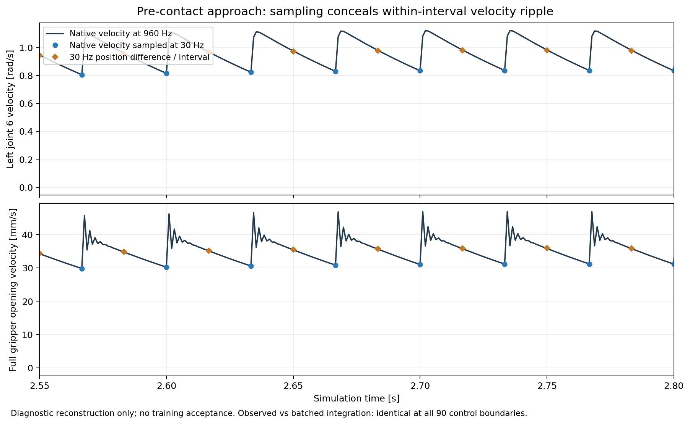
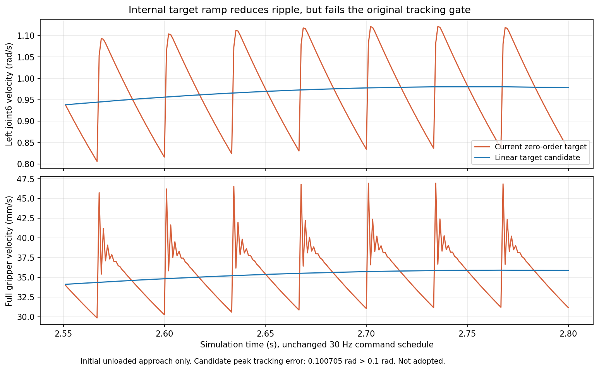
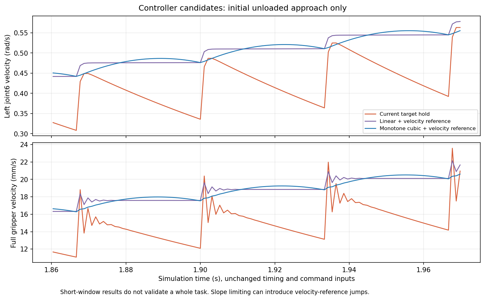
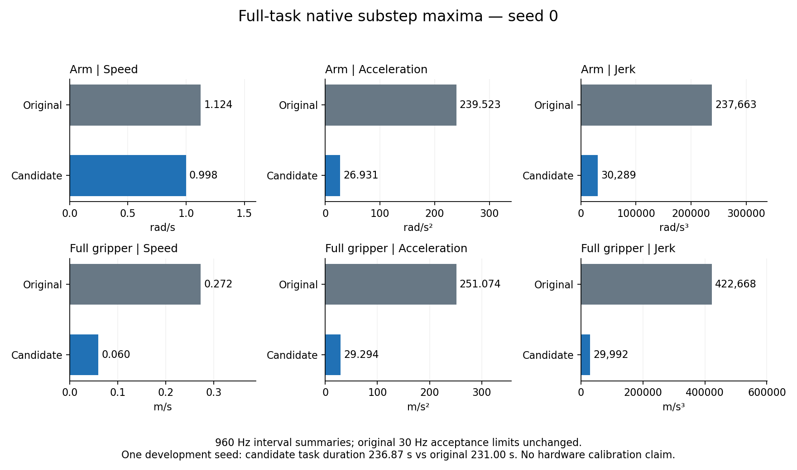
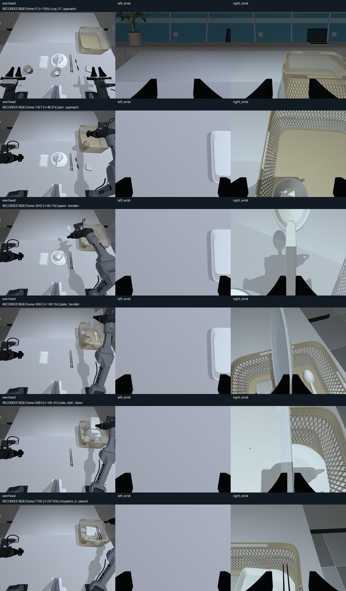
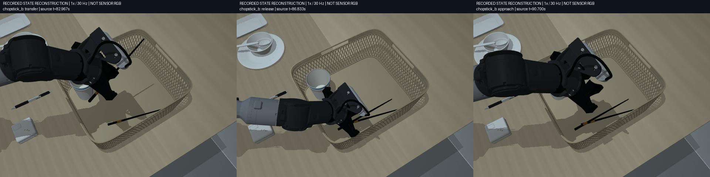

# VLA 数据生产平台审计（进行中）

目标是物理可信、可复现、高吞吐的合格数据生产，不以单个成功视频作为完成证据。
本审计从 `798d398` 开始。原有 PPO 工作不属于本次修改；所有真机接口仅做代码/记录审查，不连接 CAN。
用户目标正文在第七部分第 10 项“失败、成功、未验证、”处截断，已请求补充；已完整收到的要求全部保留。

## 验收证据清单

下表是工作清单，不是完成声明。每项只有取得对应当前版本证据后才可关闭。

| 范围 | 必需证据 | 当前状态 |
|---|---|---|
| 代码/历史基线 | 源码版本、dirty 状态、依赖/硬件、历史报告和当前复测分开 | 起始提交、各回合源码哈希、第三轮成功和失败结果均保留 |
| 六项历史现象 | Isaac 输出分辨率墙钟 FPS；种子 1/7/43 运动及碰撞复测；完整时间；加速版独立审计；标定来源 | 已复测；1/7 完整 RGB 通过，43 状态通过；仍有其他拒收布局，硬件标定缺失 |
| 关节动力学 | URDF/CAD 质量惯量/限位/驱动与两引擎实际参数对照，来源与未辨识范围 | MuJoCo 编译参数和 URDF 对照已保存；总驱动力与实机响应未辨识 |
| 抓取/接触 | 实际接触力/滑移/释放/非物理状态修改检查，双臂和自碰撞 | 原生关节/力/接触证据已记录；seed 0 原生子步完整对照完成，固定接触参数尚有拒收案例 |
| 运动约束 | 目标与实测关节速度/加速度/jerk，TCP 速度，保持/释放阶段、随机种子回归 | 可选 TCP 约束的 15619/3304020488/13 完整状态通过，原生积分边界线速度最大 0.2412 m/s；时长增加约 9%，未标定为硬件能力 |
| 引擎一致性 | 相同姿态几何/相机/关节开口；物体落体/接触的可解释差异 | 腕相机 FK、相同初始落体已测；碰撞响应不同，不能视为动力学等价 |
| 相机/尺寸 | CAD 保持不变；三路 K/外参/模式/畸变/腕部更新；同姿态实虚误差报告 | CAD 未变；两条完整 RGB 的全帧 FK 已核对，真实内外参/畸变待标定 |
| 视觉域 | 材质/灯光/曝光/噪声/遮挡随随机种子变化；成像开销 | 500 个重置候选统计与后处理基准已完成；未认证真实感/覆盖全部现实条件 |
| 时序 | obs_t、施加目标、obs_t+1、仿真/主机/图像时钟，全部帧连续性 | v9 六条配对 RGB 全帧审计通过；子步参考与外部动作语义明确；时间跳变、缓存隔离负例已覆盖 |
| 数据存储 | 无损压缩、完整/失败隔离、共享帧一致性、崩溃恢复、磁盘限制 | 共享无损 RGB 与可选遥测压缩已验证；修复跨回合/过期报告误发布，新增输入指纹、文件锁和原子审计发布；故障注入及真实文件复审通过 |
| 性能 | 物理/IK/碰撞/渲染/读回/写入/审核/导出分阶段；资源占用；合格回合/小时 | v9 同种子完整配对达到 2.128×（2.149→4.573 合格回合/小时）；仅该队列，不能转用于新控制器 |
| 批处理 | 预检重复成本、进程启动/资产加载、恢复调度、并行可行性、失败保留 | 独立并行入口、两个真实状态 worker 与恢复验证通过；汇总 RGB 导出需扩大验证 |
| 专家策略 | 停顿/绕路/任务顺序/双臂并行、抓取规划与错误恢复、独立质量审核 | 先收筷子候选已验证；新增全任务 TCP 限速在两个两杯、一个三杯已知布局通过，当前候选 RGB 与更大留出集仍待验证 |
| VLA 语义 | 单位/顺序/夹爪映射/语言匹配，非特权训练字段与独立额外状态 | 严格官方消费者检查 v9 六条导出的 45,078 行数值、抽样 RGB/action chunk/padding；未做训练收益实验 |
| 数据泄漏/多样性 | 稳定场景族拆分、重复轨迹/跨 split 检查、随机化覆盖和接受偏差 | 重置分布和录制近重复检索工具已建立；合格跨 split 样本量仍不足 |
| 正式验收 | 同条件基准、完整物理 RGB 回合、多种子且含未调参种子、LeRobot 读取和失败注入 | 未完成 |

## 起始观察

- `EpisodeWriter` 当前为每个 transition 分别写 obs/next_obs 图像，每步 flush。
  相邻帧虽在 MuJoCo 渲染层缓存，写盘仍重复；已有离线 compaction，不能节省采集时压缩成本。
- 批采集默认为状态预检后重跑完整 RGB 专家。当前不记录各阶段墙钟时间，也无断点恢复。
- Isaac 的 `step()` 即使无采集相机也调用 render；`read()` 每次重新 GPU→CPU 拷贝。
  这是候选瓶颈，尚未在本轮实测，不能直接下性能结论。
- 质量审核检查全部 transition 和图像，但接触/穿透量来自记录的教师遥测；质量阈值从 HDF5
  内嵌配置读取。后续必须区分“按记录声明阈值通过”和“按生产验收策略通过”。
- LeRobot 普通字段为图像、状态、动作及索引/时钟；物体真值和教师信息在 extras sidecar。
  导出器单位是 degree/归一化夹爪，不是 HDF5 的 rad/m，需要训练入口确认。
- 起始磁盘只剩约 8 GiB；先使用短诊断和已有数据，不删除任何源数据或旧基线。

证据存放在 `outputs/platform_audit_v1/`。短诊断、状态回合、RGB 训练回合需明确分开标记。
任何吞吐改进都必须保持原时间步、全部样本、像素和质量阈值；无实测即标记待验证。

## 第一轮证据与改进

### 当前版本复测

- `baseline_seed0/`：同样的随机化种子 0，物理模式 10/10 入篮，226.0667 秒，
  6,782 transitions；状态审核通过。动作/状态轨迹哈希和物体运动哈希均与上一轮
  `natural_motion_v3/rgb_seed_0` 一致。此回合没有 RGB，不能作为训练回合接受。
- `baseline_cprofile.json`：带 cProfile 的整回合约 389.9 秒，物理积分累计 250.5 秒；
  `robot_penetration` 累计 46.4 秒，任务 metrics 累计 23.2 秒。这些是包含 profiler
  开销的定位数据，不是未插桩的产线吞吐。规划、两次观测和教师检查有重复读取成本。
- `alignment/alignment_measurements.json`：原数字标注同姿态重投影诊断最大垂直残差
  67.1003 px；无拟合、无标定、CAD 未改变。它是有人工关联不确定度的诊断，不是标定板
  RMSE，也不是本轮实机采集得到的新内外参。

### 在线共享 RGB

`EpisodeWriter(image_storage="shared")` 只存 N 张 obs 图像和一张终止图像。
`next_observation/images` 使用同文件 HDF5 virtual dataset 映射到下一张，所有原公开字段、
shape、像素、时间戳都保留。每次共享前要求与上一 transition 的 next_obs 像素、采集时间
完全相同；缓存拥有独立副本，避免调用者复用缓冲区悄悄改写。中断/错误只留下 `.partial`。
验证错误即使被调用者捕获，也不能把截短回合发布为完整文件。

源像素：`outputs/natural_motion_v3/rgb_seed_0/episode.h5` 第 2400–2459 帧，三路
640×480，实际状态/动作/时间戳。三个重复、轮换顺序，每轮重新打开生成文件并检查全部图像。
临时诊断复制品在检查后删除，只保留 `writer_benchmark.json`；没有更改原数据。

| 写入方式 | 中位写入秒数 | 文件字节 | 写入倍率（对第一行） |
|---|---:|---:|---:|
| 两份 RGB，GZIP1，每步 flush | 2.980 | 163,045,130 | 1.00 |
| 共享 RGB，GZIP1，每步 flush | 1.642 | 83,262,865 | 1.81 |
| 共享 RGB，GZIP1，每 30 步 flush | 1.634 | 83,262,865 | 1.82 |
| 共享 RGB，LZF，每 30 步 flush | 1.002 | 112,418,421 | 2.97 |

所有方式的三路 RGB、动作/状态哈希相同；GZIP 共享格式的审核时间也从 1.104 秒降为
约 0.615 秒。结果只是无损写盘微基准，包含 close/flush，不包含仿真、规划、渲染或 fsync；
不能换算成整条产线已达 2 倍。flush 频率收益很小，优先保留每步 flush。
实际 RGB 回合接口验证后，默认采集已切换为共享 GZIP、仍每步 flush。
外部 `EpisodeWriter` / `SimulationSession` 的默认参数保留原布局；可显式选择共享模式。

实际物理抓笔对照 `rgb_pipeline_comparison.json`：553 transitions、18.4333 秒仿真，
每路原生 640×480/30 Hz，原布局 126.97 秒墙钟、共享布局 114.31 秒（约 1.11 倍）。
文件 1,492,591,995 → 750,717,757 字节；写盘本身约 1.83 倍。
这是单次顺序对照、单物体诊断，整桌任务未执行，两个文件均明确 `training_ready=false`。
两份数据所有 transition 均通过完整性审核，动作/状态哈希、每帧物体和相机位姿完全一致。

两次独立渲染的 RGB 未达到逐位相同：对每路 554 张唯一图像的全部像素比较，左腕 132、
中央 5,301、右腕 15,029 个通道值不同（各路共 510,566,400 个值），最大差 1/2/2。
原输入重复执行传感器后处理 12 次逐位相同，跨进程图像差异的具体来源尚未定位；
`rgb_all_frame_difference.json` 保留全部计数，不能宣称像素级跨进程确定性。
这与写入无损性分开：同一输入的所有 writer 微基准和回归测试都逐位一致，未丢帧或改时间。

复现（新输出文件）：

```bash
PYTHONPATH=src .venv-mujoco/bin/python scripts/benchmark_recording.py \
  --source outputs/natural_motion_v3/rgb_seed_0/episode.h5 \
  --output outputs/writer_benchmark_new.json --start 2400 --frames 60 --repeats 3

PYTHONPATH=src MUJOCO_GL=egl .venv-mujoco/bin/python scripts/profile_collection.py \
  --profile-output outputs/profile_new.json \
  --record --rgb --seed 0 --domain-randomization configs/domain_randomization/clean_table.yaml \
  --output outputs/profile_episode_new
```

插桩按物理积分、forward、IK、规划碰撞检查、渲染场景更新、渲染/读回、RGB 压缩写入、
元数据、flush、审核、checksum 和导出分别统计。inclusive 时间存在嵌套，不可求和；
exclusive 才可求和。未调用的阶段不声称为零成本。GPU 样本是整卡（包含其他应用），
尚未等价于本进程显存峰值或无竞争 GPU 基准。

### 独立生产验收策略

`configs/collection/quality_policy.yaml` 固定当前生产阈值，数值没有放宽。新版审核
`piper.collection.v3` 从独立文件加载策略，HDF5 中的教师阈值只作为溯源记录。
审核结果保存策略文件 SHA256。训练导出必须核对当前策略、源文件 checksum，以及内嵌/外置
审核报告一致性。旧 v2 审核需用明确策略重新检查后方能新导出；原始历史文件保持不变。

默认只读复核：

```bash
PYTHONPATH=src .venv-mujoco/bin/python scripts/audit_collected_episode.py EPISODE.h5 \
  --output NEW_AUDIT.json
```

要更新某个待发布 HDF5 的 acceptance，可显式加 `--update-acceptance`，并把新 sidecar
放在该 HDF5 同目录。这会改变文件 checksum；历史不可变基线不要执行该选项。
`--policy FILE` 由操作者选择，不能由记录中的路径指定。训练导出也支持相同 `--policy`。

剩余工作包括：完整任务的共享 RGB 回合和完整导出验证、Isaac 新基准、种子 7/43 复测、接触力与
自碰撞证据、策略/规划修复、调度恢复和并行、多样性/泄漏统计、同条件合格回合/小时对照。
整个审计目标仍未完成。

### 当前问题复现与参数来源

种子 1 已重跑完整物理回合：11/11 入篮，但小碟释放时右夹爪加速度
1.0461066 m/s² > 1.0，按原门限拒收。`seed1_profile.json` 记录墙钟 511.19 秒，
其中积分 384.23 秒、规划碰撞检查 21.07 秒、IK 5.79 秒、状态写入 19.83 秒。
期间存在独立的只读审核和测试进程；这个定位结果不是无竞争性能认证。
进程 RSS 峰值约 2.29 GB，GPU 显存数值包含无关应用，不归因于状态采集器。

当前旧 RGB 完整回合经 v3 独立策略只读重新审核仍通过（`existing_rgb_policy_v3.json`），
未改写原 HDF5、旧 sidecar 或旧验收哈希。

`physics_model.json` 从当前编译模型读取：30 Hz 控制、120 Hz 对外物理 tick、960 Hz 内部
积分，每个 action 32 子步，732 个 geom；机器人质量和主惯量与源 URDF 一致。
这不能证明实机动力学正确：相机/支架质量未辨识，URDF 六轴 velocity=10 rad/s 未实测，
MuJoCo 阻尼/armature、接触摩擦与夹爪控制参数是仿真假设。教师使用 `qfrc_applied`
施加偏置补偿，因此 actuator 的 forcerange 不能单独充当总关节驱动力上限。

## 第二轮：存储解除限制后的验证（进行中）

用户清理后，本轮开始时输出盘可用约 48 GB，已启动完整共享 RGB 回合及 LeRobot 导出验证。
`full_shared_seed0` 保留第一轮提交 `9be3d79` 的运动实现，用于检验存储；后续接触/释放改进
在独立状态回归中验证，不能混称为同一版完整 RGB 验收。

### 释放尖峰与自碰撞

种子 1 的小碟释放时，目标仍由 0 向外追赶，实际开口约 6.8 mm；接触消失时产生加速度尖峰。
候选策略先执行短距离平滑卸载，再张开至释放宽度。无物体锁定、位置赋值或门限放宽。

| 同种子完整状态回合 | 原实现 | 卸载候选 |
|---|---:|---:|
| 任务 | 11/11 | 11/11 |
| 记录仿真时长 | 255.1667 s | 258.6333 s |
| 最大实测夹爪加速度 | 1.0461066 m/s² | 0.8995333 m/s² |
| 独立运动门限 | 1.0 m/s² | 1.0 m/s² |
| 闭文件状态验收 | 拒收 | 通过 |
| RGB 训练验收 | 未做 | 未做 |

`release_seed1_comparison.json` 和 `failed_seed1_motion_v3.json` 使用同一独立策略重新计算。
失败文件的总审计会提前拒收；独立运动诊断仍可分析失败轨迹，但不会给它训练许可。
`audit_collection_motion.py` 现在也从独立策略读取门限，优先使用真实记录的 holding 标志。

`geometry_seed0.json` 对 6,783 个记录状态逐帧重建几何，没有发现当前模型报告的同臂或互臂
穿透；最大非目标接触为指尖/桌面约 0.528 mm。此检查保留模型相邻体排除与凸包近似，
不能观察 30 Hz 帧间碰撞。旧记录只有总开口，重建时两指各分一半，不是完整动力学复现。
基于这个检查，在线和规划碰撞门限已覆盖非相邻同臂接触，并加入相应反例测试；没有提高
4 mm 拒绝门限。拓扑索引使用弱引用缓存、接触过滤使用数组，减少重复 Python 名字查询。

新教师记录在特权 extras 内保存 8 个原生关节位置/速度、执行器力、外加力、约束力、
两指法向接触力、TCP 位姿/速度。它们是 30 Hz 求解器采样，不是子步极值或实机标定。
普通 VLA Parquet 列仍只使用公开图像、状态、动作及索引/时间字段。
种子 7/43/0/42 的新回归已完成：0、42 通过闭文件状态审计；7 在抓盘前因桌面约 4.01 mm
阻挡拒绝执行，43 在下一根筷子接近阶段因篮筐/右 link6 约 9.98 mm 阻挡拒绝执行。这两个
问题尚未修复；四个回合都不是 RGB 训练验收，不能用种子 1 的改善代替跨布局成功率。

### 可恢复批采集与性能边界

新批次记录 `run.json` 和逐任务 `jobs/*.json`。`--resume` 验证代码、配置、实际资产、依赖
版本及已通过数据的验收策略/校验和；文件或策略变化时要求另建批次。进程锁防止同时恢复。
中断尝试的原文件保留，新尝试使用 `_attempt_002` 等目录；已完成成功/失败不自动重跑。
完成但缺少审计的尝试进入 `unverified.jsonl`，与明确拒收、状态诊断和训练接受分开。
清单原子发布；恢复测试覆盖中断、证据损坏、配置变化及并发锁。旧批次没有 journal，不能
直接用此选项恢复。若导出完成后尚未来得及写 checkpoint 就中断，恢复会拒绝覆盖该导出，
需要独立校验或另设导出目录。

真实四回合批次完成后执行恢复：0.482 秒复用四个完成任务，没有新建重试目录；所有 HDF5
和 jobs 文件的 SHA256、大小及修改时间保持一致（`batch_resume.json`）。这是同一代码/
配置快照上的恢复证据；后续源码变化后，应按约定新建批次。

```bash
# 参数与首次启动保持一致；timeout 可以调整。
PYTHONPATH=src MUJOCO_GL=egl .venv-mujoco/bin/python scripts/collect_clean_table.py \
  --states-only --output outputs/platform_audit_v1/regression_contact_v2 \
  --seeds 7 43 0 42 --resume
```

每个结果记录预检/采集墙钟时间。summary 的 rate 仅按已完成阶段计时，明确排除中断尝试、
恢复检查与最终导出；它不是端到端吞吐认证。预检仍可用 `--skip-preflight` 显式关闭。

RGB 后处理的 gamma 改为 256 个值的 float32 查表，后续白平衡、噪声与最终取整保持原计算。
200 组 gamma、完整 uint8 值域探针逐位一致；含噪声/模糊的像素回归也通过。单独 gamma
步骤中位耗时约 3.82 → 1.39 ms；这是微基准，不能称为整回合 2.75 倍。
新 profiler 使用 `nvidia-smi pmon` 单独记录本进程（包括 EGL graphics）的显存，和整卡
使用量分开。没有采到该进程时保留空值，不报零占用。

### 完整 RGB 与官方 LeRobot 读取结果

`full_shared_seed0` 已完成 10/10 物体任务、6,782 transitions、226.0667 秒记录，
三路均为 640×480/30 Hz。闭文件 v3 审计和训练导出均通过；动作/状态哈希与旧基线一致。
HDF5 从 18,219,534,877 减为 9,147,511,695 字节；完整 LeRobot 导出约 115 MB。
这个回合检验第一轮存储改进，没有采用后续卸载策略或新增力证据。

完整进程墙钟 1,822.09 秒，包含仿真、审核和导出：物理积分累计 254.02 秒、渲染/读回
453.69 秒、成像后处理 350.11 秒、recording append 188.46 秒、审核 80.08 秒、导出
399.50 秒。阶段有嵌套，不能直接求和。单次观测相当于约 1.98 条合格回合/小时、每十进制
GB HDF5 约 741 条 transition；同机存在其他审计/测试负载，不能当作稳定产能或 2 倍提升。

使用独立环境中的官方 `lerobot==0.3.3`、`datasets==3.6.0`、PyAV 读取完整 v2.1 导出，
未修改用户现有环境。实际检查首帧、中间帧、倒数第二帧、末帧：三路 RGB tensor、14 维
state、16×14 action chunk、任务语言、30 Hz 时间索引，以及末尾 action padding 均符合
读取器约定。关节角从弧度转为度、总开口除以 0.095 m 后与 HDF5 相符；特权物理信息未进入
普通训练行。H.264 为有损视频，报告保留抽样像素误差，不宣称与原始 RGB 逐位一致。
证据为 `lerobot_official_reader.json`，复现脚本为 `scripts/check_lerobot_reader.py`。

### 当前两引擎三路相机基准

相同配置、每轮 180 transitions、3 次重复、三路 640×480/30 Hz、共享 GZIP、headless，
用小幅关节运动检查腕相机更新和记录。它不是收桌任务成功率测试。当前墙钟帧率中位数为
MuJoCo **6.147**、Isaac **5.310**；不是仿真时间轴的 30 Hz。Isaac 保留默认 RTX/DLSS，
640×480 是输出分辨率，内部渲染可能使用较小分辨率，不能称为每条光线原生 640×480。

Isaac 的 1,270 次 observation read 重复执行了 1,270 次成像后处理（累计 57.77 秒），
MuJoCo 已按状态复用，只有 634 次（28.30 秒）。这是下一步可验证的重复计算优化点。
Isaac 本进程 RSS 采样峰值约 7.88 GB、pmon 显存峰值 6,335 MB；整卡另有其他应用占用。
结果与限制见 `backend_native_comparison.json`，复现脚本为 `scripts/benchmark_backend.py`。

### 同时刻图像复用与导出统计

Isaac 现在按实际 camera capture revision 和控制帧缓存 CPU 图像/相机位姿。每次 read
先触发 Isaac Lab 的懒更新，再判断是否复用；reset 清空缓存，静态对齐工具强制采图也会
增加 revision。返回值拥有独立副本，修改某次返回的图像不会污染下一次观测。控制状态、
时钟及物体信息每次正常读取，不复用旧状态。

同进程、交替顺序、各三轮 180 帧对照：未缓存 **5.5524**、缓存 **7.6349** 墙钟帧/秒，
中位数比 **1.375**。各轮完整流审计通过；同一捕获的缓存/重新处理图像逐位一致，强制新
捕获可使缓存失效。六个诊断文件全部 181 个状态的腕相机位置与 URDF FK 对比，最大误差
约 0.292 μm（仅仿真数值一致性，不是实机标定精度）。保留 `isaac_cache_comparison.json`
和 `paired_camera_fk.json`；没有把该微任务收益称为整桌生产收益。

LeRobot 视频导出的 RGB 统计改为每通道 256 个整数计数，避免每帧生成 float64 全图并重复
求和/极值。最后计算均值及中心方差；编码输入、尺寸、帧率及 H.264 参数不变。24 张预加载
真实仿真图像、三次交替重复的统计步骤约快 **14.7 倍**，与旧统计最大数值差约 2.39e-12；
常量、二值和完整灰度级的解析统计测试通过。对 6,782 帧完整回合重新导出，耗时为
120.73 秒，先前导出为 399.50 秒（单次观测约 3.31 倍，负载/文件缓存条件不同）。三路
MP4、Parquet、extras 与原导出 SHA256 完全相同；全部统计最大差 7.61e-12。
`export_histogram_comparison.json` 保留证据。这是导出阶段收益，不是整条产线 3.31 倍。

### 随机化覆盖边界

默认配置采样种子 0–499：500 个不同有效布局，255 个两杯、245 个三杯；三种桌面材质
计数为白 161、灰 192、木 147，四种杯身颜色均出现。train 406、validation 94，未发现
完全相同布局跨 split。统计在去掉 seed 和非活动物体后计算，不靠种子字段制造唯一性。
完整位置、质量/摩擦、曝光/白平衡/噪声/模糊等范围见 `scene_diversity_500.json`。

这些只是重置候选布局，未跑物理任务，不能充当 500 次成功采集。两侧仍共享物体网格、语言
模板和随机范围，当前 split 只测试同分布布局泛化；不代表未见物体、任务或环境泛化，也
尚未做已录制图像/轨迹的近重复检索。CAD 尺寸、相机标定、重力和时序按要求保持固定。

第二轮最终非 PPO 全量回归 **189 passed in 87.78 s**，含缓存隔离与 RGB 统计新增测试。
更多随机种子、策略/路径修复、更新策略后的完整 RGB 验收、并行调度及端到端 2 倍目标
仍未完成；不把状态诊断算作合格 RGB 训练数据。

## 第三轮：完整录制、抓取路径和接触诊断（进行中）

### 种子 1 的完整 RGB 验收

`full_unload_seed1` 使用第二轮 `e06ec0a` 的释放卸载策略，已完成 11/11 物体、7,759 个
transition、258.6333 秒记录；三路 640×480/30 Hz 的闭文件 v3 审计通过，`training_ready=true`。
官方 LeRobot 0.3.3 读取器再次通过四个时间位置、16 步 action chunk 和末尾 padding 检查。
新增力证据留在 extras，没有加入视觉策略的普通训练列。

总墙钟 1,739.27 秒，包含采集、审核和导出；渲染/读回 564.76 秒、成像后处理 344.73 秒、
物理积分 391.64 秒、writer append 165.68 秒、审核 83.67 秒、导出 116.95 秒。
阶段存在嵌套。此时同机有状态回归和诊断任务，不能把与另一种子/负载的比值当同条件提速。
单次观察约 2.07 条合格回合/小时；本进程 RSS 采样峰值 2.89 GB、EGL 显存约 1,009 MB。

`full_seed0_camera_fk.json` 和 `full_seed1_camera_fk.json` 分别核对全部 6,783/7,760 个状态
（含终止状态），腕部外参跟随 URDF FK，位置数值误差均小于 0.3 μm；中央相机保持静止。
这仅验证程序坐标链一致，不是相机标定精度或真实视角对齐认证。

### 抓取候选和有界路径

只检查抓取点 IK 可达不足以保障完整接近路径。现在先在 scratch 数据上验证预抓取和连续
下降轨迹，再执行候选。盘子候选只改变夹持点/局部姿态，未改 CAD、物体位姿或碰撞门限。
种子 7 从原来的桌面碰撞推进到真实双指抓盘、抬升和入篮，但后续暴露两个独立问题：

1. 自然三次样条在合法 IK 节点之间越过关节 5 上界约 0.000208 rad。无载路径现在可尝试
   clamped B-spline；端点精确，内部 IK 点作为控制多边形、曲线位于其关节凸包内。不会逐值
   裁剪指令，仍检查完整曲线的碰撞和速度/加速度/jerk；载物路径不使用此备选。事件中记录
   `bounded_path_selected`，元数据明确内部点不再精确插值。
2. 盘子回撤解决后，筷子在搬运时擦到篮筐并滑脱。全帧末段几何诊断发现约 0.137 mm 的
   瞬时筷子/篮筐重叠。4 mm 的拒绝门限不能充当细物体搬运的安全余量。独立状态试验中，
   原路径再次滑脱；增加 1/3/6 mm 正间距后均完成搬运和下放。默认候选给筷子搬运增加
   6 mm 规划余量，使用 signed geom distance 检查未接触但过近的情况；验收门限未放宽。
   最初的 3 mm 候选在种子 2 仍滑脱；6 mm 候选通过原有中间姿态重新规划后，在独立搬运
   试验中保持双指接触，最大相对滑移约 1.96 mm。完整多种子复测仍在进行。

种子 43 的原篮筐碰撞可用倾斜姿态避开，但实测没有夹住筷子，因此该版本仍被拒收。
诊断发现倾斜指尖先碰桌面。刚体教师现在保持筷子夹爪直立，在实际长轴中央区域选择夹持点
（最多 ±40 mm，且不超过长度的四分之一）。该修复版本种子 43 已完成 11/11 并通过状态
审计；它还不是 RGB 训练回合，也不能替代新增搬运余量版本的复测。

所有失败回合保留：`grasp_candidates_v3`、`bounded_seed7`、`axis_seed7` 及 holdout 种子 2。
`diagnose_failed_paths.py` 只做几何规划；`diagnose_grasp_capture.py` 和
`diagnose_payload_clearance.py` 每次试验只恢复一次记录的初始状态，后续全程物理控制。
它们缺少历史物体速度和求解器 warm-start，因此是独立诊断，不能算历史逐位回放或训练验收。

### 两进程采集与引擎接触差异

`worker_feasibility/report.json` 对三路 640×480、共享 GZIP、每进程三轮 180 帧进行测量：
单进程端到端 4.210 transition/s；两个独立进程合计 6.846 transition/s，观察比值 **1.626**。
包含进程启动、warmup、close 和流审计，但只有简单关节运动，`success=false`，不算合格
任务回合。该对照每组只有一次，期间有完整 RGB 任务共享主机；该测量本身没有验证生产调度。

`drop_mujoco/report.json` 与 `drop_isaac/report.json` 在同一名义场景中，将同一 0.1 kg
充电头放在指定初始高度一次后自由落下，记录 91 个状态：

| 指标 | MuJoCo | Isaac / PhysX |
|---|---:|---:|
| 初始段拟合垂直加速度 | −9.810000 m/s² | −9.809992 m/s² |
| 内部物理步长 | 1/960 s | 1/120 s |
| 最终物体 root z | 24.932 mm | 25.000 mm |
| 最低采样 root z | 18.526 mm | 24.071 mm |
| 最后十个采样的最大线速度 | 约 0 | 0.000203 m/s |

root 高度不是网格穿透深度；该结果显示接触瞬态不同，不能只因最后停在相近位置就宣称
动力学一致。两个引擎的求解器、子步、contact offset/softness 和碰撞代理不同；还需实机
落体/摩擦/夹持响应辨识。没有用改重力、瞬移或教师吸附来让曲线一致。

### 已录制数据的重复检索

`audit_recorded_duplicates.py` 读取显式带 split 的 JSONL 清单，计算整条动作/状态哈希、
去掉 seed 的活动物体布局哈希，以及 129 个归一化轨迹采样和 9 个 RGB 缩略采样。
检索特征仅用于找候选，不改变记录、split、质量判定或导出像素。

`recorded_duplicates_v2.json` 比较旧种子 0、新共享存储种子 0、完整种子 1：准确找到前两者
相同布局和相同动作/状态轨迹。这是存储回归复制品，合并生产数据时应只保留一份。
三条都按原规则属于 train，因此这组结果没有实际 train/validation 对照，不能据此宣称
跨 split 无泄漏。背景相似、时间相位错位和未采到的局部变化仍可能影响近重复检索。

随后加入状态诊断种子 9（validation）的 `recorded_duplicates_with_validation.json`，未检出
它与上述 train 回合的完全相同布局或轨迹。种子 9 没有 RGB，跨 split 视觉相似度仍未测；
单个验证布局也不能代表验证集多样性。

### 接近开口与完整回归

3 mm 余量版本的种子 7 虽然完成 11/11，但夹爪实测加速度约 1.568 m/s²，仍按原门限拒收。
把闭合时间延长到两倍、三倍不能消除峰值：碰撞发生在张开夹爪下降阶段，指垫先碰到了旁边
的另一根筷子。局部物理对照把接近开口从 12 mm 改为 10 mm 后，仍完成双指抓取和抬升，
该段峰值降至约 0.367 m/s²。依据是 `seed7_closing_probe.json`、`seed7_aperture_probe.json`。

当前候选根据筷子实际横截面投影计算开口，再加 4 mm 接近间隙，名义 6 mm 筷子约为 10 mm。
物体滚动时使用新的截面姿态；不改变夹爪限位、驱动力、质量门限或记录频率。
`aperture_clearance_seeds7_43/episode_000000_seed_7` 完成 11/11，7,861 transitions、
262.0333 秒仿真；完整状态审计通过，最大实测夹爪加速度约 0.90251 m/s²（本次全回合峰值
发生在抓笔阶段）。它没有 RGB，`training_ready=false`；新版本完整 RGB 另行验证。

加入并行入口和收尾监测后的非 PPO 全量回归为 **207 passed in 85.88 s**。原来的失败、仅局部通过、完整
状态通过与完整 RGB 训练通过分别保留，不能相互替代。

同版本种子 43 也完成 11/11 并通过完整状态审计。种子 2 虽然解决了筷子搬运滑脱并完成
11/11，仍因实测机械臂 jerk 229.29 rad/s³ 超过 200 而拒收。原生关节逐帧几何复核在
178.10 s 发现右指尖/篮筐约 0.136 mm 接触，随后出现 jerk 峰值；发生在前一盘子放下后
转向小碟的路径，不是筷子搬运阶段。不能因碰撞深度低于 4 mm 就认定没有运动质量影响。

`seed2_approach_rise_probe.json` 恢复该转场起点后用正常控制器积分：原路径复现 jerk
229.29 和约 0.136 mm 接触；先竖直上撤 20/40 mm 的局部试验无采样接触，峰值分别约
11.81/14.43 rad/s³。它只验证接近到预抓取点，尚未集成成通用转场避障策略，也不是完整
回合通过。`scripts/diagnose_approach_clearance.py` 保留可复现实验入口。

种子 13 在当前默认放置目标下因筷子未完全留在篮内拒收（9/11）。只将两根筷子的篮内
放置目标沿篮筐局部 x 轴向机械臂方向移 30 mm，保持初始摆放、CAD、控制/物理参数和
门限不变后，`placement_goal_seed13` 完成 11/11，总仿真 263.5667 s（含 1 s 预热），闭文件状态审计通过。
可复现配置为 `placement_slot_candidate.yaml`；目前仍是候选，未替换默认目标、未做 RGB
或其他种子的完整验证。孤立释放试验中的原位置也曾成功，说明缺少速度/warm-start 的
局部恢复不能完全复现原失败；完整回合证据优先于局部试验。

### 尚未解决的接触建模限制

现有刚体教师会按当前对象切换夹爪力上限、控制增益，以及指垫的滚动摩擦、接触
softness 和求解器 noslip 次数。改变力上限/增益可对应控制策略，但同一指垫的材料属性随
任务对象类别切换，没有实测支持。当前域随机化改变物体摩擦，指垫参数则由教师设置，
两者共同决定有效接触响应，不能把物体的采样范围等同于最终接触系数范围。因此不能将
`physical` 模式解释为已辨识的实机接触模型。它仅表示运动由动力学和接触积分产生，
没有使用附着约束或逐帧设置物体姿态。

`contact_friction_mixing_v2.json` 用实际录制的双指抓笔姿态做了独立参数检查：物体滑动
摩擦从 0.52 / 0.65 / 0.78 改变时，所有恢复出的指垫/笔接触仍使用滑动摩擦 1.0，五维
接触摩擦向量保持 `[1, 1, .015, .002, .002]`。指垫 geom priority=1，物体为 0。
因此，现有“物体摩擦随机化”并未覆盖这个抓取接触对的有效摩擦。这是当前待修问题，
不能把 500 个重置中的摩擦采样统计当作 500 种真实夹持响应。复现工具为
`scripts/audit_contact_mixing.py`；只在 scratch 模型变化参数，不推进物理或修改原记录。

目前的质量通过是“满足当前仿真模型与独立数据策略”，不是现实成功率认证。后续需要
固定指垫材料参数、显式建模对象材料配对，并用真实夹持/摩擦试验辨识范围，再独立回归；
不能为了保留现有通过率而隐去这项限制。

### 运动节奏的量化边界

`cadence_full_episodes.json` 按原始 30 Hz 时间戳统计完整种子 0、1 和当前状态种子 7。
同时满足目标与实测各关节速度低于 0.02 rad/s、夹爪低于 0.002 m/s 的时段约占
19.70%、19.56%、19.90%；持续至少 250 ms 的段数为 69、74、73，最长约 2.33–2.53 s。
其中包含必要的抓取、释放、套叠稳定和轨迹端点减速，不等于全部可删等待时间。种子 1 的
接近/抬升/搬运分别约 55.3/53.0/40.6 s；它们是原事件标签下的阶段归属，不是独立 CPU 耗时。
这三个回合布局和版本不同，不能用时长差直接计算策略加速倍率。

当前已经按 30 Hz 控制/记录。增加采样频率本身只增加同一物理过程的样本数，不会缩短
视频对应的仿真时长；改变编码 fps 却不重采样只会使播放和动作时间失配，禁止用于训练提速。

### 并行调度与固定收尾等待的问题

`collect_parallel_clean_table.py` 使用独立 worker journal 和进程组，父进程复核结果后汇总，
支持分 split 统一 LeRobot 导出。真实 `parallel_scheduler_states` 同时执行种子 0/9：
9 通过状态审计，0 虽然 10/10 入篮，却因最后仅连续稳定 0.9 s（要求 1 s）拒收。
父进程正确保留两个结果，不将任务完成计作数据通过。

再次以原参数 `--resume` 耗时约 1.04 s，复用成功与失败结果，没有新增 attempt 目录。
两份 HDF5 和各 worker 的 jobs 文件 SHA256、大小、修改时间完全不变，证据为
`parallel_scheduler_resume.json`。父进程的汇总/调用记录会正常更新；恢复调用不报告生产速率。

种子 0 的三相机完整 v6 回合也因同一收尾问题拒收，不能计算为合格吞吐。固定等待 2 s
不保证最后 1 s 内角速度始终不超过 0.1 rad/s；该回合末段峰值为约 0.10123 rad/s。
新收尾逻辑保留原来 2 s 最短时长，按每个真实控制步观测物体位姿和成功状态，在必要时延长
至连续稳定满 1 s，最多等待 5 s。所有延长帧正常录制；超过时限仍失败。默认门限不变，
闭文件审核保持独立，不能追认旧 v6 失败文件为合格。

v7 已完成种子 0/7 的完整物理状态回归，两者都通过闭文件审核。种子 0 从 6,880 增至
6,930 transitions，真实增加 50 帧/1.6667 s，末尾连续稳定 1 s；它在额外等待中再次有
轻微转动，因此简单固定补 0.1 s 并不充分。种子 7 保持 7,861 transitions，不增加等待。
与 v6 RGB 回合逐帧比较，两者原有前缀的动作、观测/下一观测、仿真时间和全部物体位姿
完全相同；证据为 `final_stability_regression.json`。新种子 0 仅做状态验收，尚无 v7 RGB
训练回合；旧失败文件保持拒收。

### 完整两进程 RGB 结果

`qualified_parallel_v6/report.json` 同时运行种子 0/7，包含两个尝试、闭文件审计、合格回合的
LeRobot 导出与父进程复核，总墙钟 **1,969.60 s**。种子 0 因上述稳定时长不足拒收；种子 7
完成 11/11、7,861 transitions、262.0333 s 记录，三路 640×480/30 Hz，通过独立 v3 策略。
原始共享无损 HDF5 为 9,708,742,062 字节。官方 LeRobot 读取检查也通过，含三路图像、
16 步 action chunk、末尾 padding 和单位换算，见 `qualified_seed7_reader.json`。

该次观测为 **1.828 条合格回合/小时**，合格 transition 吞吐 3.991/s，所有尝试的原始
transition 吞吐 7.484/s。只计合格 HDF5 时约 810 个有效 transition/十进制 GB；把失败文件
也计入磁盘成本后约 413 个/GB。失败数据被保留，不用于训练。当前仍**没有建立至少 2 倍
有效吞吐量**；不能以原始帧吞吐替代合格产能。该批期间有状态回归/测试共享主机，且没有
相同种子、相同新版本的串行配对试验，不能据此给出准确并行加速比。

种子 7 的阶段 inclusive 时间约为渲染/读回 697.04 s、成像后处理 353.30 s、物理积分
405.37 s、写入 205.33 s、审核 95.64 s、导出 131.82 s；IK 4.99 s、规划碰撞检查 6.58 s。
存在嵌套，不能把这些数直接求和。单进程 RSS 采样峰值约 2.89 GB，独占可归因 EGL 显存
约 1,009 MB；整卡显存还含其他应用。渲染/读回和物理仍是主要成本，失败率则直接损失产能。

中央相机视频独立检查为 7,861 帧、30/1 fps、262.033333 s，没有播放加速；下图是其最后
一帧解码图。它证明可见任务结果，不是实机视角标定或训练收益认证。


## 2026-11-09 第四轮：按间距选择转场路径

空手转场增加了对目标容器的正间距检查：默认要求至少 2 mm，关节路径按最大
0.01 rad、夹爪开度按最大 1 mm 采样。直接路线不足时，先在 scratch 状态中检查
20/40/60 mm 竖直上撤及后续完整转场，保留中央途经点候选；只有两段均通过才执行。
原 4 mm 穿透拒绝、持物转运 6 mm 余量和独立审核门限均未修改。上撤起点允许靠近容器，
上撤段仍按原碰撞门限检查，正间距要求用于随后的空手转场。这是采样预测，不是连续
无碰撞证明，实际运动仍由物理积分并接受记录后审计。

`transit_clearance_states_v8` 的四个完整状态回合全部通过独立 v3 策略：

| 种子 | 入篮 | transitions | 记录时长 | 新增绕行 |
| --- | --- | ---: | ---: | --- |
| 0 | 10/10 | 6,930 | 231.0000 s | 无 |
| 2 | 11/11 | 7,748 | 258.2667 s | 小碟接近前上撤 20 mm |
| 7 | 11/11 | 7,861 | 262.0333 s | 无 |
| 43 | 11/11 | 7,550 | 251.6667 s | 无 |

种子 2 的原路径预测距篮筐仅 1.15 mm，因此选择上撤。相对原失败回合只增加
26 个真实控制步（0.8667 s），在线测得臂 jerk 峰值从 229.2874 降至 34.5817 rad/s³；
独立审核在存储 float32 状态上重算得到 34.5683，低于原门限 200。种子 0/7/43 的
动作/状态轨迹哈希和全部物体位姿哈希与之前对应回合完全相同，没有普遍增加绕行或等待。
证据见 `transit_clearance_regression_v8.json`。这些是开发回归种子，不是新的留出成功率；
状态回合也不自动成为 RGB 训练样本。

### 中断恢复实测与 SIGTERM 修复

该状态批次原父进程以 143 退出，信号来源未确定；当时一个 worker 及录制子进程仍在运行。
旧代码仅在 Python 异常／Ctrl-C 时执行清理，没有将 SIGTERM 转成可清理的退出。
等待所属 worker 完成后，用原代码与参数恢复汇总约耗时 1.84 s，四份 HDF5 及 worker
任务记录的 SHA256、大小和修改时间均未变化，见 `transit_v8_parent_recovery.json`。
原 `invocation_001.json` 保留中断时的 running 状态，恢复的 `invocation_002.json` 为完成；
不能把恢复耗时计作采集吞吐。

并行入口现已捕获 SIGTERM，先记录中断、清理所属进程组，再以 143 退出。对已异常退出
的 worker 组也执行清理，避免遗漏其录制后代；忽略 SIGTERM 的后代使用 SIGKILL 清理。
真实进程集成测试验证了中断日志、无接受结果、后代退出及无关进程继续运行。
SIGKILL／机器掉电仍无法运行清理程序，journal 与 partial 文件用于后续恢复，不宣称可捕获。

### 固定指垫材料的独立试验

新增 `diagnose_fixed_contact.py` 与 `probe_fixed_contact_rollout.py`，不更改默认教师。
候选取消按目标对象切换指垫材料：一次试验内固定滑动摩擦 1、扭转摩擦长度 15 mm、
滚动摩擦长度 2 mm、接触时间常数 10 ms 和同一组 impedance，再将三个摩擦分量统一
乘以 0.8/1.0/1.2。保留原来按对象设置电机力上限／增益的控制策略及负载时的求解器
迭代细化。这些材料数值未做真机辨识，候选与默认配置的证据分开保存。

`fixed_pad_material_probe_v1.json` 从历史接近起点恢复机器人位置/速度、物体位姿，之后
正常积分完成单件搬运。笔和盘子在三个倍率下均入篮且通过在线运动门限；小碟在 1.0/1.2
下完成，在 0.8 下失去双指接触、滑移约 29.5 mm 并触发夹爪加速度拒收。每一组实际
solver contact 的摩擦向量均正确反映设定倍率，例如 0.8 得到 `[.8, .8, .012, .0016, .0016]`。
这证明改变指垫参数确实覆盖了抓取接触，与仅改变低优先级物体 geom 摩擦的旧行为不同。
相关混合规则见 [MuJoCo 官方接触参数说明](https://mujoco.readthedocs.io/en/stable/modeling.html#contact-parameters)。

局部恢复没有原物体速度和 warm start，且之前已放物体的位置来自旧材料回合，因此不是
同参数从头运行的精确替代。固定材料 0.8 倍的种子 1 从初始化完整运行后反而完成 11/11、
8,028 transitions、267.6 s 记录，并通过独立状态审计：
`fixed_material_seed1_scale08/audit.json`。局部失败没有被删去，也没有用于宣称这个完整回合
失败。另一次局部试验只将固定滚动摩擦长度改成 8 mm，在 0.8 倍下小碟完成，但该设置尚未
经过完整回合验证，不能据此选择有利参数来宣称真实材料已辨识。

两个新入口都明确标记为诊断。完整候选仍使用既有 recorder 与独立审计，元数据保存
替换教师的源码 SHA256 和实际固定材料；仅状态输出不进入视觉训练接受清单。默认生产
配置暂不替换，仍需更多种子、倍率、有效接触统计和完整 RGB 验证后再决定。

固定材料 1.0 倍的种子 1 完整回合在 219.3667 s 发生小碟滑脱，8/11，拒收；
`fixed_material_seed1_scale10` 保留原始状态记录。`diagnose_contact_loss.py` 对失败前 20 帧
按原位姿重建几何接触，恢复原 multi-contact 开关，力只引用原 30 Hz 记录而不重算。
在该采样区间没有小碟与篮筐/其他物体的几何接触；失效前指垫/小碟穿透约
0.56–0.58 mm、每指记录法向力约 13 N、总开度约 1.53 mm。随后双指接触消失，开度
降到 0.10 mm，最后滑移达到 27.45 mm。证据为 `fixed_material_seed1_loss_geometry_v2.json`。
这些观察将问题缩小到薄边夹持的接触/姿态稳定性，但不足以在未辨识材料时断言唯一根因；
尤其不能单纯增加摩擦来把候选重新算作成功。

第三个固定材料完整状态试验为种子 43、1.2 倍摩擦：11/11、7,516 transitions、
250.5333 s 记录，通过独立审核。三个完整试验共两次通过、一次小碟滑脱拒收，布局和倍率
同时不同，不能据此估计总体成功率或推出摩擦越大越可靠。默认接触配置继续保持原样。

本轮代码回归为 **211 项非 PPO 测试通过，93.53 s**。其中新增实际 SIGTERM 进程树清理、
正间距查询与碰撞掩码变化、完整绕行预检和无必要绕行等测试；QVEL 警告仍来自既有故障注入。

### v8 完整三路 RGB 与合格产能

`qualified_parallel_v8` 同时采集种子 0/2，均完成物理任务、通过独立 v3 审核和 LeRobot
导出，父进程再次校验。总墙钟 **2,038.8273 s（约 33.98 分钟）**，计入两次尝试、审计、
导出与父进程复核，得到 **3.5314 条合格回合/小时、7.1992 个合格 transition/墙钟秒**。
这次基准不做状态预检，因此不含此前单独状态回归的成本；默认批采集若保留预检，产能应
连同预检重新计时。该批仍与状态诊断/测试及其他应用共享主机，不能与旧不同种子批次直接
计算加速比，也尚未证明至少 2 倍有效吞吐。

| 种子 | 完整入篮 | RGB transitions | 原速时长 | 共享无损 HDF5 |
| --- | --- | ---: | ---: | ---: |
| 0 | 10/10 | 6,930 | 231.0000 s | 9,396,547,268 B |
| 2 | 11/11 | 7,748 | 258.2667 s | 8,439,897,932 B |

三路均为 640×480/30 Hz。两个 RGB 回合的动作/状态轨迹哈希、物体位姿哈希与 v8 状态
预检分别完全相同。合计每十进制 GB 约 823 个有效 transition，包含 before/after 三相机
共享无损存储。LeRobot 官方本地读取器分别抽查初始、中间和末尾共四个位置，验证三相机、
16 步 action chunk、padding、单位及特权字段隔离；这部分兼容性检查在上述计时之后执行。
中央相机视频全帧解码数量与记录一致，另人工查看三个抽帧；这是抽查，不是逐帧人工复核。

种子 2 的 inclusive 耗时：渲染/读回 697.03 s、成像后处理 351.02 s、物理积分 471.71 s、
写入 198.86 s、审核 104.53 s、导出 130.35 s、IK 4.26 s、规划碰撞 11.44 s。
各项有嵌套，不可直接求和。两个进程 RSS 采样峰值分别约 2.88/2.81 GB，可归因 EGL 显存
各约 1,009 MB。渲染/读回、物理和成像后处理仍是主要成本，IK 不是当前主要吞吐瓶颈。
完整数据见 `qualified_parallel_v8_analysis.json`，消费者检查见 `qualified_v8_seed*_reader.json`。

- [种子 0 中央相机原速视频](../outputs/platform_audit_v1/qualified_parallel_v8/seed_0/lerobot_v2/videos/chunk-000/observation.images.cam_external_rgb/episode_000000.mp4)
- [种子 2 中央相机原速视频](../outputs/platform_audit_v1/qualified_parallel_v8/seed_2/lerobot_v2/videos/chunk-000/observation.images.cam_external_rgb/episode_000000.mp4)

视频与 HDF5 留在本机，Git 只保存代码、诊断/审核报告及少量原视频解码图。当前通过仍指
现有未标定仿真接触模型和独立数据策略；固定材料候选的失败、实机 K/外参和接触辨识缺口
均未消除，不宣称达到真实部署成功率或稳定的大规模生产水平。


### 固定指垫后端配置与释放阶段诊断（v9 候选）

新增可选 `mujoco.finger_contact`，由 MuJoCo 后端加载独立材料配置、在 reset 时采样并保持
整回合不变。左右指垫使用独立、可复现的 RNG 子流；名义滑动/扭转/滚动系数为
`[1, .015, .002]`，三分量共同乘以各自的 0.8–1.2 倍率，接触时间常数 10 ms。
这是未标定范围，不能理解为真机辨识结果。默认 `clean_table_workcell.yaml` 未启用候选。

`clean_table_fixed_contact.yaml` 启用同一套材料供自动教师和外部 HTTP 控制使用；材料不再
随笔、盘子、小碟切换，目标相关电机力/增益仍属于明确记录的控制策略。独立文件的 SHA256、
完整参数与实际左右倍率写入会话/HTTP/HDF5 元数据，并由 LeRobot 旁路元数据保留。
运行中若材料被改写、全局 contact override 开启或其他 geom priority 覆盖指垫，拒绝继续
步进。Isaac 显式拒绝该 MuJoCo 专用配置；未实现的物理等价关系不作隐式回退。

测试通过实际 solver contact 检查摩擦、solref、solimp，覆盖重复 reset、不累乘、教师
切换对象和真实 HTTP 服务录制。阻抗与时间常数还避免依赖隐式截断；相关依据见
[MuJoCo 接触参数](https://mujoco.readthedocs.io/en/stable/modeling.html#contact-parameters)与
[求解器参数](https://mujoco.readthedocs.io/en/stable/modeling.html#solver-parameters)。
本项只覆盖指垫接触，不能证明原有物体/桌面摩擦随机化都有效。

`backend_fixed_contact_v1` 从初始化运行三条完整状态回合，保持原采样率与独立质量策略：

| seed | 左/右指垫倍率 | 任务完成 | 独立状态审计 |
| --- | --- | --- | --- |
| 0 | 0.841388 / 1.105694 | 10/10 | 通过 |
| 1 | 0.915474 / 0.819715 | 11/11 | 拒收：夹爪加速度/jerk |
| 43 | 0.862813 / 0.864211 | 11/11 | 通过 |

种子 1 的右夹爪在小碟释放阶段达到 1.2116 m/s²、68.9949 m/s³，超过原来的 1/50 门槛。
任务完成没有覆盖拒收结果。释放开始时实际开度约 1.62 mm、目标为 0：尚有接触，却因为
教师清空 `carried` 而将全局 NoSlip 后处理从 10 次迭代切到 0；旧 3 mm 预载阈值也未触发
短行程卸载。独立审计首先检查到 unsuccessful_episode，在线质量报告保留具体超限原因。

`diagnose_contact_release.py` 从该帧恢复状态做四组局部对照（`fixed_release_probe_v3.json`）：

| 短行程卸载 | 释放时 NoSlip 迭代 | 开度加速度峰值 m/s² | jerk 峰值 m/s³ | 在线运动检查 |
| --- | ---: | ---: | ---: | --- |
| 无 | 0 | 1.2072 | 68.2106 | 拒收 |
| 有 | 0 | 1.1311 | 67.5672 | 拒收 |
| 无 | 10 | 0.6394 | 35.9565 | 通过 |
| 有 | 10 | 0.7119 | 33.8950 | 通过 |

这支持“释放时切换 NoSlip 对该失效有影响”，不证明所有抖动来自同一原因。NoSlip 是去除
摩擦方向正则化的后处理，并非简单提高主求解器精度；它影响当前模型的所有接触、增加成本，
也不能代替实机接触辨识。见 [MuJoCo NoSlip 说明](https://mujoco.readthedocs.io/en/latest/computation/)。
诊断未恢复原物体速度与 warm start，不是精确历史回放或训练合格证据。


图中保留真实仿真时间，没有对齐成等长动作；短行程卸载会增加耗时。四组对照也显示仅保留
NoSlip 已能通过此局部检查，因此不能声称新增卸载是必要条件，后续需要比较其完整回合
稳定性与时间成本。

新增可选控制配置 `configs/collection/clean_table_fixed_contact.yaml`：预载阈值 0.5 mm，
盘/碟松夹期间保留 10 次 NoSlip，打开完成后退出释放状态。CAD、材料、验收门槛均不随之
改变。它显式区分“停止追踪携带物”与“指垫已完成松开”，没有增加附着或位姿锁定。

```bash
PYTHONPATH=src MUJOCO_GL=egl .venv-mujoco/bin/python scripts/demo_clean_table.py \
  --config configs/clean_table_fixed_contact.yaml \
  --collection-profile configs/collection/clean_table_fixed_contact.yaml \
  --domain-randomization configs/domain_randomization/clean_table.yaml \
  --record --seed 1 --output outputs/fixed_contact_trial
```

抓取几何另有独立诊断 `fixed_rim_geometry_v1.json`：在同一固定名义材料、30° 抓取倾角下，
小碟原 x=-40 mm 抓点复现 27.4 mm 滑脱；x=-20/0 mm 均完成单件搬运并通过在线检查。
这些局部结果未直接替换全任务抓点，也未作为布局分布上的成功率；需继续完整回合验证。

释放候选的完整状态复测 `backend_fixed_release_v2` 已完成：

| seed | 任务完成 | transitions | 独立审计 | 结论 |
| --- | --- | ---: | --- | --- |
| 0 | 8/10 | 5,957 | 拒收 | 小碟松夹后的撤离路径预测 `right/link6` 与篮筐穿透 4.44 mm，被原碰撞门槛拦截 |
| 1 | 11/11 | 8,053 | 通过 | 原释放超限消除；整回合夹爪加速度/jerk 峰值降至 0.8995 m/s²、33.9679 m/s³ |
| 43 | 11/11 | 7,771 | 通过 | 原有完整收纳仍通过 |

候选种子 1 比固定材料原控制增加 32 帧（1.0667 s），这是实际控制过程增长，没有压缩
时间戳或修改视频速率。种子 0 的失败保留，不能将这组结果描述成总体成功率提升，也没有
提升为默认配置。下一步需验证仅保留释放 NoSlip 的方案，并处理松夹后的安全撤离规划。

最终源码下的默认配置种子 0 回归为 6,930 transitions、10/10，通过独立审计；动作/状态
轨迹 SHA256 与物体位姿 SHA256 均和 v8 完全一致。最终 **218 项非 PPO 测试通过，100.27 s**；
QVEL 警告为既有故障注入。各回合、失败原因、源码与政策哈希汇总为
`outputs/platform_audit_v1/round5_validation.json`。本轮新增数据均无 RGB，不进入视觉训练
接受清单；没有新增合格 RGB 吞吐量基准，也没有证明 2 倍有效产能。

### 端到端同组吞吐量基准准备

基准入口新增独立的 worker 上限和顺序执行的同组对照，生产并行入口也支持最多三个
worker（默认仍为两个）。已通过 **224 项非 PPO 测试，101.41 s**，覆盖 1/2/3 worker 队列、
超时、输入改动拒绝、对照哈希条件，以及生产/基准两个入口的真实 SIGTERM 后代清理。
中断的 partial 与失败记录保留，不把不完整比较发布为成功速率。

下一组实测固定默认物理配置和种子 0/2/7，先 1 worker，后 3 workers；每组完整三路 RGB
录制、独立审计、导出与父进程复核。代码、资产、依赖和编码器在每次启动与组结束时校验。
CLI 使用方式见 [同组吞吐量对照](domain_randomization_collection.md#同版本同种子的完整吞吐量对照)。
准备记录为 `outputs/platform_audit_v1/round6_benchmark_setup.json`，计划结果目录为
`outputs/platform_audit_v1/qualified_pair_v9`。**准备验证不等于性能实测；此处尚无新的加速结论。**

### 原生动力学遥测的只读复核

`scripts/audit_recorded_dynamics.py` 独立读取 HDF5 中的原生求解器记录，不启动物理、不解码
RGB、不改写源文件或训练许可。它逐条检查双臂八关节的维度/有限值、原生时间与公开时间、
原生关节位置与公开 14 维状态（夹爪为两指位置之和）、相邻 transition 的原生位置/速度/TCP
连续性，以及 `combined_drive = qfrc_actuator + qfrc_applied`。
边界处教师可以更新偏置补偿，所以不错误地要求前后两份力记录相同。

新增 **17 项测试通过**，包含错误时钟、NaN、缺失字段、错误夹爪映射、驱动力不一致、原生
速度断裂、未关闭文件等负例，以及读前后源文件 SHA256/mtime 不变检查。
已有 v8 状态回合 0/2/7 的共 45,078 份 observation/next_observation 快照均一致；
诊断结果仍统一 `training_ready=false`，不能代替任务、图像、接触或训练验收。
报告保存在 `native_dynamics_seed{0,2,7}_v2.json`，执行记录为 `native_dynamics_v2_run.json`。

| seed | 右臂原生 TCP 采样速度峰值 m/s | 右臂 TCP 相邻帧平均速度峰值 m/s | 右臂总驱动关节力矩采样峰值 N·m |
| --- | ---: | ---: | ---: |
| 0 | 0.5516 | 0.6022 | 11.7468 |
| 2 | 0.5083 | 0.5618 | 12.4595 |
| 7 | 0.5090 | 0.5598 | 12.5700 |

前两列是不同测量：一列为帧时刻 `J(q) qvel`，另一列为两帧 TCP 位移除以实际设定的
采样周期，峰值也可能出现在不同阶段。两者都不是 960 Hz 内部子步的全程极值。
力矩来自仿真广义驱动力，包含偏置补偿，不含约束/被动力，也不是实机能力辨识。

这确认了一个覆盖缺口：`pacing.cartesian_speed_m_s=0.25` 是部分路径的规划参数，
当前独立策略未将其作为所有关节插值/转场段的 TCP 速度门限。三条记录均出现更高的末端
速度；不能将“关节运动审核通过”解释为“全程 TCP ≤0.25 m/s”。下一轮需要明确全局
TCP 约束并在轨迹生成和独立审核中覆盖它，同时补充子步证据；不能在本轮吞吐对照中
更换条件，也不能把上述数值直接当作真机安全阈值。

```bash
PYTHONPATH=src .venv-mujoco/bin/python scripts/audit_recorded_dynamics.py \
  outputs/platform_audit_v1/transit_clearance_states_v8/worker_01/episode_000000_seed_0/episode.h5 \
  --output outputs/native_dynamics_new.json
```

本项在配对吞吐测试期间以低进程优先级读取已有状态文件，合计约 16.1 s，无 GPU 工作。
因此仍将吞吐结果表述为共享工作站上的工程基准，不声称独占主机性能。

### 合并颜色查表的独立实验：不采用

单进程首个完整 RGB 回合的后处理耗时约 308.6 s，因此另外测试将 gamma、增益和白平衡
合并为每通道 256 项查表。`scripts/benchmark_sensor_color_lut.py` 只运行候选函数，
没有修改正在采集的处理代码。以已有回合的一组三路 640×480 RGB 作代表输入，预热缓存，
轮换运行顺序，比较 15 个不同噪声 tick。输入已包含后处理；这里再次处理仅测组件，
不把所得图像保存成观测或训练记录。

| 实现 | 三路处理时间中位数 ms | 相对生产实现 | 与生产像素不同的通道值 |
| --- | ---: | ---: | ---: |
| 现有 gamma 查表＋通道乘法 | 45.568 | 1.000× | 0 |
| 合并查表，广播索引 | 49.026 | 0.929× | 0 |
| 合并查表，分通道索引 | 46.169 | 0.987× | 0 |

**两种候选都没有得到加速，因此不进入生产实现。** 30 项等价测试通过，覆盖 256 个色阶、
非连续输入、五个 gamma、噪声和模糊，确认不是以改变像素换取时间。报告为
`sensor_colour_lut_v1.json`，包含单次计时、输入像素摘要、参数及实现哈希。
这是共享主机上的短 CPU 组件实验；不能推导整回合吞吐加速，也不能据此认定后处理
没有其他优化空间。

### 训练端字段隔离与全行数值复核

复核 `check_lerobot_reader.py` 时发现：旧工具的允许字段取自待检导出自己的 `info.json`，
然后固定报告 `privileged_fields_in_public_rows=false`。如果导出同时声明并包含一个意外
的特权列，旧比较可能仍通过。这是校验器的覆盖漏洞；目前未发现已交付数据包含该列。

现在由训练端工具独立定义 Piper v2.1 的公共字段、双臂关节顺序、14 维状态/动作，以及
三路相机。额外/缺失声明、实际 Parquet 中的额外列、错误类型/顺序均拒绝。
全部数值行逐一与 HDF5 比较：状态/动作独立转成度和归一化夹爪；仿真时钟、源主机单调
时钟和从零开始的视频时钟分别比对；索引、任务与回合编号也全行检查。
关键条件改为显式异常，不依赖可能被 `python -O` 关闭的 `assert`。

新增 **23 项测试通过**，覆盖额外特权字段、未声明 Parquet 列、缺相机、关节顺序/类型错误、
错误单位、未关闭源、NaN/null，以及原四点抽查之外的九种中间行篡改。
另通过真实 `python -O` 子进程确认字段隔离检查仍然生效。
本轮单进程组的种子 0/2 已用官方 LeRobot 0.3.3 / v2.1 读取器通过：分别 **6,930/7,748 行
× 9 个数值列**全部对齐，每条回合另抽查首、中、末尾共四行的三相机、16 步 action chunk
与 padding。证据为 `qualified_v9_workers1_seed{0,2}_reader_v2.json`。
三个新诊断测试文件合计 **70 项通过，0.50 s**；运行与文件指纹保存在
`consumer_contract_v2_validation.json`。这些读取检查以 CPU 单线程参数、禁用 CUDA、低进程
优先级执行；同组吞吐测试仍按共享主机基准描述。

该检查面向本项目原生分辨率的单回合 Piper 导出；H.264 与原 RGB 的误差作为测量值报告，
没有自行设定视觉质量门槛，也没有将抽帧检查说成全视频逐帧对齐。读取器通过不新增任务
或训练合格许可。完整录制/独立审核仍由原生产策略负责，吞吐对照条件未更改。

### 积分子步证据：控制周期内的速度波动

新增独立 `diagnose_substep_motion.py`，从旧种子 0 的最初纸杯接近段初始化两个相同的
MuJoCo data 副本，对照 `mj_step(nstep=32)` 与逐次调用后只读 qpos/qvel。积分内不额外
调用 forward，不变更目标、材料、求解器或时间步；控制周期结束仍按原后端刷新一次。
Euler/implicitfast、有/无接触等 **11 项测试通过**。该工具没有修改生产后端。

90 个控制帧、3 秒的实际 Piper 场景诊断获得 2,881 个初始/子步样本。在全部 90 个边界上，
两种方法的完整 `mjSTATE_INTEGRATION` **逐位一致**。短窗口墙钟约 2.386/2.441 s；
这包含诊断记录/比较开销，不能作为完整采集吞吐或长期监测成本。

| 测量 | 左臂关节最大速度 rad/s | 左夹爪总开口最大速度 m/s |
| --- | ---: | ---: |
| 960 Hz 原生 qvel | 1.1213 | 0.0470 |
| 30 Hz 时刻的原生 qvel | 0.8366 | 0.0312 |
| 30 Hz 位置差分 | 0.9805 | 0.0359 |



关节峰值来自左臂 joint6。按子步原生速度差分的加速度峰值约 239.3 rad/s²，尖峰发生于
30 Hz 控制目标更新后的第一个子步。它与原策略的 30 Hz 位置二阶差分是不同带宽的测量，
不能直接冒充原门槛判定；但周期内的波动确实存在，现有低频质量门限不能证明执行全程
平滑。需要比较控制器内部目标插值，并用完整抓取/释放与原独立审计复测。

该诊断与历史记录的边界位置最大差约 6.9e-8 rad / 3.9e-9 m，但仍不称精确历史回放：
原物体速度和 warm start 未保存，动作也来自 float32 HDF5，且只覆盖首次无负载接近。
报告位于 `substep_approach_seed0_v1/report.json`，完整 NPZ 子步记录留在本机并保存摘要。
没有观察力/接触缓冲区后就错误地把它们标成积分后的时间。

用户提供的真机 `example_agilex/piper_controller.py:1045` 使用
`MotionCtrl_2(0x01, 0x01, 60, 0x00)`；随附 SDK 将其定义为 MOVE J、60% 速度、位置速度模式。
这不足以辨识固件内部插值、带宽或延迟，也不能直接证明当前 MuJoCo 的理想 PD 与真机响应
一致。本轮没有连接或驱动真实机械臂。

### 内部线性插值候选：波动减小，但未通过原门限

独立诊断新增 `--compare-linear`：保留相同的 30 Hz 动作输入、3 秒仿真窗口、位置 PD、
偏置补偿和积分步长，在每个控制周期的 32 个子步内，从上一个已接收目标线性推进至当前
目标。这会改变控制器和实际物理轨迹，不能再宣称与原控制器逐位一致。报告将观测等价性
明确限定为 `batched` 与 `observed` 两种原控制器调用方式。

| 测量 | 原目标保持 | 线性插值候选 |
| --- | ---: | ---: |
| 左臂子步原生速度峰值 rad/s | 1.121320 | 0.980492 |
| 左臂子步速度差分加速度峰值 rad/s² | 239.2693 | 1.1532 |
| 左夹爪子步原生速度峰值 m/s | 0.046955 | 0.035903 |
| 原 30 Hz 跟踪误差峰值 rad | 0.085717 | **0.100705** |
| 原 30 Hz 运动审核 | 通过 | **拒绝：跟踪误差 >0.1 rad** |



插值消除了大部分控制更新引发的周期内速度波动，但增加了跟踪滞后。**不采用此候选，
不放宽 0.1 rad 门限，也不通过缩短视频时间伪造改善。** 它只在诊断工具中可选，生产后端
未变更。12 项子步/插值测试通过；最终报告为 `substep_linear_seed0_v3/report.json`，
决策为 `substep_linear_decision_v1.json`。v2 原始实验保留本机，其未明确列出比较方法的
观测等价字段已在 v3 澄清；不把它解释成线性候选与原积分状态相同。

该结果仍仅覆盖首次无负载接近，不能证明任何候选的抓取、接触、释放或整回合质量。
下一版控制器需连同规划跟踪特性进行验证，再通过完整任务原审计和单独吞吐基准。
当前物理和运动门限都不能代替真实 Piper 内部控制响应辨识。

### 配对吞吐测试的串行组完成

冻结输入的 v9 串行组种子 0/2/7 均完成三路 RGB、独立审计、LeRobot 导出与父进程复核。
总计 22,539 个 transition，751.3 s 仿真时间，5,025.10 s 墙钟时间，按原独立质量策略
计算为 **2.149 条合格回合/小时、4.485 个合格 transition/墙钟秒**。这里的“合格”限定为
原策略的验收结果；不表示子步平滑、真实设备标定或域外成功率已获证明。

三个回合全部通过新版官方读取器检查：22,539 行的九个数值列与 HDF5 对齐，并对每回合
四个时刻检查三相机、16 步 action chunk 和 padding。新增种子 7 的结果为
`qualified_v9_workers1_seed7_reader_v2.json`，不是对所有 RGB 帧逐帧视觉验证。
三进程并行组仍在运行；在两组都完成且状态/物体哈希一致前不报告加速比。
诊断、读取检查以低优先级在同一工作站进行，吞吐结果仍只作为共享主机工程基准。

### 位置/速度参考候选：短段改善，整回合仍未验证

在独立诊断中进一步比较位置与速度参考。实现使用 MuJoCo 3.3.7 的
[仿射执行器偏置](https://mujoco.readthedocs.io/en/3.3.7/XMLreference.html#actuator-general-biastype)，
在私有 model 副本中计算 `kp*(位置参考−位置)+kv*(速度参考−速度)`。速度参考通过原
执行器的力限幅，不额外注入 `qfrc_applied`；原重力偏置补偿保持不变，它仍位于执行器
限幅之外，所以不能声称总驱动力已满足真机限制。未修改 kp/kv、材料、物理时间或质量门限。

| 控制器诊断 | 原 30 Hz 跟踪误差 rad | 子步左臂加速度峰值 rad/s² | 子步左夹爪加速度峰值 m/s² |
| --- | ---: | ---: | ---: |
| 原位置目标保持 | 0.085717 | 239.2693 | 15.3486 |
| 线性位置＋该段目标速度 | 0.002657 | 26.0142 | 1.9638 |
| 三次 Hermite 位置＋导数速度 | 0.002655 | 3.5705 | 0.2846 |
| 单调 Hermite 位置＋导数速度 | 0.002655 | 3.5705 | 0.2846 |

后面三个方案在这一个 3 秒无负载接近段均通过原 30 Hz 运动检查；子步数值单独报告，
没有擅自将它们按原低频阈值判定。原始与观测积分仍在全部 90 个控制边界逐位一致。



普通 Hermite 并不能直接用于完整任务：`check_controller_schedule.py` 读取种子 0/2/7
已有 22,539 个动作，以相同的 32 子步生成内部参考，不运行物理、不改写数据。原保存动作
均在限位内，但普通 Hermite 分别有 **27/28/29 个控制周期**产生超界参考，最大约
0.98 µm 夹爪开口或 1.43e-5 rad 关节位置；报告保留具体周期和通道。

单调版本显式约束端点导数方向和幅值，使内部位置参考保持在两个已接收目标之间，
不在生成后裁剪位置。这三个完整动作序列中已无超界内部目标。但约束分别在
**427/494/503 个周期**触发；停止或反转时不能保证全局 C1 连续。
实测最大参考速度跳变量约 **0.0573 rad/s / 0.000491 m/s**，仍需完整物理轨迹检查。
这些是旧动作的离线参考生成检查，不能冒充新控制器闭环执行成功；新反馈会改变后续教师动作。

32 项诊断测试通过，覆盖原生观测无扰动、关节/夹爪 tendon 的解析 PD 力、原执行器正负
力饱和、私有模型隔离、无效输入拒绝，以及停止过冲和单调导数约束。最终短段报告为
`substep_bounded_hermite_seed0_v1/report.json`，全动作参考检查为
`hermite_schedule_bounds_v2.json` 和 `bounded_hermite_schedule_v1.json`，决策为
`substep_controller_candidate_v1.json`。

**这些控制器均未进入生产后端。** 必须等冻结的吞吐对照结束，再用显式可选配置运行完整
抓取、搬运、释放和原独立审计。单调参考检查、短段跟踪改善都不授予训练数据合格许可，
也没有建立真实 Piper 固件响应的一致性。

### v9 完整配对结果：该三回合队列达到 2.128 倍合格吞吐

冻结输入的串行、三进程组均已正常退出，六个完整 RGB 回合全部通过原独立审计、导出与
父进程复核。三个种子的动作/状态、完整物体位姿摘要、帧数、仿真时长和验收策略摘要均
逐种子一致。没有跳帧、缩短记录时间或放宽门限。

| 指标 | 串行 1 worker | 并行 3 workers |
| --- | ---: | ---: |
| 合格回合/尝试 | 3/3 | 3/3 |
| 完整 transition 数 | 22,539 | 22,539 |
| 仿真时长合计 s | 751.3 | 751.3 |
| 含启动、审计、导出、父进程复核的墙钟 s | 5,025.10 | 2,361.56 |
| 合格回合/小时 | 2.149 | 4.573 |
| 合格 transition/墙钟秒 | 4.485 | 9.544 |
| HDF5 总量，十进制 GB | 27.545 | 27.545 |
| transition/十进制 HDF5 GB | 818.26 | 818.26 |

**本次配对队列的合格吞吐比为 2.127874×。** 这是按顺序执行的一组共享工作站工程对照，
不是独占主机的重复统计，也不是所有场景、物理配置或未知种子的普遍加速保证。
当前“合格”仍限定于原策略，不能据此宣布子步平滑和真机参数辨识完成。

下表为各 worker 的排他阶段时间之和除以总记录帧数；并行 worker 的等待时间会重叠，
不能将这些阶段之和当成并行队列墙钟，也不能与 30 Hz 仿真时钟混淆。

| 阶段 ms/记录 transition | 串行组 | 三进程组 |
| --- | ---: | ---: |
| 物理积分 | 47.225 | 49.958 |
| 渲染与读取 | 68.478 | 130.137 |
| 传感器后处理 | 43.633 | 45.068 |
| RGB 压缩写入 | 20.700 | 21.217 |
| IK | 0.630 | 0.656 |
| LeRobot 视频编码与统计 | 14.928 | 16.714 |

并行下渲染/读取的每 worker 等待显著增加，因此增加到三个进程没有得到线性 3×。
不能将这个现象单独归因于 GPU 算力；驱动、读取同步以及共享工作站负载还需进一步分离。
各 PID 的 RSS、CPU 时间、所报显存和整卡采样分别保存在 profile 和汇总中。
整卡显存峰值包含桌面及其他程序，不按该数值宣称采集进程独占占用。

六条导出均已通过新版官方 LeRobot 读取检查：共 **45,078 行九个数值列**与 HDF5 对齐，
每条另检查四个时刻的三相机、16 步 action chunk 与 padding。训练端检查不计入上表
采集/审计/导出基准计时，轻量诊断也在同一主机运行，已保留这一限制。

两组的原始 RGB 摘要并非逐位相同。每个回合、每台相机检查五个观测时刻，共 45 对图像，
抽样差异最大为 **1 个 uint8 色阶**，单张最多约 **0.0051% 通道值**不同；两组随机化
参数相同。原因尚未确证，不声称全帧像素完全可复现。完整回合各自的全部 RGB 连续性和
质量检查均通过；抽样差异报告不能替代这些全帧检查。

最终证据：`qualified_pair_v9/comparison.json`、`qualified_pair_v9_summary.json`、
`qualified_v9_rgb_pair_samples.json` 及各 worker 的完整 audit/profile。两组是重复种子家族，
不能拼成六条独立训练样本，更不能将其配对副本分到训练集和验证集两侧。

### 可选控制器完整状态验证：三个种子通过，尚不替换生产默认

吞吐对照正常结束后，将单调三次位置/速度参考控制器作为独立模块接入 MuJoCo，使用
`configs/clean_table_servo.yaml` 显式选择。公共接口仍为 14 维绝对目标；新增元数据解释
动作端点与内部执行器参考的关系，并将每个周期的原生速度、差分峰值、导数约束跳变量、
增益和力限幅写入私有 `controller_interval`。这些字段不进入 LeRobot 公共视觉策略列。

| seed | 完成物体数 | 原控制器时长 s | 候选时长 s | 原最大跟踪误差 rad | 候选最大跟踪误差 rad | 原独立状态审计 |
| --- | ---: | ---: | ---: | ---: | ---: | --- |
| 0 | 10/10 | 231.000 | 236.867 | 0.086422 | 0.017104 | 通过 |
| 2 | 11/11 | 258.267 | 259.367 | 0.086608 | 0.008524 | 通过 |
| 7 | 11/11 | 262.033 | 262.967 | 0.086382 | 0.006868 | 通过 |

三条均为完整物理任务，没有物体吸附/锁定/瞬移，没有修改原质量门限。合计 22,776 个
状态 transition，包含 728,832 个积分子步的区间摘要。只读诊断逐区间检查时钟、动作端点、
连续性、内部参考限位、边界原生速度是否位于所报峰值范围，以及增益/力限幅/导数数据的
有效性。它不独立重算未保存的全部 960 Hz 轨迹，也不授予训练许可。

**改善的是此三条记录的跟踪误差，不是所有运动指标都改善。** 三条回合均略长；种子 0 的
30 Hz 实测机械臂 jerk 从约 51.0 增至 68.2 rad/s³，仍通过原 200 rad/s³ 门限。
新记录的子步夹爪加速度峰值约 29.3/30.1/31.1 m/s²，发生在小碟抓取或卸载阶段；
这些高频接触峰值不能用此前接近段结果忽略，也不能与低频门限混为一谈。
完整任务原控制器的同频原生峰值对照仍缺失，因此尚不宣布全程更平滑。

同时修复原默认后端的一个异常检测缺口：首次积分从 t=0 自动重置后，时间仍可能等于
预期时间。现在增加原生物理警告检查，拒绝这类重置及容量/非法状态警告；不修改正常
积分或控制目标。故障注入测试已复现并验证拒绝，包含 t=0 与后续周期两种情况。

345 项非 PPO 全套测试通过（101.31 s），随后扩展的只读动力学审计 29 项测试通过
（其中 12 项新增区间损坏负例）。控制器测试包括关节和夹爪 tendon、力饱和、重置清理、
动作与 HDF5 元数据、区间证据、限位保持的浮点误差，以及与独立诊断的全积分状态一致性。

运行和记录方式见 [可选控制器](domain_randomization_collection.md#可选-mujoco-内部参考控制器实验配置)。
回合证据位于 `servo_full_states_v1/seed_{0,2,7}`，汇总为 `servo_full_states_v1_summary.json`，
原生证据为 `servo_native_seed{0,2,7}_v1.json`。**三条均没有 RGB，`training_ready=false`。**
下一步仍需完整原生基线对照、新 RGB/导出验证和未参与开发种子验证；原 2.128× 吞吐结果
不转用于这套新控制器。实机控制响应与总驱动力限制也仍未标定。

### 原控制器全程子步对照：种子 0，观测无轨迹扰动

新增显式 `zero_order_observed` 模式和 `configs/clean_table_observed.yaml`，只将原来的批量
积分拆成相同数量的单步并读取状态，积分内部不改控制量、力或状态、不添加 forward。
包含物体接触的单元测试中，全积分状态、加速度和执行器力与原批量积分逐位一致。
该模式用于诊断，保留原零阶目标，不是新的平滑控制器，观测开销不参与原吞吐基准。

完整 seed 0 回合再次完成 10/10 物体、6,930 transitions、231 s，原独立状态审计通过。
与 v9 串行 RGB 基线比较，动作/状态摘要、全部物体位姿摘要、帧数、时长完全一致；
**13,860 份原生 float64 力学快照全部相等**。比较程序还核对相同 CAD、相机、任务布局、
随机化配置、教师设置和验收策略，仅规范化配置文件路径表达、排除新增控制器配置。

| 960 Hz 原生测量，全任务最大值 | 原零阶控制器 | 单调三次参考候选 |
| --- | ---: | ---: |
| 机械臂角速度 rad/s | 1.12436 | 0.99824 |
| 机械臂速度差分加速度 rad/s² | 239.523 | 26.931 |
| 机械臂速度二阶差分 jerk rad/s³ | 237,663 | 30,289 |
| 夹爪总开口速度 m/s | 0.27236 | 0.06002 |
| 夹爪速度差分加速度 m/s² | 251.074 | 29.294 |
| 夹爪速度二阶差分 jerk m/s³ | 422,668 | 29,992 |



这是完整任务的同频原生峰值，不能与 30 Hz 差分审核门限混用。原机械臂峰值在接近盘子
时出现，原夹爪峰值在盘子释放时出现；候选机械臂峰值转为提杯阶段，夹爪峰值转为小碟
卸载阶段。各控制周期峰值的 p95 加速度也从 171.02 降至 5.74 rad/s²、从 16.69 降至
0.73 m/s²。**这些分位数是各周期最大值的分布，不是所有原始子步样本的分位数。**

因此本工程种子既有跟踪改善，也有全程高频运动峰值的明显降低；不过候选仍存在接触
冲击，耗时略增，30 Hz 机械臂 jerk 指标略升，不宣称所有指标均更优。两个闭环任务的
动作和接触时刻不同，不将其包装成逐帧对齐回放。此次核对不建立真实硬件限制，也不将
两个无 RGB 的状态回合授予训练许可；其他种子的同频原生比较和候选 RGB 检查仍需继续。

364 项非 PPO 测试通过（97.55 s）；故障注入中的 QVEL 警告为预期拒收案例。
证据与可重跑的只读分析程序为 `controller_native_comparison_v1.json` / `.py`，原回合
位于 `observed_baseline_seed0_v1`。程序保留所有来源 HDF5 摘要、验收策略摘要、每阶段
指标与子步摘要一致性检查；不修改源记录，不覆盖已有报告。

### 冻结候选的扩展状态验证：1 通过、3 拒收

在 `servo_validation_plan_v1.json` 中先固定种子和原策略，再运行两个状态 worker。
13 是已知放置失败回归；5987/9137/15619 是未用于本轮运动调参的选定种子，此次验证后
它们也成为开发回归样本，不再作为未来修改的全新留出集。没有在种子之间修改参数。

| seed | 类别 | 完成物体 | 原独立状态审计与拒收原因 |
| --- | --- | --- | --- |
| 13 | 历史失败回归 | 9/11 | 拒收：chopstick_a 未完全入篮 |
| 5987 | 新验证 | 10/10 | 通过；7,077 transitions；无 RGB，不能授予训练许可 |
| 9137 | 新验证 | 0/11 | 拒收：提杯连续路径的第 5 轴插值到 1.22113814 rad，超过 1.22 rad 限位 |
| 15619 | 新验证 | 7/10 | 拒收：side_dish 未完全入篮 |

因此新增三个验证种子仅 **1/3 通过**；全部四条为 1 条状态诊断通过、3 条拒收、0 条未验证、
0 条合格 RGB 训练回合。先前 0/2/7 成功不能替代这个结果，不将候选提升为生产默认。
四条完整或提前终止的闭文件均保留，原生时序/区间摘要一致性诊断分别通过；后者仅说明
证据自洽，不推翻任务/路径拒收。

失败末帧按同一可见网格、篮筐坐标和原容差重算：13 的筷子超出 y 边界约 26.9 mm、
上边界约 42.5 mm；15619 的小碟超出 x 边界约 11.7 mm、上边界约 22.3 mm。
这是几何失败定位，不是接触因果证明。报告 `servo_placement_failures_v1.json` 保存实际
边界、全部来源哈希和开爪事件；没有改变篮筐尺寸、成功容差或源记录。

9137 的局部候选使用 `scripts/diagnose_loaded_path.py`，在独立进程中仅对“合法 IK 节点的
自然样条越界”尝试凸 B 样条。原实际曲线碰撞检查、关节限位和物理抓取检查全部保留。
一段提杯路径的 1.138 mrad 超限消失，控制样本数由 191 变为 153，重新计算的速度、
加速度、jerk 与原限值之比分别为 0.980、0.467、0.429。随后三杯套叠、整摞入篮完成，
在线运动质量检查通过。**它只有杯子子任务，没有 HDF5、RGB 或独立闭文件审核，也没有
完成其余八个物体，不能作为全回合修复或训练成功。** 中间 IK 节点被近似，仍需约束持物
路径偏离并做完整回归；实验未修改生产规划源码。证据为 `loaded_path_seed9137_v1`。

另对先前候选 seed 0 的 7,107 个姿态作独立几何复核：启用碰撞对中无同臂/互臂穿透记录，
机器人/环境峰值约 0.549 mm。右臂采样 TCP 速度峰值 0.618 m/s；配置 0.25 m/s 仍只是
部分笛卡尔段规划值，并非全局限速。邻接碰撞排除、凸包近似、30 Hz 采样和未标定工具
偏置等限制见 `servo_geometry_seed0_v1.json`，该报告不授予训练许可。

### 候选控制器 seed 0：完整 RGB 与官方读取验证通过

冻结源码/配置/资产的单 worker 回合正常结束，父进程在结束时再次核对输入指纹。
物理任务完成 10/10，三路 640×480、30 Hz，7,106 transitions、236.8667 s；原独立策略
审核通过并标记 `training_ready=true`。全部 42,636 张 before/after 图像连续性检查通过，
基础图像质量异常率为零；动作/状态、全部物体位姿、帧数和时长与先前状态回合逐项一致。
这里的训练接受仍限定于现有策略，不等于实机一致或域随机化总体成功。

官方 LeRobot 0.3.3 / v2.1 消费者读取通过：全部 7,106 行九个数值列与源 HDF5 对齐，
另抽查四个时刻的三相机、16 步 action chunk 与末尾 padding，没有额外特权公共列。
三段 H.264 视频均完整解码为 7,106 帧、30 fps、236.866667 s；视频为原速，不重定时。
全部 7,107 个唯一状态的三相机 FK 检查通过，最大矩阵绝对残差约 2.8×10⁻⁷；这只验证
仿真挂载一致性，不证明真实内外参或曝光延迟已标定。

本次含启动、审核、导出和父进程检查的墙钟为 1,497.40 s（24.96 min），4.746 合格
transitions/墙钟秒；HDF5 为 9,691,366,574 B。同期存在低优先级状态验证和诊断，
这是共享负载下的一条验收运行，不能与不同控制器的三种子基准直接计算加速比。
现有 2.128× 结论仍只属于先前配对基准。完整阶段数据和限制保存在
`servo_rgb_seed0_v1_summary.json`、`servo_rgb_seed0_v1/seed_0_profile.json`。



本机原速视频（大型原始数据与 LeRobot 视频不提交 Git）：

- [中央相机](../outputs/platform_audit_v1/servo_rgb_seed0_v1/seed_0/lerobot_v2/videos/chunk-000/observation.images.cam_external_rgb/episode_000000.mp4)
- [左腕相机](../outputs/platform_audit_v1/servo_rgb_seed0_v1/seed_0/lerobot_v2/videos/chunk-000/observation.images.cam_left_wrist_rgb/episode_000000.mp4)
- [右腕相机](../outputs/platform_audit_v1/servo_rgb_seed0_v1/seed_0/lerobot_v2/videos/chunk-000/observation.images.cam_right_wrist_rgb/episode_000000.mp4)

候选仍不替换默认配置：新增验证种子只有 1/3 通过，放置规划和持物曲线问题尚未完成
整任务修复。此 seed 与既有记录属于同一家族，不能将其副本跨训练/验证划分。

### 持物越界曲线的有界备选：完整状态回归通过

加入可选 `configs/collection/clean_table_bounded_path.yaml`，只在合法 IK 节点的自然样条
越界时尝试凸样条。除这一项规划选项，其他采集参数与原配置逐字段相等；默认配置不变。
新检查在同一路径参数上比较 FK 位置和 SO(3) 旋转，预算为额外位置偏离 2 mm、旋转偏离
0.01 rad。这里的参照是原始已求解 IK 节点的位姿折线，**不包含 IK 或跟踪误差，不能解释
成硬件精度**。离散检查也不证明连续时间无碰撞。

9137 的初次凸样条为 153 个控制样本，额外位置偏离 2.371 mm，因超预算而没有执行。
对控制多边形做一次中点细分后，31 个原始 IK 节点变成 61 个控制点，仍与原始参照比较；
重新按原速度/加速度/jerk 限制确定时长，得到 197 个样本、最大位置偏离 **1.425 mm**、
旋转偏离 **0.000825 rad**。所选曲线通过原机械臂/双臂/持物几何检查后才执行，没有裁剪
关节目标、改变几何或放宽验收门限。在线事件保留每次候选的偏离和样本数。

先冻结 `bounded_loaded_plan_v1.json` 的两个工程回归种子，再完整运行；结束后核对批任务
记录的全部源码、配置与资产哈希，没有运行中修改。结果如下：

| seed | 完成物体 | transitions | 记录仿真时长 | 原独立状态审计 |
| --- | --- | --- | --- | --- |
| 9137 | 11/11 | 7,643 | 254.7667 s | 通过；原先提杯时越界失败 |
| 0 | 10/10 | 7,106 | 236.8667 s | 通过；未触发持物备选 |

seed 0 的动作/状态哈希、全部物体运动哈希、帧数和时长与之前成功候选完全一致，
**14,212 份 float64 原生物理快照也全部相等**。两条新记录的原生区间摘要一致性检查通过。
9137 的 7,644 个姿态另作逐帧几何复核，使用 15,288 份原生八关节状态，没有等分夹爪重建；
启用碰撞对内未记录同臂/互臂穿透，机器人/环境峰值约 0.623 mm。右臂采样 TCP 速度峰值
0.639 m/s，再次说明配置中的 0.25 m/s 不是全部动作的全局末端速度上限，真实限制仍待辨识。

380 项非 PPO 测试通过（98.96 s），包括偏离拒绝、原碰撞拒绝不被绕过、细分仍使用原始
参照、同参数比较不会误选相邻路径段、旋转跨 ±180°、命令不变和导数限值。故障注入
QVEL 警告仍是预期拒收测试。

**两条都是无 RGB 的状态诊断，`training_ready=false`，不算两条训练成功，也不是留出集
成功率。** 原 13/15619 放置失败仍未修复；新配置未提升为默认。当前磁盘约余 7.2 GiB，
不足以再存一条约 9.7 GB 的完整 RGB 回合并保留 5 GiB 写盘余量，已请求新的数据目录或
释放空间；未删除任何已有原始数据。状态回归的共享负载耗时不用于宣称新吞吐提升。

汇总与可重跑分析为 `bounded_loaded_summary_v1.json` / `.py`；完整状态与闭文件审计在
`bounded_loaded_states_v1/`，原生审计为 `bounded_loaded_native_seed{0,9137}_v1.json`，
几何复核为 `bounded_loaded_geometry_seed9137_v1.json`。

### 两条入篮失败的释放阶段定位

`scripts/inspect_release_geometry.py` 只读取历史闭文件，在独立模型中重建记录的原生关节
和物体位姿，不执行动态回放、不修改记录和验收。它保存来源 SHA、源码差异、篮筐局部
边界余量和重建接触对；这只能定位几何现象，不能单独证明接触力和因果。

- 13 的筷子在开爪前，XY 内壁余量约 1.65 mm、长轴倾角约 59.69°；卸载 0.5 s 后已越出
  内壁约 20.25 mm。约 1 s 后重建几何与盘子、篮壁同时接触，最终仍卡在边缘。
- 15619 的小碟开爪前有约 54.07 mm 的 XY 余量；约 1 s 后倾斜到约 57.67°、与充电头
  接触并越出内壁约 17.41 mm，后续与盘子、篮壁接触。可见单独增加平面边界余量并不能
  覆盖已入篮物体造成的下落/翻转问题。

这两条报告为 `servo_release_geometry_seed{13,15619}_v2.json`。源码差异仅涉及轨迹和教师
规划文件，没有本轮几何修改；报告仍列出差异，不将几何重建包装成位级动态复现。
下一步放置候选需同时考虑可达姿态、篮壁余量和已入篮物体的支撑/下落空间，再做物理
完整回合复测；本轮没有用特定种子偏移或修改成功容差掩盖这两条失败。

### 支撑感知放置候选：两个完整状态回合通过，一个仍因滚动拒收

新增可选 `clean_table_placement_search.yaml`，在默认槽位附近搜索筷子/小碟的释放位置和
姿态。考虑篮内现有碰撞几何、真实抓持变换、水平放平后的筷子长度、释放开爪扫掠，
保留原始 IK、机械臂/持物路径与独立质量门限。没有改变名义尺寸、物理接触配置或默认采集配置。

提前冻结种子 13、15619、0；完整回合结束后核对 **412 个输入文件哈希全部不变**：

| seed | 完成物体 | transitions | 记录仿真时长 | 原独立状态审计 |
| --- | --- | --- | --- | --- |
| 13 | 11/11 | 8,010 | 267.0000 s | 通过；原筷子落篮外问题消除 |
| 15619 | 10/10 入篮 | 6,997 | 233.2333 s | 拒收；最后一根筷子持续滚动 |
| 0 | 10/10 | 7,437 | 247.9000 s | 通过；比原候选增加约 11.03 s |

15619 的最后 6 s 中，`chopstick_b` 线速度峰值约 0.000533 m/s，但角速度峰值
0.228675 rad/s，其中沿自身 X 长轴分量约 0.228621 rad/s。最后 1 s 有 11 个不稳定区间，
结束时连续稳定仅 0.0333 s；原门限要求低于 0.1 rad/s、持续 1 s。本轮没有延长超时或
放宽门限。几何重建显示最终与盘子接触，但这不能单独证明滚动的力学原因。

三个回合的原生区间摘要一致性检查均通过；13 的 8,011 个姿态另外用 16,022 份原生
八关节状态逐帧复核，启用碰撞对内未记录同臂/互臂穿透，机器人/环境峰值约 0.589 mm。
右臂采样 TCP 速度峰值约 0.653 m/s，仍不满足把 0.25 m/s 解释为全局末端速度限制的条件。

385 项非 PPO 全套测试通过（98.19 s），之后新增的 4 项末段运动诊断测试通过（0.16 s）。
测试包括支撑面、障碍物当前位置、候选多样性、原碰撞拒绝、开爪拒绝和只读诊断。
这三个回合均 `training_ready=false`，无 RGB、无 LeRobot 导出；两条通过不是两条合格
训练轨迹，也不是留出集成功率。共享负载下的耗时不用于宣称吞吐提升。

当前支撑搜索使用持物可见顶点，筷子可见锥度与其均匀盒形碰撞体不同，顶点也可能漏掉
杆身中部支撑。需要改进碰撞表面采样和落稳预测，再做新的冻结回归。另有保守 XY 包围盒
过滤原型：22 组实际场景查询的高度与原算法逐值相等，小碟查询中位加速约 7.97 倍、
筷子约 1.20 倍。它尚未进入生产算法，只是局部查询基准，不能解释为整条采集链加速。

证据：`placement_search_summary_v1.json` / `.py` 汇总全部成功和失败；
`placement_search_states_v1/` 保存完整状态审计，`placement_search_stability15619_v1.json`
保存滚动诊断。早期隔离试验 v1/v2/v3 未记录全部专家源码哈希，仅作开发定位，不作为
最终冻结版本的验收证据。

原速释放视频及联系图位于 `placement_preview_chop13_v1/`、
`placement_preview_dish15619_v1/`，旧失败对照为 `placement_preview_original13_v1/`。
视频由连续原生状态重建，均明确标注 **NOT SENSOR RGB**；不当作新的采集图像。
小碟片段成功不代表其所属 15619 完整回合成功。原始 HDF5 和视频保留本地，不删除。

### 碰撞表面细分与支撑查询加速

可选 `clean_table_collision_support.yaml` 对筷子碰撞三角面进行最长边二分，边长不超过
5 mm；当前筷子得到 2,938 个表面点，覆盖杆身中部。没有改动真实碰撞网格、质量或接触
参数。环境三角面查询增加保守包围盒过滤，原重心坐标求交和高度计算保持不变。

开发中新增的角点测试发现第一版包围盒只扩展 ε，不能覆盖重心坐标允许的 `1+2ε`。
立即停止自有工作进程，保留 `collision_support_states_v1` 的中断记录和部分 HDF5；
修正解析边界并增加回归测试后，在新目录重跑，未把两种代码混在一个回合中。
早期局部基准的查询结果本身仍相等，但不代表旧算法没有此边界缺陷，见
`support_query_benchmark_v2_caveat.json`。

修正版 392 项非 PPO 测试通过（100.24 s）。`collision_support_states_v2` 完整重测
13、15619、0，结束后核对 413 个输入文件哈希均不变；仍是 13、0 状态审计通过，
15619 因筷子滚动拒收。三条动作、当前/下一关节状态和仿真时钟均与上一轮逐值相等，
说明这组种子没有因采样细化改变运动；不能声称它解决了落稳问题。

三个回合原生区间摘要一致性检查均通过，全部仍为无 RGB 的诊断，训练许可为 false。
详细比较在 `collision_support_summary_v2.json` / `.py`，失败末段复核在
`collision_support_stability15619_v2.json`。`support_query_benchmark_v3.json` 使用相同输入
比较原全量查询与生产过滤：可见筷子顶点约 8.81 倍、细分筷子表面约 26.52 倍、小碟
顶点约 16.32 倍，15 组查询高度逐值相等；这是共享负载下局部查询中位耗时，不是整回合
吞吐量。

后续顺序诊断将筷子提前到叠杯之后，其余操作沿用原有物理教师。15619 的一次未录制
完整试验在 235.47 s 仿真时刻完成，10/10 入篮，在线运动质量及最终稳定检查通过。
证据为 `packing_order_seed15619_v1.json` 和 `diagnose_packing_order_v1.py`。它没有 HDF5、
没有独立闭文件审核或 RGB，不能授予训练许可；需要把顺序做成可选配置并完整回归。

### 先收筷子的完整录制回归：三个工程种子均通过状态审计

新增 `clean_table_packing_order.yaml`，相对碰撞表面采样配置仅增加 `rigid_sort_order`。
杯子仍先在桌面套叠、再整摞搬运；之后先收两根筷子，再收笔、充电头、勺、碗、盘、小碟。
不改变物体几何、接触、控制或质量门限。配置校验要求完整且不重复的目标名单，并检查
`support` 依赖：上方物体必须先于支撑物收取。默认顺序保持原样，元数据记录实际顺序。

冻结 13、15619、0 三个已知工程种子，用三个独立 worker 完整录制状态。结束后核对
**414 个输入文件哈希均未改变**，结果如下：

| seed | 完成物体 | transitions | 记录仿真时长 | 独立状态审计 |
| --- | --- | --- | --- | --- |
| 13 | 11/11 | 8,054 | 268.4667 s | 通过 |
| 15619 | 10/10 | 7,034 | 234.4667 s | 通过；原末段筷子滚动拒收消除 |
| 0 | 10/10 | 7,533 | 251.1000 s | 通过 |

三条在杯子搬入篮子之前的动作、关节状态和仿真时钟均与上一版逐值相等（分别
2,167、1,446、1,413 个 transitions）。总时长比上一轮各增加约 1.47、1.23、3.20 s；
15619 上一轮是失败回合，不能把此比较解释成成功任务的速度基准。本次改善是稳定完成，
没有通过跳帧、加快视频播放或放宽成功阈值缩短记录。

15619 的末段 30 Hz 位姿差分复核显示，最后约 5.967 s 全部物体持续稳定。
`chopstick_b` 线速度峰值约 1.40e-8 m/s、角速度峰值约 3.58e-6 rad/s；原门限仍为
0.01 m/s、0.1 rad/s，要求连续 1 s。这个差分结果不等于高频原生物体速度测量。
新放置顺序避免了本例最后把筷子落到已堆放餐具上的情况，不能据一个布局证明普适因果。

三个回合的原生区间摘要一致性检查均通过。15619 另以 14,070 份原生八关节状态重建
7,035 个姿态，未用等分夹爪近似；启用碰撞对内没有记录同臂/互臂穿透，机器人/环境
峰值约 0.518 mm，预期指尖/目标接触峰值约 0.941 mm。采样 TCP 峰值仍可达约
0.653 m/s，未标定的真实全局末端限制仍待处理。

395 项非 PPO 测试通过（98.88 s），包括默认顺序保持、目标完整性、重复/未知目标拒绝、
支撑依赖拒绝、非激活目标过滤，以及既有物理和数据审核测试。
证据在 `packing_order_summary_v1.json` / `.py`、`packing_order_states_v1/`、
`packing_order_native_seed{0,13,15619}_v1.json`、`packing_order_geometry_seed15619_v1.json`
和 `packing_order_stability15619_v1.json`。



本地 `packing_order_preview15619_v1/release.mp4` 含连续 233 帧，30 Hz、7.7667 s 原速，
明确标注状态重建，来源哈希和渲染参数保存在同目录 `preview.json`。它展示早期释放阶段，
不替代最后全部物体稳定的闭文件检查，也不作为训练图像。

**三条均为状态诊断，`training_ready=false`，RGB 合格回合数仍为零。** 这不是留出集
成功率，也没有复测当前配置的合格数据吞吐。当前项目磁盘约余 5.5 GiB，无法再存完整
三路 RGB 回合并保留 5 GiB 写盘余量；已询问可用数据目录/释放空间，未删除旧原始记录。
该配置继续作为可选候选，完整 RGB、官方 LeRobot 消费者与新留出种子验证尚未完成。

### 遥测 JSON 无损压缩：存储收益与写入代价分别验证

此前 HDF5 `extras_json` 虽声明 LZF，变长字符串的实际堆载荷没有被该过滤器压缩。
三条完整状态回合约 96% 的字节来自两路 JSON 遥测。新增可选
`extras_storage="compressed"`，内部按 UTF-8 实际字节数分桶并 GZIP level 1 压缩，
公开路径仍是同文件 VDS 转换后的变长 UTF-8 字符串。长字符串动态扩容，不截断；
JSON、物体真值、原生控制证据、图像和全部控制帧均保留。默认录制模式暂不改变。

`compress_episode_json.py` 保留原文件，生成一个带来源哈希的新副本，清除旧训练许可。
原 15619 的 7,034 帧状态记录从 **161,970,920 B 缩小到 67,153,889 B**（减少 58.54%）。
转换逐项比较全部 11 个原数据集的值、形状、类型；源文件 SHA256 不变。副本重新通过
原生产门限的独立状态审计和原生控制区间一致性检查，仍 `training_ready=false`。
证据：`json_storage_copy_v1.json`、`json_storage_copy_v1/audit.json`、
`json_storage_copy_native_v1.json`。

同一记录窗口交替测试两种写法，各三次，均保持 `flush_every=1`，计入 append/flush/close，
不计输入加载和文件系统 fsync。临时基准副本核对后删除，原始记录保留。结果为中位数：

| 窗口 | 原变长 JSON 文件 | 压缩 JSON 文件 | 写入耗时：原→压缩 |
| --- | --- | --- | --- |
| 300 帧状态 | 6,180,400 B | 2,529,488 B（减少 59.07%） | 0.6142→0.6320 s（增加 2.89%） |
| 150 帧三路 RGB，已有共享无损图像 | 207,543,619 B | 205,353,740 B（减少 1.06%） | 3.8948→3.8886 s（基本持平） |

两种写法的轨迹哈希、三路 RGB 哈希、每条 JSON 原字节均相等，原流审计策略不变。
纯状态窗口的读取验证耗时从约 0.0110 s 增至 0.0306 s；压缩不是无代价的。
这些只是短窗口存储测试，**不是整回合加速、任务成功率或合格样本吞吐基准**。
JSON 占 RGB 文件比例很小，不能据状态压缩比例推算三摄像头的容量节省。
证据：`json_writer_state_benchmark_v1.json`、`json_writer_rgb_benchmark_v1.json`。

403 项非 PPO 全套测试通过（99.86 s），包含八项 JSON 长字符串/Unicode、桶切换、
移动文件、失败关闭、训练许可清除、LeRobot 通用样本转换、RGB 合并兼容和 CLI 输出路径
冲突测试。日志中的 MuJoCo 异常速度警告来自已有故障注入测试。默认公共字段和采样语义
不变；`.partial` 文件的公开 VDS 尚未完成，不支持将其作为完整数据读取。
完整测试证据：`json_compact_tests_v1.json`。

### 压缩在线录制与两个新布局的完整冻结回归

`json_compact_states_plan_v1.json` 在加载新场景之前固定种子：由公开命名空间 SHA256
顺序产生候选，选首个 train 与首个 validation；沿用原 0.2 场景族划分，不依据成功率选种子。
历史 batch summary 没有这两个种子的采集记录。另加已知 15619 作存储回归。
`clean_table_packing_compact.yaml` 与上一版唯一参数差异是遥测存储选项；物理与质量门限
不变。三个完整回合结束后，**416 个冻结输入文件哈希均未改变**。

| seed / 角色 | 完成物体 | transitions | 记录仿真时长 | 独立状态审计 |
| --- | --- | --- | --- | --- |
| 15619 / 已知回归 | 10/10 | 7,034 | 234.4667 s | 通过 |
| 4178702991 / 新 train 布局 | 11/11 | 8,164 | 272.1333 s | 通过 |
| 3304020488 / 新 validation 布局 | 10/10 | 7,093 | 236.4333 s | 通过 |

15619 全部动作、状态、仿真时间、动作序号和两路 JSON 原字节与未压缩旧回合一致；
三路 host-monotonic 时间戳因实际重跑而不同，未伪造为旧值。新录制文件为
67,508,985 B，较原 161,970,920 B 减少 58.32%。存储变更没有改变该回合的执行轨迹。
三条原生快照和控制区间摘要一致性检查均通过；这不代表实机动力学标定或高频力/jerk认证。

两个新种子另逐帧重建 8,165 / 7,094 个姿态，共用 30,518 份原生八关节状态，
没有等分两指的近似。几何来源哈希无变化；启用碰撞对内未记录同臂/互臂穿透，
机器人/环境穿透峰值分别约 0.651 / 0.510 mm，指尖/目标约 0.854 / 0.851 mm。
采样 TCP 速度峰值仍约 0.621 / 0.659 m/s；规划参数 0.25 m/s 依旧不能解释为全局限制。
本诊断只重建 30 Hz 位姿，不覆盖帧间接触，不推断接触力，也未移除相邻刚体碰撞排除。

证据：`json_compact_summary_v1.json` / `.py`、`json_compact_states_v1/`、
`json_compact_native_seed{15619,4178702991,3304020488}_v1.json`、
`json_compact_geometry_seed{4178702991,3304020488}_v1.json`。
两个新样本全部成功仍不足以估计分布成功率；若后续据此调参，它们就成为开发回归种子。
**本组三条均 `training_ready=false`，没有 RGB、没有合格 LeRobot 导出。**
共享负载下状态采集时间不能用于替代同条件的 RGB 合格吞吐基准。
结束时实际磁盘约余 5.3 GiB，继续保留 5 GiB 预留门限和全部原始记录；完整三路 RGB
容量条件仍未满足。原有 2.128× 吞吐结论只属于此前的 v9 配对基准，不延伸到本配置。

### 末端速度覆盖缺口：全任务重新定时与原生子步证据

查明直接关节接近/退让段只应用关节导数约束，原 `cartesian_speed_m_s` 仅给部分笛卡尔
路径估算时长，不能约束整条任务。可选 `clean_table_tcp.yaml` 将 FK 平移及 SO(3) 角速度
检查加入直接关节段、自然/凸样条、持物备选曲线和避障中间段的重新定时。按最终采样
结果增加真实控制帧，继续执行原关节导数、姿态偏差和碰撞检查；没有裁剪动作或时间戳。
后续抓取目标仍来自实际物理状态，因此不宣称整回合物体轨迹与旧运行相同。

新增 `MujocoTcpObserver` 在独立 scratch data 上计算 TCP Jacobian，与 live qvel 相乘，
覆盖区间起点和每个积分后的两个机械臂。记录线/角速度范数最大值、发生子步和端点
速度；每个 30 Hz 控制帧 32 个积分子步，采样边界为 960 Hz。没有向活体机器人/物体状态、
约束或控制力写入，也不通过运行 `mj_forward` 改动原求解器缓存。证据不包含两个积分
边界之间的连续时间最大值，TCP 偏移 `[0,0,0.1375]` m 仍未做实机工具标定。

候选预算为 0.25 m/s 与 1.5 rad/s，规划使用 95% 余量；它们是显式仿真预算，不是硬件
额定能力。在线超限帧保留后拒收。独立 `quality_policy_tcp.yaml` 保留原策略全部数值，
只增加 TCP 证据与速度要求；批次、恢复、子 worker、单回合和导出均显式传递该策略。
审核核对每个区间的样本数、时间连续性、双臂、峰值合法性和原生端点快照，不使用生产者
自行声明的更松门限。默认策略未改动；外部控制的后端观察器本身不执行限速。

414 项非 PPO 测试通过（95.05 s）。包含观察器在普通/参考控制器下逐步积分状态完全
不变、控制帧端点静止但中途出现峰值的拒收、纯旋转/平移约束、最终关节导数仍受限、
缺失子步证据拒收和恢复时使用操作员策略。原 15619 完整记录按旧状态策略通过，但
按新策略因缺少 TCP 子步证据拒收；原文件/旧审核不变，见 `tcp_previous_record_rejection_v1.json`。

`tcp_observer_benchmark_v1.json` / `.py` 在实际任务几何下交替测三次开启/关闭观察器，
每次 150 个低幅运动控制步。全部 qpos/qvel/qacc/warmstart/applied-force/ctrl 哈希一致。
步进加哈希耗时中位数 2.9255→3.0964 s，增加 **5.84%**。这不包含教师、RGB、写盘、
审核或导出，不是合格数据吞吐基准。测试证据在 `tcp_tests_v1.json`。

### 严格 TCP 策略的完整回合回归

预先固定的两个已知开发种子在同一组 422 个冻结输入下完成，全部文件哈希保持不变。
两回合各完成 10/10 物体，包含两纸杯堆叠后入篮。旧的运动、接触、任务、300 s 时长
门限均未更改；新策略额外检查完整记录的原生积分边界 TCP 线速度和角速度。

| seed | transitions | 原/新记录仿真时长 | 双臂 TCP 线速度最大值 | 双臂 TCP 角速度最大值 | 独立状态审计 |
| --- | --- | --- | --- | --- | --- |
| 15619 | 7,665 | 234.4667 / 255.5000 s | 0.241156 m/s | 1.120396 rad/s | 通过 |
| 3304020488 | 7,728 | 236.4333 / 257.6000 s | 0.233308 m/s | 1.177672 rad/s | 通过 |

约 21 秒的增加是真实控制帧和物理积分；限速约束有时间代价，本候选不作为加速成果。
速度证据分别覆盖 245,280 / 247,296 个积分步，另含每个控制区间起点。
3304020488 已用于上一轮验证，现在属于已知开发回归，不能再次称为新留出样本。
严格策略恢复运行已通过，复用后原始记录哈希不变、未生成新回合；恢复调用不报告
“合格回合/小时”。证据：`tcp_states_plan_v1.json`、`tcp_summary_v1.json` / `.py`、
`tcp_states_v1/`、`tcp_native_seed{15619,3304020488}_v1.json`、
`tcp_interval_seed{15619,3304020488}_v1.json`。

15619 几何复核覆盖 7,666 个姿态、15,332 份原生机械臂状态，无等分两指近似。
启用碰撞对中机器人/环境穿透峰值约 0.518 mm、指尖/目标约 0.948 mm，未记录同臂或
互臂穿透类别。该检查仅重建 30 Hz 位姿，保留原相邻刚体排除，不证明帧间无碰撞，
也不从重建位姿推断接触力。见 `tcp_geometry_seed15619_v1.json`。

`tcp_preview_original_v1/` 与 `tcp_preview_limited_v1/` 保存同一小碟接近阶段的原速
状态重建预览：170 / 277 帧、5.6667 / 9.2333 s，均 30 Hz，每个记录状态只展示一次，
已用 ffprobe 核对帧数和时长。片上明确标注不是传感器 RGB。预览元数据和三帧总览
可用于检查姿态变化，不能作为同步视觉训练数据或自然度已达到真实操作的证明。

本组仍为 `training_ready=false` 的状态诊断，没有 RGB 或合格 LeRobot 导出。
真实 TCP、相机和接触参数未辨识；此前 v9 的 2.128× 吞吐量不适用于本配置。

为覆盖三纸杯任务，另预先固定已知种子 13，保持上述全部 422 个输入文件完全相同，
没有根据中途结果调参。11/11 物体成功，8,776 transitions、292.5333 s，较先收筷子的
旧回合 268.4667 s 增加 24.0667 s，仍通过原来的 300 s 上限。三杯先套叠再整摞入篮，
其余全部目标的接触、释放、最终稳定性及独立状态门限通过。
原生 TCP 证据覆盖 280,832 个积分步，双臂线速度最大 0.233090 m/s、角速度最大
1.221216 rad/s；关节/控制区间快照一致性诊断无违规。记录关闭后复核源码与配置哈希
仍全部一致。证据：`tcp_three_cup_plan_v1.json`、`tcp_three_cup_summary_v1.json` / `.py`、
`tcp_three_cup_state_v1/`、`tcp_native_seed13_v1.json`、`tcp_interval_seed13_v1.json`。

三个已知回归成功不构成分布成功率，所有结果仍保留状态诊断标记。
本轮结束时工作目录所在磁盘实测剩余约 5.07 GiB；5 GiB 预留及原始录制均保留。
RAM 充足不能替代录制磁盘容量，本候选的完整三路 RGB 回合和导出仍待容量条件满足后验证。

### 审计发布缺口：报告必须绑定实际检查过的文件

查到 `save_audit()` 原先直接丢弃传入报告的源指纹，把报告写入任意指定 HDF5，再计算
新文件指纹。这只能保护“发布以后”的数据变化，不能发现发布时误传了其他回合的报告，
或数据在审核完成至发布之间已发生变化。

隔离故障注入使用现有完整 RGB 回合的真实通过报告，尝试发布到一份仅 3 帧、无 RGB、
无任务证据的临时文件。该临时文件的新审计明确拒收；旧发布函数仍接受旧报告，随后
`_inspect(require_quality=True)` 也放行了这 3 帧。没有实际导出训练集，临时故障文件已移除，
正式录制与旧审计原件均未修改。证据：`audit_binding_reproduction_v1.py`、
`audit_binding_before_v1.json`。

修复在读取前后对实际打开的文件描述符做完整 SHA-256，额外检测同路径文件替换。
发布前检查回合路径和输入指纹，在排他文件锁内验证、写入/同步 HDF5，并原子发布同目录
JSON。拒绝不匹配报告时不打开可写 HDF5、不改动目标或已有报告；也拒绝把 sidecar 指向
HDF5 本身或它的硬链接。保存 `audited_source_sha256`（检查版本）与 `source_sha256`
（发布版本），避免写入自身哈希的递归。合法的预检/RGB 不一致撤销仍可执行。

同一个故障重现脚本在修复后于发布前拒绝，目标字节保持不变；见
`audit_binding_after_v1.json`。这不是防恶意重写全部数据/报告的签名机制，也不改变任务、
接触、运动或图像验收阈值。已发布且匹配原文件的历史审计仍有效；旧只读报告没有输入
指纹时需重新审核，不能自动猜测其对应版本。

428 项非 PPO 全套测试通过（92.33 s），其中新增 14 个发布测试覆盖状态/图像/元数据/
JSON 在审计后变更、审计期间追加字节和替换同路径文件、并发读锁、同文件/硬链接别名、
发布失败后严格导出拒绝与显式复审恢复、有效撤销，以及共享 RGB/压缩 JSON 的全部公开
字段和移动文件兼容性。发布单元测试使用明确的任务判定桩，不将微型 fixture 计为训练
回合。原有故障注入仍产生预期的 MuJoCo 巨大速度警告。见 `audit_binding_tests_v1.json`。

另对真实已关闭记录完成验证，过程和输入指纹由 `audit_binding_validation_v1.py`、
`audit_binding_validation_plan_v1.json`、`audit_binding_validation_v1.json` 保存：

- `baseline_seed0` 的 6,782 帧完整状态记录制作无损 JSON 压缩副本，再执行新审计、发布和
  diagnostic 恢复验证。全部通过；发布后的 11 路公开数据（动作、状态、序号、时钟和
  两路 JSON 原字节）逐项哈希与原件完全一致。副本约 26.1 MB，仍 `training_ready=false`。
  副本、派生依据与发布前/后报告保存在 `audit_binding_state_copy_v1/`。
- 已有 `servo_rgb_seed0_v1` 的 7,106 帧、三路 640×480 RGB 只读复审通过，实际检查
  42,636 张 before/after 图像；旧 HDF5 指纹保持不变，原有严格导出入口检查仍通过。
  见 `audit_binding_existing_rgb_v1.json`。没有新仿真回合或新 LeRobot 导出，不作为新增
  成功率样本，也不证明上一轮 TCP 候选的 RGB 采集已完成。

文件绑定增加审核前/后两次原文件哈希、发布前一次核验，原有发布后哈希继续保留。
同一已缓存的 9,691,366,574 B RGB 文件，三次只读完整哈希耗时 2.7425 / 2.6805 /
2.6782 s，合计 8.1011 s。此测试不清空页缓存，不包括解码、任务审计、fsync、仿真或
导出；它只显示保护的 I/O 成本，不是整条产线吞吐比较。证据：`audit_binding_hash_cost_v1.json`
与 `.py`。状态/RGB 复审的墙钟时间记录在验证报告中，存在同机测试负载，不能用于推断
合格回合/小时。原生产质量策略文件哈希未变。

### 原始 HDF5 训练读取与严格导出使用同一验收

继续检查实际消费数据的入口，发现 `dataset.sequence_windows()` 原先只有结构校验，
README 却把它列为 WAM 读取入口。真实完整状态诊断副本 `audit_binding_state_copy_v1`
没有 RGB，且 `training_ready=false`；旧默认读取器仍能返回 16 帧窗口，严格 LeRobot
导出会拒绝。同一只读复现脚本在修复后确认默认读取已拒绝，显式诊断读取仍返回原始
数组，源文件指纹未变。证据：`training_reader_reproduction_v1.py`、
`training_reader_before_v1.json`、`training_reader_after_v1.json`。

现在两条训练入口共用 `training_acceptance.verify_training_acceptance()`，检查当前
操作员策略、通过的 RGB 审计、内嵌/同目录报告一致性，以及实际打开文件的完整指纹。
窗口读取保留同一个 HDF5 只读句柄，整次生成器只做一次完整哈希；每个窗口前检测路径
替换，提前结束时需关闭生成器释放读锁。此处是默认 API 行为变更，失败、状态预检或
未审核数据需显式 `require_quality=False` 作诊断。`validate_episode()` 不授予训练资格。

补齐 `sim_timestamp`、`next_sim_timestamp`、`action_timestamp`、`action_sequence`
和分相机 `image_timestamps`；旧 `timestamp` 保持主机 monotonic 含义。状态/动作继续是
原始 rad/m，窗口内部不跳帧、不补帧、不跨回合，不混入特权 extras 或教师元数据。
`next_state` 只能作预测目标，不能当作该步策略输入；时间窗口的因果切分仍由模型适配层
负责。使用、单位差异和迁移说明见 [HDF5 训练读取](training_reader.md)。

同时堵住外部存储绕过单文件哈希的缺口。独立审计、训练读取、严格导出与状态恢复均要求
硬链接/内部 VDS 的项目存储格式，拒绝外部链接、外部原始存储和其他文件的 VDS。
软链接也不在支持格式内，即使它指向同文件；不是声称所有软链接都依赖外部数据。
测试实际修改外部像素后确认主 HDF5 的 SHA-256 不变，各严格入口仍拒绝该格式。
普通共享 RGB 的内部 VDS 与压缩 JSON 保持兼容。原任务/运动/图像验收阈值没有放宽。

447 项非 PPO 测试通过（91.35 s），较上一轮新增 19 个读取测试，覆盖同入口拒收、
明确诊断模式、逐字段/像素/时钟保真、策略及指纹不符、读锁与路径替换、哈希次数、
外部依赖、参数检查和无仿真/编码框架依赖。测试中的微型合格文件继续使用任务判定桩，
不把它们算作真实物理成功样本。故障注入测试仍输出预期的巨大 QVEL 警告。
源码、策略及日志指纹保存在 `training_reader_tests_v1.json`。

对现有 `servo_rgb_seed0_v1` 的完整 7,106 transitions 做只读消费验证：逐行比对所有
返回的状态、实际动作、序号、时钟及三路 640×480 图像，共 21,318 张动作前 RGB；再
核对起点 0 / 3545 / 7090 的三个 16 帧窗口，共额外 144 张图像。全部数值/像素与索引
对应的 HDF5 原始值逐项完全一致，任务文本正确，返回键严格限定于公开训练字段。
严格 LeRobot 检查通过；原 6,782 帧状态副本也重新通过独立诊断审计，仍为
`training_ready=false`。全部源 HDF5、sidecar、代码/策略指纹复核不变。

该 RGB 回合仿真跨度 236.8667 s，仿真间隔始终约 0.0333333 s；主机间隔中位数为
0.173453 s、最大 2.257200 s。这是保留独立时钟字段的实际依据：用主机间隔推断仿真
运动速度会得到错误结果。消费验证耗时 165.27 s，包含逐项独立重复读取，不是训练
吞吐量基准。最大返回窗口数组共 44,240,512 B；整个进程（含随后完整状态复审）的
峰值 RSS 为 1,003,208 KiB，不将窗口字节数冒称整个进程内存。

计划、脚本与结果见 `training_reader_validation_plan_v1.json`、
`training_reader_validation_v1.py` / `.json`、`training_reader_state_audit_v1.json`。
没有新录制或新导出，不增加独立成功率样本，也不补足 TCP 候选的完整 RGB 验证或
实机标定。此次验证只写小型证据文件，保留已有记录与 5 GiB 磁盘预留。
