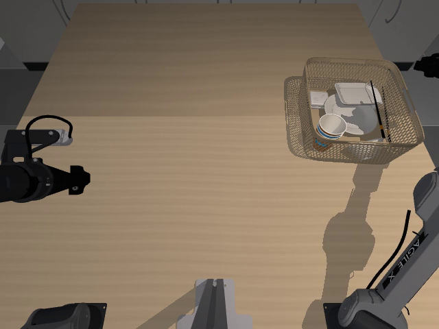
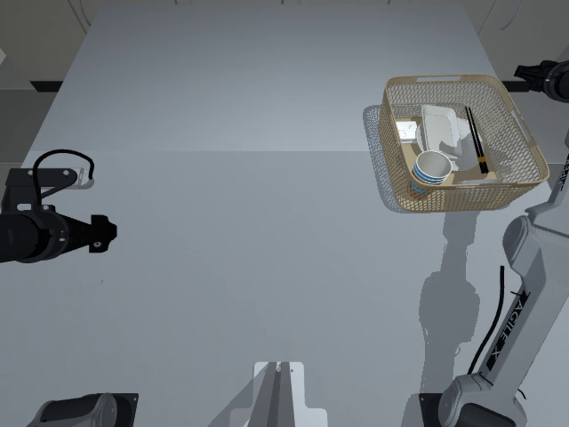
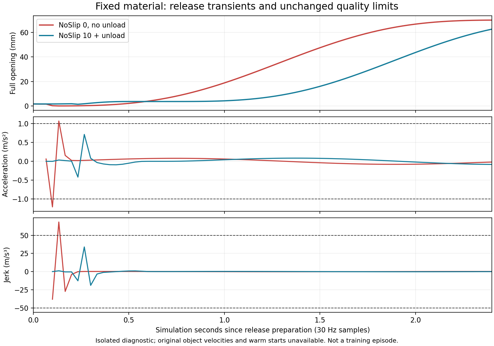

# VLA 数据生产平台审计（进行中）

目标是物理可信、可复现、高吞吐的合格数据生产，不以单个成功视频作为完成证据。
本审计从 `798d398` 开始。原有 PPO 工作不属于本次修改；所有真机接口仅做代码/记录审查，不连接 CAN。
用户目标正文在第七部分第 10 项“失败、成功、未验证、”处截断，已请求补充；已完整收到的要求全部保留。

## 验收证据清单

下表是工作清单，不是完成声明。每项只有取得对应当前版本证据后才可关闭。

| 范围 | 必需证据 | 当前状态 |
|---|---|---|
| 代码/历史基线 | 源码版本、dirty 状态、依赖/硬件、历史报告和当前复测分开 | 起始提交、各回合源码哈希、第三轮成功和失败结果均保留 |
| 六项历史现象 | Isaac 输出分辨率墙钟 FPS；种子 1/7/43 运动及碰撞复测；完整时间；加速版独立审计；标定来源 | 已复测；1/7 完整 RGB 通过，43 状态通过；仍有其他拒收布局，硬件标定缺失 |
| 关节动力学 | URDF/CAD 质量惯量/限位/驱动与两引擎实际参数对照，来源与未辨识范围 | MuJoCo 编译参数和 URDF 对照已保存；总驱动力与实机响应未辨识 |
| 抓取/接触 | 实际接触力/滑移/释放/非物理状态修改检查，双臂和自碰撞 | 新回合保存原生关节/力/接触证据；全帧几何复核通过一个基线，子步极值仍缺失 |
| 运动约束 | 目标与实测关节速度/加速度/jerk，TCP 速度，保持/释放阶段、随机种子回归 | 独立 v3 策略、初始状态与失败诊断已实现；新抓取/避障版本回归中 |
| 引擎一致性 | 相同姿态几何/相机/关节开口；物体落体/接触的可解释差异 | 腕相机 FK、相同初始落体已测；碰撞响应不同，不能视为动力学等价 |
| 相机/尺寸 | CAD 保持不变；三路 K/外参/模式/畸变/腕部更新；同姿态实虚误差报告 | CAD 未变；两条完整 RGB 的全帧 FK 已核对，真实内外参/畸变待标定 |
| 视觉域 | 材质/灯光/曝光/噪声/遮挡随随机种子变化；成像开销 | 500 个重置候选统计与后处理基准已完成；未认证真实感/覆盖全部现实条件 |
| 时序 | obs_t、施加目标、obs_t+1、仿真/主机/图像时钟，全部帧连续性 | 两条完整 RGB 闭文件审计通过；时间跳变、缓存隔离等负例已覆盖 |
| 数据存储 | 无损压缩、完整/失败隔离、共享帧一致性、崩溃恢复、磁盘限制 | 共享无损 RGB 默认启用，体积近减半；中断/源文件损坏拒收及恢复测试通过 |
| 性能 | 物理/IK/碰撞/渲染/读回/写入/审核/导出分阶段；资源占用；合格回合/小时 | 分阶段证据已保存；组件提速已测，合格端到端 2 倍尚未建立 |
| 批处理 | 预检重复成本、进程启动/资产加载、恢复调度、并行可行性、失败保留 | 独立并行入口、两个真实状态 worker 与恢复验证通过；汇总 RGB 导出需扩大验证 |
| 专家策略 | 停顿/绕路/任务顺序/双臂并行、抓取规划与错误恢复、独立质量审核 | 释放卸载已完成 RGB 验收；完整路径候选、越界曲线备选、细物体余量验证中 |
| VLA 语义 | 单位/顺序/夹爪映射/语言匹配，非特权训练字段与独立额外状态 | 官方 LeRobot 读取器验证两个完整回合、action chunk/末尾 padding/单位；未做模型训练收益实验 |
| 数据泄漏/多样性 | 稳定场景族拆分、重复轨迹/跨 split 检查、随机化覆盖和接受偏差 | 重置分布和录制近重复检索工具已建立；合格跨 split 样本量仍不足 |
| 正式验收 | 同条件基准、完整物理 RGB 回合、多种子且含未调参种子、LeRobot 读取和失败注入 | 未完成 |

## 起始观察

- `EpisodeWriter` 当前为每个 transition 分别写 obs/next_obs 图像，每步 flush。
  相邻帧虽在 MuJoCo 渲染层缓存，写盘仍重复；已有离线 compaction，不能节省采集时压缩成本。
- 批采集默认为状态预检后重跑完整 RGB 专家。当前不记录各阶段墙钟时间，也无断点恢复。
- Isaac 的 `step()` 即使无采集相机也调用 render；`read()` 每次重新 GPU→CPU 拷贝。
  这是候选瓶颈，尚未在本轮实测，不能直接下性能结论。
- 质量审核检查全部 transition 和图像，但接触/穿透量来自记录的教师遥测；质量阈值从 HDF5
  内嵌配置读取。后续必须区分“按记录声明阈值通过”和“按生产验收策略通过”。
- LeRobot 普通字段为图像、状态、动作及索引/时钟；物体真值和教师信息在 extras sidecar。
  导出器单位是 degree/归一化夹爪，不是 HDF5 的 rad/m，需要训练入口确认。
- 起始磁盘只剩约 8 GiB；先使用短诊断和已有数据，不删除任何源数据或旧基线。

证据存放在 `outputs/platform_audit_v1/`。短诊断、状态回合、RGB 训练回合需明确分开标记。
任何吞吐改进都必须保持原时间步、全部样本、像素和质量阈值；无实测即标记待验证。

## 第一轮证据与改进

### 当前版本复测

- `baseline_seed0/`：同样的随机化种子 0，物理模式 10/10 入篮，226.0667 秒，
  6,782 transitions；状态审核通过。动作/状态轨迹哈希和物体运动哈希均与上一轮
  `natural_motion_v3/rgb_seed_0` 一致。此回合没有 RGB，不能作为训练回合接受。
- `baseline_cprofile.json`：带 cProfile 的整回合约 389.9 秒，物理积分累计 250.5 秒；
  `robot_penetration` 累计 46.4 秒，任务 metrics 累计 23.2 秒。这些是包含 profiler
  开销的定位数据，不是未插桩的产线吞吐。规划、两次观测和教师检查有重复读取成本。
- `alignment/alignment_measurements.json`：原数字标注同姿态重投影诊断最大垂直残差
  67.1003 px；无拟合、无标定、CAD 未改变。它是有人工关联不确定度的诊断，不是标定板
  RMSE，也不是本轮实机采集得到的新内外参。

### 在线共享 RGB

`EpisodeWriter(image_storage="shared")` 只存 N 张 obs 图像和一张终止图像。
`next_observation/images` 使用同文件 HDF5 virtual dataset 映射到下一张，所有原公开字段、
shape、像素、时间戳都保留。每次共享前要求与上一 transition 的 next_obs 像素、采集时间
完全相同；缓存拥有独立副本，避免调用者复用缓冲区悄悄改写。中断/错误只留下 `.partial`。
验证错误即使被调用者捕获，也不能把截短回合发布为完整文件。

源像素：`outputs/natural_motion_v3/rgb_seed_0/episode.h5` 第 2400–2459 帧，三路
640×480，实际状态/动作/时间戳。三个重复、轮换顺序，每轮重新打开生成文件并检查全部图像。
临时诊断复制品在检查后删除，只保留 `writer_benchmark.json`；没有更改原数据。

| 写入方式 | 中位写入秒数 | 文件字节 | 写入倍率（对第一行） |
|---|---:|---:|---:|
| 两份 RGB，GZIP1，每步 flush | 2.980 | 163,045,130 | 1.00 |
| 共享 RGB，GZIP1，每步 flush | 1.642 | 83,262,865 | 1.81 |
| 共享 RGB，GZIP1，每 30 步 flush | 1.634 | 83,262,865 | 1.82 |
| 共享 RGB，LZF，每 30 步 flush | 1.002 | 112,418,421 | 2.97 |

所有方式的三路 RGB、动作/状态哈希相同；GZIP 共享格式的审核时间也从 1.104 秒降为
约 0.615 秒。结果只是无损写盘微基准，包含 close/flush，不包含仿真、规划、渲染或 fsync；
不能换算成整条产线已达 2 倍。flush 频率收益很小，优先保留每步 flush。
实际 RGB 回合接口验证后，默认采集已切换为共享 GZIP、仍每步 flush。
外部 `EpisodeWriter` / `SimulationSession` 的默认参数保留原布局；可显式选择共享模式。

实际物理抓笔对照 `rgb_pipeline_comparison.json`：553 transitions、18.4333 秒仿真，
每路原生 640×480/30 Hz，原布局 126.97 秒墙钟、共享布局 114.31 秒（约 1.11 倍）。
文件 1,492,591,995 → 750,717,757 字节；写盘本身约 1.83 倍。
这是单次顺序对照、单物体诊断，整桌任务未执行，两个文件均明确 `training_ready=false`。
两份数据所有 transition 均通过完整性审核，动作/状态哈希、每帧物体和相机位姿完全一致。

两次独立渲染的 RGB 未达到逐位相同：对每路 554 张唯一图像的全部像素比较，左腕 132、
中央 5,301、右腕 15,029 个通道值不同（各路共 510,566,400 个值），最大差 1/2/2。
原输入重复执行传感器后处理 12 次逐位相同，跨进程图像差异的具体来源尚未定位；
`rgb_all_frame_difference.json` 保留全部计数，不能宣称像素级跨进程确定性。
这与写入无损性分开：同一输入的所有 writer 微基准和回归测试都逐位一致，未丢帧或改时间。

复现（新输出文件）：

```bash
PYTHONPATH=src .venv-mujoco/bin/python scripts/benchmark_recording.py \
  --source outputs/natural_motion_v3/rgb_seed_0/episode.h5 \
  --output outputs/writer_benchmark_new.json --start 2400 --frames 60 --repeats 3

PYTHONPATH=src MUJOCO_GL=egl .venv-mujoco/bin/python scripts/profile_collection.py \
  --profile-output outputs/profile_new.json \
  --record --rgb --seed 0 --domain-randomization configs/domain_randomization/clean_table.yaml \
  --output outputs/profile_episode_new
```

插桩按物理积分、forward、IK、规划碰撞检查、渲染场景更新、渲染/读回、RGB 压缩写入、
元数据、flush、审核、checksum 和导出分别统计。inclusive 时间存在嵌套，不可求和；
exclusive 才可求和。未调用的阶段不声称为零成本。GPU 样本是整卡（包含其他应用），
尚未等价于本进程显存峰值或无竞争 GPU 基准。

### 独立生产验收策略

`configs/collection/quality_policy.yaml` 固定当前生产阈值，数值没有放宽。新版审核
`piper.collection.v3` 从独立文件加载策略，HDF5 中的教师阈值只作为溯源记录。
审核结果保存策略文件 SHA256。训练导出必须核对当前策略、源文件 checksum，以及内嵌/外置
审核报告一致性。旧 v2 审核需用明确策略重新检查后方能新导出；原始历史文件保持不变。

默认只读复核：

```bash
PYTHONPATH=src .venv-mujoco/bin/python scripts/audit_collected_episode.py EPISODE.h5 \
  --output NEW_AUDIT.json
```

要更新某个待发布 HDF5 的 acceptance，可显式加 `--update-acceptance`，并把新 sidecar
放在该 HDF5 同目录。这会改变文件 checksum；历史不可变基线不要执行该选项。
`--policy FILE` 由操作者选择，不能由记录中的路径指定。训练导出也支持相同 `--policy`。

剩余工作包括：完整任务的共享 RGB 回合和完整导出验证、Isaac 新基准、种子 7/43 复测、接触力与
自碰撞证据、策略/规划修复、调度恢复和并行、多样性/泄漏统计、同条件合格回合/小时对照。
整个审计目标仍未完成。

### 当前问题复现与参数来源

种子 1 已重跑完整物理回合：11/11 入篮，但小碟释放时右夹爪加速度
1.0461066 m/s² > 1.0，按原门限拒收。`seed1_profile.json` 记录墙钟 511.19 秒，
其中积分 384.23 秒、规划碰撞检查 21.07 秒、IK 5.79 秒、状态写入 19.83 秒。
期间存在独立的只读审核和测试进程；这个定位结果不是无竞争性能认证。
进程 RSS 峰值约 2.29 GB，GPU 显存数值包含无关应用，不归因于状态采集器。

当前旧 RGB 完整回合经 v3 独立策略只读重新审核仍通过（`existing_rgb_policy_v3.json`），
未改写原 HDF5、旧 sidecar 或旧验收哈希。

`physics_model.json` 从当前编译模型读取：30 Hz 控制、120 Hz 对外物理 tick、960 Hz 内部
积分，每个 action 32 子步，732 个 geom；机器人质量和主惯量与源 URDF 一致。
这不能证明实机动力学正确：相机/支架质量未辨识，URDF 六轴 velocity=10 rad/s 未实测，
MuJoCo 阻尼/armature、接触摩擦与夹爪控制参数是仿真假设。教师使用 `qfrc_applied`
施加偏置补偿，因此 actuator 的 forcerange 不能单独充当总关节驱动力上限。

## 第二轮：存储解除限制后的验证（进行中）

用户清理后，本轮开始时输出盘可用约 48 GB，已启动完整共享 RGB 回合及 LeRobot 导出验证。
`full_shared_seed0` 保留第一轮提交 `9be3d79` 的运动实现，用于检验存储；后续接触/释放改进
在独立状态回归中验证，不能混称为同一版完整 RGB 验收。

### 释放尖峰与自碰撞

种子 1 的小碟释放时，目标仍由 0 向外追赶，实际开口约 6.8 mm；接触消失时产生加速度尖峰。
候选策略先执行短距离平滑卸载，再张开至释放宽度。无物体锁定、位置赋值或门限放宽。

| 同种子完整状态回合 | 原实现 | 卸载候选 |
|---|---:|---:|
| 任务 | 11/11 | 11/11 |
| 记录仿真时长 | 255.1667 s | 258.6333 s |
| 最大实测夹爪加速度 | 1.0461066 m/s² | 0.8995333 m/s² |
| 独立运动门限 | 1.0 m/s² | 1.0 m/s² |
| 闭文件状态验收 | 拒收 | 通过 |
| RGB 训练验收 | 未做 | 未做 |

`release_seed1_comparison.json` 和 `failed_seed1_motion_v3.json` 使用同一独立策略重新计算。
失败文件的总审计会提前拒收；独立运动诊断仍可分析失败轨迹，但不会给它训练许可。
`audit_collection_motion.py` 现在也从独立策略读取门限，优先使用真实记录的 holding 标志。

`geometry_seed0.json` 对 6,783 个记录状态逐帧重建几何，没有发现当前模型报告的同臂或互臂
穿透；最大非目标接触为指尖/桌面约 0.528 mm。此检查保留模型相邻体排除与凸包近似，
不能观察 30 Hz 帧间碰撞。旧记录只有总开口，重建时两指各分一半，不是完整动力学复现。
基于这个检查，在线和规划碰撞门限已覆盖非相邻同臂接触，并加入相应反例测试；没有提高
4 mm 拒绝门限。拓扑索引使用弱引用缓存、接触过滤使用数组，减少重复 Python 名字查询。

新教师记录在特权 extras 内保存 8 个原生关节位置/速度、执行器力、外加力、约束力、
两指法向接触力、TCP 位姿/速度。它们是 30 Hz 求解器采样，不是子步极值或实机标定。
普通 VLA Parquet 列仍只使用公开图像、状态、动作及索引/时间字段。
种子 7/43/0/42 的新回归已完成：0、42 通过闭文件状态审计；7 在抓盘前因桌面约 4.01 mm
阻挡拒绝执行，43 在下一根筷子接近阶段因篮筐/右 link6 约 9.98 mm 阻挡拒绝执行。这两个
问题尚未修复；四个回合都不是 RGB 训练验收，不能用种子 1 的改善代替跨布局成功率。

### 可恢复批采集与性能边界

新批次记录 `run.json` 和逐任务 `jobs/*.json`。`--resume` 验证代码、配置、实际资产、依赖
版本及已通过数据的验收策略/校验和；文件或策略变化时要求另建批次。进程锁防止同时恢复。
中断尝试的原文件保留，新尝试使用 `_attempt_002` 等目录；已完成成功/失败不自动重跑。
完成但缺少审计的尝试进入 `unverified.jsonl`，与明确拒收、状态诊断和训练接受分开。
清单原子发布；恢复测试覆盖中断、证据损坏、配置变化及并发锁。旧批次没有 journal，不能
直接用此选项恢复。若导出完成后尚未来得及写 checkpoint 就中断，恢复会拒绝覆盖该导出，
需要独立校验或另设导出目录。

真实四回合批次完成后执行恢复：0.482 秒复用四个完成任务，没有新建重试目录；所有 HDF5
和 jobs 文件的 SHA256、大小及修改时间保持一致（`batch_resume.json`）。这是同一代码/
配置快照上的恢复证据；后续源码变化后，应按约定新建批次。

```bash
# 参数与首次启动保持一致；timeout 可以调整。
PYTHONPATH=src MUJOCO_GL=egl .venv-mujoco/bin/python scripts/collect_clean_table.py \
  --states-only --output outputs/platform_audit_v1/regression_contact_v2 \
  --seeds 7 43 0 42 --resume
```

每个结果记录预检/采集墙钟时间。summary 的 rate 仅按已完成阶段计时，明确排除中断尝试、
恢复检查与最终导出；它不是端到端吞吐认证。预检仍可用 `--skip-preflight` 显式关闭。

RGB 后处理的 gamma 改为 256 个值的 float32 查表，后续白平衡、噪声与最终取整保持原计算。
200 组 gamma、完整 uint8 值域探针逐位一致；含噪声/模糊的像素回归也通过。单独 gamma
步骤中位耗时约 3.82 → 1.39 ms；这是微基准，不能称为整回合 2.75 倍。
新 profiler 使用 `nvidia-smi pmon` 单独记录本进程（包括 EGL graphics）的显存，和整卡
使用量分开。没有采到该进程时保留空值，不报零占用。

### 完整 RGB 与官方 LeRobot 读取结果

`full_shared_seed0` 已完成 10/10 物体任务、6,782 transitions、226.0667 秒记录，
三路均为 640×480/30 Hz。闭文件 v3 审计和训练导出均通过；动作/状态哈希与旧基线一致。
HDF5 从 18,219,534,877 减为 9,147,511,695 字节；完整 LeRobot 导出约 115 MB。
这个回合检验第一轮存储改进，没有采用后续卸载策略或新增力证据。

完整进程墙钟 1,822.09 秒，包含仿真、审核和导出：物理积分累计 254.02 秒、渲染/读回
453.69 秒、成像后处理 350.11 秒、recording append 188.46 秒、审核 80.08 秒、导出
399.50 秒。阶段有嵌套，不能直接求和。单次观测相当于约 1.98 条合格回合/小时、每十进制
GB HDF5 约 741 条 transition；同机存在其他审计/测试负载，不能当作稳定产能或 2 倍提升。

使用独立环境中的官方 `lerobot==0.3.3`、`datasets==3.6.0`、PyAV 读取完整 v2.1 导出，
未修改用户现有环境。实际检查首帧、中间帧、倒数第二帧、末帧：三路 RGB tensor、14 维
state、16×14 action chunk、任务语言、30 Hz 时间索引，以及末尾 action padding 均符合
读取器约定。关节角从弧度转为度、总开口除以 0.095 m 后与 HDF5 相符；特权物理信息未进入
普通训练行。H.264 为有损视频，报告保留抽样像素误差，不宣称与原始 RGB 逐位一致。
证据为 `lerobot_official_reader.json`，复现脚本为 `scripts/check_lerobot_reader.py`。

### 当前两引擎三路相机基准

相同配置、每轮 180 transitions、3 次重复、三路 640×480/30 Hz、共享 GZIP、headless，
用小幅关节运动检查腕相机更新和记录。它不是收桌任务成功率测试。当前墙钟帧率中位数为
MuJoCo **6.147**、Isaac **5.310**；不是仿真时间轴的 30 Hz。Isaac 保留默认 RTX/DLSS，
640×480 是输出分辨率，内部渲染可能使用较小分辨率，不能称为每条光线原生 640×480。

Isaac 的 1,270 次 observation read 重复执行了 1,270 次成像后处理（累计 57.77 秒），
MuJoCo 已按状态复用，只有 634 次（28.30 秒）。这是下一步可验证的重复计算优化点。
Isaac 本进程 RSS 采样峰值约 7.88 GB、pmon 显存峰值 6,335 MB；整卡另有其他应用占用。
结果与限制见 `backend_native_comparison.json`，复现脚本为 `scripts/benchmark_backend.py`。

### 同时刻图像复用与导出统计

Isaac 现在按实际 camera capture revision 和控制帧缓存 CPU 图像/相机位姿。每次 read
先触发 Isaac Lab 的懒更新，再判断是否复用；reset 清空缓存，静态对齐工具强制采图也会
增加 revision。返回值拥有独立副本，修改某次返回的图像不会污染下一次观测。控制状态、
时钟及物体信息每次正常读取，不复用旧状态。

同进程、交替顺序、各三轮 180 帧对照：未缓存 **5.5524**、缓存 **7.6349** 墙钟帧/秒，
中位数比 **1.375**。各轮完整流审计通过；同一捕获的缓存/重新处理图像逐位一致，强制新
捕获可使缓存失效。六个诊断文件全部 181 个状态的腕相机位置与 URDF FK 对比，最大误差
约 0.292 μm（仅仿真数值一致性，不是实机标定精度）。保留 `isaac_cache_comparison.json`
和 `paired_camera_fk.json`；没有把该微任务收益称为整桌生产收益。

LeRobot 视频导出的 RGB 统计改为每通道 256 个整数计数，避免每帧生成 float64 全图并重复
求和/极值。最后计算均值及中心方差；编码输入、尺寸、帧率及 H.264 参数不变。24 张预加载
真实仿真图像、三次交替重复的统计步骤约快 **14.7 倍**，与旧统计最大数值差约 2.39e-12；
常量、二值和完整灰度级的解析统计测试通过。对 6,782 帧完整回合重新导出，耗时为
120.73 秒，先前导出为 399.50 秒（单次观测约 3.31 倍，负载/文件缓存条件不同）。三路
MP4、Parquet、extras 与原导出 SHA256 完全相同；全部统计最大差 7.61e-12。
`export_histogram_comparison.json` 保留证据。这是导出阶段收益，不是整条产线 3.31 倍。

### 随机化覆盖边界

默认配置采样种子 0–499：500 个不同有效布局，255 个两杯、245 个三杯；三种桌面材质
计数为白 161、灰 192、木 147，四种杯身颜色均出现。train 406、validation 94，未发现
完全相同布局跨 split。统计在去掉 seed 和非活动物体后计算，不靠种子字段制造唯一性。
完整位置、质量/摩擦、曝光/白平衡/噪声/模糊等范围见 `scene_diversity_500.json`。

这些只是重置候选布局，未跑物理任务，不能充当 500 次成功采集。两侧仍共享物体网格、语言
模板和随机范围，当前 split 只测试同分布布局泛化；不代表未见物体、任务或环境泛化，也
尚未做已录制图像/轨迹的近重复检索。CAD 尺寸、相机标定、重力和时序按要求保持固定。

第二轮最终非 PPO 全量回归 **189 passed in 87.78 s**，含缓存隔离与 RGB 统计新增测试。
更多随机种子、策略/路径修复、更新策略后的完整 RGB 验收、并行调度及端到端 2 倍目标
仍未完成；不把状态诊断算作合格 RGB 训练数据。

## 第三轮：完整录制、抓取路径和接触诊断（进行中）

### 种子 1 的完整 RGB 验收

`full_unload_seed1` 使用第二轮 `e06ec0a` 的释放卸载策略，已完成 11/11 物体、7,759 个
transition、258.6333 秒记录；三路 640×480/30 Hz 的闭文件 v3 审计通过，`training_ready=true`。
官方 LeRobot 0.3.3 读取器再次通过四个时间位置、16 步 action chunk 和末尾 padding 检查。
新增力证据留在 extras，没有加入视觉策略的普通训练列。

总墙钟 1,739.27 秒，包含采集、审核和导出；渲染/读回 564.76 秒、成像后处理 344.73 秒、
物理积分 391.64 秒、writer append 165.68 秒、审核 83.67 秒、导出 116.95 秒。
阶段存在嵌套。此时同机有状态回归和诊断任务，不能把与另一种子/负载的比值当同条件提速。
单次观察约 2.07 条合格回合/小时；本进程 RSS 采样峰值 2.89 GB、EGL 显存约 1,009 MB。

`full_seed0_camera_fk.json` 和 `full_seed1_camera_fk.json` 分别核对全部 6,783/7,760 个状态
（含终止状态），腕部外参跟随 URDF FK，位置数值误差均小于 0.3 μm；中央相机保持静止。
这仅验证程序坐标链一致，不是相机标定精度或真实视角对齐认证。

### 抓取候选和有界路径

只检查抓取点 IK 可达不足以保障完整接近路径。现在先在 scratch 数据上验证预抓取和连续
下降轨迹，再执行候选。盘子候选只改变夹持点/局部姿态，未改 CAD、物体位姿或碰撞门限。
种子 7 从原来的桌面碰撞推进到真实双指抓盘、抬升和入篮，但后续暴露两个独立问题：

1. 自然三次样条在合法 IK 节点之间越过关节 5 上界约 0.000208 rad。无载路径现在可尝试
   clamped B-spline；端点精确，内部 IK 点作为控制多边形、曲线位于其关节凸包内。不会逐值
   裁剪指令，仍检查完整曲线的碰撞和速度/加速度/jerk；载物路径不使用此备选。事件中记录
   `bounded_path_selected`，元数据明确内部点不再精确插值。
2. 盘子回撤解决后，筷子在搬运时擦到篮筐并滑脱。全帧末段几何诊断发现约 0.137 mm 的
   瞬时筷子/篮筐重叠。4 mm 的拒绝门限不能充当细物体搬运的安全余量。独立状态试验中，
   原路径再次滑脱；增加 1/3/6 mm 正间距后均完成搬运和下放。默认候选给筷子搬运增加
   6 mm 规划余量，使用 signed geom distance 检查未接触但过近的情况；验收门限未放宽。
   最初的 3 mm 候选在种子 2 仍滑脱；6 mm 候选通过原有中间姿态重新规划后，在独立搬运
   试验中保持双指接触，最大相对滑移约 1.96 mm。完整多种子复测仍在进行。

种子 43 的原篮筐碰撞可用倾斜姿态避开，但实测没有夹住筷子，因此该版本仍被拒收。
诊断发现倾斜指尖先碰桌面。刚体教师现在保持筷子夹爪直立，在实际长轴中央区域选择夹持点
（最多 ±40 mm，且不超过长度的四分之一）。该修复版本种子 43 已完成 11/11 并通过状态
审计；它还不是 RGB 训练回合，也不能替代新增搬运余量版本的复测。

所有失败回合保留：`grasp_candidates_v3`、`bounded_seed7`、`axis_seed7` 及 holdout 种子 2。
`diagnose_failed_paths.py` 只做几何规划；`diagnose_grasp_capture.py` 和
`diagnose_payload_clearance.py` 每次试验只恢复一次记录的初始状态，后续全程物理控制。
它们缺少历史物体速度和求解器 warm-start，因此是独立诊断，不能算历史逐位回放或训练验收。

### 两进程采集与引擎接触差异

`worker_feasibility/report.json` 对三路 640×480、共享 GZIP、每进程三轮 180 帧进行测量：
单进程端到端 4.210 transition/s；两个独立进程合计 6.846 transition/s，观察比值 **1.626**。
包含进程启动、warmup、close 和流审计，但只有简单关节运动，`success=false`，不算合格
任务回合。该对照每组只有一次，期间有完整 RGB 任务共享主机；该测量本身没有验证生产调度。

`drop_mujoco/report.json` 与 `drop_isaac/report.json` 在同一名义场景中，将同一 0.1 kg
充电头放在指定初始高度一次后自由落下，记录 91 个状态：

| 指标 | MuJoCo | Isaac / PhysX |
|---|---:|---:|
| 初始段拟合垂直加速度 | −9.810000 m/s² | −9.809992 m/s² |
| 内部物理步长 | 1/960 s | 1/120 s |
| 最终物体 root z | 24.932 mm | 25.000 mm |
| 最低采样 root z | 18.526 mm | 24.071 mm |
| 最后十个采样的最大线速度 | 约 0 | 0.000203 m/s |

root 高度不是网格穿透深度；该结果显示接触瞬态不同，不能只因最后停在相近位置就宣称
动力学一致。两个引擎的求解器、子步、contact offset/softness 和碰撞代理不同；还需实机
落体/摩擦/夹持响应辨识。没有用改重力、瞬移或教师吸附来让曲线一致。

### 已录制数据的重复检索

`audit_recorded_duplicates.py` 读取显式带 split 的 JSONL 清单，计算整条动作/状态哈希、
去掉 seed 的活动物体布局哈希，以及 129 个归一化轨迹采样和 9 个 RGB 缩略采样。
检索特征仅用于找候选，不改变记录、split、质量判定或导出像素。

`recorded_duplicates_v2.json` 比较旧种子 0、新共享存储种子 0、完整种子 1：准确找到前两者
相同布局和相同动作/状态轨迹。这是存储回归复制品，合并生产数据时应只保留一份。
三条都按原规则属于 train，因此这组结果没有实际 train/validation 对照，不能据此宣称
跨 split 无泄漏。背景相似、时间相位错位和未采到的局部变化仍可能影响近重复检索。

随后加入状态诊断种子 9（validation）的 `recorded_duplicates_with_validation.json`，未检出
它与上述 train 回合的完全相同布局或轨迹。种子 9 没有 RGB，跨 split 视觉相似度仍未测；
单个验证布局也不能代表验证集多样性。

### 接近开口与完整回归

3 mm 余量版本的种子 7 虽然完成 11/11，但夹爪实测加速度约 1.568 m/s²，仍按原门限拒收。
把闭合时间延长到两倍、三倍不能消除峰值：碰撞发生在张开夹爪下降阶段，指垫先碰到了旁边
的另一根筷子。局部物理对照把接近开口从 12 mm 改为 10 mm 后，仍完成双指抓取和抬升，
该段峰值降至约 0.367 m/s²。依据是 `seed7_closing_probe.json`、`seed7_aperture_probe.json`。

当前候选根据筷子实际横截面投影计算开口，再加 4 mm 接近间隙，名义 6 mm 筷子约为 10 mm。
物体滚动时使用新的截面姿态；不改变夹爪限位、驱动力、质量门限或记录频率。
`aperture_clearance_seeds7_43/episode_000000_seed_7` 完成 11/11，7,861 transitions、
262.0333 秒仿真；完整状态审计通过，最大实测夹爪加速度约 0.90251 m/s²（本次全回合峰值
发生在抓笔阶段）。它没有 RGB，`training_ready=false`；新版本完整 RGB 另行验证。

加入并行入口和收尾监测后的非 PPO 全量回归为 **207 passed in 85.88 s**。原来的失败、仅局部通过、完整
状态通过与完整 RGB 训练通过分别保留，不能相互替代。

同版本种子 43 也完成 11/11 并通过完整状态审计。种子 2 虽然解决了筷子搬运滑脱并完成
11/11，仍因实测机械臂 jerk 229.29 rad/s³ 超过 200 而拒收。原生关节逐帧几何复核在
178.10 s 发现右指尖/篮筐约 0.136 mm 接触，随后出现 jerk 峰值；发生在前一盘子放下后
转向小碟的路径，不是筷子搬运阶段。不能因碰撞深度低于 4 mm 就认定没有运动质量影响。

`seed2_approach_rise_probe.json` 恢复该转场起点后用正常控制器积分：原路径复现 jerk
229.29 和约 0.136 mm 接触；先竖直上撤 20/40 mm 的局部试验无采样接触，峰值分别约
11.81/14.43 rad/s³。它只验证接近到预抓取点，尚未集成成通用转场避障策略，也不是完整
回合通过。`scripts/diagnose_approach_clearance.py` 保留可复现实验入口。

种子 13 在当前默认放置目标下因筷子未完全留在篮内拒收（9/11）。只将两根筷子的篮内
放置目标沿篮筐局部 x 轴向机械臂方向移 30 mm，保持初始摆放、CAD、控制/物理参数和
门限不变后，`placement_goal_seed13` 完成 11/11，总仿真 263.5667 s（含 1 s 预热），闭文件状态审计通过。
可复现配置为 `placement_slot_candidate.yaml`；目前仍是候选，未替换默认目标、未做 RGB
或其他种子的完整验证。孤立释放试验中的原位置也曾成功，说明缺少速度/warm-start 的
局部恢复不能完全复现原失败；完整回合证据优先于局部试验。

### 尚未解决的接触建模限制

现有刚体教师会按当前对象切换夹爪力上限、控制增益，以及指垫的滚动摩擦、接触
softness 和求解器 noslip 次数。改变力上限/增益可对应控制策略，但同一指垫的材料属性随
任务对象类别切换，没有实测支持。当前域随机化改变物体摩擦，指垫参数则由教师设置，
两者共同决定有效接触响应，不能把物体的采样范围等同于最终接触系数范围。因此不能将
`physical` 模式解释为已辨识的实机接触模型。它仅表示运动由动力学和接触积分产生，
没有使用附着约束或逐帧设置物体姿态。

`contact_friction_mixing_v2.json` 用实际录制的双指抓笔姿态做了独立参数检查：物体滑动
摩擦从 0.52 / 0.65 / 0.78 改变时，所有恢复出的指垫/笔接触仍使用滑动摩擦 1.0，五维
接触摩擦向量保持 `[1, 1, .015, .002, .002]`。指垫 geom priority=1，物体为 0。
因此，现有“物体摩擦随机化”并未覆盖这个抓取接触对的有效摩擦。这是当前待修问题，
不能把 500 个重置中的摩擦采样统计当作 500 种真实夹持响应。复现工具为
`scripts/audit_contact_mixing.py`；只在 scratch 模型变化参数，不推进物理或修改原记录。

目前的质量通过是“满足当前仿真模型与独立数据策略”，不是现实成功率认证。后续需要
固定指垫材料参数、显式建模对象材料配对，并用真实夹持/摩擦试验辨识范围，再独立回归；
不能为了保留现有通过率而隐去这项限制。

### 运动节奏的量化边界

`cadence_full_episodes.json` 按原始 30 Hz 时间戳统计完整种子 0、1 和当前状态种子 7。
同时满足目标与实测各关节速度低于 0.02 rad/s、夹爪低于 0.002 m/s 的时段约占
19.70%、19.56%、19.90%；持续至少 250 ms 的段数为 69、74、73，最长约 2.33–2.53 s。
其中包含必要的抓取、释放、套叠稳定和轨迹端点减速，不等于全部可删等待时间。种子 1 的
接近/抬升/搬运分别约 55.3/53.0/40.6 s；它们是原事件标签下的阶段归属，不是独立 CPU 耗时。
这三个回合布局和版本不同，不能用时长差直接计算策略加速倍率。

当前已经按 30 Hz 控制/记录。增加采样频率本身只增加同一物理过程的样本数，不会缩短
视频对应的仿真时长；改变编码 fps 却不重采样只会使播放和动作时间失配，禁止用于训练提速。

### 并行调度与固定收尾等待的问题

`collect_parallel_clean_table.py` 使用独立 worker journal 和进程组，父进程复核结果后汇总，
支持分 split 统一 LeRobot 导出。真实 `parallel_scheduler_states` 同时执行种子 0/9：
9 通过状态审计，0 虽然 10/10 入篮，却因最后仅连续稳定 0.9 s（要求 1 s）拒收。
父进程正确保留两个结果，不将任务完成计作数据通过。

再次以原参数 `--resume` 耗时约 1.04 s，复用成功与失败结果，没有新增 attempt 目录。
两份 HDF5 和各 worker 的 jobs 文件 SHA256、大小、修改时间完全不变，证据为
`parallel_scheduler_resume.json`。父进程的汇总/调用记录会正常更新；恢复调用不报告生产速率。

种子 0 的三相机完整 v6 回合也因同一收尾问题拒收，不能计算为合格吞吐。固定等待 2 s
不保证最后 1 s 内角速度始终不超过 0.1 rad/s；该回合末段峰值为约 0.10123 rad/s。
新收尾逻辑保留原来 2 s 最短时长，按每个真实控制步观测物体位姿和成功状态，在必要时延长
至连续稳定满 1 s，最多等待 5 s。所有延长帧正常录制；超过时限仍失败。默认门限不变，
闭文件审核保持独立，不能追认旧 v6 失败文件为合格。

v7 已完成种子 0/7 的完整物理状态回归，两者都通过闭文件审核。种子 0 从 6,880 增至
6,930 transitions，真实增加 50 帧/1.6667 s，末尾连续稳定 1 s；它在额外等待中再次有
轻微转动，因此简单固定补 0.1 s 并不充分。种子 7 保持 7,861 transitions，不增加等待。
与 v6 RGB 回合逐帧比较，两者原有前缀的动作、观测/下一观测、仿真时间和全部物体位姿
完全相同；证据为 `final_stability_regression.json`。新种子 0 仅做状态验收，尚无 v7 RGB
训练回合；旧失败文件保持拒收。

### 完整两进程 RGB 结果

`qualified_parallel_v6/report.json` 同时运行种子 0/7，包含两个尝试、闭文件审计、合格回合的
LeRobot 导出与父进程复核，总墙钟 **1,969.60 s**。种子 0 因上述稳定时长不足拒收；种子 7
完成 11/11、7,861 transitions、262.0333 s 记录，三路 640×480/30 Hz，通过独立 v3 策略。
原始共享无损 HDF5 为 9,708,742,062 字节。官方 LeRobot 读取检查也通过，含三路图像、
16 步 action chunk、末尾 padding 和单位换算，见 `qualified_seed7_reader.json`。

该次观测为 **1.828 条合格回合/小时**，合格 transition 吞吐 3.991/s，所有尝试的原始
transition 吞吐 7.484/s。只计合格 HDF5 时约 810 个有效 transition/十进制 GB；把失败文件
也计入磁盘成本后约 413 个/GB。失败数据被保留，不用于训练。当前仍**没有建立至少 2 倍
有效吞吐量**；不能以原始帧吞吐替代合格产能。该批期间有状态回归/测试共享主机，且没有
相同种子、相同新版本的串行配对试验，不能据此给出准确并行加速比。

种子 7 的阶段 inclusive 时间约为渲染/读回 697.04 s、成像后处理 353.30 s、物理积分
405.37 s、写入 205.33 s、审核 95.64 s、导出 131.82 s；IK 4.99 s、规划碰撞检查 6.58 s。
存在嵌套，不能把这些数直接求和。单进程 RSS 采样峰值约 2.89 GB，独占可归因 EGL 显存
约 1,009 MB；整卡显存还含其他应用。渲染/读回和物理仍是主要成本，失败率则直接损失产能。

中央相机视频独立检查为 7,861 帧、30/1 fps、262.033333 s，没有播放加速；下图是其最后
一帧解码图。它证明可见任务结果，不是实机视角标定或训练收益认证。



## 2026-11-09 第四轮：按间距选择转场路径

空手转场增加了对目标容器的正间距检查：默认要求至少 2 mm，关节路径按最大
0.01 rad、夹爪开度按最大 1 mm 采样。直接路线不足时，先在 scratch 状态中检查
20/40/60 mm 竖直上撤及后续完整转场，保留中央途经点候选；只有两段均通过才执行。
原 4 mm 穿透拒绝、持物转运 6 mm 余量和独立审核门限均未修改。上撤起点允许靠近容器，
上撤段仍按原碰撞门限检查，正间距要求用于随后的空手转场。这是采样预测，不是连续
无碰撞证明，实际运动仍由物理积分并接受记录后审计。

`transit_clearance_states_v8` 的四个完整状态回合全部通过独立 v3 策略：

| 种子 | 入篮 | transitions | 记录时长 | 新增绕行 |
| --- | --- | ---: | ---: | --- |
| 0 | 10/10 | 6,930 | 231.0000 s | 无 |
| 2 | 11/11 | 7,748 | 258.2667 s | 小碟接近前上撤 20 mm |
| 7 | 11/11 | 7,861 | 262.0333 s | 无 |
| 43 | 11/11 | 7,550 | 251.6667 s | 无 |

种子 2 的原路径预测距篮筐仅 1.15 mm，因此选择上撤。相对原失败回合只增加
26 个真实控制步（0.8667 s），在线测得臂 jerk 峰值从 229.2874 降至 34.5817 rad/s³；
独立审核在存储 float32 状态上重算得到 34.5683，低于原门限 200。种子 0/7/43 的
动作/状态轨迹哈希和全部物体位姿哈希与之前对应回合完全相同，没有普遍增加绕行或等待。
证据见 `transit_clearance_regression_v8.json`。这些是开发回归种子，不是新的留出成功率；
状态回合也不自动成为 RGB 训练样本。

### 中断恢复实测与 SIGTERM 修复

该状态批次原父进程以 143 退出，信号来源未确定；当时一个 worker 及录制子进程仍在运行。
旧代码仅在 Python 异常／Ctrl-C 时执行清理，没有将 SIGTERM 转成可清理的退出。
等待所属 worker 完成后，用原代码与参数恢复汇总约耗时 1.84 s，四份 HDF5 及 worker
任务记录的 SHA256、大小和修改时间均未变化，见 `transit_v8_parent_recovery.json`。
原 `invocation_001.json` 保留中断时的 running 状态，恢复的 `invocation_002.json` 为完成；
不能把恢复耗时计作采集吞吐。

并行入口现已捕获 SIGTERM，先记录中断、清理所属进程组，再以 143 退出。对已异常退出
的 worker 组也执行清理，避免遗漏其录制后代；忽略 SIGTERM 的后代使用 SIGKILL 清理。
真实进程集成测试验证了中断日志、无接受结果、后代退出及无关进程继续运行。
SIGKILL／机器掉电仍无法运行清理程序，journal 与 partial 文件用于后续恢复，不宣称可捕获。

### 固定指垫材料的独立试验

新增 `diagnose_fixed_contact.py` 与 `probe_fixed_contact_rollout.py`，不更改默认教师。
候选取消按目标对象切换指垫材料：一次试验内固定滑动摩擦 1、扭转摩擦长度 15 mm、
滚动摩擦长度 2 mm、接触时间常数 10 ms 和同一组 impedance，再将三个摩擦分量统一
乘以 0.8/1.0/1.2。保留原来按对象设置电机力上限／增益的控制策略及负载时的求解器
迭代细化。这些材料数值未做真机辨识，候选与默认配置的证据分开保存。

`fixed_pad_material_probe_v1.json` 从历史接近起点恢复机器人位置/速度、物体位姿，之后
正常积分完成单件搬运。笔和盘子在三个倍率下均入篮且通过在线运动门限；小碟在 1.0/1.2
下完成，在 0.8 下失去双指接触、滑移约 29.5 mm 并触发夹爪加速度拒收。每一组实际
solver contact 的摩擦向量均正确反映设定倍率，例如 0.8 得到 `[.8, .8, .012, .0016, .0016]`。
这证明改变指垫参数确实覆盖了抓取接触，与仅改变低优先级物体 geom 摩擦的旧行为不同。
相关混合规则见 [MuJoCo 官方接触参数说明](https://mujoco.readthedocs.io/en/stable/modeling.html#contact-parameters)。

局部恢复没有原物体速度和 warm start，且之前已放物体的位置来自旧材料回合，因此不是
同参数从头运行的精确替代。固定材料 0.8 倍的种子 1 从初始化完整运行后反而完成 11/11、
8,028 transitions、267.6 s 记录，并通过独立状态审计：
`fixed_material_seed1_scale08/audit.json`。局部失败没有被删去，也没有用于宣称这个完整回合
失败。另一次局部试验只将固定滚动摩擦长度改成 8 mm，在 0.8 倍下小碟完成，但该设置尚未
经过完整回合验证，不能据此选择有利参数来宣称真实材料已辨识。

两个新入口都明确标记为诊断。完整候选仍使用既有 recorder 与独立审计，元数据保存
替换教师的源码 SHA256 和实际固定材料；仅状态输出不进入视觉训练接受清单。默认生产
配置暂不替换，仍需更多种子、倍率、有效接触统计和完整 RGB 验证后再决定。

固定材料 1.0 倍的种子 1 完整回合在 219.3667 s 发生小碟滑脱，8/11，拒收；
`fixed_material_seed1_scale10` 保留原始状态记录。`diagnose_contact_loss.py` 对失败前 20 帧
按原位姿重建几何接触，恢复原 multi-contact 开关，力只引用原 30 Hz 记录而不重算。
在该采样区间没有小碟与篮筐/其他物体的几何接触；失效前指垫/小碟穿透约
0.56–0.58 mm、每指记录法向力约 13 N、总开度约 1.53 mm。随后双指接触消失，开度
降到 0.10 mm，最后滑移达到 27.45 mm。证据为 `fixed_material_seed1_loss_geometry_v2.json`。
这些观察将问题缩小到薄边夹持的接触/姿态稳定性，但不足以在未辨识材料时断言唯一根因；
尤其不能单纯增加摩擦来把候选重新算作成功。

第三个固定材料完整状态试验为种子 43、1.2 倍摩擦：11/11、7,516 transitions、
250.5333 s 记录，通过独立审核。三个完整试验共两次通过、一次小碟滑脱拒收，布局和倍率
同时不同，不能据此估计总体成功率或推出摩擦越大越可靠。默认接触配置继续保持原样。

本轮代码回归为 **211 项非 PPO 测试通过，93.53 s**。其中新增实际 SIGTERM 进程树清理、
正间距查询与碰撞掩码变化、完整绕行预检和无必要绕行等测试；QVEL 警告仍来自既有故障注入。

### v8 完整三路 RGB 与合格产能

`qualified_parallel_v8` 同时采集种子 0/2，均完成物理任务、通过独立 v3 审核和 LeRobot
导出，父进程再次校验。总墙钟 **2,038.8273 s（约 33.98 分钟）**，计入两次尝试、审计、
导出与父进程复核，得到 **3.5314 条合格回合/小时、7.1992 个合格 transition/墙钟秒**。
这次基准不做状态预检，因此不含此前单独状态回归的成本；默认批采集若保留预检，产能应
连同预检重新计时。该批仍与状态诊断/测试及其他应用共享主机，不能与旧不同种子批次直接
计算加速比，也尚未证明至少 2 倍有效吞吐。

| 种子 | 完整入篮 | RGB transitions | 原速时长 | 共享无损 HDF5 |
| --- | --- | ---: | ---: | ---: |
| 0 | 10/10 | 6,930 | 231.0000 s | 9,396,547,268 B |
| 2 | 11/11 | 7,748 | 258.2667 s | 8,439,897,932 B |

三路均为 640×480/30 Hz。两个 RGB 回合的动作/状态轨迹哈希、物体位姿哈希与 v8 状态
预检分别完全相同。合计每十进制 GB 约 823 个有效 transition，包含 before/after 三相机
共享无损存储。LeRobot 官方本地读取器分别抽查初始、中间和末尾共四个位置，验证三相机、
16 步 action chunk、padding、单位及特权字段隔离；这部分兼容性检查在上述计时之后执行。
中央相机视频全帧解码数量与记录一致，另人工查看三个抽帧；这是抽查，不是逐帧人工复核。

种子 2 的 inclusive 耗时：渲染/读回 697.03 s、成像后处理 351.02 s、物理积分 471.71 s、
写入 198.86 s、审核 104.53 s、导出 130.35 s、IK 4.26 s、规划碰撞 11.44 s。
各项有嵌套，不可直接求和。两个进程 RSS 采样峰值分别约 2.88/2.81 GB，可归因 EGL 显存
各约 1,009 MB。渲染/读回、物理和成像后处理仍是主要成本，IK 不是当前主要吞吐瓶颈。
完整数据见 `qualified_parallel_v8_analysis.json`，消费者检查见 `qualified_v8_seed*_reader.json`。

- [种子 0 中央相机原速视频](../outputs/platform_audit_v1/qualified_parallel_v8/seed_0/lerobot_v2/videos/chunk-000/observation.images.cam_external_rgb/episode_000000.mp4)
- [种子 2 中央相机原速视频](../outputs/platform_audit_v1/qualified_parallel_v8/seed_2/lerobot_v2/videos/chunk-000/observation.images.cam_external_rgb/episode_000000.mp4)

视频与 HDF5 留在本机，Git 只保存代码、诊断/审核报告及少量原视频解码图。当前通过仍指
现有未标定仿真接触模型和独立数据策略；固定材料候选的失败、实机 K/外参和接触辨识缺口
均未消除，不宣称达到真实部署成功率或稳定的大规模生产水平。



### 固定指垫后端配置与释放阶段诊断（v9 候选）

新增可选 `mujoco.finger_contact`，由 MuJoCo 后端加载独立材料配置、在 reset 时采样并保持
整回合不变。左右指垫使用独立、可复现的 RNG 子流；名义滑动/扭转/滚动系数为
`[1, .015, .002]`，三分量共同乘以各自的 0.8–1.2 倍率，接触时间常数 10 ms。
这是未标定范围，不能理解为真机辨识结果。默认 `clean_table_workcell.yaml` 未启用候选。

`clean_table_fixed_contact.yaml` 启用同一套材料供自动教师和外部 HTTP 控制使用；材料不再
随笔、盘子、小碟切换，目标相关电机力/增益仍属于明确记录的控制策略。独立文件的 SHA256、
完整参数与实际左右倍率写入会话/HTTP/HDF5 元数据，并由 LeRobot 旁路元数据保留。
运行中若材料被改写、全局 contact override 开启或其他 geom priority 覆盖指垫，拒绝继续
步进。Isaac 显式拒绝该 MuJoCo 专用配置；未实现的物理等价关系不作隐式回退。

测试通过实际 solver contact 检查摩擦、solref、solimp，覆盖重复 reset、不累乘、教师
切换对象和真实 HTTP 服务录制。阻抗与时间常数还避免依赖隐式截断；相关依据见
[MuJoCo 接触参数](https://mujoco.readthedocs.io/en/stable/modeling.html#contact-parameters)与
[求解器参数](https://mujoco.readthedocs.io/en/stable/modeling.html#solver-parameters)。
本项只覆盖指垫接触，不能证明原有物体/桌面摩擦随机化都有效。

`backend_fixed_contact_v1` 从初始化运行三条完整状态回合，保持原采样率与独立质量策略：

| seed | 左/右指垫倍率 | 任务完成 | 独立状态审计 |
| --- | --- | --- | --- |
| 0 | 0.841388 / 1.105694 | 10/10 | 通过 |
| 1 | 0.915474 / 0.819715 | 11/11 | 拒收：夹爪加速度/jerk |
| 43 | 0.862813 / 0.864211 | 11/11 | 通过 |

种子 1 的右夹爪在小碟释放阶段达到 1.2116 m/s²、68.9949 m/s³，超过原来的 1/50 门槛。
任务完成没有覆盖拒收结果。释放开始时实际开度约 1.62 mm、目标为 0：尚有接触，却因为
教师清空 `carried` 而将全局 NoSlip 后处理从 10 次迭代切到 0；旧 3 mm 预载阈值也未触发
短行程卸载。独立审计首先检查到 unsuccessful_episode，在线质量报告保留具体超限原因。

`diagnose_contact_release.py` 从该帧恢复状态做四组局部对照（`fixed_release_probe_v3.json`）：

| 短行程卸载 | 释放时 NoSlip 迭代 | 开度加速度峰值 m/s² | jerk 峰值 m/s³ | 在线运动检查 |
| --- | ---: | ---: | ---: | --- |
| 无 | 0 | 1.2072 | 68.2106 | 拒收 |
| 有 | 0 | 1.1311 | 67.5672 | 拒收 |
| 无 | 10 | 0.6394 | 35.9565 | 通过 |
| 有 | 10 | 0.7119 | 33.8950 | 通过 |

这支持“释放时切换 NoSlip 对该失效有影响”，不证明所有抖动来自同一原因。NoSlip 是去除
摩擦方向正则化的后处理，并非简单提高主求解器精度；它影响当前模型的所有接触、增加成本，
也不能代替实机接触辨识。见 [MuJoCo NoSlip 说明](https://mujoco.readthedocs.io/en/latest/computation/)。
诊断未恢复原物体速度与 warm start，不是精确历史回放或训练合格证据。



图中保留真实仿真时间，没有对齐成等长动作；短行程卸载会增加耗时。四组对照也显示仅保留
NoSlip 已能通过此局部检查，因此不能声称新增卸载是必要条件，后续需要比较其完整回合
稳定性与时间成本。

新增可选控制配置 `configs/collection/clean_table_fixed_contact.yaml`：预载阈值 0.5 mm，
盘/碟松夹期间保留 10 次 NoSlip，打开完成后退出释放状态。CAD、材料、验收门槛均不随之
改变。它显式区分“停止追踪携带物”与“指垫已完成松开”，没有增加附着或位姿锁定。

```bash
PYTHONPATH=src MUJOCO_GL=egl .venv-mujoco/bin/python scripts/demo_clean_table.py \
  --config configs/clean_table_fixed_contact.yaml \
  --collection-profile configs/collection/clean_table_fixed_contact.yaml \
  --domain-randomization configs/domain_randomization/clean_table.yaml \
  --record --seed 1 --output outputs/fixed_contact_trial
```

抓取几何另有独立诊断 `fixed_rim_geometry_v1.json`：在同一固定名义材料、30° 抓取倾角下，
小碟原 x=-40 mm 抓点复现 27.4 mm 滑脱；x=-20/0 mm 均完成单件搬运并通过在线检查。
这些局部结果未直接替换全任务抓点，也未作为布局分布上的成功率；需继续完整回合验证。

释放候选的完整状态复测 `backend_fixed_release_v2` 已完成：

| seed | 任务完成 | transitions | 独立审计 | 结论 |
| --- | --- | ---: | --- | --- |
| 0 | 8/10 | 5,957 | 拒收 | 小碟松夹后的撤离路径预测 `right/link6` 与篮筐穿透 4.44 mm，被原碰撞门槛拦截 |
| 1 | 11/11 | 8,053 | 通过 | 原释放超限消除；整回合夹爪加速度/jerk 峰值降至 0.8995 m/s²、33.9679 m/s³ |
| 43 | 11/11 | 7,771 | 通过 | 原有完整收纳仍通过 |

候选种子 1 比固定材料原控制增加 32 帧（1.0667 s），这是实际控制过程增长，没有压缩
时间戳或修改视频速率。种子 0 的失败保留，不能将这组结果描述成总体成功率提升，也没有
提升为默认配置。下一步需验证仅保留释放 NoSlip 的方案，并处理松夹后的安全撤离规划。

最终源码下的默认配置种子 0 回归为 6,930 transitions、10/10，通过独立审计；动作/状态
轨迹 SHA256 与物体位姿 SHA256 均和 v8 完全一致。最终 **218 项非 PPO 测试通过，100.27 s**；
QVEL 警告为既有故障注入。各回合、失败原因、源码与政策哈希汇总为
`outputs/platform_audit_v1/round5_validation.json`。本轮新增数据均无 RGB，不进入视觉训练
接受清单；没有新增合格 RGB 吞吐量基准，也没有证明 2 倍有效产能。

### 端到端同组吞吐量基准准备

基准入口新增独立的 worker 上限和顺序执行的同组对照，生产并行入口也支持最多三个
worker（默认仍为两个）。已通过 **224 项非 PPO 测试，101.41 s**，覆盖 1/2/3 worker 队列、
超时、输入改动拒绝、对照哈希条件，以及生产/基准两个入口的真实 SIGTERM 后代清理。
中断的 partial 与失败记录保留，不把不完整比较发布为成功速率。

下一组实测固定默认物理配置和种子 0/2/7，先 1 worker，后 3 workers；每组完整三路 RGB
录制、独立审计、导出与父进程复核。代码、资产、依赖和编码器在每次启动与组结束时校验。
CLI 使用方式见 [同组吞吐量对照](domain_randomization_collection.md#同版本同种子的完整吞吐量对照)。
准备记录为 `outputs/platform_audit_v1/round6_benchmark_setup.json`，计划结果目录为
`outputs/platform_audit_v1/qualified_pair_v9`。**准备验证不等于性能实测；此处尚无新的加速结论。**
