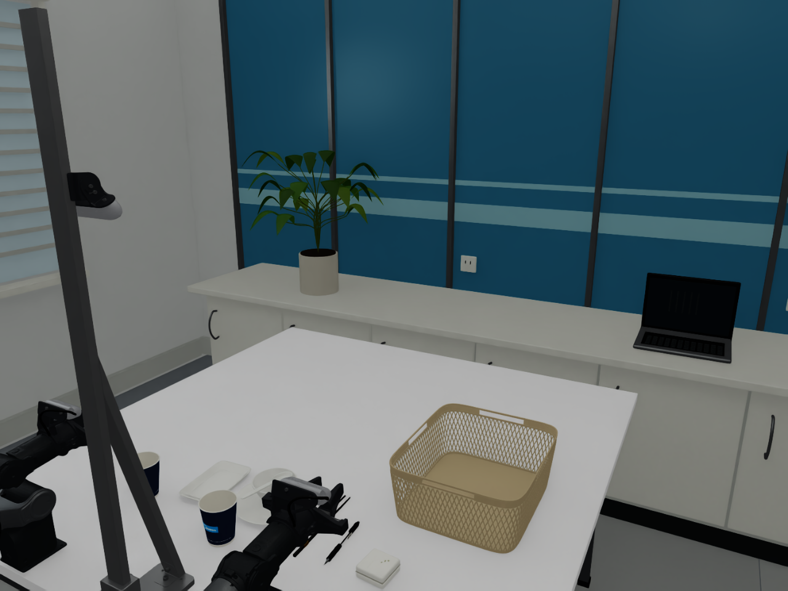
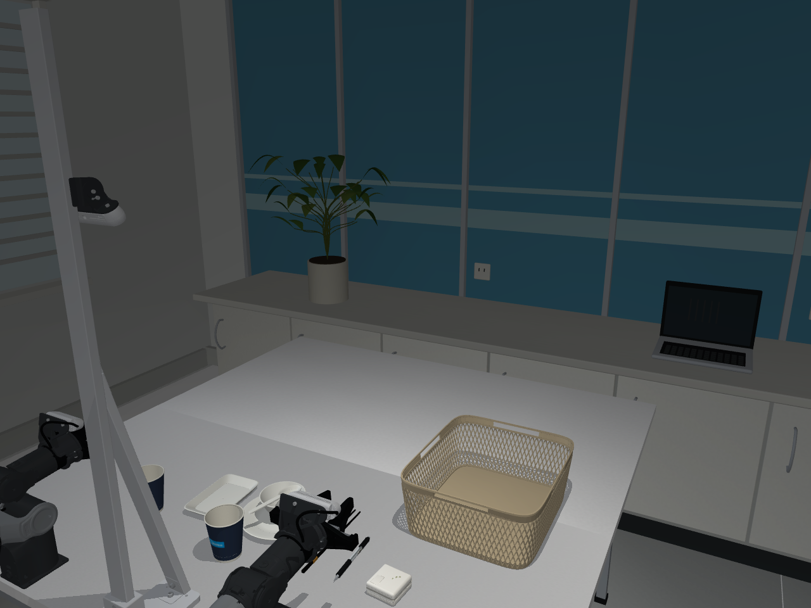
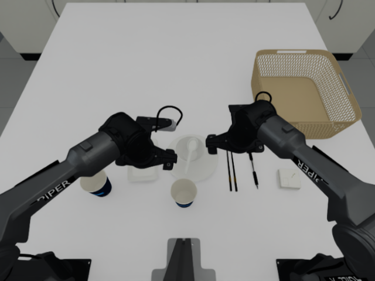
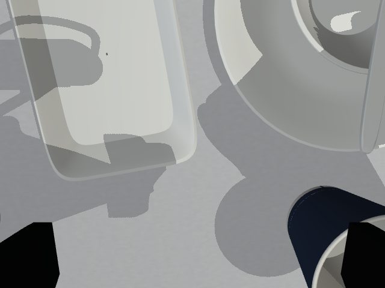

# 视觉质量与采集验收

本项目以 LIBERO、RoboTwin 的资产完整性、场景层次和可复现采集流程为参照。这是我们采用的工程验收要求，不是它们颁发的认证，也不能用“脚本运行成功”证明画面已经达到同等质量。

LIBERO 的 [官方场景定义](https://github.com/Lifelong-Robot-Learning/LIBERO/blob/master/libero/libero/assets/scenes/libero_tabletop_base_style.xml) 使用 MuJoCo，并明确配置地面、桌面、墙面纹理和多光源；因此不能把现有画面不足全部归因于 MuJoCo。RoboTwin 的 [域随机化文档](https://robotwin-platform.github.io/doc/usage/domain-randomization.html) 包含背景/桌面纹理、杂物、照明和视角变化。这里保留原 CAD 与相机安装基准，先做好固定场景，再检查随机化后的画面与任务可完成性。

## 当前场景

`configs/tasks/clean_table_rigid.yaml` 默认启用两套独立 Blender 资产：

- `appearance.asset_library`：纸杯、餐具、笔、充电头、篮筐。
- `appearance.stage_library`：实验室背景、机器人面板文字、短段线缆、RealSense 前盖和镜片外观。

环境补充了蓝色分格隔断、窗框及百叶、柜体门缝和拉手、后方工作台、绿植、笔记本、墙面插座、地砖和灯具。它们是根据照片风格制作的近似布景，**不是测绘得到的完整真实房间**，背景柜体等也不是新的可交互目标。原双臂、支架和桌面 CAD、碰撞、质量、关节与相机光学安装位置保留。

相机前盖参考已有 CAD 提取的前表面坐标系和开孔间距；镜片颜色、粗糙度、文字字形、线缆形态是外观近似，不是传感器标定或柔性线缆仿真。新增网格没有碰撞体与质量，连杆上的细节使用连杆局部坐标，随关节运动。

修正了原硬件配色在线性颜色与 sRGB 之间的转换：USD 线性颜色转换为共享材质清单的 sRGB 后，再分别送往两个引擎。MuJoCo 的显式 geom RGBA 会覆盖材质颜色，因此绑定材质时移除旧的 RGBA。

下图均来自实际仿真渲染器。展示相机用于整体检查，采集仍使用 overhead / left_wrist / right_wrist。









reference 图使用数据集第零帧的关节角作为姿态检查；桌面物品为当前刚体任务，已不含旧视频的毛巾和纸团，所以不是逐像素复刻。Isaac 需要一个控制步刷新 PhysX/Fabric，报告记录实际关节误差，不宣称精确的零步运动学回放。

此次 Isaac 刷新后与请求角度的最大偏差为约 0.0652 rad，因此这张图不能用来证明与真机第零帧精确重合。使用实际读回角度计算 URDF 正运动学，三路相机位置与读回的传感器位姿误差均小于 1 微米；这是模型内部的一致性检查，不是实机标定精度。

## 验收要求

| 项目 | 检查方式 | 完成条件 |
|---|---|---|
| 外观 | 同姿态的顶部、双腕、近景与参考照片对照 | 材质可区分；无穿模、悬浮标识、错误镜像、明显重复或拉伸纹理；不能仅凭展示图通过 |
| 几何与光学 | 原模型与新模型的关节、碰撞、惯量、相机参数对比 | 外观修改不改变物理和光学基准；估算尺寸单独标注 |
| 运动 | 逐连杆挂载检查，参考姿态渲染，短程物理状态对照 | 细节随对应连杆运动；相机视图不是缓存的旧姿态 |
| 随机化 | 同种子复现、不同种子变化、复位恢复 | 布局、材质、光照、质量/摩擦和传感器扰动都有记录；不会每帧跳色 |
| 数据链路 | 三路 RGB、状态、时间戳、HDF5、外部 API、LeRobot v2 | 实际读写验证；保存资产版本/哈希与随机化参数 |
| 专家轨迹 | 完整回合的抓取、滑移、插叠、入篮及平滑度检查 | 只收成功且通过质量检查的回合，失败不混入成功数据 |

**本轮只更新外观并验证其兼容性，不新增完整自主收桌成功率结论。** 之前的真实接触抓取/叠杯策略及质量拒收条件保留。短程物理一致、RGB 和记录测试通过，不代表全任务的视觉或动力学真实性已经获得认证。

仍待改进：逐台相机内参/曝光/白平衡标定、真实房间测量与贴图、机器人精确贴花、更多物体表面磨损和大规模专家回合验收。MuJoCo 原生阴影和材质响应与 RTX/Cycles 不同，当前保留并展示这个差异，不用 Blender 图替代其采集效果。

## 运行与复查

```bash
cd /home/midea/Desktop/piper_sim
bash scripts/run_mujoco.sh --config configs/clean_table_workcell.yaml \
  --task-scene configs/tasks/clean_table_rigid.yaml --enable_cameras --api-port 8765

# 原控制/录制与随机化接口继续可用
bash scripts/run_mujoco.sh --config configs/clean_table_workcell.yaml \
  --task-scene configs/tasks/clean_table_rigid.yaml --enable_cameras \
  --domain-randomization configs/domain_randomization/clean_table.yaml --seed 42 --api-port 8765

# 编辑源文件；每个 Collection 的附件都在其父连杆局部坐标内
bash scripts/run_blender.sh assets/blender/lab_stage/stage.blend
# 查看本机重建的完整 Blender 场景
bash scripts/run_blender.sh outputs/lab_visual_quality/scene.blend
```

重建背景和硬件细节（不重新烘焙已有物体贴图）：

```bash
PYTHONPATH=src .venv-mujoco/bin/python scripts/blender/prepare_inputs.py
# 首次或修改物体库时先构建；已有 outputs/blender_clean_table/scene.blend 可跳过
bash scripts/run_blender.sh --background --python scripts/blender/build_clean_table.py -- --skip-bake
bash scripts/run_blender.sh --background --python scripts/blender/build_stage.py
```

目前 `stage.blend` 的运行时导出由 `build_stage.py` 生成；直接在界面编辑后不会自动同步到 NPZ。需要将修改保留到构建脚本并重建。运行时读取 `manifest.json` / `meshes.npz`，不依赖 Blender 进程。CAD 和外观配置的源文件哈希发生变化时，加载器要求重建附件。

复查实际引擎画面，使用新的输出目录；加 `--baseline` 可对照上一版的背景和照明：

```bash
PYTHONPATH=src .venv-mujoco/bin/python scripts/blender/verify_stage.py \
  --backend mujoco --output outputs/my_visual_check_mujoco
PYTHONPATH=src .venv-isaac/bin/python scripts/blender/verify_stage.py \
  --backend isaac --headless --enable_cameras --output outputs/my_visual_check_isaac
```

报告含实际相机姿态、RGB 统计、源文件和资产哈希。亮暗像素统计只用于发现曝光异常，不能代替画面审查。汇总见 [验证报告](../outputs/lab_visual_quality/validation.json)。
